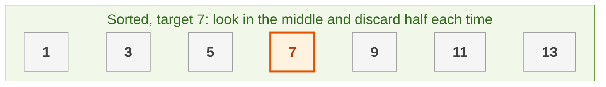
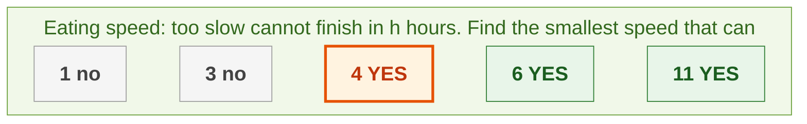
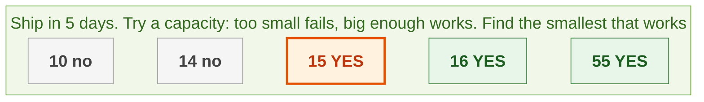

{: .no_toc}
# Binary Search
Practise here: [Leetcode](https://leetcode.com/list?selectedList=90xf0762)

- TOC
{:toc}

Binary search throws away half of what is left at every step, so it takes O(log n) instead of O(n). It needs one thing: the answers are ordered, like **no, no, no, YES, YES, YES**. The array does not have to be literally sorted.

```mermaid
%%{init: {"flowchart": {"padding": 14, "nodeSpacing": 10, "rankSpacing": 34, "subGraphTitleMargin": {"top": 6, "bottom": 22}}, "themeVariables": {"fontSize": "22px"}}}%%
flowchart TB
    subgraph F0 ["Binary search is hidden inside almost every problem here: the answers go no, no, no, YES, YES, YES. Find the first YES."]
        direction LR
        F0_0["<b>no</b>"]
        F0_1["<b>no</b>"]
        F0_2["<b>no</b>"]
        F0_3["<b>YES</b>"]
        F0_4["<b>YES</b>"]
        F0_5["<b>YES</b>"]
        F0_0 ~~~ F0_1
        F0_1 ~~~ F0_2
        F0_2 ~~~ F0_3
        F0_3 ~~~ F0_4
        F0_4 ~~~ F0_5
    end
    classDef n fill:#f5f5f5,stroke:#9e9e9e,color:#424242
    classDef hi fill:#fff3e0,stroke:#e65100,stroke-width:3px,color:#bf360c
    classDef a fill:#e3f2fd,stroke:#1565c0,color:#0d47a1
    classDef g fill:#e8f5e9,stroke:#2e7d32,color:#1b5e20
    classDef p fill:#f3e5f5,stroke:#6a1b9a,color:#4a148c
    classDef r fill:#ffebee,stroke:#c62828,color:#b71c1c
    classDef y fill:#fff8e1,stroke:#f9a825,color:#5d4037
    classDef c fill:#e0f7fa,stroke:#00838f,color:#006064
    classDef txt fill:none,stroke:none,color:#e65100
    classDef ghost fill:none,stroke:none,color:transparent
    classDef empty fill:#ffffff,stroke:#bdbdbd,stroke-dasharray:4 3,color:#9e9e9e
    class F0_0,F0_1,F0_2 n
    class F0_3 hi
    class F0_4,F0_5 g
    style F0 fill:#f1f8e9,stroke:#689f38,color:#33691e
```



**Key intuition 1:** Do not search for a value, search for the **boundary** where the answer flips from NO to YES. "Find the first index where something is true" covers plain search, insert position, rotated arrays, and "smallest capacity or speed that works".

**Key intuition 2:** Memorize one loop (below). Use `while left < right`, set `right = mid` when mid might be the answer, and `left = mid + 1` when it is too small. That avoids most off-by-one mistakes.

### [Binary Search](https://leetcode.com/problems/binary-search/)

> Find a target in a sorted array. Return its index or -1.



**Key intuition 1:** Compare with the middle item. If the target is bigger it can only be on the right, so discard the left half, and the reverse if smaller.

**Key intuition 2:** Update with mid + 1 and mid - 1 (never mid) in this version, or the loop can run forever.

<details><summary markdown="span">Execute!</summary>

```python
class SolutionBS:
    def search(self, nums: List[int], target: int) -> int:
        left = 0
        right = len(nums) - 1
        while left <= right:
            # in Java write left + (right - left) // 2 to avoid overflow
            mid = (left + right) // 2
            if nums[mid] == target:
                return mid
            if nums[mid] < target:
                # the target can only be to the right of mid
                left = mid + 1
            else:
                # the target can only be to the left of mid
                right = mid - 1
        return -1
```

</details>
<BR>

### The one template: first index where it is True

> The same loop for every "find the boundary" problem.

**Key intuition 1:** `is_ok(mid)` answers one yes/no question. If YES the boundary is at mid or to its left, so `right = mid`; if NO it is to the right, so `left = mid + 1`.

**Key intuition 2:** Once you can phrase a problem as "smallest x such that this is true", the code is always this loop.

<details><summary markdown="span">Execute!</summary>

```python
def first_true(left, right, is_ok):
    """The one template to memorize. is_ok is False, False, ..., True, True over [left, right].
    Returns the first index where it is True (or right + 1 if it never is)."""
    right += 1
    while left < right:
        mid = (left + right) // 2
        if is_ok(mid):
            # mid might be the answer: keep it
            right = mid
        else:
            # mid is too small: throw it away
            left = mid + 1
    return left
```

Example: Search Insert Position (the first index whose value is at least the target):

```python
class SolutionInsert:
    def searchInsert(self, nums: List[int], target: int) -> int:
        # the first index whose value is >= target
        return first_true(0, len(nums) - 1, lambda i: nums[i] >= target)
```

</details>
<BR>

### [Find Minimum in Rotated Sorted Array (simple version)](https://leetcode.com/problems/find-minimum-in-rotated-sorted-array/)

> A sorted array was rotated at an unknown point. Find the minimum in O(log n).

```mermaid
%%{init: {"flowchart": {"padding": 14, "nodeSpacing": 10, "rankSpacing": 34, "subGraphTitleMargin": {"top": 6, "bottom": 22}}, "themeVariables": {"fontSize": "22px"}}}%%
flowchart TB
    subgraph F0 ["Rotated: the minimum is where the order drops. Compare mid with the right end to know which half it is in"]
        direction LR
        F0_0["<b>4</b>"]
        F0_1["<b>5</b>"]
        F0_2["<b>6</b>"]
        F0_3["<b>7</b>"]
        F0_4["<b>0</b>"]
        F0_5["<b>1</b>"]
        F0_6["<b>2</b>"]
        F0_0 ~~~ F0_1
        F0_1 ~~~ F0_2
        F0_2 ~~~ F0_3
        F0_3 ~~~ F0_4
        F0_4 ~~~ F0_5
        F0_5 ~~~ F0_6
    end
    classDef n fill:#f5f5f5,stroke:#9e9e9e,color:#424242
    classDef hi fill:#fff3e0,stroke:#e65100,stroke-width:3px,color:#bf360c
    classDef a fill:#e3f2fd,stroke:#1565c0,color:#0d47a1
    classDef g fill:#e8f5e9,stroke:#2e7d32,color:#1b5e20
    classDef p fill:#f3e5f5,stroke:#6a1b9a,color:#4a148c
    classDef r fill:#ffebee,stroke:#c62828,color:#b71c1c
    classDef y fill:#fff8e1,stroke:#f9a825,color:#5d4037
    classDef c fill:#e0f7fa,stroke:#00838f,color:#006064
    classDef txt fill:none,stroke:none,color:#e65100
    classDef ghost fill:none,stroke:none,color:transparent
    classDef empty fill:#ffffff,stroke:#bdbdbd,stroke-dasharray:4 3,color:#9e9e9e
    class F0_0,F0_1,F0_2,F0_3,F0_5,F0_6 n
    class F0_4 hi
    style F0 fill:#f1f8e9,stroke:#689f38,color:#33691e
```



**Key intuition 1:** Compare the middle with the RIGHT end. If mid is bigger, the drop (and the minimum) is to the right of mid; otherwise the minimum is at mid or to its left.

**Key intuition 2:** Comparing with the right end works because the right end is always in the second sorted part. Your original recursive solution below also works.

<details><summary markdown="span">Execute!</summary>

```python
class SolutionRotated:
    def findMin(self, nums: List[int]) -> int:
        left = 0
        right = len(nums) - 1
        while left < right:
            mid = (left + right) // 2
            if nums[mid] > nums[right]:
                # the minimum is in the right half, after mid
                left = mid + 1
            else:
                # mid could be the minimum: keep it
                right = mid
        return nums[left]
```

</details>
<BR>

### [Finding a minimum in a Rotated Sorted Array: original recursive solution](https://leetcode.com/problems/find-minimum-in-rotated-sorted-array/)

> Suppose an array sorted in ascending order is rotated at some pivot unknown to you beforehand.


**Key intuition:** This one hunts for the pivot (the place where the order drops) by recursion. It works, but it needs extra cases (already sorted, single item); the version above is shorter.

<details><summary markdown="span">Execute!</summary>

```python
class Solution:
    def findMin(self, nums: List[int]) -> int:
        def findPivot(arr, left, right):
            if left > right:
                return None

            mid = (left+right)//2

            if arr[mid+1] < arr[mid]:
                return mid+1

            if arr[left] > arr[mid]:
                return findPivot(arr, left, mid)

            return findPivot(arr, mid+1, right)

        # Edge case: Already sorted
        if nums[0] < nums[~0]:
            return nums[0]
        if len(nums)==1:
            return nums[0]

        pivot = findPivot(nums, 0, len(nums)-1)
        return nums[pivot]
```

</details>
<BR>

### [Search a 2D Matrix (as one long list)](https://leetcode.com/problems/search-a-2d-matrix/)

> Rows are sorted and each row starts above the last row's end. Find a target.

```mermaid
%%{init: {"flowchart": {"padding": 14, "nodeSpacing": 10, "rankSpacing": 34, "subGraphTitleMargin": {"top": 6, "bottom": 22}}, "themeVariables": {"fontSize": "22px"}}}%%
flowchart TB
    subgraph F0 ["Rows laid end to end form one sorted list. Index i is row i // cols, column i % cols"]
        direction LR
        F0_0["<b>1</b>"]
        F0_1["<b>3</b>"]
        F0_2["<b>5</b>"]
        F0_3["<b>7</b>"]
        F0_4["<b>10</b>"]
        F0_5["<b>11</b>"]
        F0_6["<b>16</b>"]
        F0_7["<b>20</b>"]
        F0_8["<b>23</b>"]
        F0_9["<b>30</b>"]
        F0_10["<b>34</b>"]
        F0_11["<b>60</b>"]
        F0_0 ~~~ F0_1
        F0_1 ~~~ F0_2
        F0_2 ~~~ F0_3
        F0_3 ~~~ F0_4
        F0_4 ~~~ F0_5
        F0_5 ~~~ F0_6
        F0_6 ~~~ F0_7
        F0_7 ~~~ F0_8
        F0_8 ~~~ F0_9
        F0_9 ~~~ F0_10
        F0_10 ~~~ F0_11
    end
    classDef n fill:#f5f5f5,stroke:#9e9e9e,color:#424242
    classDef hi fill:#fff3e0,stroke:#e65100,stroke-width:3px,color:#bf360c
    classDef a fill:#e3f2fd,stroke:#1565c0,color:#0d47a1
    classDef g fill:#e8f5e9,stroke:#2e7d32,color:#1b5e20
    classDef p fill:#f3e5f5,stroke:#6a1b9a,color:#4a148c
    classDef r fill:#ffebee,stroke:#c62828,color:#b71c1c
    classDef y fill:#fff8e1,stroke:#f9a825,color:#5d4037
    classDef c fill:#e0f7fa,stroke:#00838f,color:#006064
    classDef txt fill:none,stroke:none,color:#e65100
    classDef ghost fill:none,stroke:none,color:transparent
    classDef empty fill:#ffffff,stroke:#bdbdbd,stroke-dasharray:4 3,color:#9e9e9e
    class F0_0,F0_1,F0_2,F0_3,F0_4,F0_5,F0_6,F0_7,F0_8,F0_9,F0_10,F0_11 n
    style F0 fill:#f1f8e9,stroke:#689f38,color:#33691e
```



**Key intuition 1:** If every row starts above where the last one ended, the whole matrix read row by row is ONE sorted list. Search that list.

**Key intuition 2:** Convert an index back with row = i // cols and column = i % cols. Your original two-step version (pick the row, then search it) is below.

<details><summary markdown="span">Execute!</summary>

```python
class SolutionMatrixOne:
    def searchMatrix(self, matrix: List[List[int]], target: int) -> bool:
        if not matrix:
            return False
        rows = len(matrix)
        cols = len(matrix[0])
        # pretend the matrix is one long sorted list
        left = 0
        right = rows * cols - 1
        while left <= right:
            mid = (left + right) // 2
            # index -> (row, column)
            value = matrix[mid // cols][mid % cols]
            if value == target:
                return True
            if value < target:
                left = mid + 1
            else:
                right = mid - 1
        return False
```

</details>
<BR>

### [Search a 2d Matrix: original two-step solution](https://leetcode.com/problems/search-a-2d-matrix/)

> Find a value in a matrix where integers in each row are sorted from left to right.
The first integer of each row is greater than the last integer of the previous row.


**Key intuition:** First binary search over the rows (compare the target with each row's first and last value), then binary search inside that one row. Two O(log n) searches in a row.

<details><summary markdown="span">Execute!</summary>

```python
class Solution:
    def searchMatrix(self, matrix: List[List[int]], target: int) -> bool:

        def bsearch(arr, left=0, right=None):
            if right is None:
                right = len(arr) - 1

            while left <= right:
                mid = (left + right) // 2
                if arr[mid] == target:
                    return True
                if arr[mid] < target:
                    left = mid + 1
                else:
                    right = mid - 1

            return False

        if len(matrix) == 0:
            return False

        left = 0
        right = len(matrix) - 1

        while left <= right:
            mid = (left + right) // 2
            if target < matrix[mid][0]:
                right = mid - 1
            elif target > matrix[mid][-1]:
                left = mid + 1
            else:
                return bsearch(matrix[mid])
        return False
```

</details>
<BR>

### [Koko Eating Bananas](https://leetcode.com/problems/koko-eating-bananas/)

> Koko eats k bananas per hour from one pile at a time. Find the smallest k that finishes all piles in h hours.



**Key intuition 1:** Faster is never worse: if speed 4 finishes in time, so does 5. That gives a NO, NO, YES, YES shape, so binary search the speed instead of trying them all.

**Key intuition 2:** To test a speed, add up the hours per pile (rounded up) and compare with h.

<details><summary markdown="span">Execute!</summary>

```python
class SolutionKoko:
    def minEatingSpeed(self, piles: List[int], h: int) -> int:
        def can_finish(speed):
            return sum(math.ceil(p / speed) for p in piles) <= h
        # the smallest speed that finishes in time
        return first_true(1, max(piles), can_finish)
```

</details>
<BR>

## Harder: come back to these


### [Min.Weight for k contiguous split](https://leetcode.com/problems/capacity-to-ship-packages-within-d-days/)

> Divide Array into k contiguous slices, minimize max weight per slice. 
> Identical to [split-array-largest-sum](https://leetcode.com/problems/split-array-largest-sum/)



**Key intuition 1:** Flip the question. Instead of asking how to split the array, guess the answer (the biggest load any slice may have) and ask: can I split into k or fewer slices with that limit?

**Key intuition 2:** Bigger limits only make it easier, so the answers are NO, NO, YES, YES. Binary search between max(weights) (the smallest possible limit) and sum(weights) (one slice).

<details><summary markdown="span">Execute!</summary>

```python
class Solution:
    def shipWithinDays(self, weights: List[int], days: int) -> int:
        def feasible(capacity):
            d = 1
            curr = 0
            for w in weights:
                if curr + w > capacity:
                    d += 1
                    curr = w
                else:
                    curr += w

            return d <= days

        left = max(weights)
        right = sum(weights)
        while left < right:
            mid = (left + right ) // 2
            if feasible(mid):
                right = mid
            else:
                left = mid + 1

        return left
```

</details>
<BR>
