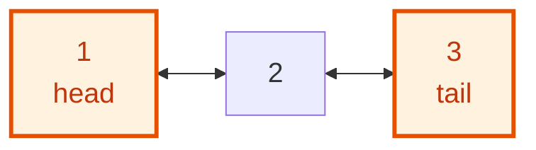
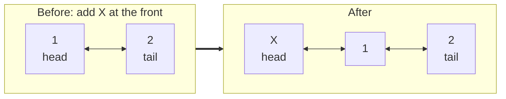

{: .no_toc}
# Doubly Linked Lists

A doubly linked list node knows both its next and its previous node. That one extra pointer buys you the thing a singly linked list cannot do: remove a node in O(1) when all you hold is the node itself. It is the data structure behind LRU caches, browser history and undo stacks.

Interview favourite: "implement one", then "now make it thread-safe" (see [Threading](../Misc/Threading.md) and [LRU Cache](../Misc/LRUCache.md)).

- TOC
{:toc}

### The picture to keep in your head



**Key intuition 1:** The list remembers two ends, `head` and `tail`. The first node's `prev` and the last node's `next` are `None`. Every operation has the same three shapes: an **empty** list, a list with **one** node (where head and tail are the same node), and a list with **several** nodes.

**Key intuition 2:** Every change is the same move: set the new or moved node's pointers, then rewire its neighbours so they point back. Do the steps in an order that never loses a reference you still need.

### Add to the front and the back

> Add a node at either end of the list in O(1).



**Key intuition 1:** If the list is empty, the new node is both the first and the last node: set `head` and `tail` to it and you are done. That one case is the whole difference from the normal path.

**Key intuition 2:** Otherwise remember the old end in `tmp`, make the new node the end, point the new node at `tmp`, and point `tmp` back at the new node. Forgetting the last step breaks walking backwards.

<details><summary markdown="span">Execute!</summary>

This version takes a ready-made Node.

```python
class Node:
    def __init__(self, key=0, val=0):
        self.key = key
        self.val = val
        self.prev = None
        self.next = None


class DoublyLinkedList:
    def __init__(self):
        self.head = None
        self.tail = None

    # Add a node at the front of the list.
    def add_front(self, node):
        if self.head is None:
            # Empty list: the new node is both the first and the last node.
            self.head = node
            self.tail = node
            return

        tmp = self.head
        self.head = node
        node.next = tmp
        tmp.prev = node

    # Add a node at the back of the list.
    def add_back(self, node):
        if self.head is None:
            # Empty list: the new node is both the first and the last node.
            self.head = node
            self.tail = node
            return

        tmp = self.tail
        self.tail = node
        node.prev = tmp
        tmp.next = node
```

</details>
<BR>
### Remove from the front and the back

> Remove the first node, or the last node, in O(1).

**Key intuition 1:** There are three shapes: an empty list (nothing to do), a list with one node (it becomes empty, so BOTH `head` and `tail` must be cleared), and a list with several nodes (move the end one step inward and cut the old node loose).

**Key intuition 2:** The one-node case is the one people forget. Without it the code reads `head.next.prev` on `None` and crashes, or leaves `tail` pointing at a node that is no longer in the list.

<details><summary markdown="span">Execute!</summary>

```python
# These go inside the DoublyLinkedList class.

    # Remove the first node. Does nothing if the list is empty.
    def remove_front(self):
        if self.head is None:
            return

        if self.head is self.tail:
            # Only one node: the list becomes empty.
            self.head = None
            self.tail = None
            return

        tmp = self.head
        self.head = tmp.next
        self.head.prev = tmp.prev
        tmp.next = None

    # Remove the last node. Does nothing if the list is empty.
    def remove_back(self):
        if self.tail is None:
            return

        if self.head is self.tail:
            # Only one node: the list becomes empty.
            self.head = None
            self.tail = None
            return

        tmp = self.tail
        self.tail = tmp.prev
        self.tail.next = tmp.next
        tmp.prev = None
```

</details>
<BR>
### Remove a node you already hold

> Remove a given node from anywhere in the list in O(1).

**Key intuition 1:** This is the superpower of a doubly linked list: the node already knows both neighbours, so no search is needed. Its previous node skips over it, and its next node points back past it.

**Key intuition 2:** If the node is the head or the tail, reuse `remove_front` or `remove_back`: those already fix `head` and `tail`. Only a node strictly in the middle needs the neighbour-skipping code.

<details><summary markdown="span">Execute!</summary>

```python
# This goes inside the DoublyLinkedList class.

    # Remove a node that is somewhere in the list, given the node itself.
    def remove(self, node):
        if node is self.head:
            self.remove_front()
            return

        if node is self.tail:
            self.remove_back()
            return

        # In the middle: its neighbours skip over it.
        before = node.prev
        after = node.next

        before.next = after
        after.prev = before

        node.prev = None
        node.next = None
```

</details>
<BR>
### Reverse a Doubly Linked List

> Reverse the list in place.

**Key intuition 1:** It is the same walk as reversing a singly linked list. `prev` is the part you have already reversed. For each node, save the old `next` in `tmp`, point `next` back at `prev`, and also point `prev` forward at `tmp`. Every node ends up with its `prev` and `next` swapped.

**Key intuition 2:** At the end swap `head` and `tail`. An empty list and a one-node list need no special case: the loop does nothing (empty list) or sets two pointers to `None` (one node), and swapping `head` and `tail` leaves them unchanged.

<details><summary markdown="span">Execute!</summary>

```python
# This goes inside the DoublyLinkedList class.

    # Reverse the list in place: every node swaps its prev and next pointers.
    def reverse(self):
        prev = None
        curr = self.head

        while curr is not None:
            tmp = curr.next

            # Core Code
            curr.next = prev
            curr.prev = tmp
            prev = curr

            curr = tmp

        # The old tail is now the first node, and the old head is the last.
        self.head, self.tail = self.tail, self.head
```

</details>
<BR>
### The whole class

Everything above in one piece, ready to copy.

<details><summary markdown="span">Execute! (the whole class)</summary>

```python
class Node:
    def __init__(self, key=0, val=0):
        self.key = key
        self.val = val
        self.prev = None
        self.next = None


class DoublyLinkedList:
    def __init__(self):
        self.head = None
        self.tail = None

    # Add a node at the front of the list.
    def add_front(self, node):
        if self.head is None:
            # Empty list: the new node is both the first and the last node.
            self.head = node
            self.tail = node
            return

        tmp = self.head
        self.head = node
        node.next = tmp
        tmp.prev = node

    # Add a node at the back of the list.
    def add_back(self, node):
        if self.head is None:
            # Empty list: the new node is both the first and the last node.
            self.head = node
            self.tail = node
            return

        tmp = self.tail
        self.tail = node
        node.prev = tmp
        tmp.next = node

    # Remove the first node. Does nothing if the list is empty.
    def remove_front(self):
        if self.head is None:
            return

        if self.head is self.tail:
            # Only one node: the list becomes empty.
            self.head = None
            self.tail = None
            return

        tmp = self.head
        self.head = tmp.next
        self.head.prev = tmp.prev
        tmp.next = None

    # Remove the last node. Does nothing if the list is empty.
    def remove_back(self):
        if self.tail is None:
            return

        if self.head is self.tail:
            # Only one node: the list becomes empty.
            self.head = None
            self.tail = None
            return

        tmp = self.tail
        self.tail = tmp.prev
        self.tail.next = tmp.next
        tmp.prev = None

    # Remove a node that is somewhere in the list, given the node itself.
    def remove(self, node):
        if node is self.head:
            self.remove_front()
            return

        if node is self.tail:
            self.remove_back()
            return

        # In the middle: its neighbours skip over it.
        before = node.prev
        after = node.next

        before.next = after
        after.prev = before

        node.prev = None
        node.next = None

    # Reverse the list in place: every node swaps its prev and next pointers.
    def reverse(self):
        prev = None
        curr = self.head

        while curr is not None:
            tmp = curr.next

            # Core Code
            curr.next = prev
            curr.prev = tmp
            prev = curr

            curr = tmp

        # The old tail is now the first node, and the old head is the last.
        self.head, self.tail = self.tail, self.head
```

</details>
<BR>
### Multi-threading it

> Several threads call these methods at the same time. What goes wrong, and how do you fix it?

**Key intuition 1:** Each method reads `head` or `tail`, decides what to do and then rewires several pointers. Another thread can run in the middle and see the list half-rewired, or two threads can overwrite each other's changes. The fix is one lock, held for the whole method.

**Key intuition 2:** The lock must be an **RLock** (re-entrant lock), because `remove` calls `remove_front` or `remove_back` while it already holds the lock. The FAQ in the code explains why, and when other tools (mutex, semaphore, read-write lock) would or would not fit.

<details><summary markdown="span">Execute! (thread-safe, with the FAQ)</summary>

```python
import functools
import threading


# Run the method while holding the list's lock, so only one thread
# can change the list at a time.
def locked(method):
    @functools.wraps(method)
    def wrapper(self, *args):
        with self.lock:
            return method(self, *args)

    return wrapper


class Node:
    def __init__(self, key=0, val=0):
        self.key = key
        self.val = val
        self.prev = None
        self.next = None


# ---------------------------------------------------------------------------
# FAQ: making a doubly linked list thread-safe
#
# Q: Do we really need to lock the whole method?
# A: Yes, and it is also the safer choice in the long term. Each method reads
#    head or tail, decides what to do, then rewires pointers. The check and the
#    change must happen together. If the lock were released in between, another
#    thread could slip in and we would overwrite its work. Every line in these
#    methods touches shared data, so there is nothing to move outside the lock.
#
# Q: Could we lock less to make it faster?
# A: The real option is finer-grained locking: give each node its own lock and
#    hold only the node and its neighbour while rewiring (hand-over-hand
#    locking). Different threads can then work on different parts of the list.
#    It is rarely worth it:
#      - Deadlock risk: removing a node means locking its previous node, itself
#        and its next node. Locks must be taken in one agreed order, and the
#        neighbours must be re-checked after locking.
#      - head and tail are shared by almost every operation, so most threads
#        would still queue there. reverse() touches every node and still needs
#        a lock on the whole list.
#      - In standard CPython only one thread runs Python code at a time (the
#        GIL), so extra locks add overhead without adding parallelism.
#    Measure first. If contention is real, split the data (for example one
#    list and one lock per shard of an LRU cache) before touching node locks.
#
# Q: What is a re-entrant lock (RLock), and why is it right here?
# A: A normal lock can be taken by one thread at a time, and that includes the
#    thread that already holds it: it would wait for itself forever (a
#    deadlock). A re-entrant lock remembers which thread owns it and how many
#    times it was taken, so the owner can take it again; it is released fully
#    when the owner has released it the same number of times.
#    Here remove() holds the lock and then calls remove_front() or
#    remove_back(), which take the same lock again. With a plain Lock the
#    thread would deadlock on the first remove of the head or the tail.
#
# Q: Would a mutex, a semaphore or another locking tool fit better?
# A: Mutex: Python's threading.Lock is a mutex, and RLock is a mutex that the
#    owner can take again. A plain mutex also works if the locked methods never
#    call each other (for example by moving the logic into private helpers
#    that do not lock). The RLock is the simpler fix.
#    Semaphore: a counter of permits that lets up to N threads in at once. We
#    want exactly one thread changing the list at a time, so it does not fit.
#    A semaphore with one permit acts like a mutex, but it has no owner and is
#    not re-entrant. Use semaphores to limit things like connections.
#    Read-write lock: many readers or one writer. Every method here changes the
#    list, so there are no readers to let through and it gains nothing.
#    Condition variable: lets a thread wait until something changes, for
#    example a blocking queue that waits while empty. Our removes just return
#    when the list is empty, so nothing needs to wait.
#
# (Add more questions here over time.)
# ---------------------------------------------------------------------------
class DoublyLinkedList:
    def __init__(self):
        self.head = None
        self.tail = None

        # See the FAQ above for why this is an RLock and not a plain Lock.
        self.lock = threading.RLock()

    # Add a node at the front of the list.
    @locked
    def add_front(self, node):
        if self.head is None:
            # Empty list: the new node is both the first and the last node.
            self.head = node
            self.tail = node
            return

        tmp = self.head
        self.head = node
        node.next = tmp
        tmp.prev = node

    # Add a node at the back of the list.
    @locked
    def add_back(self, node):
        if self.head is None:
            # Empty list: the new node is both the first and the last node.
            self.head = node
            self.tail = node
            return

        tmp = self.tail
        self.tail = node
        node.prev = tmp
        tmp.next = node

    # Remove the first node. Does nothing if the list is empty.
    @locked
    def remove_front(self):
        if self.head is None:
            return

        if self.head is self.tail:
            # Only one node: the list becomes empty.
            self.head = None
            self.tail = None
            return

        tmp = self.head
        self.head = tmp.next
        self.head.prev = tmp.prev
        tmp.next = None

    # Remove the last node. Does nothing if the list is empty.
    @locked
    def remove_back(self):
        if self.tail is None:
            return

        if self.head is self.tail:
            # Only one node: the list becomes empty.
            self.head = None
            self.tail = None
            return

        tmp = self.tail
        self.tail = tmp.prev
        self.tail.next = tmp.next
        tmp.prev = None

    # Remove a node that is somewhere in the list, given the node itself.
    @locked
    def remove(self, node):
        if node is self.head:
            # This takes the lock a second time (see the FAQ above).
            self.remove_front()
            return

        if node is self.tail:
            self.remove_back()
            return

        # In the middle: its neighbours skip over it.
        before = node.prev
        after = node.next

        before.next = after
        after.prev = before

        node.prev = None
        node.next = None

    # Reverse the list in place: every node swaps its prev and next pointers.
    @locked
    def reverse(self):
        prev = None
        curr = self.head

        while curr is not None:
            tmp = curr.next

            # Core Code
            curr.next = prev
            curr.prev = tmp
            prev = curr

            curr = tmp

        # The old tail is now the first node, and the old head is the last.
        self.head, self.tail = self.tail, self.head
```

</details>
<BR>
More on locks, deadlocks and semaphores: [Threading](../Misc/Threading.md). The working example is the [LRU Cache](../Misc/LRUCache.md).
