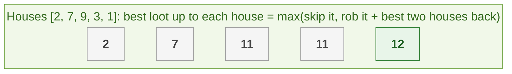
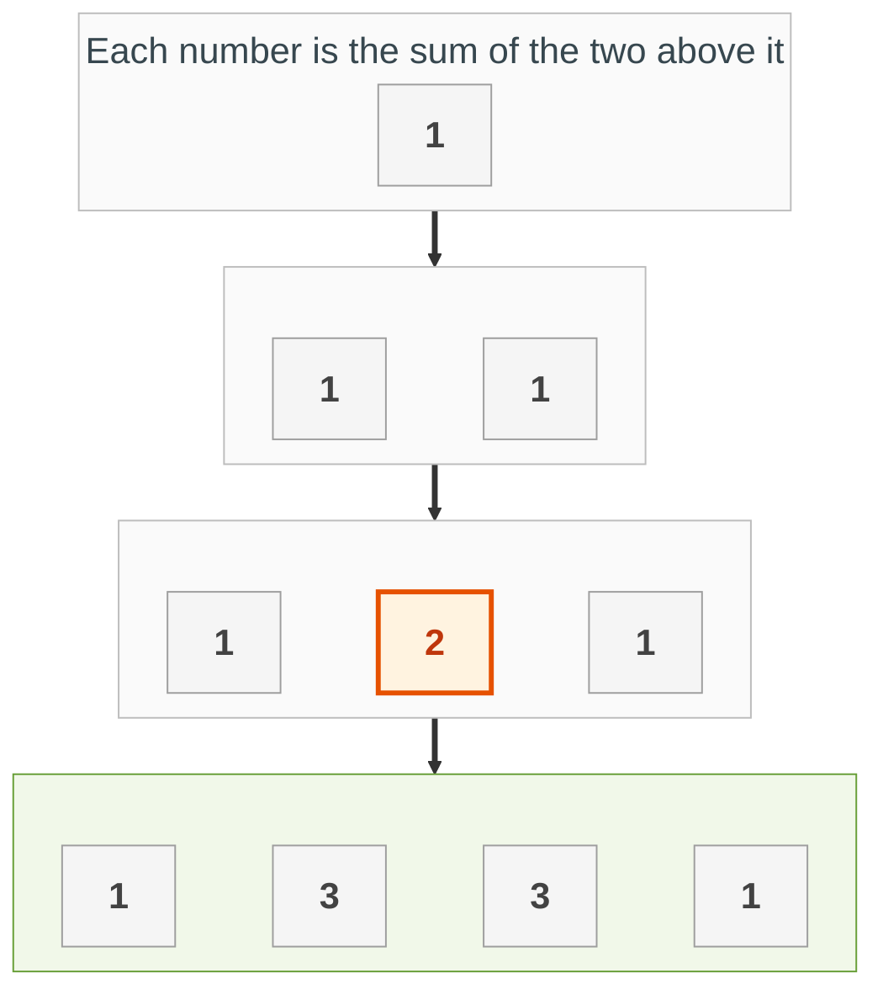
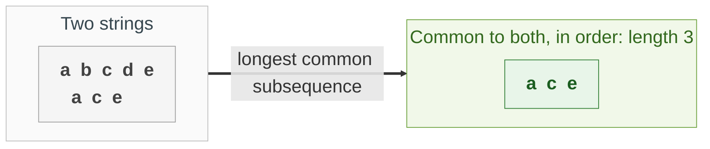
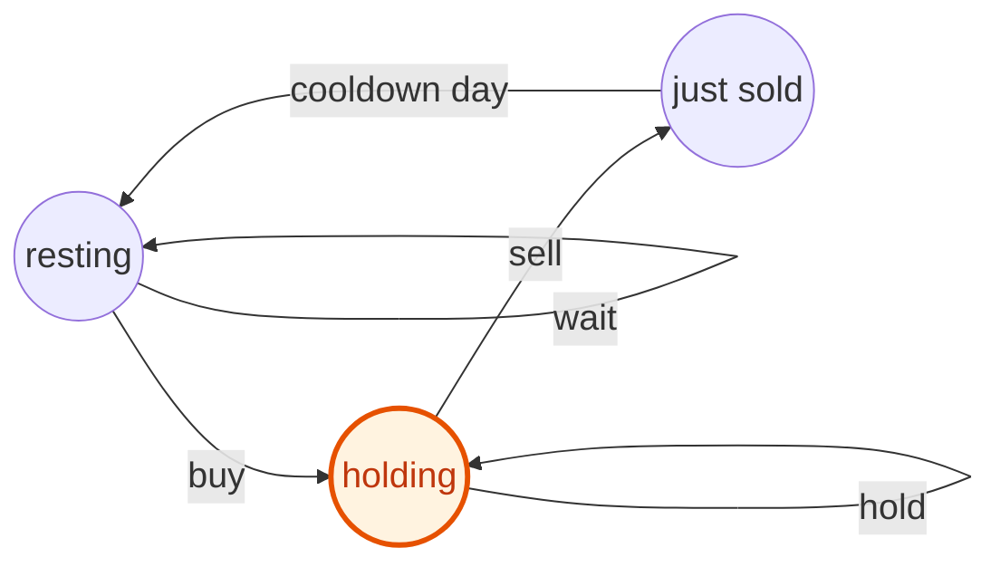

{: .no_toc}
# Dynamic Programming
Practise here: [Leetcode](https://leetcode.com/list?selectedList=9di6va53)

- TOC
{:toc}

**Dynamic programming (DP)** means: solve a big problem by solving smaller versions of it and remembering the answers, so nothing is computed twice.

**Key intuition 1:** Ask "what is the answer for the smallest case, and how does the answer for step i follow from the answers before it?" Write that down in words first (for example: best[i] = max(skip, take)). The code is then just a loop or a memoized recursion.

**Key intuition 2:** Two ways to write the same thing: **top-down** (recursion plus a dictionary of answers already found) and **bottom-up** (fill a table from the smallest case upwards). Start with top-down recursion if you are unsure; convert to a table if asked to optimize.

Problems about running totals of subarrays moved to [Prefix Sums](PrefixSums.html).

### [Climbing Stairs](https://leetcode.com/problems/climbing-stairs/)

> You can climb 1 or 2 steps at a time. How many different ways are there to climb n steps?

```mermaid
%%{init: {"flowchart": {"padding": 14, "nodeSpacing": 10, "rankSpacing": 34, "subGraphTitleMargin": {"top": 6, "bottom": 22}}, "themeVariables": {"fontSize": "22px"}}}%%
flowchart TB
    subgraph F0 ["Ways to reach each step: each is the sum of the two before it (Fibonacci)"]
        direction LR
        F0_0["<b>step 0: 1</b>"]
        F0_1["<b>step 1: 1</b>"]
        F0_2["<b>step 2: 2</b>"]
        F0_3["<b>step 3: 3</b>"]
        F0_4["<b>step 4: 5</b>"]
        F0_0 ~~~ F0_1
        F0_1 ~~~ F0_2
        F0_2 ~~~ F0_3
        F0_3 ~~~ F0_4
    end
    classDef n fill:#f5f5f5,stroke:#9e9e9e,color:#424242
    classDef hi fill:#fff3e0,stroke:#e65100,stroke-width:3px,color:#bf360c
    classDef a fill:#e3f2fd,stroke:#1565c0,color:#0d47a1
    classDef g fill:#e8f5e9,stroke:#2e7d32,color:#1b5e20
    classDef p fill:#f3e5f5,stroke:#6a1b9a,color:#4a148c
    classDef r fill:#ffebee,stroke:#c62828,color:#b71c1c
    classDef y fill:#fff8e1,stroke:#f9a825,color:#5d4037
    classDef c fill:#e0f7fa,stroke:#00838f,color:#006064
    classDef txt fill:none,stroke:none,color:#e65100
    classDef ghost fill:none,stroke:none,color:transparent
    classDef empty fill:#ffffff,stroke:#bdbdbd,stroke-dasharray:4 3,color:#9e9e9e
    class F0_0,F0_1,F0_2,F0_3 n
    class F0_4 g
    style F0 fill:#f1f8e9,stroke:#689f38,color:#33691e
```



**Key intuition 1:** To stand on step i you came from step i-1 or step i-2, so ways(i) = ways(i-1) + ways(i-2). That is the Fibonacci sequence.

**Key intuition 2:** You only ever need the last two answers, so two variables are enough instead of a whole table.

<details><summary markdown="span">Execute!</summary>

```python
class SolutionStairs:
    def climbStairs(self, n: int) -> int:
        # ways to reach step 1 and step 0
        one_back = 1
        two_back = 1
        for _ in range(n - 1):
            # ways(i) = ways(i-1) + ways(i-2)
            tmp = one_back
            one_back = one_back + two_back
            two_back = tmp
        return one_back
```

</details>
<BR>

### [Robbing Non-Adjacent Houses](https://leetcode.com/problems/house-robber/)

> Optimize for max robbery amount, should adjacent houses not be robbable. 



**Key intuition 1:** At each house you have two choices: rob it (and add what you had two houses back) or skip it (and keep what you had one house back). Take the larger.

**Key intuition 2:** The three solutions are the same idea written three ways: a table, plain recursion (slow, repeats work), and recursion with memoization.

<details><summary markdown="span">Execute!</summary>

```python
class Solution:
    def rob(self, nums: List[int]) -> int:
        h = collections.defaultdict(int)
        if len(nums) == 0:
            return 0
        if len(nums) == 1:
            return nums[0]
        if len(nums) == 2:
            return max(nums[0], nums[1])

        h[0] = nums[0]
        h[1] = max(nums[0], nums[1])
        for i in range(1, len(nums)):
            h[i] = max(nums[i] + h[i - 2], h[i - 1])

        return max(h.values())

class Solution:
    def rob(self, nums: List[int]) -> int:
        def solve(nums, i):
            if i < 0:
                return 0

            return max(nums[i] + solve(nums, i - 2), solve(nums, i - 1))

        return solve(nums, len(nums) - 1)

class Solution:
    def rob(self, nums: List[int]) -> int:
        def solve(nums, i):
            if i < 0:
                return 0
            if i in memo:
                return memo[i]

            memo[i] = max( nums[i] + solve(nums, i-2), solve(nums, i-1) )
            return memo[i]

        memo = {}
        return solve(nums, len(nums)-1)
```

</details>
<BR>

### [Coin Change](https://leetcode.com/problems/coin-change/)

> Given coin values and an amount, find the fewest coins that make the amount (or -1 if impossible).

```mermaid
%%{init: {"flowchart": {"padding": 14, "nodeSpacing": 10, "rankSpacing": 34, "subGraphTitleMargin": {"top": 6, "bottom": 22}}, "themeVariables": {"fontSize": "22px"}}}%%
flowchart TB
    subgraph F0 ["Coins {1, 2, 5}: fewest coins for each amount, built from smaller amounts"]
        direction LR
        F0_0["<b>0: 0</b>"]
        F0_1["<b>1: 1</b>"]
        F0_2["<b>2: 1</b>"]
        F0_3["<b>3: 2</b>"]
        F0_4["<b>4: 2</b>"]
        F0_5["<b>5: 1</b>"]
        F0_6["<b>11: 3</b>"]
        F0_0 ~~~ F0_1
        F0_1 ~~~ F0_2
        F0_2 ~~~ F0_3
        F0_3 ~~~ F0_4
        F0_4 ~~~ F0_5
        F0_5 ~~~ F0_6
    end
    classDef n fill:#f5f5f5,stroke:#9e9e9e,color:#424242
    classDef hi fill:#fff3e0,stroke:#e65100,stroke-width:3px,color:#bf360c
    classDef a fill:#e3f2fd,stroke:#1565c0,color:#0d47a1
    classDef g fill:#e8f5e9,stroke:#2e7d32,color:#1b5e20
    classDef p fill:#f3e5f5,stroke:#6a1b9a,color:#4a148c
    classDef r fill:#ffebee,stroke:#c62828,color:#b71c1c
    classDef y fill:#fff8e1,stroke:#f9a825,color:#5d4037
    classDef c fill:#e0f7fa,stroke:#00838f,color:#006064
    classDef txt fill:none,stroke:none,color:#e65100
    classDef ghost fill:none,stroke:none,color:transparent
    classDef empty fill:#ffffff,stroke:#bdbdbd,stroke-dasharray:4 3,color:#9e9e9e
    class F0_0,F0_1,F0_2,F0_3,F0_4,F0_5 n
    class F0_6 g
    style F0 fill:#f1f8e9,stroke:#689f38,color:#33691e
```



**Key intuition 1:** The fewest coins for amount a is one coin plus the fewest coins for what remains. Try each coin and keep the best: best[a] = 1 + min(best[a - coin]).

**Key intuition 2:** Build the answers from amount 0 upwards, so the smaller answers are always ready when you need them.

<details><summary markdown="span">Execute!</summary>

```python
class SolutionCoin:
    def coinChange(self, coins: List[int], amount: int) -> int:
        INF = float('inf')
        # best[a] = fewest coins that make amount a
        best = [0] + [INF] * amount
        for a in range(1, amount + 1):
            for coin in coins:
                if coin <= a and best[a - coin] + 1 < best[a]:
                    # use one coin, then solve the smaller amount
                    best[a] = best[a - coin] + 1
        return best[amount] if best[amount] != INF else -1
```

</details>
<BR>

### [Longest Increasing Subsequence](https://leetcode.com/problems/longest-increasing-subsequence/)

> Given an unsorted sort of integers, find the length of the longest increasing subsequence.

```mermaid
%%{init: {"flowchart": {"padding": 14, "nodeSpacing": 10, "rankSpacing": 34, "subGraphTitleMargin": {"top": 6, "bottom": 22}}, "themeVariables": {"fontSize": "22px"}}}%%
flowchart TB
    subgraph F0 ["[10, 9, 2, 5, 3, 7, 101, 18]: best increasing run that ends at each number"]
        direction LR
        F0_0["<b>10: 1</b>"]
        F0_1["<b>9: 1</b>"]
        F0_2["<b>2: 1</b>"]
        F0_3["<b>5: 2</b>"]
        F0_4["<b>3: 2</b>"]
        F0_5["<b>7: 3</b>"]
        F0_6["<b>101: 4</b>"]
        F0_7["<b>18: 4</b>"]
        F0_0 ~~~ F0_1
        F0_1 ~~~ F0_2
        F0_2 ~~~ F0_3
        F0_3 ~~~ F0_4
        F0_4 ~~~ F0_5
        F0_5 ~~~ F0_6
        F0_6 ~~~ F0_7
    end
    classDef n fill:#f5f5f5,stroke:#9e9e9e,color:#424242
    classDef hi fill:#fff3e0,stroke:#e65100,stroke-width:3px,color:#bf360c
    classDef a fill:#e3f2fd,stroke:#1565c0,color:#0d47a1
    classDef g fill:#e8f5e9,stroke:#2e7d32,color:#1b5e20
    classDef p fill:#f3e5f5,stroke:#6a1b9a,color:#4a148c
    classDef r fill:#ffebee,stroke:#c62828,color:#b71c1c
    classDef y fill:#fff8e1,stroke:#f9a825,color:#5d4037
    classDef c fill:#e0f7fa,stroke:#00838f,color:#006064
    classDef txt fill:none,stroke:none,color:#e65100
    classDef ghost fill:none,stroke:none,color:transparent
    classDef empty fill:#ffffff,stroke:#bdbdbd,stroke-dasharray:4 3,color:#9e9e9e
    class F0_0,F0_1,F0_2,F0_3,F0_4,F0_5 n
    class F0_6,F0_7 g
    style F0 fill:#f1f8e9,stroke:#689f38,color:#33691e
```



**Key intuition 1:** Let h[j] be the longest increasing run that ENDS at j. Any earlier smaller number i can be extended: h[j] = max(h[i] + 1).

**Key intuition 2:** This is O(n²). There is an O(n log n) version using binary search, but this one is what interviews usually expect first.

<details><summary markdown="span">Execute!</summary>

```python
class Solution:
    def lengthOfLIS(self, nums: List[int]) -> int:
        if not nums:
            return 0

        h = collections.defaultdict(int)

        # Every element is an increasing subsequence of at least length 1
        for i in range(len(nums)):
            h[i] = 1

        for i in range(0, len(nums)):
            for j in range(i + 1, len(nums)):
                if nums[j] > nums[i]:
                    # Update h[j] only if going through i gives a longer sequence
                    h[j] = max(h[j], h[i] + 1)

        return max(h.values())
```

</details>
<BR>

### [Maximum Sub-array Sum](https://leetcode.com/problems/maximum-subarray/)

> Given an integer array, find the contiguous subarray which has the largest sum. 

```mermaid
%%{init: {"flowchart": {"padding": 14, "nodeSpacing": 10, "rankSpacing": 34, "subGraphTitleMargin": {"top": 6, "bottom": 22}}, "themeVariables": {"fontSize": "22px"}}}%%
flowchart TB
    subgraph F0 ["[-2, 1, -3, 4, -1, 2, 1]: the best subarray ending here either extends the previous one or starts fresh"]
        direction LR
        F0_0["<b>-2</b>"]
        F0_1["<b>1</b>"]
        F0_2["<b>-3</b>"]
        F0_3["<b>4</b>"]
        F0_4["<b>-1</b>"]
        F0_5["<b>2</b>"]
        F0_6["<b>1</b>"]
        F0_0 ~~~ F0_1
        F0_1 ~~~ F0_2
        F0_2 ~~~ F0_3
        F0_3 ~~~ F0_4
        F0_4 ~~~ F0_5
        F0_5 ~~~ F0_6
    end
    classDef n fill:#f5f5f5,stroke:#9e9e9e,color:#424242
    classDef hi fill:#fff3e0,stroke:#e65100,stroke-width:3px,color:#bf360c
    classDef a fill:#e3f2fd,stroke:#1565c0,color:#0d47a1
    classDef g fill:#e8f5e9,stroke:#2e7d32,color:#1b5e20
    classDef p fill:#f3e5f5,stroke:#6a1b9a,color:#4a148c
    classDef r fill:#ffebee,stroke:#c62828,color:#b71c1c
    classDef y fill:#fff8e1,stroke:#f9a825,color:#5d4037
    classDef c fill:#e0f7fa,stroke:#00838f,color:#006064
    classDef txt fill:none,stroke:none,color:#e65100
    classDef ghost fill:none,stroke:none,color:transparent
    classDef empty fill:#ffffff,stroke:#bdbdbd,stroke-dasharray:4 3,color:#9e9e9e
    class F0_0,F0_1,F0_2 n
    class F0_3,F0_4,F0_5,F0_6 hi
    style F0 fill:#f1f8e9,stroke:#689f38,color:#33691e
```



**Key intuition 1:** The best subarray ending here either extends the best one ending at the previous position, or starts fresh here. Start fresh whenever the running total goes negative (it only drags you down).

**Key intuition 2:** Keep one running best-ending-here and one overall best. That is Kadane's algorithm, O(n).

<details><summary markdown="span">Execute!</summary>

```python
class Solution:
    def maxSubArray(self, arr: List[int]) -> int:
        h = collections.defaultdict(int)
        for i in range(0, len(arr)):
            if i==0:
                h[i] = arr[i]
            else:
                h[i] = max(arr[i], h[i-1]+arr[i])

        return max(h.values())
```

The next version is slower (it re-adds the window every step) but easier to read:

```python
class Solution:
    def maxSubArray(self, n)-> int:
        max_so_far = n[0]
        elements_so_far = [max_so_far]
        for x in n[1:]:
            if x > sum(elements_so_far + [x]):
                elements_so_far = [x]
            else:
                elements_so_far.append(x)
            max_so_far = max(max_so_far, sum(elements_so_far))

        return max_so_far
```

</details>
<BR>

### [Pascals Triangle](https://leetcode.com/problems/pascals-triangle/)

> Given an integer numRows, return the first numRows of Pascal's triangle.



**Key intuition 1:** Every number is the sum of the two numbers above it, and every row starts and ends with 1. Build each row from the previous row.

**Key intuition 2:** It is the simplest example of dynamic programming: each answer is built from answers you already have.

<details><summary markdown="span">Execute!</summary>

```python
class Solution:
    def generate(self, numRows: int) -> List[List[int]]:
        dp = [[1]]
        for i in range(1, numRows):
            tmp = [1] * (i + 1)
            # First and last should not be overwritten in range 0..i+1 (== 1 to i)
            for j in range(1, i):
                tmp[j] = dp[i - 1][j - 1] + dp[i - 1][j]
            dp = dp + [tmp]
        return dp
```

</details>
<BR>

### [Longest Common Subsequence](https://leetcode.com/problems/longest-common-subsequence/)

> Return the length of the longest subsequence common to two strings (letters in order, not necessarily next to each other).



**Key intuition 1:** Compare the last letters. If they match, that letter is part of the answer, so it is 1 plus the answer for both strings without it.

**Key intuition 2:** If they do not match, one of the two last letters is not used, so take the better of dropping one or the other. The table dp[i][j] is the answer for the first i and first j letters.

<details><summary markdown="span">Execute!</summary>

```python
class SolutionLCS:
    def longestCommonSubsequence(self, a: str, b: str) -> int:
        # dp[i][j] = answer for a[:i] and b[:j]
        dp = [[0] * (len(b) + 1) for _ in range(len(a) + 1)]
        for i in range(1, len(a) + 1):
            for j in range(1, len(b) + 1):
                if a[i - 1] == b[j - 1]:
                    # the last letters match: extend the earlier answer
                    dp[i][j] = dp[i - 1][j - 1] + 1
                else:
                    # drop the last letter of one of them
                    dp[i][j] = max(dp[i - 1][j], dp[i][j - 1])
        return dp[len(a)][len(b)]
```

</details>
<BR>

### [Best Time to Buy and Sell Stock with Cooldown](https://leetcode.com/problems/best-time-to-buy-and-sell-stock-with-cooldown/description)

You are given an array prices where prices[i] is the price of a given stock on the ith day.

Find the maximum profit you can achieve. You may complete as many transactions as you like (i.e., buy one and sell one share of the stock multiple times) with the following restrictions:

After you sell your stock, you cannot buy stock on the next day (i.e., cooldown one day).
Note: You may not engage in multiple transactions simultaneously (i.e., you must sell the stock before you buy again).



**Key intuition 1:** Think of three states you can be in at the end of a day: holding a stock, just sold (must cool down), or resting with no stock. Each state has a best profit.

**Key intuition 2:** Each day moves between states: resting can buy, holding can sell, selling must rest next. Track the three best profits and update them every day.

<details><summary markdown="span">Execute!</summary>

```python
def maxProfit(prices):
    if not prices:
        return 0

    # Initial states for Day 0
    # We use -infinity for 'sold' and 'holding' initially because
    # those states aren't possible before we start.
    holding = -float('inf')
    sold = -float('inf')
    resting = 0

    for price in prices:
        prev_holding = holding
        prev_sold = sold
        prev_resting = resting

        # 1. To be holding: either keep holding or buy from resting state
        holding = max(prev_holding, prev_resting - price)

        # 2. To be sold: must have held stock and sold it at current price
        sold = prev_holding + price

        # 3. To be resting: either stayed resting or just finished a cooldown (sold)
        resting = max(prev_resting, prev_sold)

    # The max profit will be either from the 'sold' state or 'resting' state
    return max(sold, resting)

# Example: prices = [1, 2, 3, 0, 2]
# Output: 3
```

</details>
<BR>

<details><summary markdown="span">Top-down with memoization (the same idea written as recursion)</summary>

```python
def maxProfit(prices):
    # Memoization table: (index, buying_state)
    memo = {}

    def backtrack(i, buying):
        # Base case: reached the end of the price list
        if i >= len(prices):
            return 0

        # Check if we've already computed this state
        if (i, buying) in memo:
            return memo[(i, buying)]

        if buying:
            # Option 1: Buy today (spend money, move to next day to sell)
            buy = backtrack(i + 1, False) - prices[i]
            # Option 2: Cooldown (skip today, stay in buying state)
            cooldown = backtrack(i + 1, True)
            res = max(buy, cooldown)
        else:
            # Option 1: Sell today (gain money, skip 1 day for cooldown)
            sell = backtrack(i + 2, True) + prices[i]
            # Option 2: Cooldown (skip today, stay in selling state)
            cooldown = backtrack(i + 1, False)
            res = max(sell, cooldown)

        memo[(i, buying)] = res
        return res

    return backtrack(0, True)

# Example Usage:
# prices = [1, 2, 3, 0, 2]
# Output: 3
```
</details>
<BR>

## Harder: come back to these

### [Max Points in Matrix with Cost](https://leetcode.com/problems/maximum-number-of-points-with-cost/)

> Pick one cell in every row. Your score is the sum of the cells, minus the horizontal distance between the picks in neighbouring rows.
> Standard Dynamic programming problem. Google Onsite.

**Key intuition 1:** For each row, the best score ending in column j is this cell plus the best of (the previous row's score in column k minus the distance |k - j|) over every k.

**Key intuition 2:** Do not try every k (that is slow). Sweep once left to right and once right to left, subtracting 1 per column, and take the larger.

<details><summary markdown="span">Execute!</summary>

Bug fix: the old solution scored each cell from the same column of the row above, so it could not move sideways correctly (and a single-row grid returned a list). This version tracks the best score ending in each column and charges 1 per column moved, scanning from the left and from the right so it runs in O(rows × columns).

```python
class SolutionPoints:
    def maxPoints(self, A: List[List[int]]) -> int:
        n = len(A)
        m = len(A[0])
        # best score ending in each column of the current row
        dp = A[0][:]
        for i in range(1, n):
            left = [0] * m
            right = [0] * m
            left[0] = dp[0]
            for j in range(1, m):
                # best from the left, losing 1 per column moved
                left[j] = max(left[j - 1] - 1, dp[j])
            right[m - 1] = dp[m - 1]
            for j in range(m - 2, -1, -1):
                # best from the right
                right[j] = max(right[j + 1] - 1, dp[j])
            dp = [A[i][j] + max(left[j], right[j]) for j in range(m)]
        return max(dp)
```

</details><BR>
