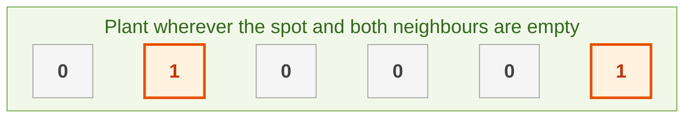
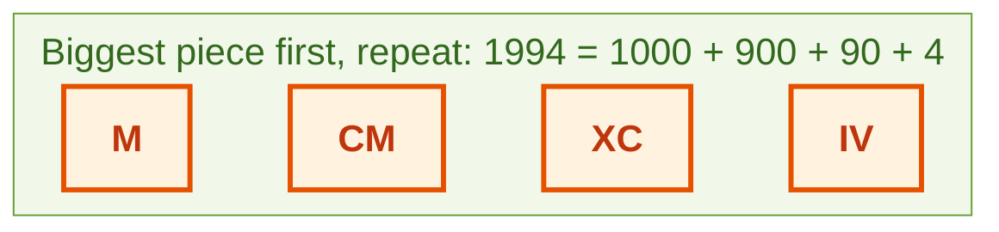
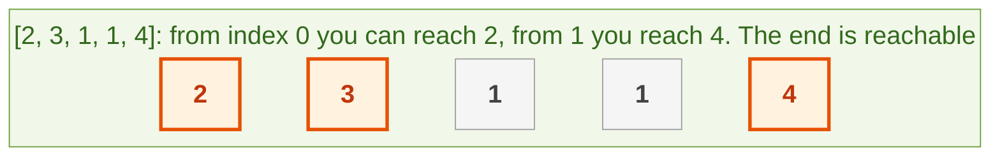
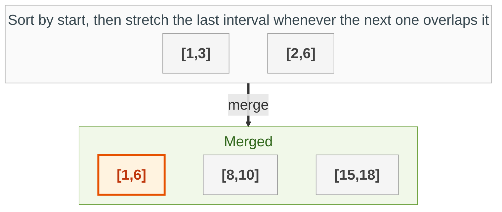

{: .no_toc}
# Greedy Algorithms

- TOC
{:toc}

A **greedy** algorithm makes the best-looking choice right now and never looks back. It is fast and simple, but it is only correct when a local best choice can never block a better overall answer, so ask yourself why it is safe.

**Key intuition 1:** Look for a rule like "always take the biggest", "always take the earliest ending" or "sort first, then scan". Sorting usually turns a hard problem into a one-pass scan.

**Key intuition 2:** To trust a greedy rule, try to find a counter-example where taking the best now hurts later. If you cannot, and you can say why, you have your answer. If you can, it is probably dynamic programming.

### [Flower Bed Placement](https://leetcode.com/problems/can-place-flowers/)

> Given an integer array flowerbed containing 0's and 1's, where 0 means empty and 1 means not empty,
and an integer n, return if n new flowers can be planted in the flowerbed without violating the
no-adjacent-flowers rule.



**Key intuition 1:** Plant as early as you can: a spot is fine if it and both neighbours are empty. Planting early never hurts, because it only uses up a spot the next flower could not have used anyway.

**Key intuition 2:** Treat the ends as empty neighbours so you do not need special cases.

<details><summary markdown="span">Execute!</summary>

```python
class Solution:
    def canPlaceFlowers(self, f: List[int], n: int) -> bool:
        for i in range(0, len(f)):
            a = 0 if i == 0 else f[i - 1]
            b = f[i]
            c = 0 if i == len(f) - 1 else f[i + 1]

            if a == b == c == 0:
                f[i] = 1
                n -= 1

        return n <= 0
```

</details>
<BR>

### [Assign Cookies](https://leetcode.com/problems/assign-cookies/)

> Each child wants a minimum cookie size and each cookie has a size. Satisfy as many children as possible (one cookie each).


**Key intuition 1:** Never waste a big cookie on a child a small one would satisfy. Sort both lists and give each cookie to the least greedy child who is still waiting.

**Key intuition 2:** If a cookie is too small for the current child, it is too small for everyone after, so move to the next cookie.

<details><summary markdown="span">Execute!</summary>

```python
class SolutionCookies:
    def findContentChildren(self, greed: List[int], sizes: List[int]) -> int:
        greed.sort()
        sizes.sort()
        child = 0
        # offer each cookie, smallest first, to the least greedy waiting child
        for size in sizes:
            if child < len(greed) and size >= greed[child]:
                child += 1
        return child
```

</details>
<BR>

### [Integer-->Roman Numerals](https://leetcode.com/problems/integer-to-roman/)

> Integer to Roman numerals. 14 --> XIV



**Key intuition 1:** Take the biggest roman value that still fits, write it, subtract it, repeat. Include the special values (900, 400, 90, 40, 9, 4) in the list so the greedy rule works.

**Key intuition 2:** The list order matters: largest to smallest.

<details><summary markdown="span">Execute!</summary>

```python
class Solution:
    def intToRoman(self, num: int) -> str:
        d ={'I': 1, 'V': 5, 'X': 10, 'L': 50, 'C': 100, 'D': 500, 'M': 1000 }
        #4
        d['IV'] = d['V']- d['I']
        #9
        d['IX'] = d['X']- d['I']
        #40
        d['XL'] = d['L']- d['X']
        #90
        d['XC'] = d['C']- d['X']
        #400
        d['CD'] = d['D']- d['C']
        #900
        d['CM'] = d['M']- d['C']

        h = {v: k for k, v in d.items()}
        h = dict(sorted(h.items(), key=lambda item: item[0], reverse=True))

        #Flip above to:
        # {1000: 'M', 900: 'CM', 500: 'D', 400: 'CD', 100: 'C', 90: 'XC', 50: 'L', 40: 'XL', 10: 'X', 9: 'IX', 5: 'V', 4: 'IV', 1: 'I'}

        res = ""
        for k,v in h.items():
            res += (num//k) * v
            num %= k

        return res
```

</details>
<BR>

### [Roman Numerals-->Integer](https://leetcode.com/problems/roman-to-integer/)

> Roman numerals to integer. XIV --> 14


**Key intuition 1:** Read left to right. A smaller letter before a bigger one (IV, IX, XC...) is a subtraction, so those two-letter pairs have their own values.

**Key intuition 2:** Check the pair first; if it is not a known pair, use the single letter.

<details><summary markdown="span">Execute!</summary>

Bug fix: the previous version tried to skip a letter with `i += 2` inside a `for` loop, which does nothing, so it double counted (IV came out as 9). This `while` loop really skips.

```python
class SolutionRoman:
    def romanToInt(self, word: str) -> int:

        d = {'I': 1, 'V': 5, 'X': 10, 'L': 50, 'C': 100, 'D': 500, 'M': 1000}
        # 4
        d['IV'] = d['V'] - d['I']
        # 9
        d['IX'] = d['X'] - d['I']
        # 40
        d['XL'] = d['L'] - d['X']
        # 90
        d['XC'] = d['C'] - d['X']
        # 400
        d['CD'] = d['D'] - d['C']
        # 900
        d['CM'] = d['M'] - d['C']

        total = 0
        i = 0
        while i < len(word):
            if i != len(word) - 1 and word[i:i + 2] in d:
                # a two-letter value such as IV: use it and skip both letters
                total += d[word[i:i + 2]]
                i += 2
            else:
                total += d[word[i]]
                i += 1

        return total
```

</details>
<BR>

## Harder: come back to these


### [Jump Game](https://leetcode.com/problems/jump-game/)

> Each number is the maximum jump length from that index. Can you reach the last index?



**Key intuition 1:** You do not need the path, only the farthest index you could possibly reach so far. Update it as you scan.

**Key intuition 2:** If you ever stand on an index beyond the farthest reach, you are stuck, so return False.

<details><summary markdown="span">Execute!</summary>

```python
class SolutionJump:
    def canJump(self, nums: List[int]) -> bool:
        # the farthest index we can reach so far
        farthest = 0
        for i, jump in enumerate(nums):
            if i > farthest:
                # we cannot even get to index i
                return False
            farthest = max(farthest, i + jump)
        return True
```

</details>
<BR>

### [Merge Intervals](https://leetcode.com/problems/merge-intervals/)

> Merge all overlapping intervals.



**Key intuition 1:** Sort by start. Now any interval that overlaps the previous one must be right next to it, so one scan is enough.

**Key intuition 2:** If the next start is at or before the last end, stretch the last interval's end to the larger of the two ends. Otherwise start a new interval.

<details><summary markdown="span">Execute!</summary>

```python
class SolutionIntervals:
    def merge(self, intervals: List[List[int]]) -> List[List[int]]:
        merged = []
        # sort by start so overlapping intervals are neighbours
        for start, end in sorted(intervals):
            if merged and start <= merged[-1][1]:
                # overlaps the last one: stretch it
                merged[-1][1] = max(merged[-1][1], end)
            else:
                merged.append([start, end])
        return merged
```

</details>
<BR>
