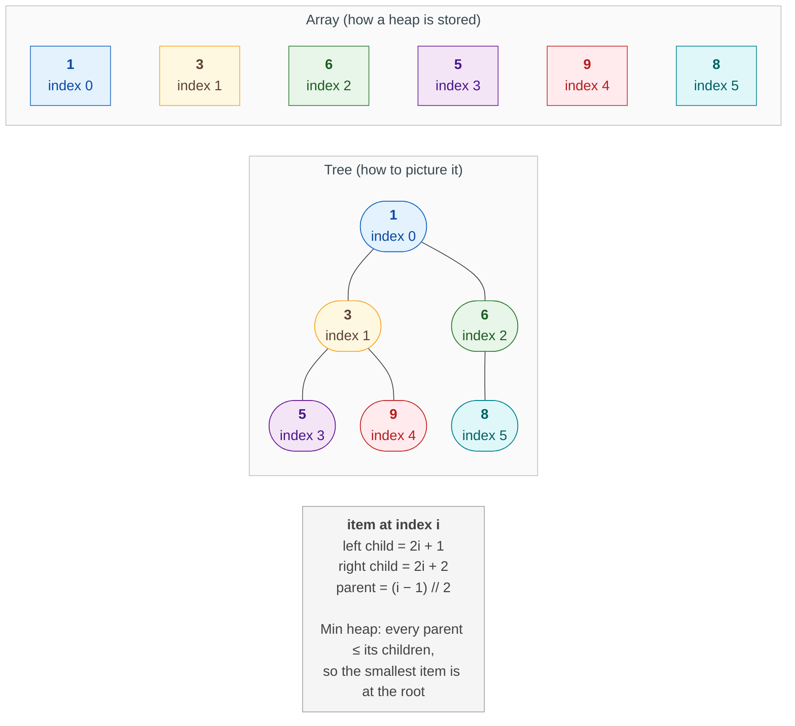
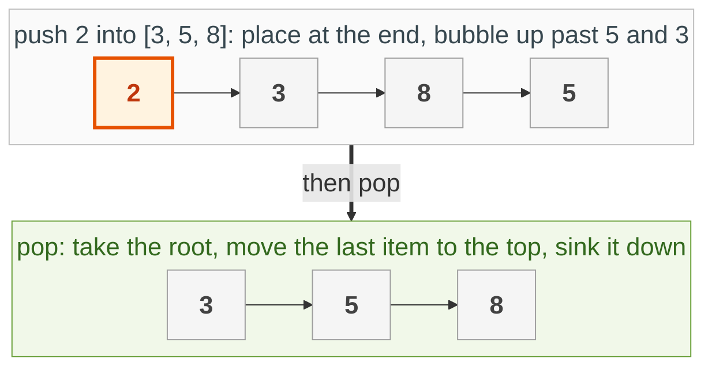
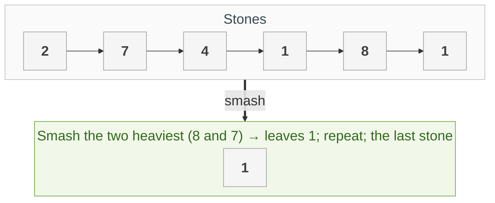
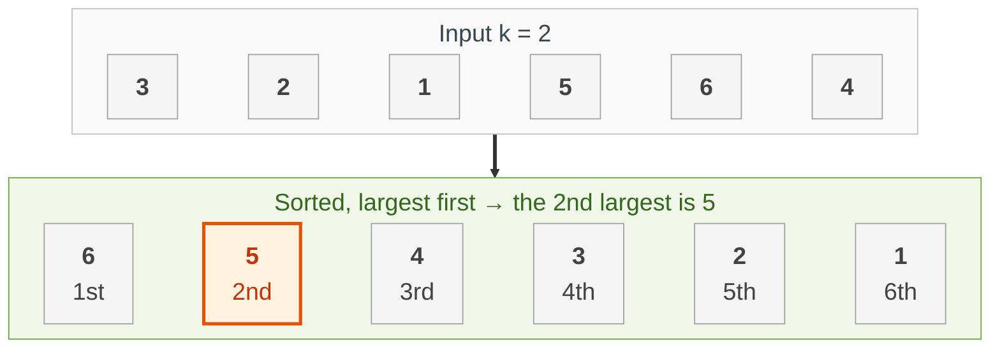
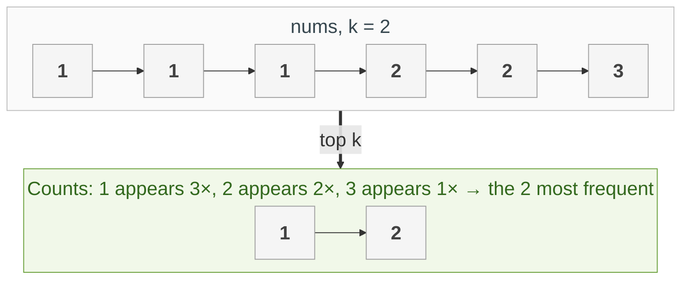
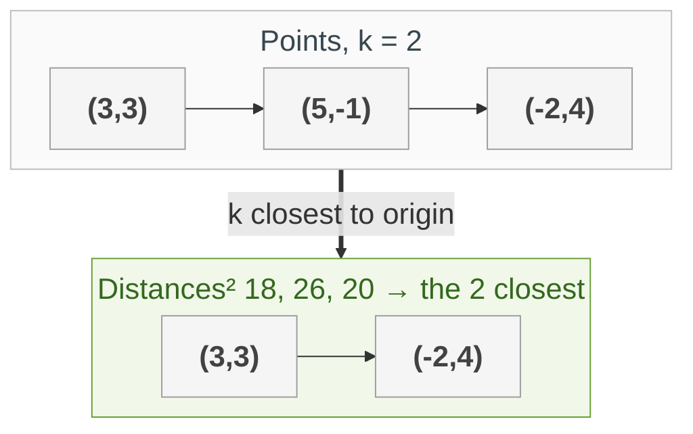
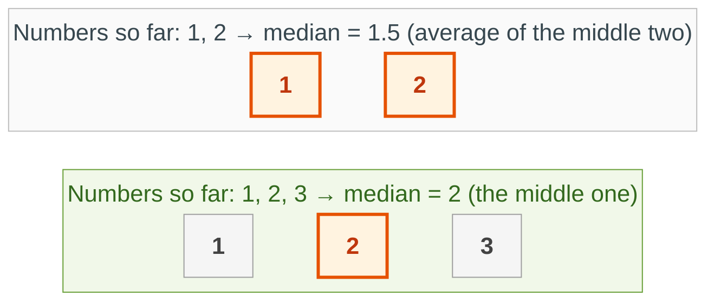
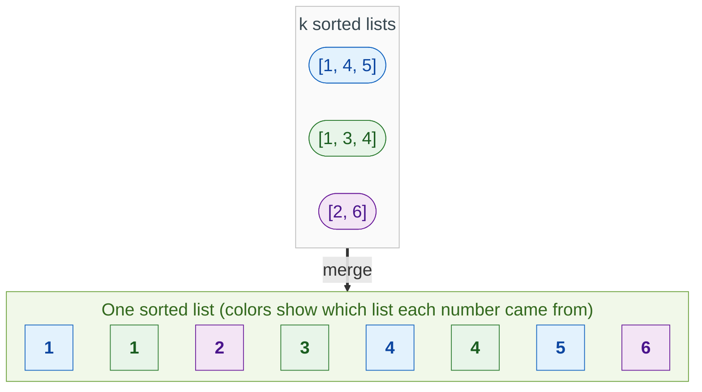
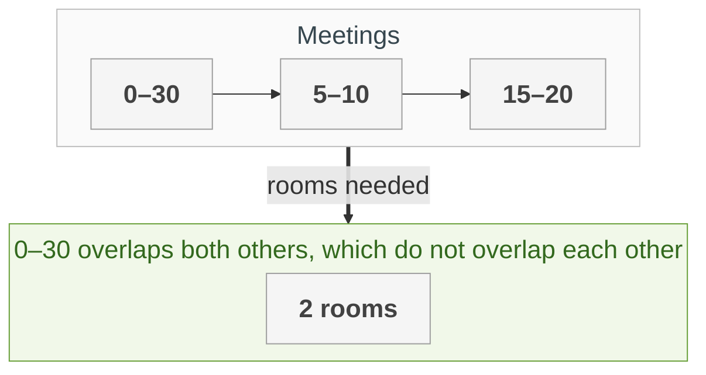

{::options parse_block_html="true" /}

Practise here: [Leetcode](https://leetcode.com/tag/heap-priority-queue/)

A heap is a pile where the smallest (or largest) item is always on top, and adding or removing an item costs only O(log n). Reach for it whenever a problem says "the k largest", "the next smallest", "merge sorted things" or "repeatedly take the best".

- TOC
{:toc}

### Heap Data Structure

* A subtree of a heap is also a heap
* A heap is always a complete binary tree (hence array indexing works)
* A Min heap's root always has the smallest value.

**Key intuition 1:** A heap is NOT fully sorted. It only promises the top item is the smallest, which is why it is cheaper than sorting.

**Key intuition 2:** To keep the k largest, use a MIN-heap of size k and throw away the top whenever it grows. The root is then your k-th largest.


### Implement a Min Heap

> Implement push, pop and peek on a min-heap using only a list.



**Key intuition 1:** A heap is a complete binary tree stored in a list (parent at (i-1)//2, children at 2i+1 and 2i+2). Push adds at the end and bubbles UP; pop moves the last item to the root and sinks it DOWN.

**Key intuition 2:** Both moves swap along one root-to-leaf path, so they cost O(log n). When sinking, always swap with the SMALLER child so the heap rule still holds.

<details><summary markdown="span">Execute!</summary>

```python
class MinHeap:
    def __init__(self):
        # the heap lives in a plain list
        self.a = []

    def push(self, x):
        # 1. put it in the next free spot (end of the list)
        self.a.append(x)
        i = len(self.a) - 1
        # 2. bubble up while smaller than the parent
        while i > 0 and self.a[(i - 1) // 2] > self.a[i]:
            parent = (i - 1) // 2
            tmp = self.a[i]
            self.a[i] = self.a[parent]
            self.a[parent] = tmp
            i = parent

    def pop(self):
        top = self.a[0]
        # 1. take the last item off the end...
        last = self.a.pop()
        if self.a:
            # 2. ...and put it at the root
            self.a[0] = last
            i = 0
            n = len(self.a)
            # 3. sink down, swapping with the smaller child
            while True:
                smallest = i
                for child in (2 * i + 1, 2 * i + 2):
                    if child < n and self.a[child] < self.a[smallest]:
                        smallest = child
                if smallest == i:
                    break
                tmp = self.a[i]
                self.a[i] = self.a[smallest]
                self.a[smallest] = tmp
                i = smallest
        return top

    def peek(self):
        return self.a[0]
```

</details>
<BR>

### [Last Stone Weight](https://leetcode.com/problems/last-stone-weight/)

> Repeatedly smash the two heaviest stones together; if they differ, the difference stays. Return the last stone's weight (or 0).



**Key intuition 1:** Whenever a problem says "take the largest, then the largest again", that is a heap.

**Key intuition 2:** Negate the values to turn Python's min-heap into a max-heap.

<details><summary markdown="span">Execute!</summary>

```python
import heapq

class SolutionStone:
    def lastStoneWeight(self, stones: List[int]) -> int:
        # heapq is a min-heap, so store negatives to get a max-heap
        heap = [-s for s in stones]
        heapq.heapify(heap)
        while len(heap) > 1:
            # heaviest
            first = -heapq.heappop(heap)
            # second heaviest
            second = -heapq.heappop(heap)
            if first != second:
                heapq.heappush(heap, -(first - second))
        return -heap[0] if heap else 0
```

</details>
<BR>

### [Kth Largest Element](https://leetcode.com/problems/kth-largest-element-in-an-array/)

> Find the kth largest element in an unsorted array (the kth in sorted order, not the kth distinct value).



**Key intuition 1:** You do not need to sort everything. Put the numbers in a heap and the next-largest is always one pop away.

**Key intuition 2:** Python's heap is a min-heap, so store negatives (-n) to make the biggest number come out first. (Faster: keep a min-heap of only the k largest; its root is the answer.)

<details><summary markdown="span">Execute!</summary>
```python
import heapq
class Solution:
    def findKthLargest(self, nums: List[int], k: int) -> int:
        h = []
        for n in nums:
            heapq.heappush(h, -n)

        i=0
        for i in range(k-1):
            heapq.heappop(h)

        return -heapq.heappop(h)
```
And voila it now works
</details>
<BR>

### [Top K Frequent Elements](https://leetcode.com/problems/top-k-frequent-elements/)

> Return the k most frequent elements of an array.



**Key intuition 1:** First count with a dictionary. Then you need the k biggest counts, which is a "top k" problem.

**Key intuition 2:** Keep a MIN-heap of size k: whenever it grows past k, pop the smallest. What is left are the k largest. This costs O(n log k), better than sorting everything.

<details><summary markdown="span">Execute!</summary>

Short version:

```python
import collections
import heapq

class SolutionTopK:
    def topKFrequent(self, nums: List[int], k: int) -> List[int]:
        # value -> how many times it appears
        counts = collections.Counter(nums)
        return heapq.nlargest(k, counts.keys(), key=counts.get)
```

Showing the heap yourself (keep only k items):

```python
import collections
import heapq

class SolutionTopKHeap:
    def topKFrequent(self, nums: List[int], k: int) -> List[int]:
        counts = collections.Counter(nums)
        # a min-heap that never holds more than k items
        heap = []
        for value, count in counts.items():
            heapq.heappush(heap, (count, value))
            if len(heap) > k:
                # drop the least frequent of the k+1
                heapq.heappop(heap)
        return [value for count, value in heap]
```

</details>
<BR>

### [K Closest Points to Origin](https://leetcode.com/problems/k-closest-points-to-origin/)

> Return the k points closest to (0, 0).



**Key intuition 1:** "Closest k" is the mirror image of "largest k": keep a MAX-heap of the k closest so far, so the farthest of them is on top, ready to be thrown out.

**Key intuition 2:** Compare squared distances (x*x + y*y): the square root never changes the order.

<details><summary markdown="span">Execute!</summary>

```python
import heapq

class SolutionClosest:
    def kClosest(self, points: List[List[int]], k: int) -> List[List[int]]:
        # max-heap (negated distance) of the k closest so far
        heap = []
        for x, y in points:
            # no square root needed to compare distances
            dist = x * x + y * y
            heapq.heappush(heap, (-dist, x, y))
            if len(heap) > k:
                # drop the farthest
                heapq.heappop(heap)
        return [[x, y] for _, x, y in heap]
```

</details>
<BR>

## Harder: come back to these


### [Find Median from Data Stream](https://leetcode.com/problems/find-median-from-data-stream/)

> Design a data structure that takes in numbers one at a time and can return the median of all the numbers so far.



**Key intuition 1:** The median sits between the smaller half and the larger half. Keep the smaller half in a max-heap and the larger half in a min-heap: the two roots are exactly the middle values.

**Key intuition 2:** After every insert, rebalance so the halves differ in size by at most one. Then the median is the root of the bigger half, or the average of both roots.

<details><summary markdown="span">Execute!</summary>

```python
import heapq

class MedianFinder:
    # Heaps by default are MinHeaps. Unless you use negation
    def __init__(self):
        self.maxHeap = []
        self.minHeap = []

    def addNum(self, num: int) -> None:
        heapq.heappush(self.maxHeap, -num)
        heapq.heappush(self.minHeap, -heapq.heappop(self.maxHeap))

        if len(self.minHeap) > len(self.maxHeap):
            heapq.heappush(self.maxHeap, -heapq.heappop(self.minHeap))

    def findMedian(self) -> float:
        if len(self.minHeap) == len(self.maxHeap):
            return (-self.maxHeap[0] + self.minHeap[0]) / 2

        return -self.maxHeap[0]
```
</details>
<BR>

### Merge k Sorted Arrays

> Merge k sorted arrays into one sorted array. See also: Merge-k-sorted-linked-lists



**Key intuition 1:** The next smallest number overall must be at the front of one of the k lists. A heap of those k fronts always hands you the smallest.

**Key intuition 2:** Store (value, which list, index). After popping, push the next number from that same list.

<details><summary markdown="span">Execute!</summary>

```python
def merge_k_way(lists):
    import heapq
    heap  = [(l[0],i,0) for i,l in enumerate(lists) if len(l)> 0 ]
    heapq.heapify(heap)

    res = []
    while heap:
        smallest,k,i = heapq.heappop(heap)
        res.append(smallest)

        #Add new smallest from list K, at index i
        if i < len(lists[k])-1:
            heapq.heappush(heap,(lists[k][i+1],k,i+1))

    return(res)
```

```python
# Returns [1,2,3,4,5,6]
merge_k_way([[1,2,3], [4,5,6]])
```

</details>
<BR>

### [Meeting Rooms II](https://leetcode.com/problems/meeting-rooms-ii/)

> Given meeting time intervals, find the minimum number of rooms needed.



**Key intuition 1:** Process meetings in order of start time. The only question for each is: has any room already become free?

**Key intuition 2:** A min-heap of end times answers it: if the smallest end time is at or before this start, reuse that room; otherwise open a new one. The heap size at the end is the answer.

<details><summary markdown="span">Execute!</summary>

```python
import heapq

class SolutionMeeting:
    def minMeetingRooms(self, intervals: List[List[int]]) -> int:
        # min-heap of the end times of rooms in use
        ends = []
        for start, end in sorted(intervals):
            if ends and ends[0] <= start:
                # the earliest-ending room is free: reuse it
                heapq.heapreplace(ends, end)
            else:
                # every room is busy: open a new one
                heapq.heappush(ends, end)
        return len(ends)
```

</details>
<BR>

### K-Messed Array (sort an almost-sorted array)

> Given an array of integers arr where each element is at most k places away from its sorted position, code an efficient function sortKMessedArray that sorts arr. For instance, for an input array of size 10 and k = 2, an element belonging to index 6 in the sorted array will be located at either index 4, 5, 6, 7 or 8 in the input array.

> Arr = [1, 4, 5, 2, 3, 7, 8, 6, 10, 9], k = 2

**Key intuition 1:** Every element is at most k places from its sorted position, so the smallest of the first k + 1 elements must be the very first one in the answer.

**Key intuition 2:** Keep a min-heap of a window of k + 1 elements: pop the smallest to the output, push the next element in. The heap never holds more than k + 1 items, so it is O(n log k).

<details><summary markdown="span">Execute!</summary>

Solution using Heaps
```python
import heapq
def sort_k_messed_array(arr, k):
  h = []
  for i in range(min(k, len(arr))):
    heapq.heappush(h, arr[i])

  res = []
  for i in range(k, len(arr)):
    heapq.heappush(h, arr[i])
    res.append(heapq.heappop(h))

  while h:
    res.append(heapq.heappop(h))

  return res

  # Correctness Check
  # 1, 4
  # 1, 4, 5   H = [1]
  # 4, 5, 2   H = [2]
```
</details>
<BR>
