{: .no_toc}
# Linked Lists
Practise here: [Leetcode](https://leetcode.com/list/?selectedList=9dbla3q1)

A linked list is a chain of nodes, each pointing to the next. You cannot jump to the middle, so almost every problem is solved by walking the list with one or two pointers and carefully rewiring arrows. Two habits remove most bugs: start with a **dummy node** in front of the real head, and **save `next` before you change it**.

Next: [Doubly Linked Lists](DoublyLinkedLists.md) and the [LRU Cache](../Misc/LRUCache.md).

- TOC
{:toc}

### [Reverse Linked List](https://leetcode.com/problems/reverse-linked-list/)

> Reverse a singly linked list.

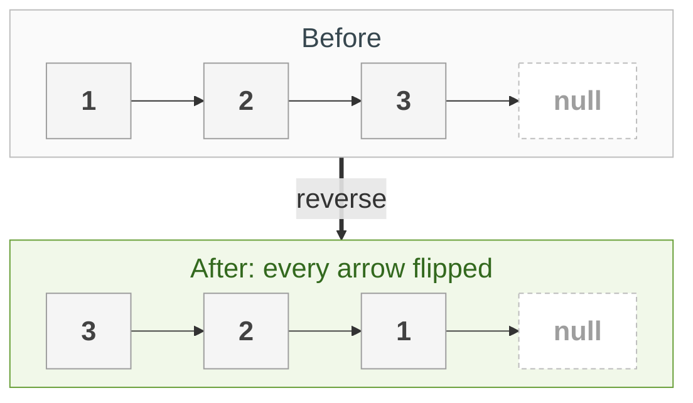

Here is the state of `prev` and `curr` after each pass of the loop. Orange is the node that was just flipped, blue is the next node to flip. Each pass does the same four things: save `temp = curr.next`, point `curr.next` at `prev`, move `prev` to `curr`, move `curr` to `temp`.

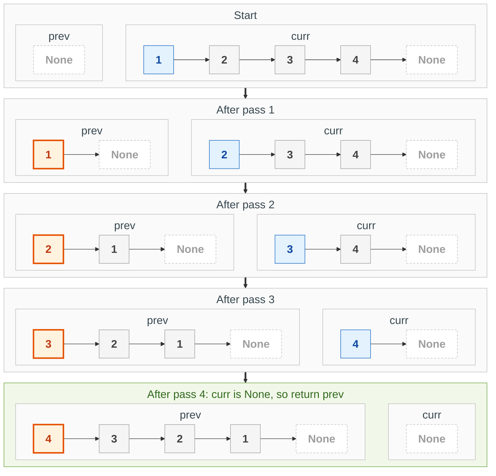

The same pointer flip shows up on a tree: see [Binary Tree Upside Down](../Trees/PostOrder.md#binary-tree-upside-down).

**Key intuition 1:** Walk the list and flip each arrow to point backwards, keeping a pointer to the part you have already reversed.

**Key intuition 2:** Remember the next node BEFORE you flip the arrow, or you lose the rest of the list.

<details><summary markdown="span">Execute!</summary>

```python
class Solution:
    def reverseList(self, head: ListNode) -> ListNode:
        prev = None
        curr = head

        while curr:
            temp = curr.next

            # Core Code
            curr.next = prev
            # curr.prev = temp would make this work for a doubly linked list
            prev = curr

            curr = temp

        return prev
```

</details>
<BR>

### [Merge Two Sorted Lists](https://leetcode.com/problems/merge-two-sorted-lists/)

> Merge two sorted linked lists into one sorted list.

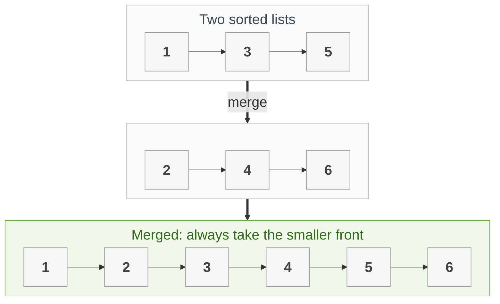

**Key intuition 1:** Compare the two front nodes, attach the smaller one, and move that list forward. Repeat until one list runs out, then attach the rest of the other.

**Key intuition 2:** Start from a dummy node so you never need a special case for the first node.

<details><summary markdown="span">Execute!</summary>

```python
class SolutionMerge2:
    def mergeTwoLists(self, list1: Optional[ListNode], list2: Optional[ListNode]) -> Optional[ListNode]:
        # A dummy head means no special case for the first node.
        dummy = ListNode()
        tail = dummy

        while list1 and list2:
            if list1.val <= list2.val:
                tail.next = list1
                list1 = list1.next
            else:
                tail.next = list2
                list2 = list2.next

            tail = tail.next

        # One list ran out: attach the rest of the other.
        tail.next = list1 or list2
        return dummy.next
```

</details>
<BR>

### [Detect Cycle](https://leetcode.com/problems/linked-list-cycle/)

> Determine whether a linked list has a cycle.

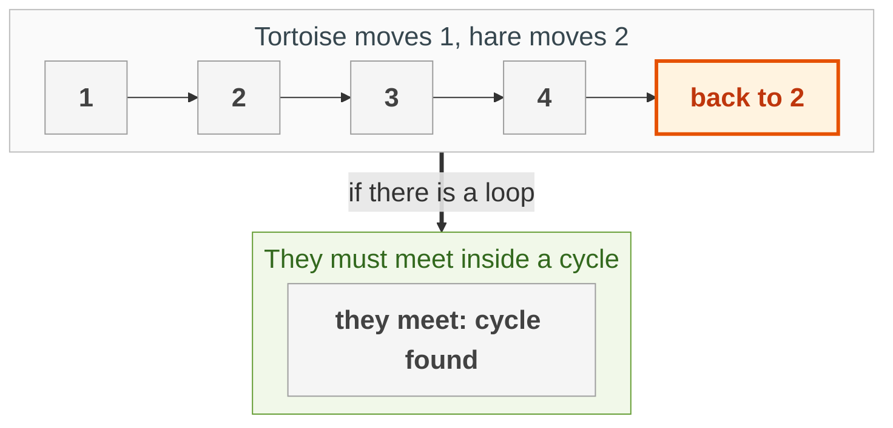

**Key intuition 1:** Send two runners round the list: one steps 1, the other steps 2. If the track is a loop the fast one laps the slow one and they meet; if not, the fast one falls off the end.

**Key intuition 2:** This uses O(1) memory. The alternative, remembering every node you have seen in a set, is correct but uses O(n).

<details><summary markdown="span">Execute!</summary>

```python
class SolutionCycle:
    def hasCycle(self, head: Optional[ListNode]) -> bool:
        slow = head
        fast = head

        while slow and fast and fast.next:
            slow = slow.next
            fast = fast.next.next

            if slow == fast:
                return True

        return False
```

</details>
<BR>

### [Remove Duplicates from Sorted List](https://leetcode.com/problems/remove-duplicates-from-sorted-list/)

> Delete all duplicates from a sorted linked list so each value appears once.

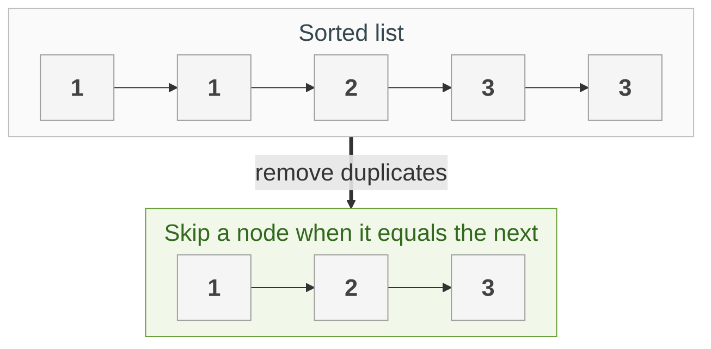

**Key intuition 1:** Because the list is sorted, duplicates are always next to each other. Compare each node with the next one.

**Key intuition 2:** If they are equal, skip the next node by pointing past it. Otherwise move on.

<details><summary markdown="span">Execute!</summary>

```python
class SolutionDupes:
    def deleteDuplicates(self, head: Optional[ListNode]) -> Optional[ListNode]:

        curr = head
        while curr:
            while curr and curr.next and curr.val == curr.next.val:
                curr.next = curr.next.next

            curr = curr.next

        return head
```

</details>
<BR>

### [Remove Nth Node From End of List](https://leetcode.com/problems/remove-nth-node-from-end-of-list/)

> Remove the nth node from the end of the list.

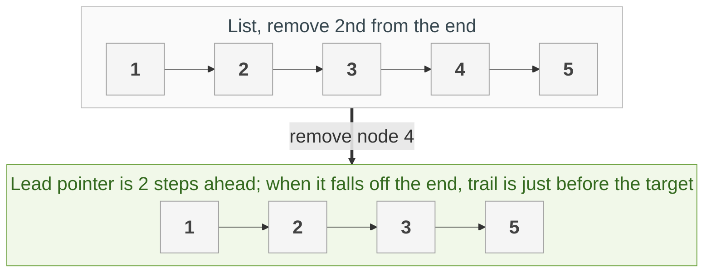

**Key intuition 1:** You cannot count from the end, but you can keep two pointers n steps apart. When the front one reaches the end, the back one is exactly where you need to be.

**Key intuition 2:** Use a dummy node so removing the head works like removing any other node.

<details><summary markdown="span">Execute!</summary>

```python
class SolutionNth:
    def removeNthFromEnd(self, head, n):
        cur = head
        lag = head

        for i in range(0, n):
            cur = cur.next

        # Example: [1,2], n=2.
        if not cur:
            return head.next

        # Tricky: you want to be one behind for deletion.
        while cur.next:
            cur = cur.next
            lag = lag.next

        lag.next = lag.next.next

        return head
```

</details>
<BR>

### [Add Two Numbers](https://leetcode.com/problems/add-two-numbers/)

> Two numbers are stored as linked lists with the digits in reverse order. Add them and return the sum in the same form.

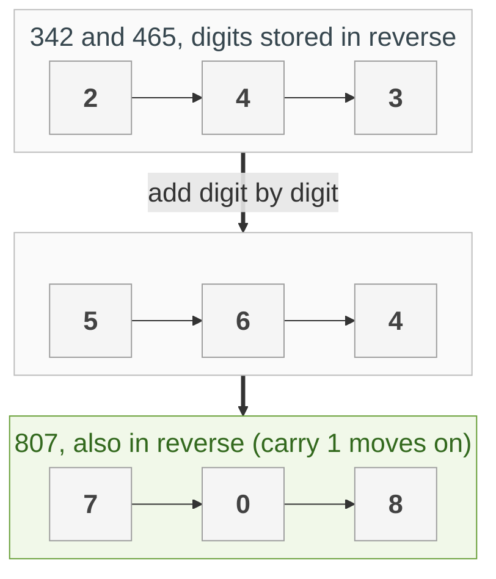

**Key intuition 1:** Reverse order is a gift: the first node is the ones digit, which is where schoolbook addition starts. Add digit by digit.

**Key intuition 2:** Carry the overflow to the next column. Keep going while either list or a carry remains, so a final carry becomes a new node.

<details><summary markdown="span">Execute!</summary>

```python
class SolutionAdd:
    def addTwoNumbers(self, l1: ListNode, l2: ListNode) -> ListNode:
        carry = 0

        head = ListNode(None)
        curr = head

        while l1 or l2 or carry:
            if l1:
                carry += l1.val
                l1 = l1.next

            if l2:
                carry += l2.val
                l2 = l2.next

            curr.next = ListNode(carry % 10, None)
            curr = curr.next
            carry = carry // 10

        return head.next
```

</details>
<BR>

### [Intersection of Two Linked Lists](https://leetcode.com/problems/intersection-of-two-linked-lists/)

> Find the node where two singly linked lists meet, or return null.

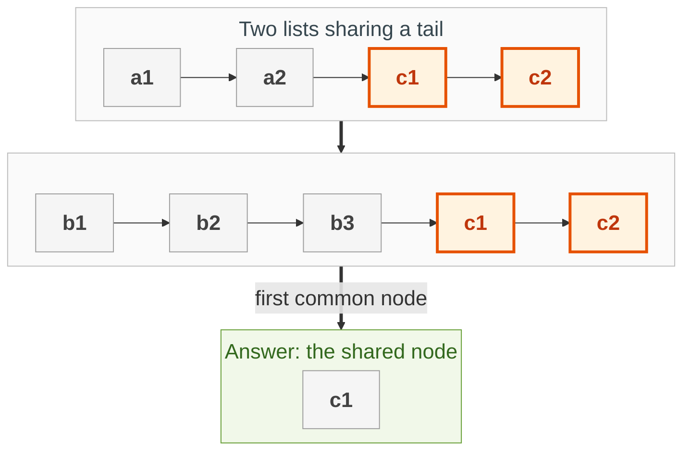

**Key intuition 1:** Two lists that merge share the same tail, but the lengths before the merge can differ, so walking them side by side misses the meeting point.

**Key intuition 2:** Let each pointer walk its own list and then jump to the head of the other list. Both walk the same total distance, so they line up at the intersection (or both reach null).

<details><summary markdown="span">Execute!</summary>

Using a set (easy to think of, O(n) extra memory):

```python
class SolutionIntersect:
    def getIntersectionNode(self, headA: ListNode, headB: ListNode) -> ListNode:
        d = {}
        while headA:
            d[headA] = 1
            headA = headA.next

        while headB:
            if headB in d:
                return headB
            headB = headB.next

        return None
```

Two pointers (O(1) extra memory):

```python
class SolutionIntersect2:
    def getIntersectionNode(self, headA: ListNode, headB: ListNode) -> ListNode:
        a = headA
        b = headB

        while a is not b:
            # At the end of A, carry on along B.
            a = a.next if a else headB

            # And the other way round.
            b = b.next if b else headA

        # The intersection, or None if the lists never meet.
        return a
```

</details>
<BR>

### [Palindrome Linked List](https://leetcode.com/problems/palindrome-linked-list/)

> Determine whether a linked list reads the same forwards and backwards.

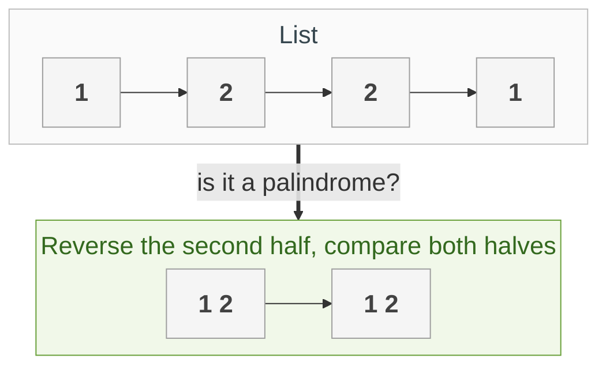

**Key intuition 1:** A palindrome mirrors around its middle. Find the middle with fast and slow pointers.

**Key intuition 2:** Reverse the second half in place, then compare it with the first half node by node. This combines three earlier tricks: fast/slow, reverse, compare.

<details><summary markdown="span">Execute!</summary>

```python
class SolutionPalin:
    def isPalindrome(self, head: ListNode) -> bool:

        def solve(B):
            if B is None:
                return True

            # Tail up recursion.
            if not solve(B.next) or self.A.val != B.val:
                return False

            self.A = self.A.next
            return True

        self.A = head

        return solve(head)
```

</details>
<BR>

## Harder: come back to these

### [Reorder List](https://leetcode.com/problems/reorder-list/)

> Reorder L0 → L1 → … → Ln into L0 → Ln → L1 → Ln-1 → L2 → …, in place.

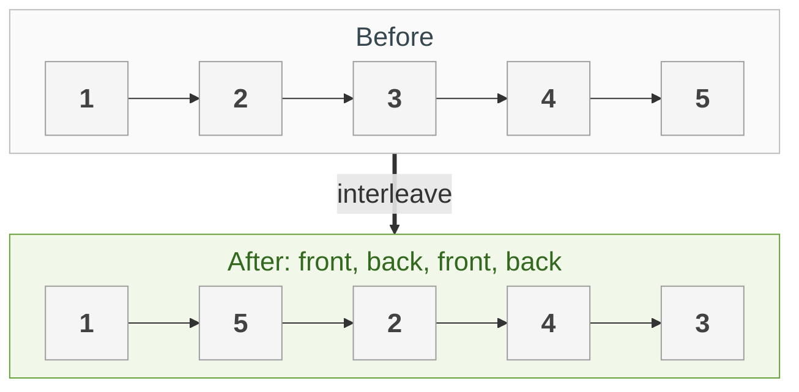

**Key intuition 1:** It is three small problems glued together: find the middle (fast/slow), reverse the second half, then weave the two halves together.

**Key intuition 2:** Cut the list in two at the middle before weaving, or the last node will still point back into the list and create a cycle.

<details><summary markdown="span">Execute!</summary>

```python
class SolutionReorder:
    def reorderList(self, head: ListNode) -> None:
        if not head:
            return

        # 1. Find the middle: when fast reaches the end, slow is halfway.
        slow = head
        fast = head
        while fast and fast.next:
            slow = slow.next
            fast = fast.next.next

        # 2. Reverse the second half in place.
        prev = None
        curr = slow
        while curr:
            tmp = curr.next
            curr.next = prev
            prev = curr
            curr = tmp

        # 3. Merge the two halves, alternating one node from each.
        first = head
        second = prev
        while second.next:
            tmp = first.next
            first.next = second
            first = tmp

            tmp = second.next
            second.next = first
            second = tmp
```

</details>
<BR>

### [Merge K Sorted Lists](https://leetcode.com/problems/merge-k-sorted-lists/)

> Merge k sorted linked lists into one sorted list.

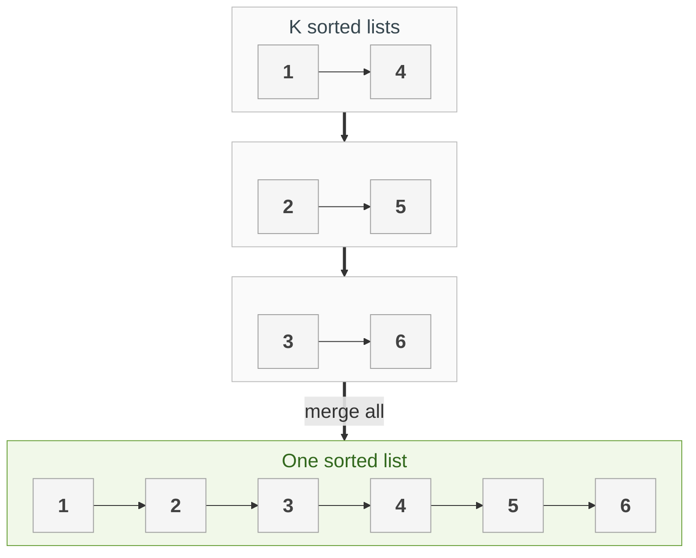

**Key intuition 1:** The smallest remaining node is always at the front of one of the k lists. A min-heap of those k fronts always gives you the next one in O(log k).

**Key intuition 2:** Pop the smallest, attach it, and push that node's next node into the heap.

<details><summary markdown="span">Execute!</summary>

```python
import heapq

class SolutionMergeK:
    def mergeKLists(self, lists: List[ListNode]) -> ListNode:
        head = ListNode(None)
        res = head
        heap = []

        for k in range(len(lists)):
            if lists[k] is not None:
                heapq.heappush(heap, (lists[k].val, k))

        while heap:
            curr, k = heapq.heappop(heap)
            res.next = ListNode(curr)
            res = res.next

            lists[k] = lists[k].next
            if lists[k] is not None:
                heapq.heappush(heap, (lists[k].val, k))

        return head.next
```

</details>
<BR>

### [Copy List with Random Pointer](https://leetcode.com/problems/copy-list-with-random-pointer/)

> Each node has a next pointer and a random pointer. Return a deep copy.

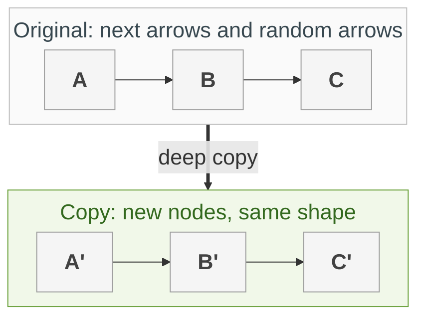

**Key intuition 1:** The hard part is a random pointer to a node you have not copied yet. Solve it by first creating a copy of every node and remembering original → copy.

**Key intuition 2:** Then fill in next and random for each copy by looking their targets up in that map.

<details><summary markdown="span">Execute!</summary>

```python
class SolutionCopy:
    def copyRandomList(self, head: 'Optional[Node]') -> 'Optional[Node]':
        d = collections.defaultdict(lambda: Node(0, None, None))

        newHead = None
        while head:
            d[head].val = head.val
            d[head].next = d[head.next] if head.next else None
            d[head].random = d[head.random] if head.random else None

            if newHead == None:
                newHead = d[head]

            head = head.next

        return newHead
```

</details>
<BR>

