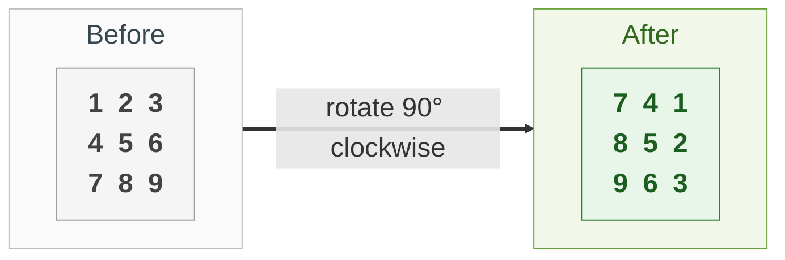
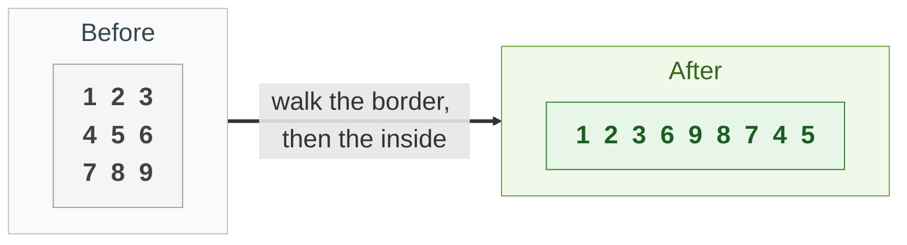
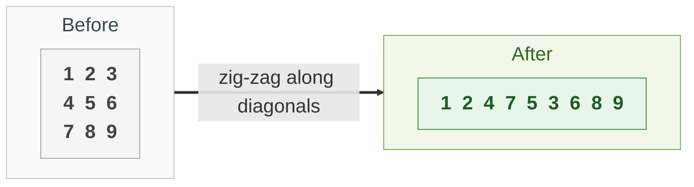
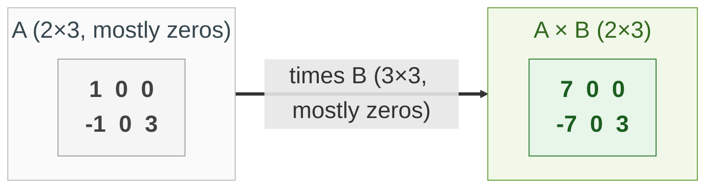

{: .no_toc}
# Matrices
Practise here: [Leetcode](https://leetcode.com/list/?selectedList=9dunhxke)

- TOC
{:toc}

A matrix is a list of rows. Most matrix problems are really **index arithmetic**: where does the element at (row, column) go, or which cell is next?

**Key intuition 1:** Draw a 3×3 example and write the coordinates in each cell. The pattern in the indices IS the solution.

**Key intuition 2:** Prefer built-in moves you can trust (reverse, transpose with `zip`) over clever index juggling, and check non-square shapes (1 row, 1 column) before you call it done.

### [Rotate Matrix](https://leetcode.com/problems/rotate-image/)

> Rotate Matrix 90 degrees, in place.



**Key intuition 1:** Rotating 90° clockwise is two easy moves: flip the matrix upside down (reverse the list of rows), then transpose it (swap the element at (i, j) with the one at (j, i)).

**Key intuition 2:** Doing it in place means swapping pairs, never copying. The layered version instead rotates four cells at a time, ring by ring, which is harder to get right.

<details><summary markdown="span">Execute!</summary>

> Solution using Reverse and Transpose. 
```python
class Solution:
    def rotate(self, A):
        A.reverse()
        for i in range(len(A)):
            for j in range(i):
                tmp = A[i][j]
                A[i][j] = A[j][i]
                A[j][i] = tmp
```

> Solution using a [layered rotation approach](https://stackoverflow.com/questions/42519/how-do-you-rotate-a-two-dimensional-array)

```python
class Solution:
    def rotate(self, m: List[List[int]]) -> None:
        n = len(m)
        layer = n//2
        inner = n//2+n%2

        for i in range(layer):
            for j in range(inner):
                tmp = m[i][j]

                # It is instructive to do the first two manually to visualize the indices mutate:
                # Swap 0,0 with 2,0
                # Swap 0,1 with 1,0
                # Or ==> m[0][j] with m[~j][0]
                # Or ==> m[i][j] with m[~j][i]
                m[i][j] = m[~j][i]
                m[~j][i] = m[~i][~j]
                m[~i][~j] = m[j][~i]
                m[j][~i] = tmp
```

</details>
<BR>

### [Traverse Matrix in a Spiral](https://leetcode.com/problems/spiral-matrix/)
> Given a matrix of m x n elements (m rows, n columns), return all elements of the matrix in spiral order.
 


**Key intuition 1:** Keep walking in one direction until the next cell is off the board or already visited, then turn right (right, down, left, up, repeat). Mark visited cells as you go.

**Key intuition 2:** The second solution peels the top row off, then rotates what is left counter-clockwise (zip and reverse), so the next row to peel is again the top.

<details><summary markdown="span">Execute!</summary>

```python
class Solution:
    def spiralOrder(self, m: List[List[int]]) -> List[int]:
        def add(t1):
            nonlocal r, c
            r = r + t1[0]
            c = c + t1[1]

        def sub(t1):
            nonlocal r, c
            r = r - t1[0]
            c = c - t1[1]

        directions = [(0, 1), (1, 0), (0, -1), (-1, 0)]
        res = []
        count = 0
        total = len(m) * len(m[0])

        curr = 0
        r = 0
        c = 0
        while count < total:
            res.append(m[r][c])
            m[r][c] = 'z'
            count += 1
            add(directions[curr])

            if r not in range(len(m)) or c not in range(len(m[0])) or m[r][c] == 'z':
                sub(directions[curr])
                curr = (curr + 1) % 4
                add(directions[curr])

        return res

class Solution:
    def spiralOrder(self, m: List[List[int]]) -> List[int]:

        def solve(m, accum = [] ):
            if len(m)==0:
                return accum

            accum += list(m.pop(0))
            m = list(zip(*m))[::-1]
            return solve(m, accum)

        return solve(m)
```
</details>
<BR>

### [Traverse Matrix Diagonally](https://leetcode.com/problems/diagonal-traverse/)

> Traverse Matrix diagonally.



**Key intuition 1:** Cells on the same anti-diagonal share row + column. Start from each cell on the top row and the right column and walk down-left.

**Key intuition 2:** Every other diagonal is read in the opposite direction, so reverse every other one.

<details><summary markdown="span">Execute!</summary>

```python
class Solution:
    def findDiagonalOrder(self, matrix: List[List[int]]) -> List[int]:
        m = len(matrix)
        n = len(matrix[0])
        start = [(0,i) for i in range(n)] + [(j,n-1) for j in range(1,m)]

        res = []
        count = 0
        for r,c in start:
            tmp = []
            while r in range(m) and c in range(n):
                tmp.append(matrix[r][c])
                r+=1
                c-=1

            if count %2 ==0:
                tmp.reverse()

            count+=1
            res+= tmp

        return res
```

</details>
<BR>

## Harder: come back to these

### [Sparse Matrix Multiplication](https://leetcode.com/problems/sparse-matrix-multiplication/)

> Multiply large matrices. 
> Remember, multiplying an m×n matrix by an n×p matrix, result is an mxp matrix
> The optimization for sparse matrices is below the original solution.



**Key intuition 1:** In a sparse matrix almost every value is 0, and 0 times anything is 0. The simple triple loop wastes time multiplying zeros.

**Key intuition 2:** Loop over A's rows and columns, skip the whole inner loop when A[i][k] is 0, and add A[i][k] * B[k][j] into res[i][j]. The work now depends on the number of non-zero values.

<details><summary markdown="span">Execute!</summary>

```python
class Solution:
    def multiply(self, A, B):
        def dotProduct(x, y):
            return sum(a * b for a, b in zip(x, y))

        # To multiply an m×n matrix by an n×p matrix, the n's must be the same,
        # and the result is an m×p matrix.

        # Inner expression is column, outside rows
        res = [[0 for x in range(len(B[0]))] for y in range(len(A))]

        for i in range(len(A)):
            for j in range(len(B[0])):
                res[i][j] = dotProduct(A[i], [x[j] for x in B])

        return res
```

</details>
<BR>

<details><summary markdown="span">Execute! (optimized for sparse matrices)</summary>

```python
class SolutionSparse:
    def multiply(self, A: List[List[int]], B: List[List[int]]) -> List[List[int]]:
        m = len(A)
        n = len(B)
        p = len(B[0])
        res = [[0] * p for _ in range(m)]
        for i in range(m):
            for k in range(n):
                if A[i][k] == 0:
                    # a zero contributes nothing: skip the whole inner loop
                    continue
                for j in range(p):
                    if B[k][j] != 0:
                        res[i][j] += A[i][k] * B[k][j]
        return res
```

</details>
<BR>
