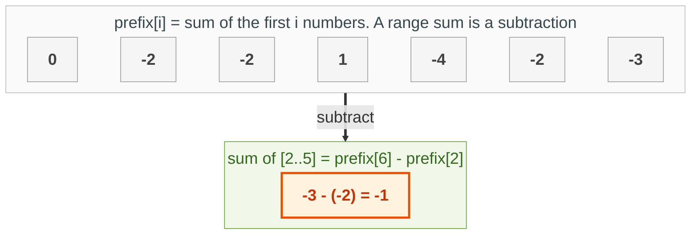
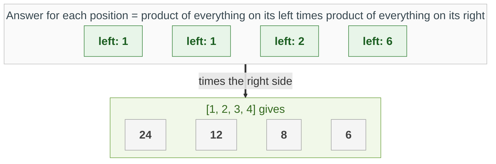

{: .no_toc}
# Prefix Sums

A **prefix sum** is a running total: prefix[i] is the sum of the first i numbers. Once you have it, the sum of ANY range is a single subtraction, and a whole family of "subarray with sum k" problems become a dictionary lookup.

Related: [Sliding Windows](SlidingWindow.html) solve similar problems when all the numbers are positive; prefix sums also work with negative numbers.

- TOC
{:toc}

**Key intuition 1:** sum(left..right) = prefix[right + 1] - prefix[left]. Everything up to the right edge, minus everything before the left edge.

**Key intuition 2:** For "a subarray that sums to k": if the running total is T now, you want an EARLIER total of T - k. Store the totals you have seen in a dictionary and look it up.

### [Range Sum Query - Immutable](https://leetcode.com/problems/range-sum-query-immutable/)

> Answer many sumRange(left, right) queries on an array that does not change.



**Key intuition 1:** Pay once (O(n)) to build the running totals, then every query is O(1): two lookups and a subtraction.

**Key intuition 2:** Start the list with a 0 so that a range beginning at index 0 needs no special case.

<details><summary markdown="span">Execute!</summary>

```python
class NumArray:
    def __init__(self, nums: List[int]):
        # prefix[i] = sum of the first i numbers
        self.prefix = [0]
        for x in nums:
            self.prefix.append(self.prefix[-1] + x)

    def sumRange(self, left: int, right: int) -> int:
        # everything up to right, minus everything before left
        return self.prefix[right + 1] - self.prefix[left]
```

</details>
<BR>

### [Subarray Sum Equals K](https://leetcode.com/problems/subarray-sum-equals-k/description/)


**Key intuition 1:** Keep a running total, and a dictionary counting how many times each total has occurred. If (total - k) occurred before, then the numbers after that point add up to k.

**Key intuition 2:** Count every earlier occurrence (not just one), and remember that the total can also equal k by itself, starting from index 0.

<details><summary markdown="span">Execute!</summary>

```python
class Solution:
    def subarraySum(self, nums: List[int], k: int) -> int:
        h = collections.defaultdict(int)
        total_at_i = 0
        count = 0

        for num in nums:
            total_at_i += num

            # 1. Explicitly check if the prefix from index 0 equals k
            if total_at_i == k:
                count += 1

            # 2. Check if (current_sum - k) exists in history
            if total_at_i - k in h:
                count += h[total_at_i - k]

            # 3. Record the current prefix sum
            h[total_at_i] += 1

        return count
```
</details>
<br/>


### [Maximum Length of a sub-array that sums to k](https://leetcode.com/problems/maximum-size-subarray-sum-equals-k/)
> Given an array nums and a target value k, find the maximum length of a subarray that sums to k.
If there isn't one, return 0 instead.
> Key intuition: If total_at_i + total_at_j = k, then sum(i..j) must be k
> [Contrast with](https://leetcode.com/problems/path-sum-iii/)

**Key intuition 1:** Same idea, but now you want the LONGEST such subarray, so store the FIRST index at which each total occurred. The earliest start gives the longest length.

**Key intuition 2:** Only record a total the first time you see it; later occurrences would make the subarray shorter.

<details><summary markdown="span">Execute!</summary>

```python
class Solution:
    def maxSubArrayLen(self, nums: List[int], k: int) -> int:
        h = collections.defaultdict(int)
        total_at_i = 0
        maxLen = 0

        for i in range(0, len(nums)):
            total_at_i += nums[i]

            if total_at_i not in h:
                h[total_at_i] = i

            if total_at_i == k:
                maxLen = max(maxLen, i - 0 + 1)
            elif total_at_i - k in h:
                maxLen = max(maxLen, i - h[total_at_i - k])

        return maxLen
```
</details>
<br/>

## Harder: come back to these

### [Product of Array Except Self](https://leetcode.com/problems/product-of-array-except-self/)

> Return an array where each element is the product of all the other elements. Do not use division.



**Key intuition 1:** It is a prefix idea with multiplication: the answer at i is (product of everything to the left) times (product of everything to the right).

**Key intuition 2:** Fill the answer with the left products in one pass, then multiply in the right products in a second pass from the end. No division, so zeros are fine.

<details><summary markdown="span">Execute!</summary>

```python
class SolutionProduct:
    def productExceptSelf(self, nums: List[int]) -> List[int]:
        result = [1] * len(nums)
        running = 1
        for i in range(len(nums)):
            # product of everything to the LEFT of i
            result[i] = running
            running *= nums[i]
        running = 1
        for i in range(len(nums) - 1, -1, -1):
            # times the product of everything to the RIGHT of i
            result[i] *= running
            running *= nums[i]
        return result
```

</details>
<BR>
