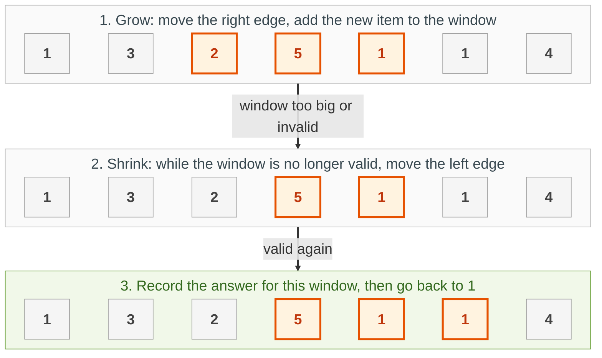
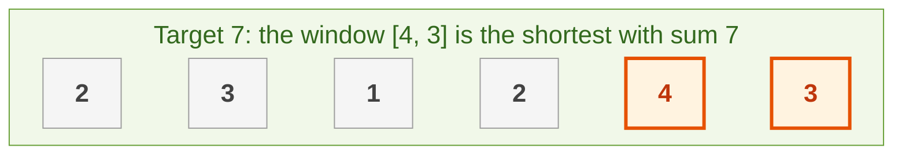
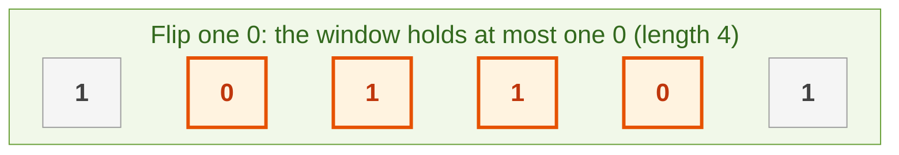
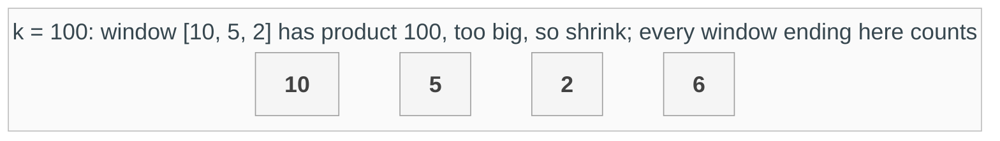

{: .no_toc}
# Sliding Window
Practise here: [Leetcode](https://leetcode.com/list?selectedList=9di1s4a1)

- TOC
{:toc}

A **sliding window** is a stretch of the array (or string) that you grow on the right and shrink on the left. It solves "longest / shortest / how many contiguous pieces" problems in O(n), because each item enters the window once and leaves once.



**Key intuition 1:** Never restart. When the window becomes invalid, drop items from the LEFT until it is valid again, instead of starting a fresh window.

**Key intuition 2:** Decide first what "valid" means (no repeats, sum at least k, at most one zero, product below k). Everything else is the same loop: grow right, `while invalid: shrink left`, record the answer.

Other pages: sliding-window style problems that moved: [Flower Bed](Greedy.html), [K-messed array](Heap.html), [Longest Palindromic Substring](../Misc/String.html), and Remove Duplicates is on [Two Pointers](TwoPointers.html).

### [Minimum Size Subarray Sum](https://leetcode.com/problems/minimum-size-subarray-sum/)
> Given an array of n positive integers and a positive integer s, find the minimal length of a
contiguous subarray of which the sum ≥ s. If there isn't one, return 0 instead.
 


**Key intuition 1:** Add numbers on the right until the sum reaches the target. Now the window is valid, so try to make it shorter by removing numbers from the left while it stays valid.

**Key intuition 2:** This only works because all numbers are positive: removing one always lowers the sum and adding one always raises it. With negatives, use prefix sums instead.

<details><summary markdown="span">Execute!</summary>

```python
class Solution:
    def minSubArrayLen(self, target: int, nums: List[int]) -> int:
        left = 0
        minLength = float('inf')
        currSum = 0
        for i in range(len(nums)):
            currSum += nums[i]

            while currSum >= target:
                if currSum >= target:
                    minLength = min(minLength, i - left + 1)

                currSum -= nums[left]
                left += 1

        if minLength == float('inf'):
            return 0

        return minLength
```
</details>
<BR>

### [Longest Substring without repeating characters](https://leetcode.com/problems/longest-substring-without-repeating-characters/)

> Given a string, find the length of the longest substring without repeating characters.

```mermaid
%%{init: {"flowchart": {"padding": 14, "nodeSpacing": 10, "rankSpacing": 34, "subGraphTitleMargin": {"top": 6, "bottom": 22}}, "themeVariables": {"fontSize": "22px"}}}%%
flowchart TB
    subgraph F0 ["“abcabcbb”: the window “abc” has no repeats (length 3)"]
        direction LR
        F0_0["<b>a</b>"]
        F0_1["<b>b</b>"]
        F0_2["<b>c</b>"]
        F0_3["<b>a</b>"]
        F0_4["<b>b</b>"]
        F0_5["<b>c</b>"]
        F0_6["<b>b</b>"]
        F0_7["<b>b</b>"]
        F0_0 ~~~ F0_1
        F0_1 ~~~ F0_2
        F0_2 ~~~ F0_3
        F0_3 ~~~ F0_4
        F0_4 ~~~ F0_5
        F0_5 ~~~ F0_6
        F0_6 ~~~ F0_7
    end
    classDef n fill:#f5f5f5,stroke:#9e9e9e,color:#424242
    classDef hi fill:#fff3e0,stroke:#e65100,stroke-width:3px,color:#bf360c
    classDef a fill:#e3f2fd,stroke:#1565c0,color:#0d47a1
    classDef g fill:#e8f5e9,stroke:#2e7d32,color:#1b5e20
    classDef p fill:#f3e5f5,stroke:#6a1b9a,color:#4a148c
    classDef r fill:#ffebee,stroke:#c62828,color:#b71c1c
    classDef y fill:#fff8e1,stroke:#f9a825,color:#5d4037
    classDef c fill:#e0f7fa,stroke:#00838f,color:#006064
    classDef txt fill:none,stroke:none,color:#e65100
    classDef ghost fill:none,stroke:none,color:transparent
    classDef empty fill:#ffffff,stroke:#bdbdbd,stroke-dasharray:4 3,color:#9e9e9e
    class F0_0,F0_1,F0_2 hi
    class F0_3,F0_4,F0_5,F0_6,F0_7 n
    style F0 fill:#f1f8e9,stroke:#689f38,color:#33691e
```



**Key intuition 1:** The window is valid while it has no repeated character. Add the new character, and if it is now a repeat, shrink from the left until the repeat is gone.

**Key intuition 2:** A dictionary of counts tells you instantly whether a character repeats. The answer is the largest window size you ever saw.

<details><summary markdown="span">Execute!</summary>

```python
class Solution:
    def lengthOfLongestSubstring(self, s: str) -> int:
        h = collections.defaultdict(int)
        left = 0
        maxL = 0
        for i, c in enumerate(s):
            h[c]+=1

            while h[c] > 1:
                h[s[left]]-=1
                left+=1

            maxL = max(maxL, i-left + 1)

        return maxL
```

</details>
<BR>

### [Max Consecutive Ones](https://leetcode.com/problems/max-consecutive-ones-ii/)

> Given a binary array, find the maximum number of consecutive 1s in this sort if you can flip at most one 0.
> Key Intuition: Look for a sliding window with 1 zero, if 2 zeroes found, remove first zero found


**Key intuition 1:** Flipping one 0 is the same as allowing one 0 inside the window. Count the zeros in the window.

**Key intuition 2:** When a second zero arrives the window is invalid: move the left edge forward until the first zero has left.

<details><summary markdown="span">Execute!</summary>

```python
class Solution:
    def findMaxConsecutiveOnes(self, nums: List[int]) -> int:
        maxL = 0

        left = 0
        zeroes = 0
        for i in range(len(nums)):
            if nums[i] == 0:
                zeroes += 1

            # Flipping a zero is equivalent to ignore a zero
            while zeroes >= 2:
                if nums[left] == 0:
                    zeroes -= 1
                left += 1

            maxL = max(maxL, i - left + 1)

        return maxL
```

</details>
<BR>

### [Subarray Product less than K](https://leetcode.com/problems/subarray-product-less-than-k)

Given an array of integers nums and an integer k, return the number of contiguous subarrays where the product of all the elements in the subarray is strictly less than k.

Can also be solved using [backtracking](../Graphs/DFS.md#subarray-product-less-than-k) but inefficent 



**Key intuition 1:** With positive numbers, the product only grows as you add and only shrinks as you remove, so a window works. Shrink while the product is at least k.

**Key intuition 2:** Counting trick: if [left..i] is valid, then every subarray that ENDS at i and starts inside the window is also valid. That is i - left + 1 new subarrays.

<details><summary markdown="span">Execute!</summary>

```python
class Solution:
    def numSubarrayProductLessThanK(self, nums: List[int], k: int) -> int:
        # If k is 0 or 1, no product of positive integers can be < k
        if k <= 1:
            return 0

        current_prod = 1
        left = 0
        count = 0

        for i, num in enumerate(nums):
            # Equivalent to hsh[s[i]] += 1: Add the new number to the window
            current_prod *= nums[i]

            # Equivalent to while hsh[s[i]] > 1: Shrink until product is valid
            while current_prod >= k:
                current_prod //= nums[left]
                left += 1

            # Instead of maxL, we add the number of valid subarrays ending at 'i'
            # Each element in the current window [left...i] is a new valid subarray
            count += (i - left + 1)

        return count
```

</details>
<BR>

## Harder: come back to these

### [Permutation in String](https://leetcode.com/problems/permutation-in-string/description)

Given two strings s1 and s2, return true if s2 contains a permutation of s1, or false otherwise.

```mermaid
%%{init: {"flowchart": {"padding": 14, "nodeSpacing": 10, "rankSpacing": 34, "subGraphTitleMargin": {"top": 6, "bottom": 22}}, "themeVariables": {"fontSize": "22px"}}}%%
flowchart TB
    subgraph F0 ["s1 = “ab” (a permutation is any order: “ab” or “ba”). Slide a window of length 2"]
        direction LR
        F0_0["<b>e</b>"]
        F0_1["<b>i</b>"]
        F0_2["<b>d</b>"]
        F0_3["<b>b</b>"]
        F0_4["<b>a</b>"]
        F0_5["<b>o</b>"]
        F0_6["<b>o</b>"]
        F0_7["<b>o</b>"]
        F0_0 ~~~ F0_1
        F0_1 ~~~ F0_2
        F0_2 ~~~ F0_3
        F0_3 ~~~ F0_4
        F0_4 ~~~ F0_5
        F0_5 ~~~ F0_6
        F0_6 ~~~ F0_7
    end
    classDef n fill:#f5f5f5,stroke:#9e9e9e,color:#424242
    classDef hi fill:#fff3e0,stroke:#e65100,stroke-width:3px,color:#bf360c
    classDef a fill:#e3f2fd,stroke:#1565c0,color:#0d47a1
    classDef g fill:#e8f5e9,stroke:#2e7d32,color:#1b5e20
    classDef p fill:#f3e5f5,stroke:#6a1b9a,color:#4a148c
    classDef r fill:#ffebee,stroke:#c62828,color:#b71c1c
    classDef y fill:#fff8e1,stroke:#f9a825,color:#5d4037
    classDef c fill:#e0f7fa,stroke:#00838f,color:#006064
    classDef txt fill:none,stroke:none,color:#e65100
    classDef ghost fill:none,stroke:none,color:transparent
    classDef empty fill:#ffffff,stroke:#bdbdbd,stroke-dasharray:4 3,color:#9e9e9e
    class F0_0,F0_1,F0_2,F0_5,F0_6,F0_7 n
    class F0_3,F0_4 hi
    style F0 fill:#f1f8e9,stroke:#689f38,color:#33691e
```



**Key intuition 1:** A permutation has the same letter counts, so slide a window of exactly len(s1) over s2 and compare counts.

**Key intuition 2:** Do not recount each window: when the window moves one step, add one letter and remove one letter, and track how many required letters are still missing.

<details><summary markdown="span">Execute!</summary>

```python
class Solution(object):
    def checkInclusion(self, s1, s2):
        # s1 is like 't', s2 is like 's'
        need = collections.Counter(s1)
        missing = len(s1)

        left = 0

        for i, c in enumerate(s2):
            if need[c] > 0:
                missing -= 1
            need[c] -= 1

            if i - left + 1 > len(s1):
                if need[s2[left]] >= 0:
                    missing += 1
                need[s2[left]] += 1
                left += 1

            # 3. If missing is 0 and window is exactly len(s1) we found a permutation
            if missing == 0:
                return True

        return False
```
</details>
<BR>

### [Minimum Window Substring](https://leetcode.com/problems/minimum-window-substring/)

> Given two strings s and t of lengths m and n respectively, return the minimum window substring of 
> s such that every character in t (including duplicates) is included in the window.

```mermaid
%%{init: {"flowchart": {"padding": 14, "nodeSpacing": 10, "rankSpacing": 34, "subGraphTitleMargin": {"top": 6, "bottom": 22}}, "themeVariables": {"fontSize": "22px"}}}%%
flowchart TB
    subgraph F0 ["Smallest window containing A, B and C"]
        direction LR
        F0_0["<b>A</b>"]
        F0_1["<b>D</b>"]
        F0_2["<b>O</b>"]
        F0_3["<b>B</b>"]
        F0_4["<b>E</b>"]
        F0_5["<b>C</b>"]
        F0_6["<b>O</b>"]
        F0_7["<b>D</b>"]
        F0_8["<b>E</b>"]
        F0_9["<b>B</b>"]
        F0_10["<b>A</b>"]
        F0_11["<b>N</b>"]
        F0_12["<b>C</b>"]
        F0_0 ~~~ F0_1
        F0_1 ~~~ F0_2
        F0_2 ~~~ F0_3
        F0_3 ~~~ F0_4
        F0_4 ~~~ F0_5
        F0_5 ~~~ F0_6
        F0_6 ~~~ F0_7
        F0_7 ~~~ F0_8
        F0_8 ~~~ F0_9
        F0_9 ~~~ F0_10
        F0_10 ~~~ F0_11
        F0_11 ~~~ F0_12
    end
    classDef n fill:#f5f5f5,stroke:#9e9e9e,color:#424242
    classDef hi fill:#fff3e0,stroke:#e65100,stroke-width:3px,color:#bf360c
    classDef a fill:#e3f2fd,stroke:#1565c0,color:#0d47a1
    classDef g fill:#e8f5e9,stroke:#2e7d32,color:#1b5e20
    classDef p fill:#f3e5f5,stroke:#6a1b9a,color:#4a148c
    classDef r fill:#ffebee,stroke:#c62828,color:#b71c1c
    classDef y fill:#fff8e1,stroke:#f9a825,color:#5d4037
    classDef c fill:#e0f7fa,stroke:#00838f,color:#006064
    classDef txt fill:none,stroke:none,color:#e65100
    classDef ghost fill:none,stroke:none,color:transparent
    classDef empty fill:#ffffff,stroke:#bdbdbd,stroke-dasharray:4 3,color:#9e9e9e
    class F0_0,F0_1,F0_2,F0_3,F0_4,F0_5,F0_6,F0_7,F0_8 n
    class F0_9,F0_10,F0_11,F0_12 hi
    style F0 fill:#f1f8e9,stroke:#689f38,color:#33691e
```



**Key intuition 1:** Grow right until the window contains every needed character (nothing missing). Then it is valid, so shrink from the left as far as you can, recording the smallest window along the way.

**Key intuition 2:** `need` counts what is still required (it can go negative for extras) and `missing` counts how many required letters are still absent, so you can test validity in O(1).

<details><summary markdown="span">Execute!</summary>

```python
class Solution(object):
    def minWindow(self, s, t):
        need = collections.Counter(t)
        missing = len(t)

        # Initialize with a string longer than s so the first window always fits
        min_chr = s + " "
        left = 0
        for i, c in enumerate(s):
            if need[c] > 0:
                missing -= 1
            need[c] -= 1

            while missing == 0:
                if i - left + 1 < len(min_chr):
                    min_chr = s[left:i+1]

                need[s[left]] += 1
                if need[s[left]] > 0:
                    missing += 1
                left += 1

        # If min_chr is still longer than s, no window was found
        return min_chr if len(min_chr) <= len(s) else ""
```
</details>
<BR>
