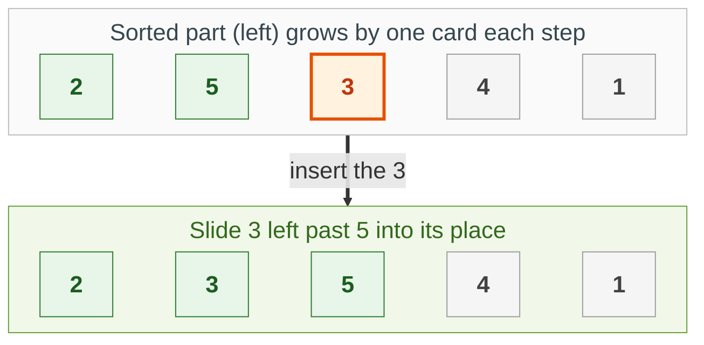
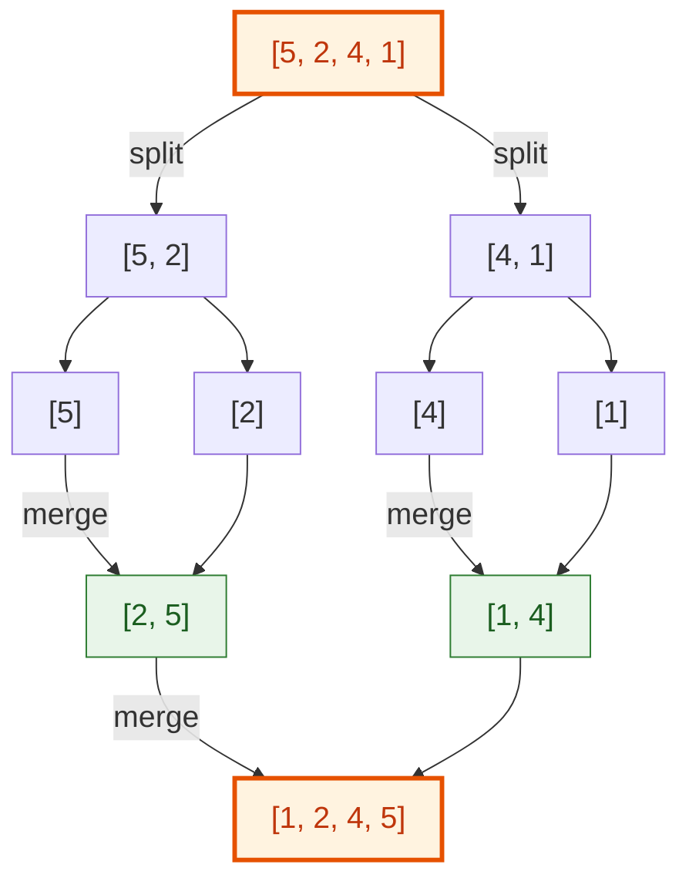
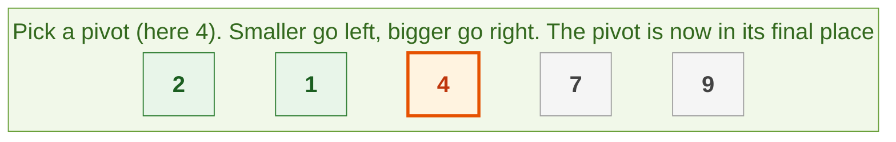

{: .no_toc}
# Sorting Algorithms

- TOC
{:toc}

In an interview you rarely write a sort from scratch, but you are expected to know how each one **thinks** and what it costs.

| Sort | Time | Extra memory | Remember it as |
|---|---|---|---|
| Insertion | O(n²), O(n) if nearly sorted | O(1) | Sorting a hand of cards |
| Merge | O(n log n) always | O(n) | Split in half, sort, merge |
| Quick | O(n log n) average, O(n²) worst | O(log n) | Pick a pivot, smaller left, bigger right |
| Heap | O(n log n) always | O(1) | Repeatedly pull out the biggest |
| Radix | O(n · bits) | O(n) | Sort by one digit or bit at a time |

**Key intuition 1:** Anything that compares items cannot beat O(n log n). Faster sorts (radix, counting) avoid comparing by using the structure of the numbers.

**Key intuition 2:** Use the built-in `sorted()` in real code (Timsort, O(n log n), stable). All the problems below use the same question (Maximum Gap) so you can compare the sorts side by side.

### [Insertion Sort](https://leetcode.com/problems/maximum-gap/)

> Sort an array of integers, and find the maximum gap between any two neighbours in the sorted array.



**Key intuition 1:** Sort like a hand of cards: keep the left part sorted, take the next card, and slide it left past every bigger card until it fits.

**Key intuition 2:** Slow in general (O(n²)) but excellent when the array is already nearly sorted, because then each card moves only a step or two. That is why it appears in the K-messed array problem.

<details><summary markdown="span">Execute!</summary>

```python
class SolutionInsertion:
    def maximumGap(self, nums: List[int]) -> int:
        if len(nums) < 2:
            return 0

        nums = self.insertionSort(nums)

        res = 0
        for i in range(1, len(nums)):
            res = max(nums[i] - nums[i - 1], res)
        return res

    def insertionSort(self, nums: List[int]) -> List[int]:
        for i in range(1, len(nums)):
            # the next card to place into the sorted part nums[:i]
            current = nums[i]
            j = i - 1
            while j >= 0 and nums[j] > current:
                # shift bigger cards one slot to the right
                nums[j + 1] = nums[j]
                j -= 1
            # drop the card into the gap
            nums[j + 1] = current
        return nums
```

</details>
<BR>

### [Merge Sort](https://leetcode.com/problems/maximum-gap/)

> Sort an array of integers, and find the maximum gap between any two neighbours in the sorted array.



**Key intuition 1:** Split the array in half, sort each half, and merge the two sorted halves. Merging two sorted lists is easy: repeatedly take the smaller front item (the same move as Merge Two Sorted Lists).

**Key intuition 2:** Always O(n log n), because there are log n levels of splitting and each level does O(n) merging work. It needs O(n) extra memory.

<details><summary markdown="span">Execute!</summary>

```python
class SolutionMerge:
    def maximumGap(self, nums: List[int]) -> int:
        if len(nums) < 2:
            return 0

        nums = self.mergeSort(nums)

        res = 0
        for i in range(1, len(nums)):
            res = max(nums[i] - nums[i - 1], res)
        return res

    def mergeSort(self, nums: List[int]) -> List[int]:
        if len(nums) <= 1:
            # 0 or 1 items are already sorted
            return nums
        mid = len(nums) // 2
        # sort each half...
        left = self.mergeSort(nums[:mid])
        right = self.mergeSort(nums[mid:])
        # ...then merge the two sorted halves
        return self.merge(left, right)

    def merge(self, left: List[int], right: List[int]) -> List[int]:
        merged = []
        i = 0
        j = i
        while i < len(left) and j < len(right):
            # <= keeps equal items in their original order (a stable sort)
            if left[i] <= right[j]:
                merged.append(left[i])
                i += 1
            else:
                merged.append(right[j])
                j += 1
        # one side ran out: the rest of the other side is already in order
        merged += left[i:]
        merged += right[j:]
        return merged
```

</details>
<BR>

### [Quick Sort](https://leetcode.com/problems/maximum-gap/)

> Sort an array of integers, and find the maximum gap between any two in the sorted array.



**Key intuition 1:** Pick a pivot, put everything smaller on its left and everything bigger on its right. The pivot is now exactly where it belongs; sort each side the same way.

**Key intuition 2:** Average O(n log n). If the pivot is always the smallest or largest (an already-sorted array and a first-item pivot) it degrades to O(n²), so real implementations pick a random or middle pivot. This version builds new lists, which is simple but uses extra memory.

<details><summary markdown="span">Execute!</summary>

```python
class Solution:

    def maximumGap(self, num):
        if len(num) < 2:
            return 0

        num = self.qsort(num)

        res = 0
        for i in range(1, len(num)):
            res = max(num[i] - num[i - 1], res)
        return res

    def qsort(self, L):
        if L == []:
            return []

        P = L[0]
        R = L[1:]

        return self.qsort([x for x in R if x< P])+ [P] + self.qsort([x for x in R if x>=P])
```

</details>
<BR>

### [Heap Sort](https://leetcode.com/problems/maximum-gap/)

> Sort an array of integers, and find the maximum gap between any two in the sorted array.

**Key intuition 1:** A max-heap keeps the biggest item at the root. Swap the root with the last unsorted item, shrink the heap by one, and sink the new root back into place. Repeat.

**Key intuition 2:** O(n log n) and no extra memory, but not stable. See the [Heaps](Heap.html) page for how a heap works.

<details><summary markdown="span">Execute! See better explanation [here](https://thelicato.medium.com/sorting-algorithms-in-python-heapsort-ad31323fce18)</summary>

```python
class Solution:
    def maximumGap(self, nums: List[int]) -> int:
        def max_heapify(array, n, i):
            # Left(i)
            l = (2*i)+1
            # Right(i)
            r = (2*i)+2
            largest=i
            if l < n and array[l] > array[largest]:
                largest = l
            if r < n and array[r] > array[largest]:
                largest = r
            if largest != i:
                tmp = array[i]
                array[i] = array[largest]
                array[largest] = tmp
                max_heapify(array, n, largest)

        def build_max_heap(array):
            n = len(array)
            for i in range((len(array)//2 + 1), -1, -1):
                max_heapify(array, n, i)

        def heapsort(array):
            build_max_heap(array)
            n = len(array)
            for i in range(n-1, 0, -1):
                tmp = array[0]
                array[0] = array[i]
                array[i] = tmp
                max_heapify(array, i, 0)

            return array

        if len(nums) < 2:
            return 0

        nums = heapsort(nums)
        res = 0
        for i in range(1, len(nums)):
            res = max(nums[i] - nums[i - 1], res)
        return res
```

</details>
<BR>

### [Radix Sort](https://leetcode.com/problems/maximum-gap/)

> Sort an array of integers, and find the maximum gap between any two in the sorted array.

**Key intuition 1:** Do not compare numbers at all. Sort by the lowest bit (a stable split into zeros then ones), then by the next bit, and so on up to the highest. Each pass is O(n).

**Key intuition 2:** Stable passes are the whole trick: sorting by a higher bit must not undo the order from the lower bits. This version assumes non-negative integers below 2³¹.

<details><summary markdown="span">Execute!</summary>

```python
class Solution:

    def maximumGap(self, num):
        if len(num) < 2:
            return 0

        num = self.radixSort(num)

        res = 0
        for i in range(1, len(num)):
            res = max(num[i] - num[i - 1], res)
        return res

    def radixSort(self, num):
        for i in range(31):
            onebucket = []
            zerobucket = []
            needle = 1 << i
            for j in range(len(num)):
                if num[j] & needle != 0:
                    onebucket.append(num[j])
                else:
                    zerobucket.append(num[j])
            num = []
            num += zerobucket
            num += onebucket
        return num
```

</details>
<BR>

## Harder: come back to these

### [Quick Select - Nth Smallest / Median / Percentile](https://leetcode.com/problems/kth-largest-element-in-an-array/)

> Original Leetcode Problem: Find the kth largest element in an unsorted array. Note that it is the kth largest element in
the sorted order, not the kth distinct element.
> 
> However we use can this problem to test an alternative solution, leveraging the 
> [Quickselect algorithm](https://en.wikipedia.org/wiki/Quickselect), which zeroes in on the nth smallest element in log(n) time. 

> The same strategy is also very effective in calculating a Median or a Percentile.
 

**Key intuition 1:** To find the k-th smallest you do not need a full sort. Partition around a pivot like Quick Sort, then only recurse into the ONE side that contains position k.

**Key intuition 2:** That halves the work each time on average: O(n) total. The same trick finds a median or a percentile.

<details><summary markdown="span">Execute!</summary>

```python
class Solution:
    def findKthLargest(self, nums: List[int], k: int) -> int:
        def findnsmallset(arr, n):
            P = arr[len(arr)//2]

            smaller = [x for x in arr if x < P]
            equal = [x for x in arr if x == P]
            bigger = [x for x in arr if x > P]

            if n < len(smaller):
                return findnsmallset(smaller,n)
            if n in range(len(smaller), len(smaller)+len(equal)):
                return P

            return findnsmallset(bigger,n-(len(smaller)+len(equal)))

        if len(nums)==1:
            return nums[0]
        if len(nums)==0:
            return -1

        return findnsmallset(nums,len(nums)-k)
```

```python
        def median(arr):
            m = len(arr)//2
            if len(arr)%2==1: 
                return findnsmallset(arr,m)
            else:
                return (findnsmallset(arr,m) + findnsmallset(arr,m-1))//2
```

</details>
<BR>

### [Kanhar Sort! :)](https://leetcode.com/problems/maximum-gap/)

I like to jokingly call this Kanhar Sort, faster than Merge, Heap and Quick sort.

**Key intuition 1:** Treat each neighbouring pair as an edge from the smaller to the larger value, then topologically sort the graph with a heap (see [Directed Graphs](../Graphs/DirectedGraphs.html)).

**Key intuition 2:** Honest note: it works only when there are no duplicate numbers (equal values break the in-degree counts), and because it uses a heap it costs O(n log n), the same as heap sort.

<details><summary markdown="span">Execute!</summary>

```python
class Solution:
    def maximumGap(self, num):
        if len(num) < 2:
            return 0

        num = self.KanharSort(num)
        print(num)
        res = 0
        for i in range(1, len(num)):
            res = max(num[i] - num[i - 1], res)
        return res

    def KanharSort(self, nums: List[int]) -> int:
        edges = collections.defaultdict(list)
        indeg = {x: 0 for x in nums}

        for a,b, in zip(nums, nums[1:]):
            (a,b) = (a,b) if a <= b else (b,a)
            edges[a].append(b)
            indeg[b]+=1

        res = []
        h = [x for x in indeg if indeg[x] == 0]
        heapq.heapify(h)
        while h:
            curr = heapq.heappop(h)
            res.append(curr)
            for e in edges[curr]:
                indeg[e]-=1
                if indeg[e]==0:
                    heapq.heappush(h, e)
        print(res)
        return res
```
