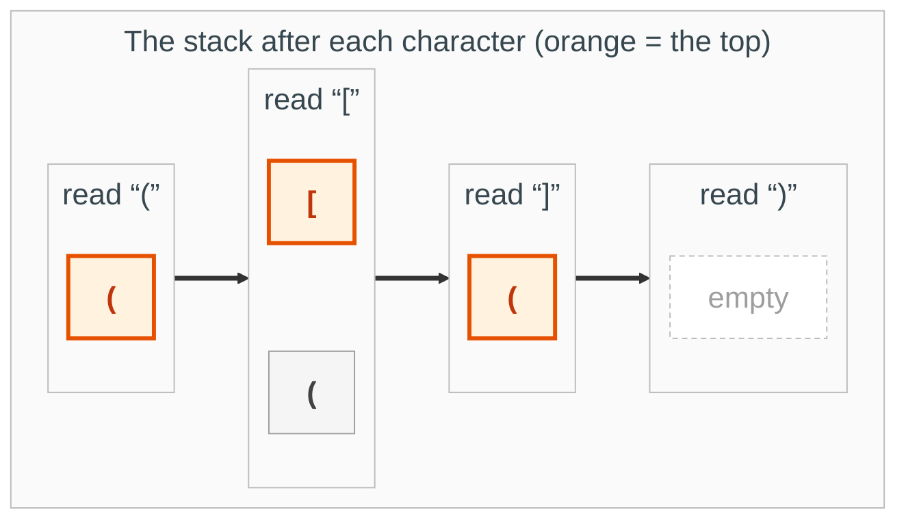
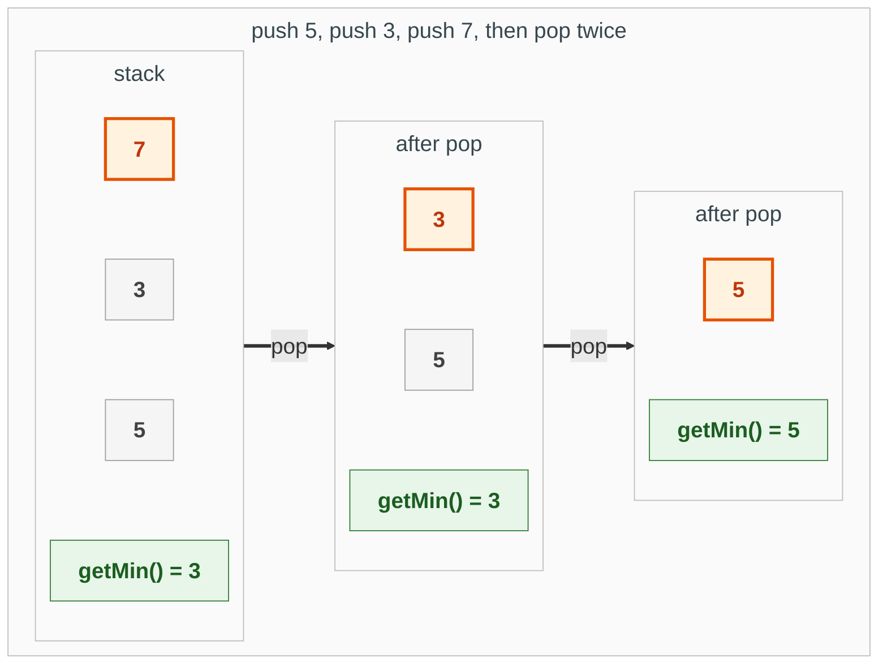
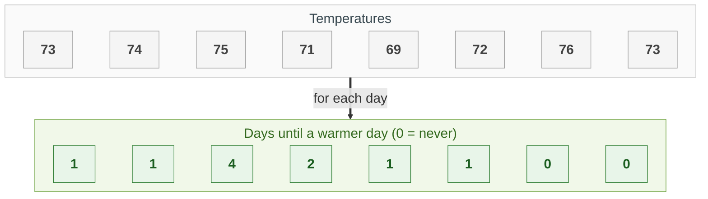
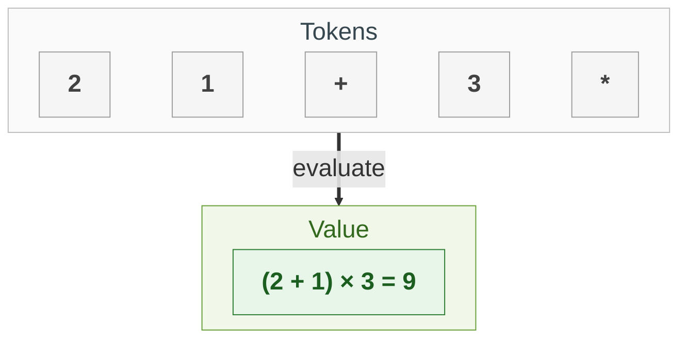
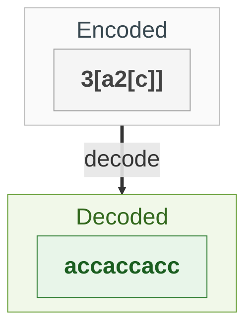
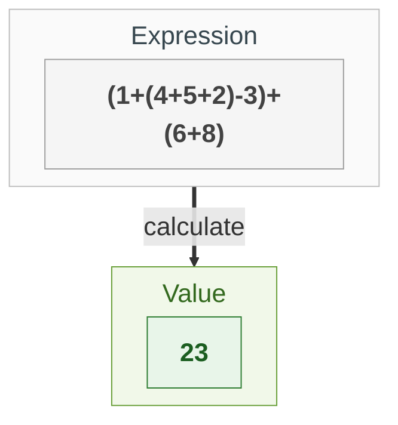

{: .no_toc}
# Stack
Practise here: [Leetcode](https://leetcode.com/list/?selectedList=9duv7mlj)

A stack is last in, first out: the thing you added most recently is the first thing you take off. Reach for one whenever the most recent unfinished thing is the one you need next: brackets that must close in the right order, nested structure, or "which earlier item is waiting for this one?".

- TOC
{:toc}

### [Valid Parentheses](https://leetcode.com/problems/valid-parentheses/)

> Given a string containing just the characters '(', ')', '{', '}', '[' and ']', determine if the input string is valid.



**Key intuition 1:** The most recently opened bracket must be the first one closed. Last in, first out is exactly what a stack does.

**Key intuition 2:** On a closing bracket, the top of the stack must be its matching opener. At the very end the stack must be empty, or something was never closed.

<details><summary markdown="span">Execute!</summary>

```python
class Solution(object):
    def isValid(self, s):
        d = dict(zip("([{",")]}" ) )
        stk = []
        for b in s:
            if b in d.keys():
                stk.append(b)
            elif b in d.values():
                if stk == [] or b != d[stk.pop()]:
                    return False

        return len(stk)==0
```

</details>
<BR>

### [Min Stack](https://leetcode.com/problems/min-stack/)

> Design a stack that supports push, pop, top, and retrieving the minimum element, each in constant time.



**Key intuition 1:** Each element only needs to know the smallest value at or beneath it, and that never changes while the element is on the stack.

**Key intuition 2:** So store a pair (value, smallest so far). Popping an element automatically brings back the previous minimum, with no searching.

<details><summary markdown="span">Execute!</summary>

```python
class MinStack:
    def __init__(self):
        # each entry is (value, smallest value in the stack up to and including it)
        self.stack = []

    def push(self, val: int) -> None:
        smallest = val if not self.stack else min(val, self.stack[-1][1])
        self.stack.append((val, smallest))

    def pop(self) -> None:
        self.stack.pop()

    def top(self) -> int:
        return self.stack[-1][0]

    def getMin(self) -> int:
        return self.stack[-1][1]
```

</details>
<BR>

### [Daily Temperatures](https://leetcode.com/problems/daily-temperatures/)

> For each day, how many days until a warmer temperature? Use 0 if there is none.



**Key intuition 1:** Keep a stack of the days that are still waiting for a warmer day. Their temperatures only ever go down from bottom to top (a monotonic stack).

**Key intuition 2:** When today is warmer than the day on top, that day has found its answer: pop it and record the distance. Repeat while that stays true, then push today.

<details><summary markdown="span">Execute!</summary>

```python
class SolutionTemps:
    def dailyTemperatures(self, temperatures: List[int]) -> List[int]:
        answer = [0] * len(temperatures)
        # days still waiting for a warmer day
        stack = []
        for day, temp in enumerate(temperatures):
            while stack and temperatures[stack[-1]] < temp:
                # today is the warmer day that one was waiting for
                waiting = stack.pop()
                answer[waiting] = day - waiting
            stack.append(day)
        return answer
```

</details>
<BR>

### [Evaluate Reverse Polish Notation](https://leetcode.com/problems/evaluate-reverse-polish-notation/)

> Evaluate an arithmetic expression written in postfix form (the operator comes after its two operands).



**Key intuition 1:** In postfix an operator always applies to the two most recent results, which is exactly what is on top of a stack.

**Key intuition 2:** Pop the right-hand operand first, then the left. The order matters for subtraction and division, and division truncates toward zero.

<details><summary markdown="span">Execute!</summary>

```python
class SolutionRPN:
    def evalRPN(self, tokens: List[str]) -> int:
        stack = []
        for token in tokens:
            if token in ("+", "-", "*", "/"):
                # b was pushed last, so it is the right-hand side
                b = stack.pop()
                a = stack.pop()
                if token == "+":
                    stack.append(a + b)
                elif token == "-":
                    stack.append(a - b)
                elif token == "*":
                    stack.append(a * b)
                else:
                    # division truncates toward zero
                    stack.append(int(a / b))
            else:
                stack.append(int(token))
        return stack[0]
```

</details>
<BR>

### [Decode String](https://leetcode.com/problems/decode-string/)

> Given an encoded string such as 3[a2[c]], return its decoded string.
> See also [Regex.html#decode-string](../Misc/Regex.md#decode-string)



**Key intuition 1:** A '[' starts a smaller version of the same problem inside it. When it ends you must return to the outer one exactly as you left it, so save what you had on a stack.

**Key intuition 2:** On '[' push (the repeat count, the text built so far). On ']' pop them and set text = saved text + count × current text.

<details><summary markdown="span">Execute!</summary>

```python
class SolutionDecode:
    def decodeString(self, s: str) -> str:

        stk = []
        curr_num = 0
        curr_str = ''

        for i in s:
            if i.isdigit():
                curr_num = curr_num*10 + int(i)

            elif i.isalpha():
                curr_str += i

            elif i == '[':
                stk.append((curr_num, curr_str))
                curr_num = 0
                curr_str = ''

            elif i == ']':
                prev_num, prev_str = stk.pop()
                curr_str = prev_str + prev_num*curr_str

        return curr_str
```

DFS Approach (implicit Stack)

```python
class SolutionDecodeDFS:
    def decodeString(self, s):
        def dfs(s):
            nonlocal i
            r = []

            while i < len(s):
                if s[i] == ']':
                    i +=1
                    return ''.join(r)

                if s[i] == '[':
                    i += 1
                    sub = dfs(s)
                    r.append(sub * n)

                elif s[i].isdigit():
                    n = 0
                    while i < len(s) and s[i].isdigit():
                        n = n * 10 + int(s[i])
                        i += 1

                else:
                    r.append(s[i]);
                    i += 1

            return ''.join(r)
        i = 0
        return dfs(list(s))
```

</details>
<BR>

## Harder: come back to these

### [Basic Calculator](https://leetcode.com/problems/basic-calculator/)

> Evaluate an expression with numbers, + - * / and parentheses.
> See [LC: Python-Basic-Calculator-I-II-III-easy-solution-detailed-explanation](https://leetcode.com/problems/basic-calculator/discuss/1456850/Python-Basic-Calculator-I-II-III-easy-solution-detailed-explanation)



**Key intuition 1:** A '(' starts a fresh sub-problem, so save your running state when you meet it (here the recursion does that) and combine the result when you meet ')'.

**Key intuition 2:** Handle * and / right away by combining with the number on top of the stack. Push + and - numbers with their sign, and add everything up at the end.

<details><summary markdown="span">Execute!</summary>

```python
class SolutionCalc:
    def calculate(self, s):
        def update(op, v):
            if op == "+":
                stack.append(v)
            if op == "-":
                stack.append(-v)
            #for BC II and BC III
            if op == "*":
                stack.append(stack.pop() * v)
            #for BC II and BC III
            if op == "/":
                stack.append(int(stack.pop() / v))

        it = 0
        num = 0
        stack = []
        sign = "+"

        while it < len(s):
            if s[it].isdigit():
                num = num * 10 + int(s[it])
            elif s[it] in "+-*/":
                update(sign, num)
                num = 0
                sign = s[it]
            # For BC I and BC III
            elif s[it] == "(":
                num, j = self.calculate(s[it + 1:])
                it = it + j
            # For BC I and BC III
            elif s[it] == ")":
                update(sign, num)
                return sum(stack), it + 1
            it += 1
        update(sign, num)
        return sum(stack)
```

</details>
<BR>

