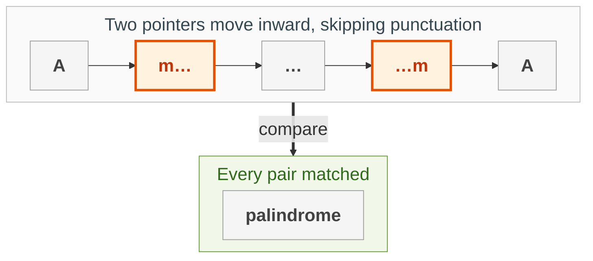
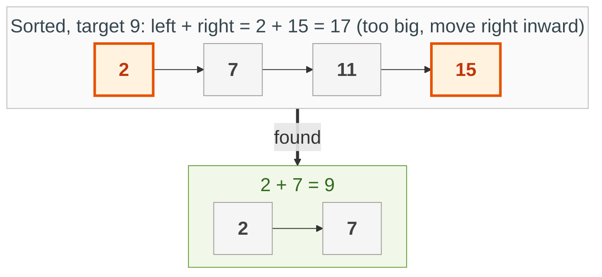
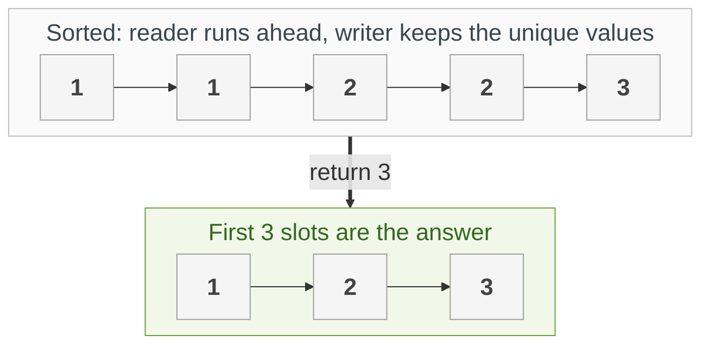
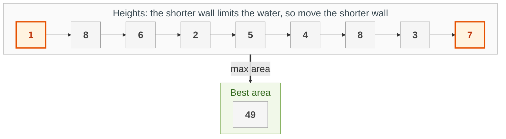
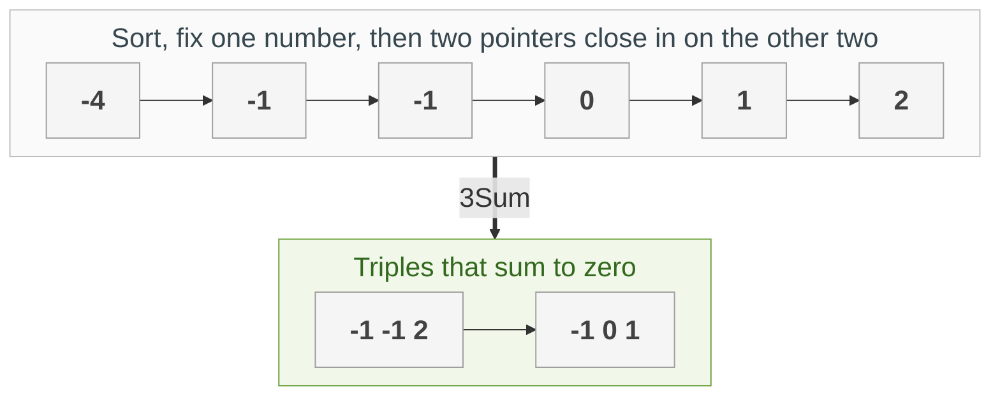

{: .no_toc}
# Two Pointers
Practise here: [Leetcode](https://leetcode.com/tag/two-pointers/)

Use two indexes instead of one nested loop. Put them at the two ends and move them inward, or have one run ahead of the other. It works when moving a pointer lets you safely rule something out, which is usually because the data is sorted or symmetric. It turns O(n²) into O(n).

Related: sliding windows (a pair of pointers that expands and shrinks) and fast/slow pointers on Linked Lists.

- TOC
{:toc}

### [Valid Palindrome](https://leetcode.com/problems/valid-palindrome/)

> Ignoring case and non-alphanumeric characters, is the string a palindrome?



**Key intuition 1:** A palindrome matches from the outside in, so compare the first and last characters and move both inward.

**Key intuition 2:** Skip characters that do not count, but keep left < right in every inner loop so the pointers never cross.

<details><summary markdown="span">Execute!</summary>

```python
class SolutionPal:
    def isPalindrome(self, s: str) -> bool:
        left = 0
        right = len(s) - 1
        while left < right:
            # skip anything that is not a letter or digit
            while left < right and not s[left].isalnum():
                left += 1
            while left < right and not s[right].isalnum():
                right -= 1
            if s[left].lower() != s[right].lower():
                return False
            left = left + 1
            right = right - 1
        return True
```

</details>
<BR>

### [Two Sum II - Input Array Is Sorted](https://leetcode.com/problems/two-sum-ii-input-array-is-sorted/)

> Find two numbers in a sorted array that add up to the target. Return their 1-based positions.



**Key intuition 1:** Sorted means the sum has a direction. If the total is too small, only a bigger left number can fix it; if too big, only a smaller right number can.

**Key intuition 2:** So every step throws away one candidate for good, and the two pointers meet after at most n steps.

<details><summary markdown="span">Execute!</summary>

```python
class SolutionTwoSum2:
    def twoSum(self, numbers: List[int], target: int) -> List[int]:
        left = 0
        right = len(numbers) - 1
        while left < right:
            total = numbers[left] + numbers[right]
            if total == target:
                # the problem numbers positions from 1
                return [left + 1, right + 1]
            if total < target:
                # too small: only a bigger left number can help
                left += 1
            else:
                # too big: only a smaller right number can help
                right -= 1
```

</details>
<BR>

### [Remove Duplicates from Sorted Array](https://leetcode.com/problems/remove-duplicates-from-sorted-array/)

> Remove duplicates in place and return the new length.



**Key intuition 1:** One pointer reads every element; the other marks where the next unique value goes. The array is rewritten behind the reader.

**Key intuition 2:** Because it is sorted, a value is new exactly when it differs from the last one written.

<details><summary markdown="span">Execute!</summary>

```python
class SolutionDedup:
    def removeDuplicates(self, nums: List[int]) -> int:
        # nums[:write] is the answer built so far
        write = 0
        for read in range(len(nums)):
            if write == 0 or nums[read] != nums[write - 1]:
                nums[write] = nums[read]
                write += 1
        return write
```

</details>
<BR>

### [Container With Most Water](https://leetcode.com/problems/container-with-most-water/)

> Given wall heights, pick two walls that hold the most water.



**Key intuition 1:** Start with the widest container. The water level is set by the shorter wall, so moving the TALLER wall inward can only make things worse (narrower, same limit).

**Key intuition 2:** So always move the shorter wall, hoping for a taller one.

<details><summary markdown="span">Execute!</summary>

```python
class SolutionWater:
    def maxArea(self, height: List[int]) -> int:
        left = 0
        right = len(height) - 1
        best = 0
        while left < right:
            best = max(best, (right - left) * min(height[left], height[right]))
            if height[left] < height[right]:
                # the shorter wall limits the water: try a taller one
                left += 1
            else:
                right -= 1
        return best
```

</details>
<BR>

## Harder: come back to these

### [3Sum](https://leetcode.com/problems/3sum/)

> Find all unique triplets that add up to zero.



**Key intuition 1:** Sort, then fix the first number. What is left is Two Sum II on the rest: two pointers close in on the pair that completes it.

**Key intuition 2:** Skip repeated values (for the first number and for the second) so each triplet is listed once.

<details><summary markdown="span">Execute!</summary>

```python
class SolutionThreeSum:
    def threeSum(self, nums: List[int]) -> List[List[int]]:
        nums.sort()
        result = []
        for i in range(len(nums) - 2):
            if i > 0 and nums[i] == nums[i - 1]:
                # same first number as last time: skip duplicates
                continue
            left = i + 1
            right = len(nums) - 1
            while left < right:
                total = nums[i] + nums[left] + nums[right]
                if total < 0:
                    left += 1
                elif total > 0:
                    right -= 1
                else:
                    result.append([nums[i], nums[left], nums[right]])
                    left += 1
                    while left < right and nums[left] == nums[left - 1]:
                        # skip duplicate second numbers
                        left += 1
        return result
```

</details>
<BR>

