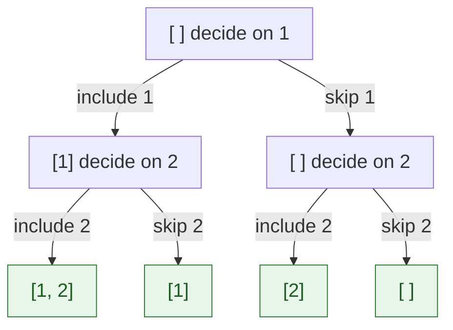
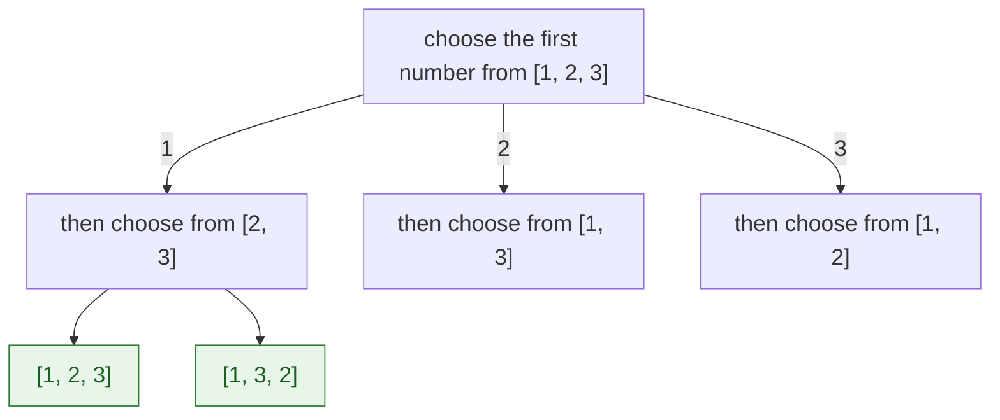
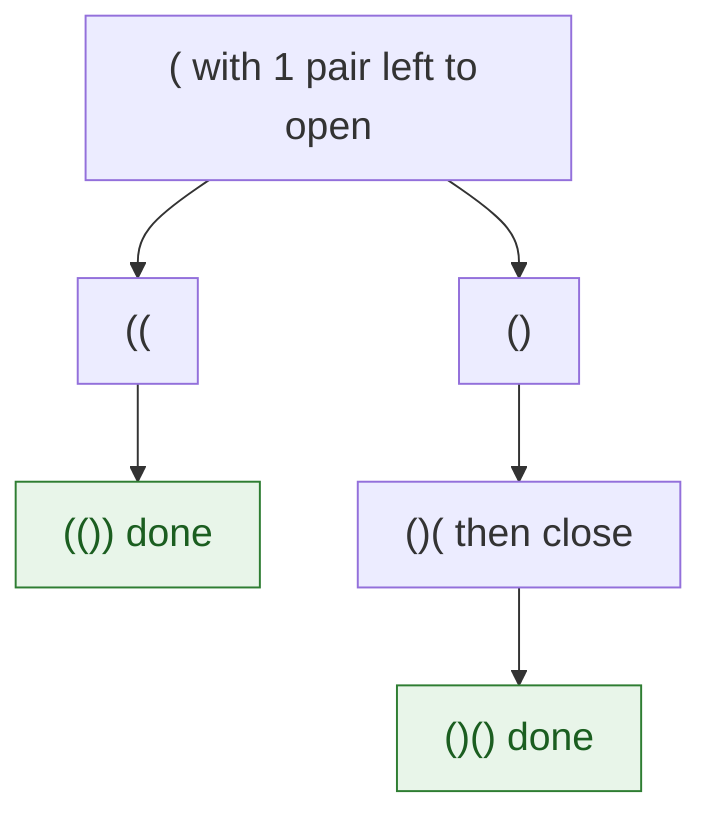

{: .no_toc}
# Backtracking

Backtracking (a specific form of Depth-First Search), used to explore a Decision Tree where each level of the tree represents a choice.

In every problem here we build a solution one piece at a time. At each step, we ask: "What are my valid options right now?"

* Subsets: At each number, do I Include it or Exclude it?
* Permutations: Which of the remaining numbers should I swap into the current position?
* Generate Parentheses: Can I add an '('? Can I add a ')'?
* Phone Digits: Which letter from the current digit's mapping should I pick?

- TOC
{:toc}

**Key intuition 1:** Picture a tree of decisions. Each level asks one question (take this number or not? which letter next?). Walking the tree depth-first and **undoing** each choice on the way back (that undo is the "backtrack") visits every possibility once.

**Key intuition 2:** Every backtracking solution has the same three parts: a **base case** (when to record an answer), the **choices** at this step, and a **recursive call** for each choice. Pruning (stop early when a path cannot work) is what makes it fast enough.

Also see: Subarray Product Less Than K is solved properly with a [Sliding Window](../Arrays/SlidingWindow.html#subarray-product-less-than-k), "Best time to buy and sell with cooldown" is on [Dynamic Programming](../Arrays/DynamicProgramming.html), and Minimum Knight Moves is on [Graphs: BFS and DFS](GraphBasics.html).

### [Subsets](https://leetcode.com/problems/subsets/)

>> Inp: [1,2,3]
>> Out: [[],[1],[2],[1,2],[3],[1,3],[2,3],[1,2,3]]



**Key intuition 1:** For each number there are exactly two choices: put it in the subset or leave it out. With n numbers that is 2ⁿ subsets, one per leaf of the tree.

**Key intuition 2:** Pass a NEW list down (`tmp + [x]`) instead of editing one list, and no undo step is needed.

<details><summary markdown="span">Execute!</summary>

```python
class Solution:
    def subsets(self, nums: List[int]) -> List[List[int]]:
        def solve(tmp, i):
            # Base Case: When we've looked at every number in nums
            if i == len(nums):
                res.append(tmp)
                return

            # Key Intuition: [1] subsets [] (don't include) and [1] (include). Solution Mirrors this structure

            # Include nums[i]
            solve(tmp + [nums[i]], i + 1)

            # Exclude nums[i]
            solve(tmp, i + 1)

        res = []
        solve([], 0)
        return res
```

</details>
<BR>

### [Combinations](https://leetcode.com/problems/combinations/description/)

**Key intuition 1:** It is Subsets with a goal: stop as soon as the list has k numbers, and skip numbers that can no longer fit.

**Key intuition 2:** Always move forward (i + 1) so you never produce the same group in a different order.

<details><summary markdown="span">Execute!</summary>

To transition from Subsets to Combinations (specifically "Combinations of size $k$"), the logic remains almost identical to your "Include/Exclude" pattern.The main difference is the stopping condition: instead of waiting until you've looked at every number, you stop as soon as your tmp list reaches the required size $k$.

```python
class Solution:
    def combine(self, n: int, k: int) -> List[List[int]]:
        res = []

        def solve(tmp, i):
            # Base Case 1: If we found a combination of size k, save it
            if len(tmp) == k:
                # Use a copy to avoid reference issues
                res.append(tmp[:])
                return

            # Base Case 2: If we ran out of numbers to pick from
            if i > n:
                return

            # Include i
            solve(tmp + [i], i + 1)

            # Exclude i
            solve(tmp, i + 1)

        solve([], 1)
        return res
```

</details>
<BR>

### [Permutations](https://leetcode.com/problems/permutations/description/)



**Key intuition 1:** A permutation is an ordering, so at each position try every number that is still unused. Swapping the chosen number into the current position is a neat way to track what is used.

**Key intuition 2:** The swap back after the recursive call is the backtrack: it restores the list for the next choice.

<details><summary markdown="span">Execute!</summary>

```python
class Solution:
    def permute(self, nums: List[int]) -> List[List[int]]:
        def backtrack(start):
            # Base Case: If the start index reaches the end, we've formed a permutation
            if start == len(nums):
                # Append a copy of the current state
                res.append(nums[:])
                return

            for i in range(start, len(nums)):
                # 1. "Include" nums[i] at the current 'start' position by swapping
                tmp = nums[start]
                nums[start] = nums[i]
                nums[i] = tmp

                # 2. Recurse for the next position
                backtrack(start + 1)

                # 3. "Exclude" (Backtrack): Swap back to restore the original order
                tmp = nums[start]
                nums[start] = nums[i]
                nums[i] = tmp
        res = []
        backtrack(0)
        return res
```

</details>
<BR>

### [Generate Parentheses](https://leetcode.com/problems/generate-parentheses/)

> Given n pairs of parentheses, write a function to generate all combinations of well-formed parentheses.



**Key intuition 1:** Two simple rules keep every string valid: you may add '(' while you have some left, and add ')' only when it would not close more than you opened.

**Key intuition 2:** Because the rules prevent invalid strings, you never build one and throw it away.

<details><summary markdown="span">Execute!</summary>

```python
class Solution:
    def generateParenthesis(self, n: int) -> List[str]:
        def solve(tmp, open, closed):
            if len(tmp) == 2 * n:
                res.append(tmp)
                return

            if open<n:
                solve(tmp + "(", open+1, closed)
            if closed<open:
                solve(tmp + ")", open, closed+1)
                # N.B: No pop needed because implicitly tmp is immutable and the pop is implicit
        res = []
        solve("", 0, 0)
        return res
```

</details>
<BR>

### [Letter Combinations of a Phone Number](https://leetcode.com/problems/letter-combinations-of-a-phone-number/)

> Given a string containing digits from 2-9 inclusive, return all possible letter
combinations that the number could represent.

**Key intuition 1:** Each digit is one level of the tree, and each letter on that digit is a branch. The depth of the tree is the number of digits.

**Key intuition 2:** Base case: you have picked a letter for every digit, so record the string.

<details><summary markdown="span">Execute!</summary>

```python
class Solution:
    def letterCombinations(self, digits: str) -> List[str]:
        if not digits:
            return []

        mapping = {'1': '', '2': "abc", '3': "def", '4': "ghi", '5': "jkl", '6': "mno", '7': "pqrs", '8': "tuv", '9': 'wxyz' }
        res = []

        def solve(tmp, i):
            # Base Case: When we've picked a letter for every digit
            if i == len(digits):
                res.append(tmp)
                return

            # Identify the letters for the current digit (e.g., '2' -> "abc")
            letters = mapping[digits[i]]

            # Decision: Try every possible letter for this digit
            for char in letters:
                # tmp + char creates a NEW string, so no pop is needed
                solve(tmp + char, i + 1)

        solve("", 0)
        return res
```
</details>
<BR>

### [Word Search](https://leetcode.com/problems/word-search/description/)

> Given an m x n grid of characters board and a string word, return true if word exists in the grid.

The word can be constructed from letters of sequentially adjacent cells, where adjacent cells are horizontally or vertically neighboring. The same letter cell may not be used more than once.

**Key intuition 1:** Try starting at every cell. From a cell, try the 4 neighbours that match the next letter.

**Key intuition 2:** Mark the current cell as used before exploring and restore it afterwards: the restore is the backtrack, and it lets other paths reuse the cell.

<details><summary markdown="span">Execute!</summary>

```python
class Solution:
    def exist(self, board: List[List[str]], word: str) -> bool:
        def backtrack(r, c, index):
            # Base Case: All characters matched
            if index == len(word):
                return True

            # Failure Cases: Out of bounds, wrong character, or already visited
            if (r < 0 or c < 0 or
                r >= ROWS or c >= COLS or
                board[r][c] != word[index]):
                return False

            # Step 1: Mark as visited (Backtracking Setup)
            temp = board[r][c]
            board[r][c] = "#"

            # Step 2: Explore neighbors
            # result will be True if any direction finds the rest of the word
            found = (backtrack(r + 1, c, index + 1) or
                     backtrack(r - 1, c, index + 1) or
                     backtrack(r, c + 1, index + 1) or
                     backtrack(r, c - 1, index + 1))

            # Step 3: Backtrack (Restore the cell)
            board[r][c] = temp

            return found

        ROWS = len(board)
        COLS = len(board[0])
        # Try starting the word from every single cell
        for r in range(ROWS):
            for c in range(COLS):
                if backtrack(r, c, 0):
                    return True

        return False
```

</details>
<BR>

## Harder: come back to these

### [Subsequences that sum to Target](https://leetcode.com/problems/combination-sum/)

> Subsequences of numbers that sum to target

**Key intuition 1:** Subtract each chosen number from the target. When the remainder is 0 you found a combination; when it goes negative, stop that branch (pruning).

**Key intuition 2:** The same number may be reused, so recurse with the same index `i`; going forward only (never back) avoids duplicates in a different order.

<details><summary markdown="span">Execute!</summary>

```python
class Solution(object):
    def combinationSum(self, candidates, target):
        def solve(remain, idx, path):
            if remain == 0:
                res.append(list(path))
                return

            if remain < 0:
                return

            for i in range(idx, len(candidates)):
                solve(remain - candidates[i], i, path + [candidates[i]])

        res = []
        # Sort to allow for potential pruning (optimization)
        candidates.sort()
        solve(target, 0, [])
        return res
```

</details>
<BR>

### [Subsequences of size 3 that sum to target](https://leetcode.com/problems/3sum/)

Given an integer array nums, return all the triplets [nums[i], nums[j], nums[k]]
such that i != j, i != k, and j != k, and nums[i] + nums[j] + nums[k] == 0.

Notice that the solution set must not contain duplicate triplets.

**Key intuition 1:** The plain version tries every group of 3 and keeps those that sum to 0. It works but it is slow.

**Key intuition 2:** The second version fixes the first number and finds the other two with the two-pointer trick (see [Two Pointers](../Arrays/TwoPointers.html)), which is what you would submit.

<details><summary markdown="span">Execute!</summary>

Standard backtracking
```python
class Solution:
    def threeSum(self, nums: list[int]) -> list[list[int]]:
        def solve(idx, accum):
            if len(accum) == 3:
                if sum(accum) == 0:
                    res.add(tuple(accum))
                return

            for i in range(idx, len(nums)):
                solve(i + 1, accum + [nums[i]])

        # Sorting helps handle duplicates and optimization
        nums.sort()
        res = set()
        solve(0, [])
        return [list(t) for t in res]
```

Backtracking with 2sum optimization

```python
class Solution:
    def threeSum(self, nums: List[int]) -> List[List[int]]:
        def twoSum(arr, target_val):
            left = 0
            right = len(arr) - 1
            curr = []
            while left < right:
                total = arr[left] + arr[right]
                if total > target_val:
                    right -= 1
                elif total < target_val:
                    left += 1
                else:
                    curr.append([arr[left], arr[right]])
                    left += 1
                    right -= 1
            return curr

        def solve():
            for i, n in enumerate(nums):
                for t in twoSum(nums[i + 1:], target - n):
                    res.append([n] + t)

        nums.sort()
        res = []
        target = 0

        solve()

        return [list(x) for x in set([tuple(sorted(x)) for x in res])]
```

</details>
<BR>
