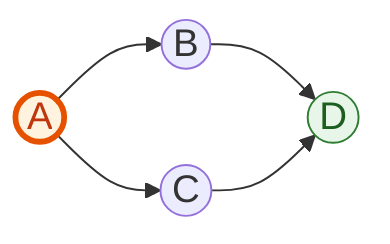
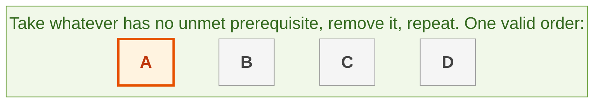
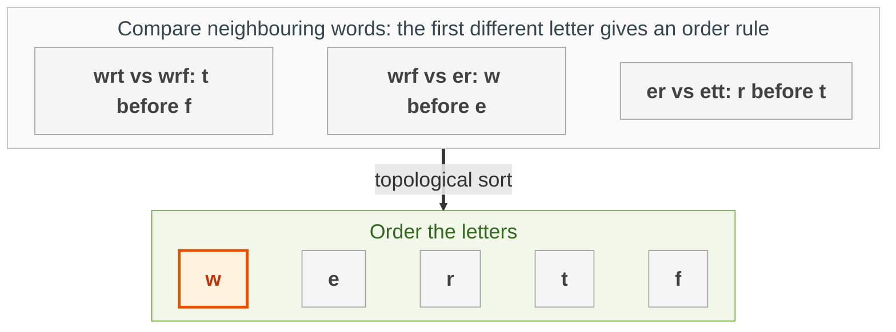

{: .no_toc}
# Directed Graphs


- TOC
{:toc}

In a directed graph an edge goes one way, like "course A must come before course B". The big idea here is **topological sort**: putting nodes in an order where every edge points forwards.

**Key intuition 1:** A node with no incoming edges has nothing it must wait for, so it can go first. Remove it, and some other node will now have no incoming edges. Repeat. If you get stuck before placing everything, there is a cycle and no valid order exists.

**Key intuition 2:** Count each node's incoming edges (its in-degree) so "does anything still block this node?" is a quick check. This is Kahn's algorithm, O(V + E).





### [Course Dependency](https://leetcode.com/problems/course-schedule-ii)

>Given the total number of courses and a list of prerequisite pairs, return the ordering of courses
you should take to finish all courses.
> Time: O(V+E) <BR>
> Space: O(V+E) <BR>

> See also https://leetcode.com/problems/course-schedule/

**Key intuition 1:** Draw an edge for every "take this before that" rule and do the topological sort above. Here the edges are drawn course to prerequisite, so the finished order comes out backwards and is reversed at the end.

**Key intuition 2:** If fewer courses come out than exist, a cycle blocks some of them: return an empty list.

<details><summary markdown="span">Execute!</summary>

Bug fix: this used to return `reversed(res)`, which is an iterator, not a list. `res[::-1]` returns the list that the problem expects.

```python
class Solution:
    def findOrder(self, numCourses: int, prereq: typing.List[typing.List[int]]) -> List[int]:
        nodes = [x for x in range(numCourses)]
        edges = collections.defaultdict(list)
        indeg = {x: 0 for x in nodes}
        for course, dep in prereq:
            edges[course].append(dep)
            indeg[dep] += 1

        q = [x for x in indeg if indeg[x] == 0]
        res = []

        while q:
            curr = q.pop(0)
            res.append(curr)
            for neighbor in edges[curr]:
                indeg[neighbor] -= 1
                if indeg[neighbor] == 0:
                    q.append(neighbor)

        if len(res) == len(nodes):
            return res[::-1]

        return []
```

</details>
<BR>

### [Evaluate Lexicographical Order](https://leetcode.com/problems/alien-dictionary/)
> You are given a list of strings words from the alien language's dictionary, where the strings in words
are sorted lexicographically by the rules of this new language.
> Return a string of the unique letters in the new alien language sorted in lexicographically increasing
order by the new language's rules. If there is no solution, return "". If there are multiple solutions,
return any of them.



**Key intuition 1:** The dictionary order hides rules like "w comes before e". Compare each word with the next and find the FIRST letter where they differ: that pair is one rule. Letters after it tell you nothing.

**Key intuition 2:** Now it is a topological sort of the letters. Watch the trap: a longer word that comes before its own prefix ("abc" before "ab") is impossible, so return "".

<details><summary markdown="span">Execute!</summary>

```text
    Loop like so:
    zip:
    -> "wrt",  "wrf",  "er",   "ett",  "rftt"
    -> "wrf",  "er",   "ett",  "rftt"
    results in:
    --> wrt wrf
    --> wrf er
    --> er ett
    --> ett rftt

    Then zip (wrf er):
        w --> e (w comes before e)
        <Hard Break after first find, since no further inference can be made>
```

```python
class Solution:
    def alienOrder(self, words: List[str]) -> str:
        # Create Graph and check ordering
        edges = collections.defaultdict(set)
        indeg = {x: 0 for word in words for x in word}

        for i in range(len(words) - 1):
            w1 = words[i]
            w2 = words[i + 1]

            orderingFound = False

            for j in range(min(len(w1), len(w2))):
                a = w1[j]
                b = w2[j]
                if a != b:
                    if b not in edges[a]:
                        edges[a].add(b)
                        indeg[b] += 1
                    orderingFound = True
                    break

            if not orderingFound and len(w1) > len(w2):
                return ""

        # Topological Sort Graph (Kahn's Algorithm)
        q = [x for x in indeg if indeg[x] == 0]
        res = []
        while q:
            curr = q.pop()
            res.append(curr)
            for neighbor in edges[curr]:
                indeg[neighbor] -= 1
                if indeg[neighbor] == 0:
                    q.append(neighbor)

        return ''.join(res) if len(res) == len(indeg) else ""
```

</details>
<BR>

### [Kanhar Sort - Sort Integers](https://leetcode.com/problems/maximum-gap/)

I like to jokingly call this Kanhar Sort, faster than Merge, Heap and Quick sort.

A modified version of Kahn's algorithm for sorting integer arrays, without duplicates.

See [Arrays->SortingAlgorithms.html#kanhar-sort-](../Arrays/SortingAlgorithms.md#kanhar-sort-)

### [All Paths Lead to Destination](https://leetcode.com/problems/all-paths-from-source-lead-to-destination/)

> Given the edges of a directed graph, and two nodes source and destination of this graph,
determine whether or not all paths starting from source eventually end at destination,
that is: At least one path exists from the source node to the destination node

**Key intuition 1:** You must prove that EVERY path from the source ends at the destination, so one bad path is enough to fail. That is why the DFS returns False as soon as any branch fails.

**Key intuition 2:** Cycles are bad here (a path that never ends), so track the nodes on the current path and fail if you come back to one.

<details><summary markdown="span">Execute!</summary>

```python
class Solution:
    #What is different here is that the graph may have cycles
    def leadsToDestination(self, n: int, edges: List[List[int]], source: int, dest: int) -> bool:
        def dfs(source, dest, seen = set()):
            #To prevent cycles.
            if source == dest and len(graph[source])==0:
                return True
            if len(graph[source])==0:
                return False

            for curr in graph[source]:
                # It is interesting to note here, that you cannot reverse the direction of this condition as is normal for Graph DFS coz:
                # - You are not just looking for a valid path, i.e. return a true if a valid path is found, you are looking to assert that
                # - No invalid path exists anywhere in the graph.
                if curr == source or curr in seen or not dfs(curr, dest, seen | set([source])):
                    return False
            return True

        graph = collections.defaultdict(set)
        for a, b in edges:
            graph[a].add(b)

        return dfs(source, dest)
```

</details>
<BR>
