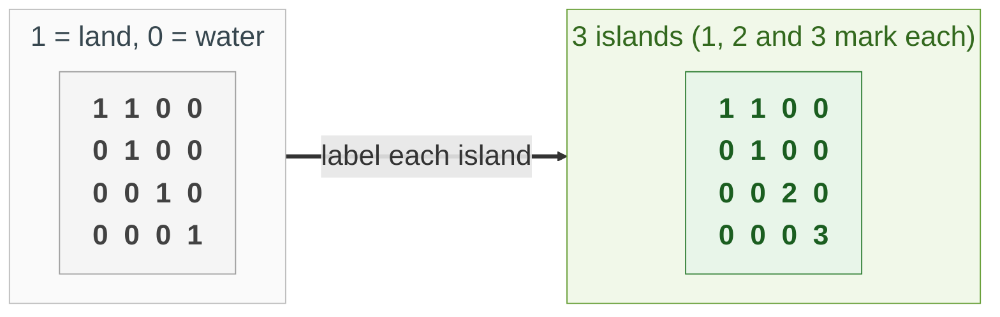
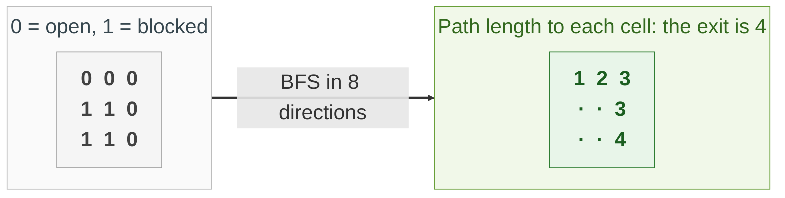
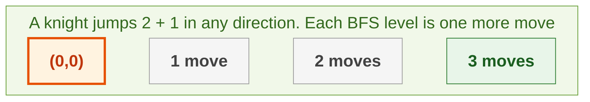
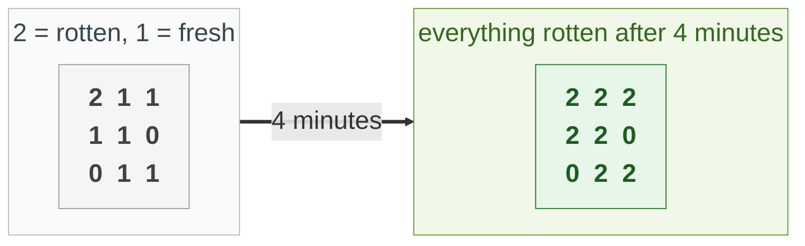
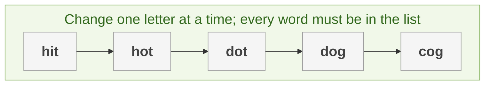

{: .no_toc}
# Graphs: BFS and DFS
Practise here: [Leetcode](https://leetcode.com/tag/breadth-first-search/)

A graph is things (nodes) joined by connections (edges). Almost every graph problem is one of two walks: **depth-first** (go as deep as you can, then back up) or **breadth-first** (visit everything 1 step away, then 2 steps away...). Grids count too: every cell is a node whose neighbours are the cells next to it.

Next: [Undirected](UndirectedGraphs.html), [Directed](DirectedGraphs.html), [Weighted](UndirectedGraphsWeighted.html) and [Backtracking](DFS.html).

- TOC
{:toc}

**Key intuition 1:** Always remember what you have visited (a set, or mark the grid cell). Without that, any cycle makes the walk run forever.

**Key intuition 2:** DFS (recursion or a stack) is for "is there a path", "how many groups" and exploring everything. BFS (a queue) is for the **shortest path when every step costs the same**, because it reaches the goal by the fewest steps first.

### [Number of Islands](https://leetcode.com/problems/number-of-islands/)

> Given a grid of '1' (land) and '0' (water), count the islands. An island is land connected up, down, left or right.



**Key intuition 1:** Scan the grid. The first time you hit land you have found a new island, so count it, then walk the whole island and turn it into water so it is never counted again.

**Key intuition 2:** "How many separate groups?" is the basic graph question. Every connected-groups problem has this shape.

<details><summary markdown="span">Execute!</summary>

DFS (recursion):

```python
class SolutionIslandsDFS:
    def numIslands(self, grid: List[List[str]]) -> int:
        rows = len(grid)
        cols = len(grid[0])

        def sink(r, c):
            if r < 0 or c < 0 or r >= rows or c >= cols or grid[r][c] != "1":
                # off the map, water, or already visited
                return
            # mark visited by turning land into water
            grid[r][c] = "0"
            sink(r + 1, c)
            sink(r - 1, c)
            sink(r, c + 1)
            sink(r, c - 1)

        count = 0
        for r in range(rows):
            for c in range(cols):
                if grid[r][c] == "1":
                    # a new island: sink all of it so it is never counted twice
                    count += 1
                    sink(r, c)
        return count
```

BFS (queue), same idea:

```python
class SolutionIslandsBFS:
    def numIslands(self, grid: List[List[str]]) -> int:
        rows = len(grid)
        cols = len(grid[0])
        count = 0
        for r in range(rows):
            for c in range(cols):
                if grid[r][c] != "1":
                    continue
                count += 1
                grid[r][c] = "0"
                queue = collections.deque([(r, c)])
                # explore the island with a queue instead of recursion
                while queue:
                    cr, cc = queue.popleft()
                    for nr, nc in ((cr + 1, cc), (cr - 1, cc), (cr, cc + 1), (cr, cc - 1)):
                        if 0 <= nr < rows and 0 <= nc < cols and grid[nr][nc] == "1":
                            # mark when you add to the queue, not when you remove
                            grid[nr][nc] = "0"
                            queue.append((nr, nc))
        return count
```

</details>
<BR>

### [Shortest Path in Binary Matrix](https://leetcode.com/problems/shortest-path-in-binary-matrix/)

> Find the length of the shortest clear path from the top-left to the bottom-right of a grid of 0s (open) and 1s (blocked), moving in 8 directions.



**Key intuition 1:** Every step costs 1, so use BFS: it explores all cells 1 step away, then 2, and so on, and the first time it reaches the goal is the shortest path.

**Key intuition 2:** Mark a cell visited when you put it in the queue, not when you take it out, or the same cell is queued many times.

<details><summary markdown="span">Execute!</summary>

```python
class SolutionBinMatrix:
    def shortestPathBinaryMatrix(self, grid: List[List[int]]) -> int:
        n = len(grid)
        if grid[0][0] or grid[n - 1][n - 1]:
            return -1
        # (row, column, path length so far)
        queue = collections.deque([(0, 0, 1)])
        # visited
        grid[0][0] = 1
        while queue:
            r, c, dist = queue.popleft()
            if (r, c) == (n - 1, n - 1):
                # BFS reaches the goal by the fewest steps first
                return dist
            for dr in (-1, 0, 1):
                for dc in (-1, 0, 1):
                    nr = r + dr
                    nc = c + dc
                    if 0 <= nr < n and 0 <= nc < n and grid[nr][nc] == 0:
                        grid[nr][nc] = 1
                        queue.append((nr, nc, dist + 1))
        return -1
```

</details>
<BR>

### [Minimum Knight Moves](https://leetcode.com/problems/minimum-knight-moves/)

> A knight starts at (0, 0) on an infinite board. Return the fewest moves to reach (x, y).



**Key intuition 1:** Each move costs the same, so it is a shortest-path problem: BFS, where the neighbours of a square are the 8 squares a knight can jump to.

**Key intuition 2:** The board is symmetric, so work with abs(x), abs(y). Never let the search wander far away (here no further than 2 behind the origin). Note: the old DFS version of this problem was removed because it gave wrong answers, for example 4 instead of 2 for (1, 1).

<details><summary markdown="span">Execute!</summary>

```python
class SolutionKnight:
    def minKnightMoves(self, x: int, y: int) -> int:
        # the board is symmetric, so only look at one quadrant
        x = abs(x)
        y = abs(y)
        moves = ((1, 2), (2, 1), (-1, 2), (-2, 1), (1, -2), (2, -1), (-1, -2), (-2, -1))
        # (row, column, number of moves)
        queue = collections.deque([(0, 0, 0)])
        seen = {(0, 0)}
        while queue:
            r, c, steps = queue.popleft()
            if (r, c) == (x, y):
                return steps
            for dr, dc in moves:
                nr = r + dr
                nc = c + dc
                # a little room behind the origin is enough
                if (nr, nc) not in seen and nr >= -2 and nc >= -2:
                    seen.add((nr, nc))
                    queue.append((nr, nc, steps + 1))
```

</details>
<BR>

## Harder: come back to these

### [Rotting Oranges](https://leetcode.com/problems/rotting-oranges/)

> Each minute, a fresh orange next to a rotten one rots. How many minutes until none are fresh (or -1 if impossible)?



**Key intuition 1:** Start the BFS from ALL the rotten oranges at once (a multi-source BFS). Each level of the queue is exactly one minute.

**Key intuition 2:** Count the fresh oranges at the start. If any are left when the queue is empty, they can never be reached: return -1.

<details><summary markdown="span">Execute!</summary>

```python
class SolutionOranges:
    def orangesRotting(self, grid: List[List[int]]) -> int:
        rows = len(grid)
        cols = len(grid[0])
        queue = collections.deque()
        fresh = 0
        for r in range(rows):
            for c in range(cols):
                if grid[r][c] == 2:
                    # start from ALL rotten oranges at once
                    queue.append((r, c))
                elif grid[r][c] == 1:
                    fresh += 1
        minutes = 0
        while queue and fresh:
            # one full level of the BFS = one minute
            for _ in range(len(queue)):
                r, c = queue.popleft()
                for nr, nc in ((r + 1, c), (r - 1, c), (r, c + 1), (r, c - 1)):
                    if 0 <= nr < rows and 0 <= nc < cols and grid[nr][nc] == 1:
                        grid[nr][nc] = 2
                        fresh -= 1
                        queue.append((nr, nc))
            minutes += 1
        return minutes if fresh == 0 else -1
```

</details>
<BR>

### [Word Ladder](https://leetcode.com/problems/word-ladder/)

> Transform beginWord into endWord changing one letter at a time, each intermediate word must be in the list. Return the length of the shortest sequence (0 if none).



**Key intuition 1:** Words are nodes, and two words are connected if they differ by one letter. The shortest transformation is a shortest path, so BFS.

**Key intuition 2:** Do not compare every pair of words. Generate each possible one-letter change of the current word and check whether it is in the set.

<details><summary markdown="span">Execute!</summary>

```python
class SolutionLadder:
    def ladderLength(self, beginWord: str, endWord: str, wordList: List[str]) -> int:
        words = set(wordList)
        if endWord not in words:
            return 0
        queue = collections.deque([(beginWord, 1)])
        seen = {beginWord}
        while queue:
            word, steps = queue.popleft()
            if word == endWord:
                return steps
            # change one letter at a time
            for i in range(len(word)):
                for ch in "abcdefghijklmnopqrstuvwxyz":
                    nxt = word[:i] + ch + word[i + 1:]
                    if nxt in words and nxt not in seen:
                        seen.add(nxt)
                        queue.append((nxt, steps + 1))
        return 0
```

</details>
<BR>

