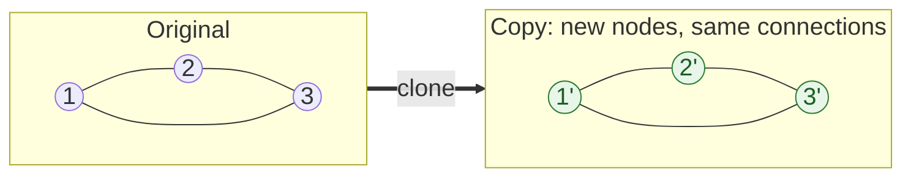
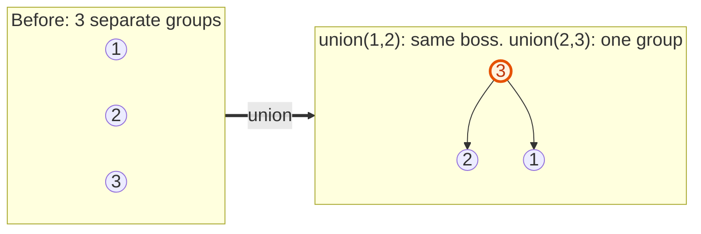

{: .no_toc}
# Undirected Graphs  


- TOC
{:toc}

In an undirected graph an edge works both ways. Two questions come up again and again: **are these two nodes connected?** and **how many separate groups are there?** Union-Find answers both in almost O(1) per question.

First time here? Read [Graphs: BFS and DFS](GraphBasics.html).

### [Clone Graph](https://leetcode.com/problems/clone-graph/)

> Given a reference of a node in a connected undirected graph. Return a deep copy (clone) of the graph.



**Key intuition 1:** A graph can have cycles, so the copy needs memory: a dictionary from each original node to its copy. When you meet a node you already copied, reuse its copy instead of recursing again.

**Key intuition 2:** Create the copy and store it in the dictionary BEFORE copying its neighbours, or a cycle sends you round forever.

<details><summary markdown="span">Execute! (your two versions)</summary>

```python
class Solution:
    def cloneGraph(self, node: Optional['Node'], visited = {}) -> Optional['Node']:
        # Works but infinite loop if graph has cycle
        if node:
            tmp = Node(node.val, [])
            tmp.neighbors = [ self.cloneGraph(x) for x in node.neighbors ]
            return tmp

class Solution:
    def cloneGraph(self, node: Optional['Node'], visited = {}) -> Optional['Node']:
        if node:
            if node in visited:
                return visited[node]

            visited[node] = Node(node.val, [])
            visited[node].neighbors = [ self.cloneGraph(x) for x in node.neighbors ]
            return visited[node]
```

</details>
<BR>

<details><summary markdown="span">Execute! (fixed, no shared state)</summary>

Bug fix: the version above uses `visited = {}` as a default argument. Python creates that dictionary ONCE, so it is shared by every call, and a second test case would get the clones from the first. This version makes the dictionary fresh for each call:

```python
class SolutionClone:
    def cloneGraph(self, node: 'Optional[Node]') -> 'Optional[Node]':
        if not node:
            return None
        # original node -> its copy. Created per call, never shared between calls
        copies = {}

        def clone(original):
            if original in copies:
                # already copied: reuse it (this is what stops infinite loops on cycles)
                return copies[original]
            copy = Node(original.val, [])
            copies[original] = copy
            copy.neighbors = [clone(n) for n in original.neighbors]
            return copy

        return clone(node)
```

</details>
<BR>

### [Redundant Connection](https://leetcode.com/problems/redundant-connection/)

> Convert Connected Graph to (Minimum) Undirected Graph with no cycles.

 

**Key intuition 1:** Add the edges one at a time. The redundant edge is the first one that joins two nodes that are ALREADY connected, because it closes a cycle.

**Key intuition 2:** You can test "already connected?" by searching (the first solution) or, far faster, with Union-Find (the second).

<details><summary markdown="span">Execute!</summary>

```python
class Solution:
    def findRedundantConnection(self, edges: List[List[int]]) -> List[int]:
        def canMeet(curr,target, visited):
            if curr==target:
                return True
            visited.add(curr)
            for neighbor in graph[curr] :
                if neighbor not in visited:
                    if canMeet(neighbor, target, visited):
                        return True

            return False

        graph = collections.defaultdict(set)
        for u,v in edges:
            if canMeet(u,v, set()):
                return [u,v]
            graph[u].add(v)
            graph[v].add(u)
```

Union find only works with undirected graphs. It asks the question if your highest order boss, is shared with another node, you must be in the same org. 


```
class Solution:
    def findRedundantConnection(self, edges: List[List[int]]) -> List[int]:
        parent = defaultdict(lambda: None)

        def find(i):
            # If the node isn't in our dict, it's its own parent
            if parent[i] is None:
                return i
            # If the node is its own parent return it            
            elif parent[i] == i:
                return i
            else:
            # If node's parent is not itself, find the parent.
                return find(parent[i])
            
        def union(i, j):
            root_i = find(i)
            root_j = find(j)
            
            if root_i != root_j:
                # Union: point one root to the other
                parent[root_i] = root_j
                return True
            return False

        for u, v in edges:
            if not union(u, v):
                return [u, v]

```
</details>
<BR>

## Harder: come back to these

### Union-Find (disjoint set) explained

> Keep track of groups of connected things. `find(x)` says which group x is in, `union(a, b)` merges two groups.

**Key intuition 1:** Think of an organisation chart. Each node points to a boss; a group is everyone with the same top boss. `find` climbs to the top boss. Two nodes are connected if they have the same top boss.

**Key intuition 2:** `union(a, b)` makes one top boss report to the other. If `find(a) == find(b)` already, the edge joins two nodes that were already connected, which is exactly how you detect a cycle. Path compression (point at the grandparent while climbing) keeps the chains short.



<details><summary markdown="span">Execute!</summary>

```python
class UnionFind:
    def __init__(self, n):
        # at the start everyone is their own boss
        self.parent = list(range(n))

    def find(self, x):
        while self.parent[x] != x:
            # path compression: point at the grandparent as we climb
            self.parent[x] = self.parent[self.parent[x]]
            x = self.parent[x]
        # the boss of x's group
        return x

    def union(self, a, b):
        root_a = self.find(a)
        root_b = self.find(b)
        if root_a == root_b:
            # already in the same group
            return False
        # one boss now reports to the other
        self.parent[root_a] = root_b
        return True
```

</details>
<BR>
### [Number of Connected Components](https://leetcode.com/problems/number-of-connected-components-in-an-undirected-graph/)

> Given n nodes and a list of edges, count the connected components.

**Key intuition 1:** Start with n groups. Every edge that really merges two different groups reduces the count by one.

**Key intuition 2:** Union returns False when the two nodes were already together, so those edges (cycles) change nothing.

<details><summary markdown="span">Execute!</summary>

```python
class SolutionProvinces:
    def countComponents(self, n: int, edges: List[List[int]]) -> int:
        uf = UnionFind(n)
        # every node starts as its own group
        groups = n
        for a, b in edges:
            if uf.union(a, b):
                # a successful union merges two groups into one
                groups -= 1
        return groups
```

</details>
<BR>
