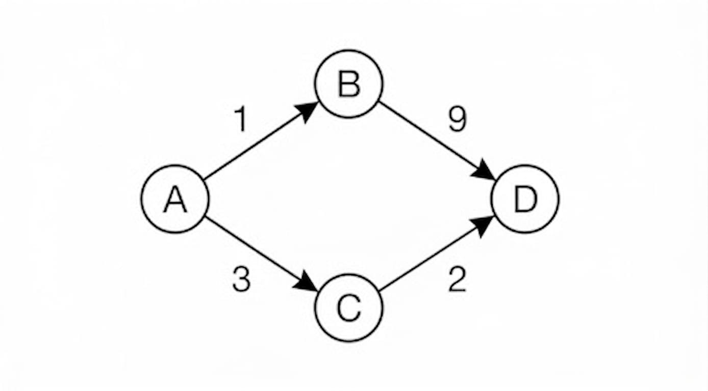
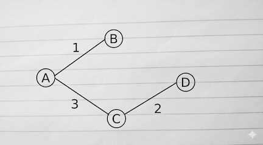

{: .no_toc}
# Undirected Graphs  (Weighted)


- TOC
{:toc}

Weighted edges have a cost. Two classics use a min-heap to always pick the cheapest next step: **Dijkstra** (cheapest path from a start) and **Prim** (cheapest way to connect everything).

**Key intuition 1:** Both are greedy: keep a heap of candidate edges and always take the cheapest one that reaches a new node.

**Key intuition 2:** The only difference is what goes in the heap. Dijkstra pushes the **total cost from the start** (`cost + weight`). Prim pushes just the **cost of the one bridge** (`weight`).

### [Path with maximal probability](https://leetcode.com/problems/path-with-maximum-probability/description/)

> Given two nodes start and end, find the path with the maximum probability of success to go from start to end and return its success probability.

**Key intuition 1:** It is Dijkstra with multiplication instead of addition: the best path to a node is found first. Python's heap is a min-heap, so push the NEGATIVE probability.

**Key intuition 2:** Probabilities are at most 1, so adding another edge can never make the path better. That is what makes the greedy choice safe, just as non-negative costs make it safe for ordinary Dijkstra.

<details><summary markdown="span">Execute!</summary>

```python
class Solution:
    def maxProbability(self, n: int, edges: list[list[int]], succProb: list[float], start_node: int, end_node: int) -> float:
        graph = defaultdict(set)
        for (u, v), p in zip(edges, succProb):
            graph[u].add((p, v));
            graph[v].add((p, u))

        visited = collections.defaultdict(int)
        heap = [(-1.0, start_node)]

        while heap:
            cost, curr = heapq.heappop(heap)
            cost = -cost

            visited[curr] = cost
            if curr == end_node:
                break

            for weight, neighbor in graph[curr]:
                if neighbor not in visited:
                    heapq.heappush(heap, (-(cost * weight), neighbor))

        return visited.get(end_node, 0.0)
```

</details>
<BR>

### [Connecting Cities at Minimum cost](https://leetcode.com/problems/connecting-cities-with-minimum-cost/)
Return the minimum cost to connect all n nodes such that there is at least one path between each pair of cities. 

**Key intuition 1:** You want the cheapest set of roads that connects every city: a minimum spanning tree. Start anywhere and repeatedly add the cheapest edge that reaches a city not yet connected (Prim).

**Key intuition 2:** If you finish with fewer than n cities connected, the graph is split in pieces: return -1.

<details><summary markdown="span">Using Prim's algorithm</summary>

The fundamental difference between Dijkstra’s Algorithm (for shortest paths) and Prim’s Algorithm (for Minimum Spanning Trees) is how they prioritize the "next" node to visit. In Dijkstra's, you care about the total distance from the start. In Prim's, you only care about the cost of the immediate bridge to an unvisited node.

Using the original example:


Prims would render:


```python
class Solution:
    def minimumCost(self, n: int, connections: List[List[int]]) -> int:
        graph = collections.defaultdict(list)
        for u, v, w in connections:
            graph[u].append((w, v))
            graph[v].append((w, u))

        # We store the edge weight used to reach each node
        visited = {}
        k = 1
        heap = [(0, k)]

        while heap:
            cost, curr = heapq.heappop(heap)
            if curr in visited:
                continue
            visited[curr] = cost

            if len(visited) == n:
                break

            for weight, neighbor in graph[curr]:
                if neighbor not in visited:
                    # Key divergence from djikstra which would be `cost + weight`
                    heapq.heappush(heap, (weight, neighbor))

        return sum(visited.values()) if len(visited) == n else -1
```
</details>
<BR>
