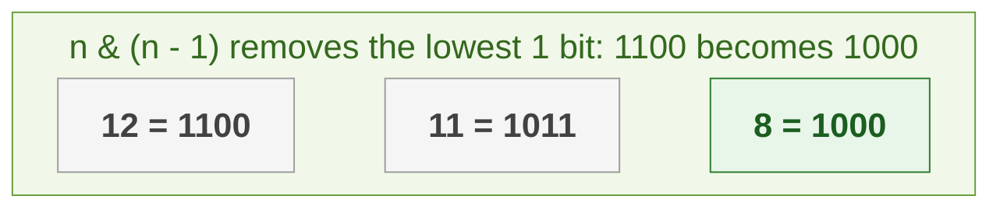
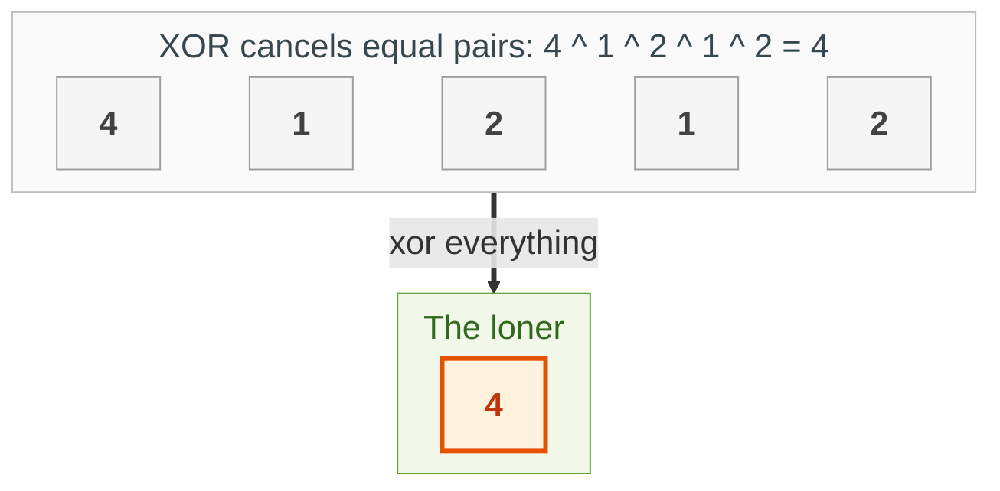

{: .no_toc}
# Binary Bit Manipulation
Practise here: [Leetcode](https://leetcode.com/list?selectedList=90xf0762)

- TOC
{:toc}
  

Bit tricks work directly on the binary digits of a number.

**Key intuition 1:** Know six operators: `&` (and), `|` (or), `^` (xor: 1 only if the bits differ), `~` (not), `<<` (shift left = times 2) and `>>` (shift right = divide by 2).

**Key intuition 2:** Two facts solve most problems: `x ^ x = 0` (pairs cancel), and `n & (n - 1)` removes the lowest 1 bit of n.

### [Power of Two](https://leetcode.com/problems/power-of-two/)

> Is n a power of two?



**Key intuition 1:** A power of two in binary has exactly one 1 (1000). Subtracting 1 flips that 1 to 0 and the zeros after it to 1s (0111), so `n & (n-1)` is 0 only for powers of two.

**Key intuition 2:** Remember n > 0: zero and negative numbers are not powers of two.

<details><summary markdown="span">Execute!</summary>

```python
class SolutionPow2:
    def isPowerOfTwo(self, n: int) -> bool:
        # a power of two has exactly one 1 bit; n & (n-1) clears the lowest 1 bit
        return n > 0 and n & (n - 1) == 0
```

</details>
<BR>

### [Single Number](https://leetcode.com/problems/single-number/)

> Every number appears twice except one. Find the one that appears once, with O(1) extra memory.



**Key intuition 1:** XOR of two equal numbers is 0, and XOR with 0 changes nothing. XOR everything together and every pair cancels, leaving the loner.

**Key intuition 2:** No dictionary needed, so memory is O(1).

<details><summary markdown="span">Execute!</summary>

```python
class SolutionSingle:
    def singleNumber(self, nums: List[int]) -> int:
        result = 0
        for x in nums:
            # x ^ x = 0 and x ^ 0 = x, so every pair cancels and the loner is left
            result ^= x
        return result
```

</details>
<BR>

### [Binary Bit Count](https://leetcode.com/problems/number-of-1-bits/)

> Return the number of '1' bits in an unsigned integer. 

**Key intuition 1:** Look at the lowest bit with `num & 1`, count it, shift right, repeat until nothing is left.

**Key intuition 2:** Kernighan's trick below is faster for numbers with few 1 bits.

<details><summary markdown="span">Execute!</summary>

```python
class Solution:
    def hammingWeight(self, num: int) -> int:
        count = 0
        while num:
            if num & 1:
                count+=1
            num = num >> 1
        return count
```

</details>
<BR>

<details><summary markdown="span">Execute! (Kernighan's trick)</summary>

Faster, using n & (n - 1): the loop runs once per 1 bit instead of once per bit.

```python
class SolutionKernighan:
    def hammingWeight(self, n: int) -> int:
        count = 0
        while n:
            # clear the lowest 1 bit: the loop runs once per 1 bit, not once per bit
            n &= n - 1
            count += 1
        return count
```

</details>
<BR>

## Harder: come back to these

### [Reverse Bits of an integer](https://leetcode.com/problems/reverse-bits/)

> Reverse bits of a given 32 bits unsigned integer.

**Key intuition 1:** Take the lowest bit of n and place it at the highest remaining position of the answer. Shift n right and the target position left, 32 times.

**Key intuition 2:** Work out the position with a counter (31, 30, 29, ...), or shift the answer left each step and OR the new bit in.

<details><summary markdown="span">Execute!</summary>

```python
class Solution:
    def reverseBits(self, n):
        res = 0
        pow = 31

        while n:
            tmp = (n&1) << pow
            res += tmp

            n = n >> 1
            pow -=1

        return res
```

</details>
<BR>
