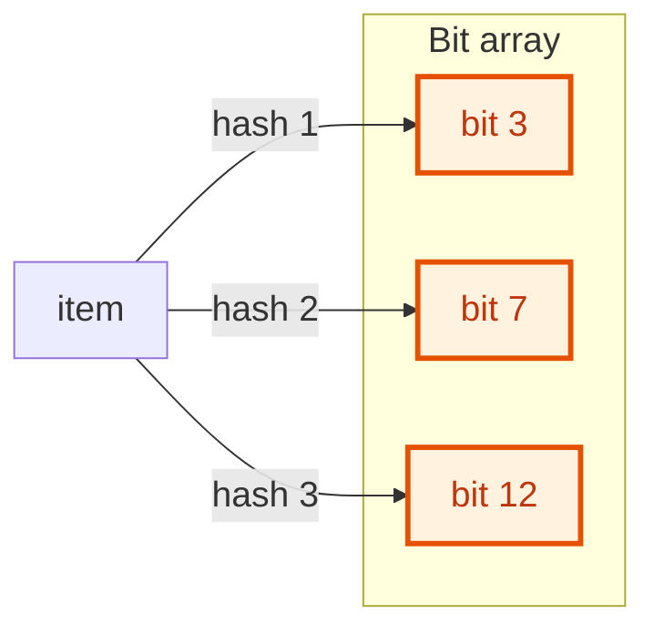

{: .no_toc}
# Bloom Filters
Practise here: [Leetcode]()

- TOC
{:toc}

A **Bloom filter** is a tiny, fast "have I seen this?" check that trades a small chance of a wrong *yes* for a huge saving in memory. Used in databases (skip a disk read when the key is certainly absent), web caches and spell checkers. Not a common interview coding question, but a favourite system-design topic.

### A Bloom filter you can reuse

> Build a set that uses very little memory and answers "definitely not present" or "probably present".



**Key intuition 1:** Each item turns on k bits of a long bit array (chosen by k hash functions). To check an item, look at its k bits: if ANY is 0 it was never added; if ALL are 1 it was probably added.

**Key intuition 2:** It never gives a false negative, but other items can happen to turn on the same bits, so false positives are possible. More bits (m) and the right number of hashes (k) lower the error rate.

<details><summary markdown="span">Execute!</summary>

```python
import hashlib
import math

class BloomFilter:
    """Answers 'definitely not in the set' or 'probably in the set'. Never forgets an item, sometimes invents one."""

    def __init__(self, expected_items: int, error_rate: float = 0.01):
        # m bits and k hash functions that give about the requested false positive rate
        self.m = max(1, int(-expected_items * math.log(error_rate) / (math.log(2) ** 2)))
        self.k = max(1, round(self.m / expected_items * math.log(2)))
        # one byte per bit, for simplicity
        self.bits = bytearray(self.m)

    def _positions(self, item):
        # k different hashes: hash the item together with i
        for i in range(self.k):
            digest = hashlib.sha256((str(i) + str(item)).encode()).hexdigest()
            yield int(digest, 16) % self.m

    def add(self, item):
        for p in self._positions(item):
            self.bits[p] = 1

    def might_contain(self, item) -> bool:
        # one 0 bit proves the item was never added
        return all(self.bits[p] for p in self._positions(item))
```

</details>
<BR>

### [Find Missing Number](https://leetcode.com/problems/missing-number/discuss/1637159/python-solution-using-bloom-filters-cheeky-but-ultimately-a-good-learning-exercise) <BR>

> Despite the widespread use of Bloom filters in industry, I find it frustrating that no problem on leetcode requires them - so here i go - sub-optimally forcing the solution to fit the problem, this is the only one I could find where I can "test out" how the Bloom filter strategy would work - what kind of memory it would require, and get a feel for the variables, m, k and e where m is the number of bits in bit array, k is the number of hash functions and e is the false positive error rate.

**Key intuition 1:** A Bloom filter cannot list what it holds, but it can say whether a number was definitely NOT added. Add every number in the array, then ask about 0, 1, 2... the first definite "no" is the missing number.

**Key intuition 2:** This is a cheeky use for learning how m (bits), k (hashes) and the error rate interact. The ordinary solution (n(n+1)/2 minus the sum, or XOR) is far better for the real problem.

<details><summary markdown="span">Execute!</summary>

```python
import hashlib
from sys import getsizeof
class Solution:
    def missingNumber(self, nums: List[int]) -> int:

        # Custom Hash - Just for practice. Not very good.
        def hash1(val):
            nonlocal MAX
            primes = [ 3, 17, 23]
            curr = 0
            for s in str(val):
                for p in primes:
                    curr += ord(s)**p

            return curr % MAX

        def hash2(val):
            nonlocal MAX
            hashValue = hashlib.md5(str(val).encode())
            return int (hashValue.hexdigest(), 16) % MAX

        def hash3(val):
            nonlocal MAX
            hashValue = hashlib.sha3_384(str(val).encode())
            return int (hashValue.hexdigest(), 16) % MAX

        def hash4(val):
            nonlocal MAX
            hashValue = hashlib.sha512(str(val).encode())
            return int (hashValue.hexdigest(), 16) % MAX

        MAX = 10000
        hashList = [ hash1, hash2, hash3, hash4]
        bits = [[0] * MAX for x in range(len(hashList))]

        totalMemory = getsizeof(bits)+ getsizeof(bits[0]) +  getsizeof(bits[0][0])*MAX
        print ("Memory used for 2D Array Indexing: ", getsizeof(bits))
        print ("Memory used for (nested) 1D Array Indexing: ", getsizeof(bits[0]))
        print ("Memory used for (nested) integer in array: ", getsizeof(bits[0][0]))
        print ("Memory used for (nested) integer in array (total): ", getsizeof(bits[0][0])*MAX )
        print ("Total Memory (bytes)  for Bloom Filter: ", totalMemory )
        print ("Total Memory (kbytes)  for Bloom Filter: ", totalMemory / 1024 )

        for n in nums:
            for h, func in enumerate(hashList):
                bits[h][func(n)] = 1

        for i in range(0, max(nums)+2):
            for h, func in enumerate(hashList):
                if bits[h][func(i)] == 0:
                    return i

        return -1
```

</details>
<BR>
