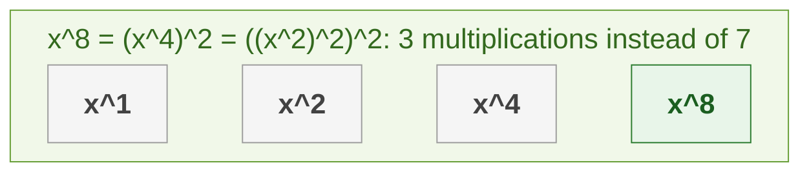
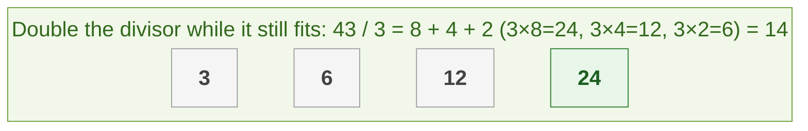

{: .no_toc}
# Integers
Practise here: [Leetcode](https://leetcode.com/list?selectedList=90xf0762)

- TOC
{:toc}

Integer problems are about digits, carries and overflow, and about doing arithmetic with fewer operations.

**Key intuition 1:** Work one digit at a time with `% 10` (the last digit) and `// 10` (drop the last digit), like long arithmetic on paper.

**Key intuition 2:** Many "do it faster" problems (power, square root, divide) become O(log n) by **halving**: either by binary search or by repeated doubling.

### [Integer add 1](https://leetcode.com/problems/plus-one/)

> Given a non-empty sort of digits representing a non-negative integer, plus one to the integer.

**Key intuition 1:** Start at the last digit and add 1. A digit that becomes 10 turns into 0 and carries 1 to the next digit on its left.

**Key intuition 2:** If a carry is left after the first digit (999 + 1), add a new leading 1.

<details><summary markdown="span">Execute!</summary>

```python
class Solution:
    def plusOne(self, digits: List[int]) -> List[int]:
        res = []
        carry = 0

        for i in range(len(digits)-1,-1,-1):
            d = digits[i] + carry
            if i == len(digits)-1:
                d = d + 1

            if d > 9:
                carry = 1
                d = d - 10
            else:
                carry = 0

            res = [d] + res

        if carry==1:
            res = [carry] + res

        return (res)
```

</details>
<BR>

### [Integer Reverse](https://leetcode.com/problems/reverse-integer/)

> Given a 32-bit signed integer, reverse digits of an integer.

**Key intuition 1:** Peel the last digit off with `% 10` and push it onto the answer with `res * 10 + d`.

**Key intuition 2:** Overflow: only check the 32-bit limit at the end here, because Python integers never overflow. In languages with fixed-size integers you must check before each multiply.

<details><summary markdown="span">Execute!</summary>

```python
class Solution:
    def reverse(self, x: int) -> int:

        sign = -1 if x < 0 else 1

        num = abs(x)
        res = 0
        while num != 0:
            d = num %10
            res = res * 10 + d
            num = int(num /10 )

        if res > 2**31 - 1 or res < -2**31:
            #Cannot do this check earlier. Think why.
            return 0

        return sign * res
```

</details>
<BR>

### [Implement Sqrt(x)](https://leetcode.com/problems/sqrtx/)

> Implement int sqrt(int x).

**Key intuition 1:** The answer is the largest number whose square is at most x. Squares grow with the number, so binary search works.

**Key intuition 2:** Compare mid * mid with x directly (no floating point).

<details><summary markdown="span">Execute!</summary>

```python
class Solution:
    def mySqrt(self, x: int) -> int:
        l = 0
        r = x
        while l <= r:
            mid = (r + l) // 2
            square = mid * mid
            next_sq = (mid + 1) * (mid + 1)
            if square <= x < next_sq:
                return mid
            if square > x:
                r = mid - 1
            else:
                l = mid + 1
        return square
```

</details>
<BR>

### [Implement Power(x,n)](https://leetcode.com/problems/powx-n/)

> Implement pow(x, n), which calculates x raised to the power n.



**Key intuition 1:** Do not multiply n times. x^n is (x^(n/2)) squared, and times one more x if n is odd, so the work halves each step: O(log n).

**Key intuition 2:** A negative power is 1 divided by the positive power. Use n // 2 (integer division) so n stays an integer.

<details><summary markdown="span">Execute!</summary>

```python
class SolutionPow:
    def myPow(self, x: float, n: int) -> float:
        if n < 0:
            return 1 / self.myPow(x, -n)
        if n == 0:
            return 1
        # x^n = (x^(n/2))^2, so the problem halves each time: O(log n)
        half = self.myPow(x, n // 2)
        return half * half if n % 2 == 0 else half * half * x
```

</details>
<BR>

### [Implement Power(x,n): original recursive solution](https://leetcode.com/problems/powx-n/)

> Implement pow(x, n), which calculates x raised to the power n. 
> The cleaner rewrite is above this original solution.

<details><summary markdown="span">Execute!</summary>

```python
class Solution:
    def myPow(self, num, power):
        if not power:
            return 1
        if power < 0:
            return 1 / self.myPow(num, -power)
        if power % 2 == 1:
            return num * self.myPow(num, power-1)

        return self.myPow(num*num, power/2)
```

</details>
<BR>

## Harder: come back to these

### [Divide two integers](https://leetcode.com/problems/divide-two-integers/)

> Given two integers dividend and divisor, divide two integers without using multiplication,
division and mod operator.

> This algorithm is known as exponential search and is commonly used for searching sorted 
> spaces of unknown size for the first value that past a particular condition. It is a lot like binary search



**Key intuition 1:** Division is repeated subtraction. To make it fast, subtract the divisor times 1, 2, 4, 8... (doubling with shifts) while it still fits, then start over with the remainder.

**Key intuition 2:** Handle the sign separately, and the one overflow case: -2³¹ / -1 does not fit in 32 bits, so return 2³¹ - 1.

<details><summary markdown="span">Execute!</summary>

```python
class Solution:
    def divide(self, a: int, b: int) -> int:

        # Answer of -2147483648/-1 should be 2147483648
        # However 2147483648 is too big, 2^31 == 2147483648 (one more than possible 2^31-1)
        # Therefore abs(2^31) == 2147483648-1 = 2147483647
        # This is an edge case scenario. The lowest value a 32 bit can contain is -2147483648
        if a == -2147483648 and b == -1:
            return 2147483647

        sign = (a < 0) == (b < 0)
        a = abs(a)
        b = abs(b)
        res = 0
        while a >= b:
            tmp = b
            val = 1
            while a >= b:
                a -= b
                res += val

                b = b << 1
                val = val << 1
            b = tmp

        return res if sign == 1 else 0 - res
```

</details>
<BR>
