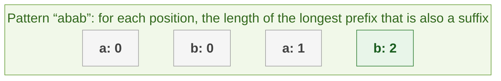

# KMP

Searching for a pattern naively restarts from scratch after every mismatch, which is O(n·m). KMP (Knuth-Morris-Pratt) never goes backwards in the text, so it is O(n + m). It is a good one to know but rarely required: most interviews accept `haystack.find(needle)` or the naive loop.

### [Knuth Morris Pratt Algorithm (KMP) - String Search](https://leetcode.com/problems/implement-strstr/)

> Implement strStr(). Return the index of the first occurrence of needle in haystack, or -1 if needle is not part of haystack.



**Key intuition 1:** When a mismatch happens, you already know the last few characters you matched. If the end of what matched is also the start of the pattern (a prefix that is also a suffix), you can resume there instead of restarting.

**Key intuition 2:** The table ("longest proper prefix that is also a suffix" for each position) tells you exactly how far to fall back. Build it once from the pattern, then scan the text once.

<details><summary markdown="span">Execute!</summary>

```python
class Solution:

    def indexOf(self, t, p):
        def getLongestProperPrefix(p):
            # arrarra -> [0, 0, 0, 1, 2, 3, 4]
            # amar ->    [0, 0, 1, 0]
            # aaoiaa ->  [0, 1, 0, 0, 1, 2]
            arr = [0]
            j = 0
            for i in range(1, len(p)):
                while j > 0 and p[j] != p[i]:
                    j = arr[j - 1]
                if p[j] == p[i]:
                    j += 1
                arr.append(j)
            print(arr)
            return arr

        def getMatches(t,p):
            kmp = getLongestProperPrefix(p)
            res = []
            j = 0
            for i in range(len(t)):
                while j > 0 and t[i] != p[j]:
                    j = kmp[j - 1]
                if t[i] == p[j]:
                    j += 1
                if j == len(p):
                    res.append(i - (j - 1))
                    j = kmp[j - 1]
            return res

        ans = getMatches(t,p)
        return ans if ans != [] else [-1]

    def strStr(self, string: str, pattern: str) -> int:
        return self.indexOf(string, pattern)[0] if pattern else 0
```

</details>
<BR>
