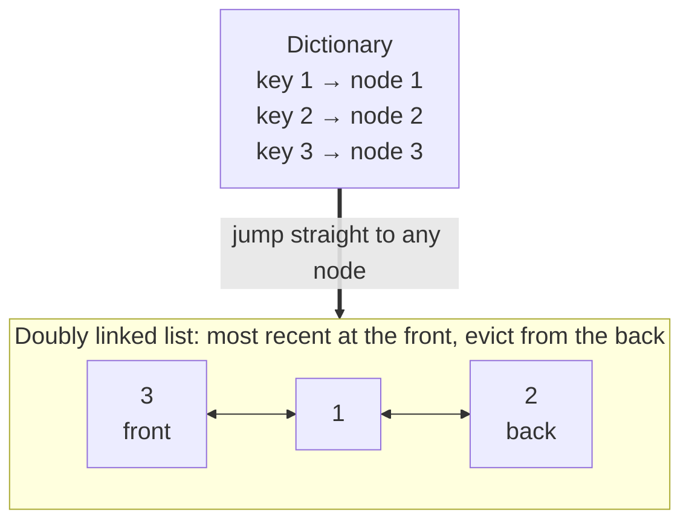

{: .no_toc}
# LRU Cache
Practise here: [Leetcode](https://leetcode.com/problems/lru-cache/)

A cache with a fixed size that, when full, throws away the item that was used least recently. Both get and put must run in O(1). This is the best single problem for practising a hash map and a doubly linked list working together, and it is the usual lead-in to "now make it thread-safe".

Build blocks first: [Doubly Linked Lists](../Arrays/DoublyLinkedLists.md). Threading concepts: [Threading](Threading.md).

- TOC
{:toc}

### [LRU Cache](https://leetcode.com/problems/lru-cache/)

> Design a data structure that follows the Least Recently Used (LRU) cache rules: `get(key)` returns the value or -1, `put(key, value)` inserts or updates and evicts the least recently used key when over capacity. Both in O(1).



**Key intuition 1:** You need two things at once: find any key instantly (a dictionary) and know the usage order, moving an item to the front instantly (a linked list). Neither structure alone can do both in O(1).

**Key intuition 2:** The dictionary stores the *node*, not just the value. A doubly linked list can remove a node it already holds in O(1), which is exactly why the list must be doubly linked. Most recent goes at the front, evict from the back.

<details><summary markdown="span">Execute!</summary>

The doubly linked list (each method is explained on the [Doubly Linked Lists](../Arrays/DoublyLinkedLists.md) page):

```python
class Node:
    def __init__(self, key=0, val=0):
        self.key = key
        self.val = val
        self.prev = None
        self.next = None


class DoublyLinkedList:
    def __init__(self):
        self.head = None
        self.tail = None

    # Add a node at the front of the list.
    def add_front(self, node):
        if self.head is None:
            # Empty list: the new node is both the first and the last node.
            self.head = node
            self.tail = node
            return

        tmp = self.head
        self.head = node
        node.next = tmp
        tmp.prev = node

    # Add a node at the back of the list.
    def add_back(self, node):
        if self.head is None:
            # Empty list: the new node is both the first and the last node.
            self.head = node
            self.tail = node
            return

        tmp = self.tail
        self.tail = node
        node.prev = tmp
        tmp.next = node

    # Remove the first node. Does nothing if the list is empty.
    def remove_front(self):
        if self.head is None:
            return

        if self.head is self.tail:
            # Only one node: the list becomes empty.
            self.head = None
            self.tail = None
            return

        tmp = self.head
        self.head = tmp.next
        self.head.prev = tmp.prev
        tmp.next = None

    # Remove the last node. Does nothing if the list is empty.
    def remove_back(self):
        if self.tail is None:
            return

        if self.head is self.tail:
            # Only one node: the list becomes empty.
            self.head = None
            self.tail = None
            return

        tmp = self.tail
        self.tail = tmp.prev
        self.tail.next = tmp.next
        tmp.prev = None

    # Remove a node that is somewhere in the list, given the node itself.
    def remove(self, node):
        if node is self.head:
            self.remove_front()
            return

        if node is self.tail:
            self.remove_back()
            return

        # In the middle: its neighbours skip over it.
        before = node.prev
        after = node.next

        before.next = after
        after.prev = before

        node.prev = None
        node.next = None

    # Reverse the list in place: every node swaps its prev and next pointers.
    def reverse(self):
        prev = None
        curr = self.head

        while curr is not None:
            tmp = curr.next

            # Core Code
            curr.next = prev
            curr.prev = tmp
            prev = curr

            curr = tmp

        # The old tail is now the first node, and the old head is the last.
        self.head, self.tail = self.tail, self.head
```

The cache:

```python
class LRUCache:
    def __init__(self, capacity: int):
        self.capacity = capacity

        # key -> its node, so we can find any node in O(1).
        self.nodes = {}

        # Most recently used at the front, least recently used at the back.
        self.order = DoublyLinkedList()

    def get(self, key: int) -> int:
        if key not in self.nodes:
            return -1

        node = self.nodes[key]

        # It was just used: move it to the front.
        self.order.remove(node)
        self.order.add_front(node)
        return node.val

    def put(self, key: int, value: int) -> None:
        if key in self.nodes:
            # get() moves the node to the front for us.
            self.get(key)
            self.nodes[key].val = value
            return

        if len(self.nodes) == self.capacity:
            # Full: evict the least recently used node, the one at the back.
            oldest = self.order.tail
            self.order.remove_back()
            del self.nodes[oldest.key]

        node = Node(key, value)
        self.nodes[key] = node
        self.order.add_front(node)
```

</details>
<BR>
### Thread-safe LRU Cache

> Now several threads call get and put at the same time. What goes wrong, and how do you fix it?

**Key intuition 1:** `get` is not a plain read. It *moves a node*, which rewires pointers, so two threads can corrupt the list or the dictionary even if every call looks like a lookup. A read-write lock does not help here.

**Key intuition 2:** Simplest correct answer: one lock around every method. Use a re-entrant lock (`RLock`) so a method may call another method that takes the same lock (`put` calls `get`). Then, only if asked about scale, split the cache into shards with a lock each.

<details><summary markdown="span">Execute! (one re-entrant lock)</summary>

```python
import functools
import threading


# Run the method while holding the cache's lock.
def locked(method):
    @functools.wraps(method)
    def wrapper(self, *args):
        with self.lock:
            return method(self, *args)

    return wrapper


class ThreadSafeLRUCache:
    def __init__(self, capacity: int):
        self.capacity = capacity
        self.nodes = {}
        self.order = DoublyLinkedList()

        # An RLock (re-entrant lock): put() calls get() while it already holds
        # the lock. A plain Lock would make the thread wait for itself forever.
        # See the FAQ on the Doubly Linked Lists page.
        self.lock = threading.RLock()

    # Even get() needs the lock: it moves a node, so it changes the list.
    @locked
    def get(self, key: int) -> int:
        if key not in self.nodes:
            return -1

        node = self.nodes[key]
        self.order.remove(node)
        self.order.add_front(node)
        return node.val

    @locked
    def put(self, key: int, value: int) -> None:
        if key in self.nodes:
            self.get(key)
            self.nodes[key].val = value
            return

        if len(self.nodes) == self.capacity:
            oldest = self.order.tail
            self.order.remove_back()
            del self.nodes[oldest.key]

        node = Node(key, value)
        self.nodes[key] = node
        self.order.add_front(node)
```

</details>
<BR>
<details><summary markdown="span">Execute! (sharded, for high scale)</summary>

Higher throughput: shard the keys, one small cache and one lock per shard.

```python
class ShardedLRUCache:
    # Many small caches, each with its own lock. Threads that touch different
    # shards never wait for each other. The trade-off: eviction is least
    # recently used within a shard, not across the whole cache.
    def __init__(self, capacity: int, shards: int = 8):
        self.shards = []

        for _ in range(shards):
            shard_capacity = max(1, capacity // shards)
            self.shards.append(ThreadSafeLRUCache(shard_capacity))

    def _shard(self, key):
        return self.shards[hash(key) % len(self.shards)]

    def get(self, key):
        return self._shard(key).get(key)

    def put(self, key, value):
        self._shard(key).put(key, value)
```

</details>
<BR>
**Recommendation and trade-offs**

| Approach | Good | Bad |
|---|---|---|
| One lock for the whole cache | Simple, obviously correct | Every thread waits for every other thread |
| Sharded locks (hash the key to a shard) | Threads on different shards run in parallel | Eviction is least recently used *per shard*, not globally; more code |
| Read-write lock | Great for read-heavy caches that do not reorder on read | Useless here: `get` reorders the list, so it is a write |
| Lock-free / concurrent libraries | Best scalability | Hard to get right; in an interview, name it and move on |

More on locks, deadlocks and semaphores: [Threading](Threading.md).

### Other ways to write it

The same cache without writing your own list, and a slower version that shows why a heap is the wrong tool (finding a key inside a heap is O(n)).

### [LRU Cache - Ordered Dict](https://leetcode.com/problems/lru-cache/)

**Key intuition:** `OrderedDict` is already a hash map plus a doubly linked list. `move_to_end` is the "mark as most recently used" step.

<details><summary markdown="span">Execute!</summary>

```python
import collections


class OrderedDictLRUCache:
    def __init__(self, capacity: int):
        self.capacity = capacity

        # Keeps keys in the order they were added or moved.
        self.cache = collections.OrderedDict()

    def get(self, key: int) -> int:
        if key not in self.cache:
            return -1

        # Most recently used goes to the end.
        self.cache.move_to_end(key)
        return self.cache[key]

    def put(self, key: int, value: int) -> None:
        if key in self.cache:
            self.cache.move_to_end(key)

        self.cache[key] = value

        if len(self.cache) > self.capacity:
            # Drop the oldest: the front of the dictionary.
            self.cache.popitem(last=False)
```

</details>
<BR>
### [LRU Cache - Custom with Heap](https://leetcode.com/problems/lru-cache/)

**Key intuition:** Stamp every use with an increasing counter and keep a min-heap of stamps: the smallest stamp is the least recently used. But refreshing a stamp means searching the heap, so `get` is O(n). Fine to know, not what to submit.

<details><summary markdown="span">Execute!</summary>

```python
import heapq

class HeapLRUCache:
    def __init__(self, capacity):
        # stores Keys
        self.dic = {}
        # stores time ordering of Keys.
        self.heap = []

        self.capacity = capacity
        self.count = 0
        self.counter = 0

    def get(self, key):
        if key not in self.dic:
            return -1

        self.updateHeap(key)
        return self.dic[key]

    def put(self, key, value):
        if key in self.dic:
            self.updateHeap(key)
            self.dic[key] = value
        elif self.count >= self.capacity:
            _, delKey = heapq.heappop(self.heap)
            del self.dic[delKey]
            self.addToHeap(key)
            self.dic[key] = value
        else:
            self.count += 1
            self.addToHeap(key)
            self.dic[key] = value

    def getOrdering(self):
        self.counter += 1
        return self.counter

    def addToHeap(self, key):
        heapq.heappush(self.heap, (self.getOrdering(), key))

    def updateHeap(self, key):
        for i in range(len(self.heap)):
            if self.heap[i][1] == key:
                self.heap[i] = (self.getOrdering(), key)

        heapq.heapify(self.heap)
```

</details>
<BR>
