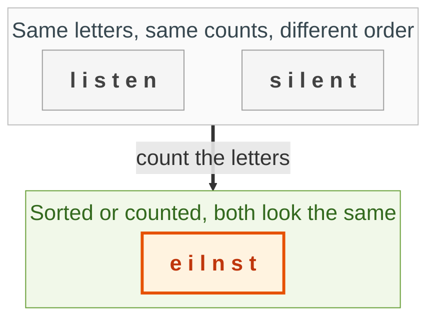
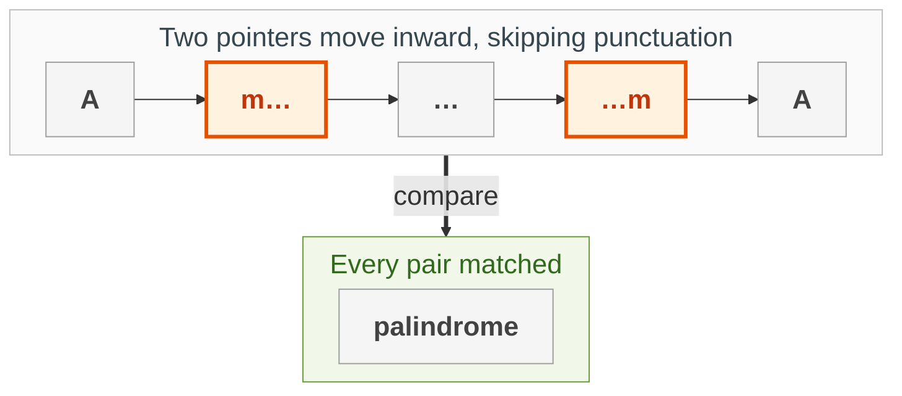
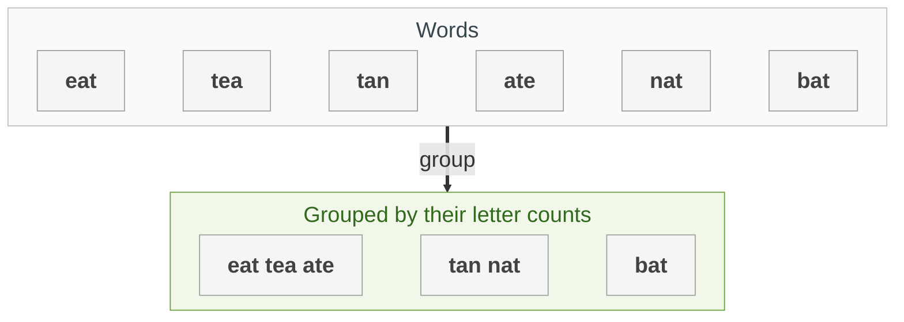
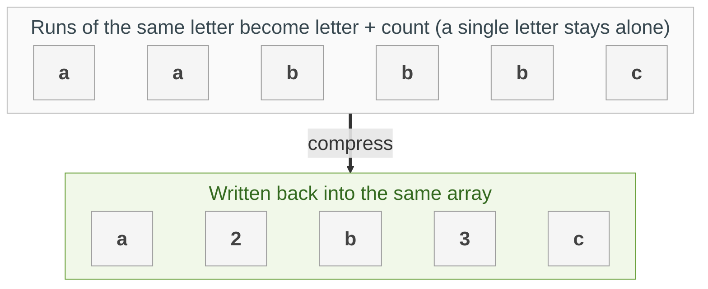
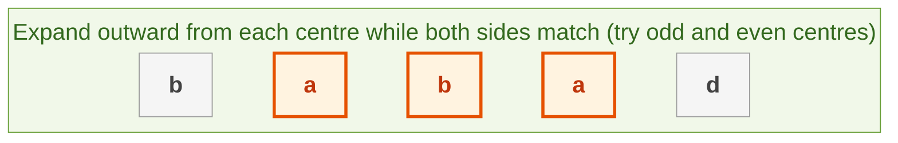

{: .no_toc}
# Strings
Practise here: [Leetcode](https://leetcode.com/list?selectedList=90xfipte)

- TOC
{:toc}

Strings are arrays of characters, so most string problems reuse array tricks: two pointers, sliding windows, and counting with a dictionary.

**Key intuition 1:** Counting letters (a dictionary or a 26-slot list) answers "same letters?" questions without sorting.

**Key intuition 2:** Python strings cannot be changed. Building a string with `+=` in a loop copies it every time; collect pieces in a list and `''.join` them once, or work in place on a list of characters.

### [Valid Anagram](https://leetcode.com/problems/valid-anagram/)

> Are two strings anagrams of each other (the same letters in a different order)?



**Key intuition 1:** Two words are anagrams exactly when they have the same count of every letter.

**Key intuition 2:** Comparing two `Counter`s is O(n), faster than sorting both strings.

<details><summary markdown="span">Execute!</summary>

```python
class SolutionAnagram:
    def isAnagram(self, s: str, t: str) -> bool:
        # same letters with the same counts
        return collections.Counter(s) == collections.Counter(t)
```

</details>
<BR>

### [Valid Palindrome](https://leetcode.com/problems/valid-palindrome/)

> Ignoring case and non-alphanumeric characters, is the string a palindrome?



**Key intuition 1:** A palindrome matches from the outside in, so compare the first and last characters and move both inward (two pointers).

**Key intuition 2:** Skip characters that do not count, keeping left < right in the inner loops. See also [Two Pointers](../Arrays/TwoPointers.html).

<details><summary markdown="span">Execute!</summary>

```python
class SolutionPal:
    def isPalindrome(self, s: str) -> bool:
        left = 0
        right = len(s) - 1
        while left < right:
            # skip anything that is not a letter or digit
            while left < right and not s[left].isalnum():
                left += 1
            while left < right and not s[right].isalnum():
                right -= 1
            if s[left].lower() != s[right].lower():
                return False
            left = left + 1
            right = right - 1
        return True
```

</details>
<BR>

### [Group Anagrams](https://leetcode.com/problems/group-anagrams/)

> Given an array of strings, group anagrams together



**Key intuition 1:** Words that are anagrams of each other have identical letter counts, so the counts make a perfect dictionary key. Put each word into the group for its key.

**Key intuition 2:** A list of 26 counts (as a tuple) is faster than sorting each word, and `sorted(word)` as the key also works.

<details><summary markdown="span">Execute!</summary>

Fix: the first version returned `ans.values()`, a view object rather than a list; it now returns `list(ans.values())`.

```python
class Solution:
    def groupAnagrams(self, wordList):
        ans = collections.defaultdict(list)
        for word in wordList:
            count = [0] * 26
            for c in word:
                count[ord(c) - ord('a')] += 1
            ans[tuple(count)].append(word)
        return list(ans.values())

import collections
class Solution:
    def groupAnagrams(self, strs: List[str]) -> List[List[str]]:
        d = collections.defaultdict(list)
        for s in strs:
            d[frozenset(collections.Counter(s).items())].append(s)
        res = []
        for k,v in d.items():
            res.append(v)
        return res
```

</details>
<BR>

### [String Compression](https://leetcode.com/problems/string-compression/)

> Replace runs of the same character with the character and the run length ("aa" becomes "a2"; a single letter stays "b"). Do it in place and return the new length.



**Key intuition 1:** Use two indexes: `read` finds the end of each run, `write` stores the compressed result. The output is never longer than the input, so `write` never overtakes `read`.

**Key intuition 2:** A run of 12 is written as the two characters '1' and '2', and a run of 1 gets no number at all. Bug fix: the old version dropped single letters ("abc" came out empty).

<details><summary markdown="span">Execute!</summary>

```python
class SolutionCompress:
    def compress(self, chars: List[str]) -> int:
        # where the next compressed character goes
        write = 0
        read = 0
        while read < len(chars):
            letter = chars[read]
            run = 0
            while read < len(chars) and chars[read] == letter:
                read += 1
                # count the run of equal letters
                run += 1
            chars[write] = letter
            write += 1
            if run > 1:
                # the count, one digit per slot ("12" takes two)
                for digit in str(run):
                    chars[write] = digit
                    write += 1
        # the compressed form is chars[:write]
        return write
```

</details>
<BR>

## Harder: come back to these

### [Longest Palindromic Substring](https://leetcode.com/problems/longest-palindromic-substring/)

> Given a string s, find the longest palindromic substring in s.


**Key intuition 1:** Every palindrome has a centre. Try each position as a centre (and each gap between letters, for even lengths), then expand outward while the two sides match.

**Key intuition 2:** There are 2n - 1 centres and each expansion is at most O(n), so O(n²) total, which is perfectly acceptable for an interview.

<details><summary markdown="span">Execute!</summary>

```python
class Solution:
    def longestPalindrome(self, s: str) -> str:
        def palindromeAt(w,l,r):
            while l>=0 and r < len(w) and w[l]==w[r]:
                l -=1
                r +=1
            return w[l+1:r]

        res = ""
        for i in range(0, len(s)):
            odd  = palindromeAt(s,i,i)
            even = palindromeAt(s,i,i+1)
            res = max([res,odd,even], key=len)
        return res
```

</details>
<BR>
