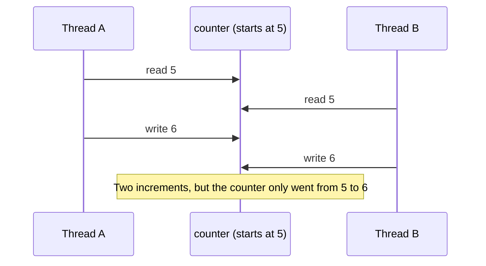

{: .no_toc}
# Threading

When several threads share data, any code that reads, changes, then writes can be interleaved with another thread's. This page is the whole interview toolbox in one place: what a race is, then mutex, re-entrant lock, semaphore, condition variable, read-write lock and deadlock, each with a small program. Examples are in Python; Java and Kotlin have the same ideas (`synchronized`, `ReentrantLock`, `Semaphore`, `wait/notify`). For Kotlin coroutines see [Concurrency](../ConcurrencyInJava.md).

- TOC
{:toc}

### The words to know

| Word | In one line | Reach for it when |
|---|---|---|
| **Race condition** | The result depends on how threads happen to interleave | Always the thing you are fixing |
| **Mutex** (`Lock`) | Only one thread inside at a time | Protecting shared data |
| **Re-entrant lock** (`RLock`) | A mutex the *same* thread may take again | A locked method calls another locked method |
| **Semaphore** | A counter of permits; up to N threads inside | Limiting concurrency: connections, workers |
| **Condition variable** | Wait until something changes, without spinning | Producer / consumer, "wait until not empty" |
| **Read-write lock** | Many readers or one writer | Read-heavy data where reads do not change anything |

### Race condition

> Four threads each add 1 to a shared counter 100,000 times. What is the final value?



**Key intuition 1:** `counter += 1` looks like one step but is three: read, add, write. A thread can be paused between them, and the other thread's update is overwritten.

**Key intuition 2:** A race is nondeterministic: the program may print 400000 on your laptop and a smaller number in production. Not failing in testing proves nothing, so reason about it instead.

<details><summary markdown="span">Execute! (the bug)</summary>

```python
import threading

counter = 0

def add_many(n):
    global counter
    for _ in range(n):
        # Three steps: read counter, add 1, write counter.
        # Another thread can slip in between them.
        counter += 1

threads = [threading.Thread(target=add_many, args=(100_000,)) for _ in range(4)]
for t in threads:
    t.start()
for t in threads:
    t.join()

# Should be 400000, but can be less: updates were lost.
print(counter)
```

</details>
<BR>
### Mutex

> Fix the counter so the answer is always 400000.

**Key intuition 1:** A mutex turns "read, add, write" into one indivisible step: whoever holds the lock does all three before anyone else may start.

**Key intuition 2:** Always use `with lock:` so the lock is released even when an exception is thrown. Keep the locked section as small as possible, because every other thread waits for it.

<details><summary markdown="span">Execute!</summary>

```python
import threading

counter = 0

# A mutex: only one thread at a time may hold it.
lock = threading.Lock()

def add_many(n):
    global counter
    for _ in range(n):
        # Acquire on entry, always release on exit (even if an exception is raised).
        with lock:
            counter += 1

threads = [threading.Thread(target=add_many, args=(100_000,)) for _ in range(4)]
for t in threads:
    t.start()
for t in threads:
    t.join()

# Always 400000.
print(counter)
```

</details>
<BR>
### Re-entrant lock (RLock)

> A method that holds the lock calls another method that takes the same lock. What happens?

**Key intuition 1:** With a plain lock the thread waits for itself and never wakes up: a deadlock with one thread. An `RLock` remembers who owns it and a count, so the owner can acquire it again.

**Key intuition 2:** This is why the thread-safe [LRU Cache](LRUCache.md) uses an `RLock`: `put` calls `get` while already holding the lock.

<details><summary markdown="span">Execute!</summary>

```python
import threading

class Account:
    def __init__(self, balance):
        self.balance = balance

        # Re-entrant: the thread that holds the lock may take it again.
        self.lock = threading.RLock()

    def deposit(self, amount):
        with self.lock:
            self.balance += amount

    def deposit_twice(self, amount):
        # This takes the lock...
        with self.lock:
            # ...and deposit() takes it again. Fine with an RLock, a deadlock
            # with a plain Lock (the thread waits for itself).
            self.deposit(amount)
            self.deposit(amount)
```

</details>
<BR>
### Semaphore

> Allow at most N threads to use a resource (database connections, API calls) at the same time.

**Key intuition 1:** A semaphore is a counter of permits. `acquire` takes one (waiting if there are none), `release` gives it back. A mutex is a semaphore with a single permit.

**Key intuition 2:** A mutex says "one at a time"; a semaphore says "at most N at a time". Use it for rate and concurrency limits, not for protecting data.

<details><summary markdown="span">Execute!</summary>

```python
import threading

# At most `limit` threads may be inside use() at the same time.
class ConnectionLimiter:
    def __init__(self, limit):
        # A counter of free slots: acquire() takes one, release() gives it back.
        self.slots = threading.Semaphore(limit)

    def use(self, work):
        # Waits here if every slot is taken.
        with self.slots:
            return work()
```

</details>
<BR>
### [Design Bounded Blocking Queue](https://leetcode.com/problems/design-bounded-blocking-queue/)

> A queue with a maximum size. `enqueue` blocks while it is full; `dequeue` blocks while it is empty.

**Key intuition 1:** Producers must sleep while the queue is full and consumers while it is empty. A condition variable is a lock plus a waiting room: `wait()` releases the lock and sleeps, and `notify_all()` wakes the sleepers.

**Key intuition 2:** Always `while condition: wait()`, never `if`. Another thread may have changed things again by the time you wake, so re-check.

<details><summary markdown="span">Execute!</summary>

```python
import threading
import collections

class BoundedBlockingQueue:
    def __init__(self, capacity):
        self.capacity = capacity
        self.items = collections.deque()

        # A lock plus the ability to wait until something changes.
        self.cond = threading.Condition()

    def enqueue(self, item):
        with self.cond:
            # Full: wait. Use 'while', not 'if': re-check after waking up.
            while len(self.items) == self.capacity:
                self.cond.wait()

            self.items.append(item)

            # Wake the consumers waiting for an item.
            self.cond.notify_all()

    def dequeue(self):
        with self.cond:
            # Empty: wait.
            while not self.items:
                self.cond.wait()

            item = self.items.popleft()

            # Wake the producers waiting for space.
            self.cond.notify_all()
            return item
```

</details>
<BR>
### Deadlock

> Transfer money between two accounts, each protected by its own lock. Two threads transfer in opposite directions.

**Key intuition 1:** Thread 1 holds A and waits for B while thread 2 holds B and waits for A. Nobody can move. Deadlock needs a cycle of waiting.

**Key intuition 2:** Break the cycle by making every thread take locks in the same global order (for example sort by id). Other fixes: take all locks at once, or use a timeout and retry.

<details><summary markdown="span">Execute!</summary>

```python
import threading

class Account:
    def __init__(self, balance):
        self.balance = balance
        self.lock = threading.Lock()

# Deadlock if two threads run transfer(a, b) and transfer(b, a): each holds one
# lock and waits for the other.
# Fix: every thread takes the locks in the same global order (here: by id),
# so a cycle of waiting is impossible.
def transfer(src, dst, amount):
    ordered = sorted((src, dst), key=id)
    first = ordered[0]
    second = ordered[1]

    with first.lock:
        with second.lock:
            src.balance -= amount
            dst.balance += amount
```

</details>
<BR>
### Read-write lock

> A shared structure is read far more often than it is written. Let readers run together but give writers exclusive access.

**Key intuition 1:** Readers cannot hurt each other, so they can overlap; a writer needs the structure to itself. The first reader locks writers out and the last reader lets them back in.

**Key intuition 2:** Only worth it when reads truly do not modify anything. An LRU `get` reorders the list, so it counts as a write and a read-write lock gains nothing there. This simple version can starve writers; real libraries add fairness.

<details><summary markdown="span">Execute!</summary>

```python
import threading

# Many readers at once, or one writer alone.
class ReadWriteLock:
    def __init__(self):
        self.readers = 0

        # Protects the readers count.
        self.readers_lock = threading.Lock()

        # Held by the writer, or by the group of readers as a whole.
        self.writer_lock = threading.Lock()

    def acquire_read(self):
        with self.readers_lock:
            self.readers += 1
            if self.readers == 1:
                # The first reader locks writers out.
                self.writer_lock.acquire()

    def release_read(self):
        with self.readers_lock:
            self.readers -= 1
            if self.readers == 0:
                # The last reader lets writers back in.
                self.writer_lock.release()

    def acquire_write(self):
        self.writer_lock.acquire()

    def release_write(self):
        self.writer_lock.release()
```

</details>
<BR>
### Worked example: a thread-safe doubly linked list

The full code is on the [LRU Cache](LRUCache.md) page. The answer to give in an interview, in order:

1. **Say what breaks.** An insert or remove rewires several pointers; another thread can see the list half-changed, or two threads can edit the same node.
2. **Start simple.** One `RLock` around every public method. Correct, easy to explain.
3. **Name the cost.** All threads queue on one lock.
4. **Then scale it.** Shard the keys into several small structures, one lock each (lock striping), accepting per-shard rather than global ordering. For a plain list, *hand-over-hand* locking (take the next node's lock before releasing the current one) lets threads work on different parts of the list at once.
5. **Mention what you would not hand-write.** Lock-free structures and the standard concurrent collections.

### Where else to say "here is how I would multi-thread it"

| Problem | Threading answer |
|---|---|
| LRU Cache | One `RLock`; shard for scale (see above) |
| Trie / autocomplete | Read-write lock, or copy-on-write: build a new trie and swap the reference |
| Stack or queue (Min Stack) | One lock, or the standard `queue.Queue`, which is already thread-safe |
| Heap / Top K | One lock around push and pop; or one heap per thread and merge at the end |
| Rate limiter / connection pool | A semaphore |
| Producer / consumer pipeline | A bounded blocking queue |
| Counting words, summing a large array | Split the work with no shared state, combine at the end (map-reduce) |
