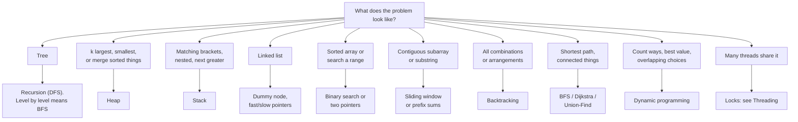

{: .no_toc}
# Start Here

This site is a field guide, not a textbook. Each page has the idea as a picture, two bold **key intuitions** per problem, and the code collapsed until you want it. If you only have a few weeks, follow the plan below and skip the rest.

- TOC
{:toc}

### How to use a problem page

1. Read the statement, then look at the **diagram**. Try to say the pattern out loud.
2. Read the two **key intuitions**. If they are enough, write the solution yourself before opening the code.
3. Open **Execute!** to compare. Anything under "Harder: come back to these" is for after the basics.

### If you see this, think that

| If the problem says… | Reach for | Page |
|---|---|---|
| tree, depth, path | DFS recursion | [Post-Order](Trees/PostOrder.md), [Pre-Order](Trees/PreOrder.md) |
| level by level, shortest | BFS with a queue | [Traversals](Trees/BinaryTree-Traversals.md) |
| k largest, merge k, median | Heap | [Heaps](Arrays/Heap.md) |
| matching brackets, next greater | Stack | [Stacks](Arrays/Stacks.md) |
| prefix of words, autocomplete | Trie | [Tries](Trees/Tries.md) |
| linked list | dummy node, fast/slow | [Linked Lists](Arrays/LinkedLists.md) |
| cache, O(1) get and put | hash map + doubly linked list | [LRU Cache](Misc/LRUCache.md) |
| sorted, pairs, from both ends | two pointers | [Two Pointers](Arrays/TwoPointers.md) |
| grid, shortest path, groups | BFS / DFS | [Graphs: BFS and DFS](Graphs/GraphBasics.md) |
| all combinations or arrangements | backtracking | [Backtracking](Graphs/DFS.md) |
| subarray sums | prefix sums | [Prefix Sums](Arrays/PrefixSums.md) |
| "make it thread-safe" | locks | [Threading](Misc/Threading.md) |

### Speed reference

| Operation | Cost |
|---|---|
| Hash map get / put | O(1) average |
| Sorting | O(n log n) |
| Binary search | O(log n) |
| Heap push / pop | O(log n); peek at the top O(1) |
| Build a heap from n items (`heapify`) | O(n) |
| Balanced BST search / insert | O(log n); a degenerate tree is O(n) |
| Trie insert / search a word of length L | O(L) |
| Stack / queue push and pop | O(1) |
| Linked list: reach the kth node | O(k); insert or delete given the node, O(1) (doubly linked) |
| BFS / DFS on a graph | O(V + E) |
| Dijkstra with a heap | O((V + E) log V) |

### A four-week plan (about an hour a day)

Highest-return topics first, then breadth.

| Week | Focus | Pages |
|---|---|---|
| 1 | Trees and recursion | [Post-Order](Trees/PostOrder.md), [Pre-Order](Trees/PreOrder.md), [Traversals](Trees/BinaryTree-Traversals.md), [Binary Search Trees](Trees/BinarySearchTree.md) |
| 2 | Heaps, stacks, linked lists | [Heaps](Arrays/Heap.md), [Stacks](Arrays/Stacks.md), [Linked Lists](Arrays/LinkedLists.md), [Doubly Linked Lists](Arrays/DoublyLinkedLists.md) |
| 3 | LRU cache, threading, tries | [LRU Cache](Misc/LRUCache.md), [Threading](Misc/Threading.md), [Tries](Trees/Tries.md) |
| 4 | Breadth: arrays, graphs, DP basics | [Two Pointers](Arrays/TwoPointers.md), [Binary Search](Arrays/BinarySearch.md), [Sliding Windows](Arrays/SlidingWindow.md), [Graphs: BFS and DFS](Graphs/GraphBasics.md), [Prefix Sums](Arrays/PrefixSums.md), [Dynamic Programming](Arrays/DynamicProgramming.md) |

Each session: redo yesterday's hardest problem from memory first (repetition beats new problems), then do one new problem.

