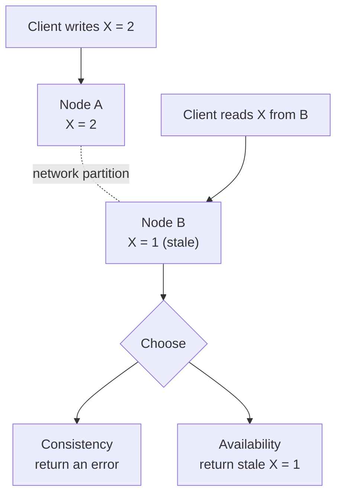
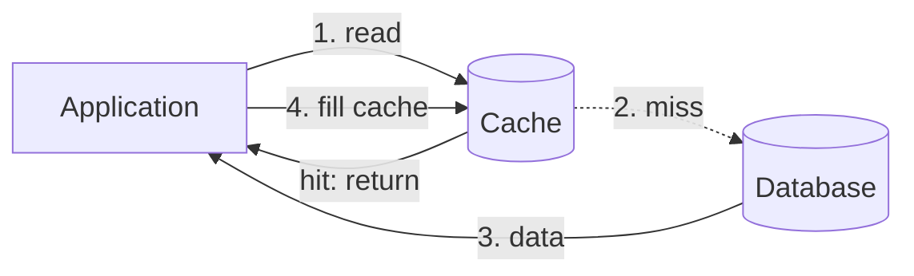

# System Design Concepts

A cheat sheet. Each entry starts with a question an interviewer might ask, then **Say it** (the short answer), **Also works, but not optimal** (the alternatives and why they lose), **Common mistake**, and **Seen in** (designs on this site that use the idea). Tap **Answer** to open each one, and **Go deeper** inside it for the detail. The ultimate primer: https://github.com/donnemartin/system-design-primer


<style>
/* Code on this page wraps instead of scrolling sideways, and the column is a little wider on desktop. */
pre, code { white-space: pre-wrap; overflow-wrap: anywhere; }
pre code { font-size: 12px; line-height: 1.45; }
@media (min-width: 961px) {
  .wrapper { width: 940px; }
  section { width: 640px; }
}
</style>

---

### A service sends 100M notifications a day. How much traffic and storage?

<details><summary markdown="span">Answer</summary>

**Say it:** "Round a day to about 100,000 seconds. 100M divided by 100,000 is about 1,000 per second on average (1,160 with the exact 86,400, so the shortcut is within 15%). I'd plan for 10 times that at peak, so about 10,000 per second. At 1 KB each, that is 100 GB a day, about 36 TB a year."

**Also works, but not optimal:**

* **Giving only the average.** It is easy, but the peak is what breaks the design.
* **Exact arithmetic with 86,400.** Correct, but slower to say out loud, and the extra precision is false: the inputs are guesses.

**Common mistake:** Giving one number. Always give the average **and** the peak.

**Seen in:** [Audit Log System](SystemDesignAuditLog.md) and [Push Notifications](SystemDesignPushNotifications.md) both start from this arithmetic.

<details><summary markdown="span">Go deeper: sizes, speeds and rules of thumb</summary>

Powers of two: 2^10 is about a thousand, 2^20 about a million, 2^30 about a billion, and 2^40 about a trillion.

* **Integers:** an unsigned b-bit integer holds 0 to 2^b - 1. A signed one holds -2^(b-1) to 2^(b-1) - 1. A 32-bit signed integer tops out at about 2.1 billion, and a 64-bit one at about 9.2 × 10^18.
* **Sizes:** ASCII character 1 byte (really 7 bits used). UTF-16 character 2 bytes (65,536 values, and 4 bytes for emoji and rarer characters). Long or double 8 bytes. Timestamp in nanoseconds 8 bytes. UUID 16 bytes.
* **A sample database row:** id (long) + username (10 characters) + email (50 characters) = 8 + 20 + 100 = 128 bytes, call it 150 with overhead. One billion users × 150 bytes = 150 GB.
* **Short links:** base-62 encoding of an MD5 hash of a long string. Seven base-62 digits give 62^7, about 3.5 trillion combinations (about 42 bits).

Sequential read speed, using the classic napkin figures (real hardware is often faster): a hard disk reads about 30 MB/s, an SSD about 1 GB/s, memory about 4 GB/s, and a 1 Gbps Ethernet link carries about 100 MB/s.

Round-trip time: about 0.5 ms inside one datacenter, 1 to 2 ms across zones in a region, 70 to 100 ms across a continent, and 100 to 200 ms between continents.

* **Rough rules of thumb:** a SQL database about 100 to 250 GB per node and about 25K requests per second. Redis about 300 GB and about 100K requests per second. A message queue handles thousands to hundreds of thousands of messages per second depending on the system, and a single Kafka partition roughly tens of thousands.

</details>
</details>


---

### The link between two datacenters fails. Do both sides keep accepting writes?

<details><summary markdown="span">Answer</summary>

**Say it:** "It depends on which is worse: wrong data or no answer. For money or inventory, stay **consistent**: the side that can't reach the majority refuses writes. For a feed, likes or notifications, stay **available**: keep accepting writes and reconcile when the link returns. This is CAP: during a partition you choose, and without a partition you get both."



**Also works, but not optimal:**

* **"We pick all three."** Not possible during a partition, and partitions are not optional on a real network.
* **Always choose consistency.** Needlessly turns away users for data that can tolerate being stale.
* **Always choose availability.** Silently creates conflicting writes for data that cannot tolerate them.

**Common mistake:** "Pick two of three." It is really consistency versus availability *during* a partition.

**Seen in:** the [Audit Log System](SystemDesignAuditLog.md) protects the record over speed, while [Push Notifications](SystemDesignPushNotifications.md) keeps the inbox correct and treats the push as best-effort.

<details><summary markdown="span">Go deeper</summary>

> Distributed systems can achieve either Consistency or Availability given Partition Tolerance. See also the [updated version of Eric Brewer's statement](https://research.google/pubs/pub45855/).

* **Consistency:** every read receives the most recent write, or an error.
* **Availability:** every request receives a response that is not an error, though it may not be the most recent write.
* **Partition tolerance:** the system keeps operating despite network failures between nodes.

More: [CAP theorem](https://en.wikipedia.org/wiki/CAP_theorem).

</details>
</details>


---

### A page is read 1,000 times per write and the database struggles. Which caching pattern?

<details><summary markdown="span">Answer</summary>

**Say it:** "Cache-aside. The application checks the cache, falls back to the database on a miss, and then fills the cache. It is simple, the application controls what is cached, and a cache outage only slows things down."



**Also works, but not optimal:**

* **Read-through.** The same effect, but the loading logic moves into the cache layer, which is less flexible.
* **Write-through.** Every write pays extra latency, for a workload that is almost all reads, and the cache fills with data nobody reads.
* **Write-around.** Fine when data is rarely read. Here the first read after every write misses.
* **Write-back.** Fastest writes, but the cache acknowledges before the database has the data, so a cache failure loses writes. Wrong for a source of truth.

**Common mistake:** Forgetting invalidation. The hard part of caching is keeping it correct, not filling it.

**Seen in:** [LRU Cache](Misc/LRUCache.md), which is the eviction policy behind many caches.

<details><summary markdown="span">Go deeper: all five patterns</summary>

**Cache-aside** is the general default. The app checks the cache, and on a miss it reads the database and updates the cache. Writes go to the database. The risk is stale entries.

**Read-through** has the cache check itself: on a miss it loads from the database, updates itself and returns the result. It is usually paired with another write pattern. The cost is more logic in the cache layer, and it suits read-heavy data and simpler application code.

**Write-through** reads from the cache, and writes go first to the cache and then to the database. Writes are slower, and it is best for data that is read soon after it is written.

**Write-around** lets only data that is read make its way into the cache, and always writes to the database. The first read is slow, and it is best for data that is written often but rarely read.

**Write-back** reads from the cache, and the cache acknowledges a write immediately and writes to the database after a delay. The risk is losing data if the cache dies, so it is for write-heavy, loss-tolerant data.

More: [caching strategies and how to choose](https://codeahoy.com/2017/08/11/caching-strategies-and-how-to-choose-the-right-one/).

</details>
</details>


---

### A worker may crash mid-send. Can a notification be sent exactly once?

<details><summary markdown="span">Answer</summary>

**Say it:** "No. An acknowledgment can be lost, so the sender must retry, and a duplicate is inevitable. I deliver **at-least-once** and make duplicates harmless with a unique ID, so the effect is exactly-once."

**Also works, but not optimal:**

* **At-most-once (never retry).** Loses messages on any crash. Wrong for anything that matters.
* **Claim a key first (`SET NX`), then send.** A crash after the claim leaves the key set, so the retry drops the message and it is lost. In a simulation of 200,000 notifications, claiming first lost 3,921, while sending first and then marking duplicated 3,856. Prefer a duplicate over a loss, and make duplicates harmless.

**Common mistake:** Promising exactly-once delivery. Promise exactly-once *effect*.

**Seen in:** the outbox in the [Audit Log System](SystemDesignAuditLog.md), deep dive 2 of [Push Notifications](SystemDesignPushNotifications.md), and the idempotent tickle in [The Binary SMS Tickle](SystemDesignSmsTickle.md).

<details><summary markdown="span">Go deeper</summary>

> Producers recovering from a failure retransmit messages for which no acknowledgment arrived. The consumer might have sent a confirmation that never reached the producer. A duplicate message is inevitably sent. See [the impossibility of exactly-once](https://blog.bulloak.io/post/20200917-the-impossibility-of-exactly-once/).
>
> Or, better stated: there are only two hard problems in distributed systems:
> 2. Exactly-once delivery
> 1. Guaranteed order of messages
> 2. Exactly-once delivery

</details>
</details>


---

### Two edits to one profile collide rarely. How do you avoid a silent overwrite?

<details><summary markdown="span">Answer</summary>

**Say it:** "Optimistic locking. Read the row with a version number, and write only if the version is unchanged. If no row was updated, someone else won, so re-read and retry or tell the user. Conflicts are rare, so almost nobody pays for it, and no lock is held while a user is thinking."

```sql
UPDATE profiles SET bio = :new_bio, version = version + 1
WHERE id = :id AND version = :version_i_read;
-- 0 rows updated means someone else changed it first
```

**Also works, but not optimal:**

* **Pessimistic locking (lock the row on read).** Blocks other requests, a slow or crashed client can hold the lock, deadlocks become possible, and throughput drops, all to protect against a conflict that rarely happens.
* **Last write wins.** Simple, but silently loses edits.

**When the answer flips:** a hot row with constant conflicts, such as the last ticket in a sale, a seat booking or a shared counter. Retries would thrash, so use a lock or an atomic update instead.

**Common mistake:** Trusting a distributed lock with a timeout. A holder that pauses can wake up after its lock expired and still write, so protect writes with a fencing token (a number that only increases).

**Seen in:** [Threading](Misc/Threading.md) and [LRU Cache](Misc/LRUCache.md), where a single re-entrant lock protects the cache.

<details><summary markdown="span">Go deeper</summary>

* **Optimistic locking:** read a record, note a version indicator (version number, timestamp, checksum or hash), and confirm it has not changed before you write the record back.
* **Pessimistic locking:** assume the record has changed or will change, and lock the resource before reading.

See also:

* [Impossibility of Distributed Consensus with One Faulty Process](https://www.the-paper-trail.org/post/2008-08-13-a-brief-tour-of-flp-impossibility)
* [Why RedLock won't work](https://martin.kleppmann.com/2016/02/08/how-to-do-distributed-locking.html) versus [its rebuttal](http://antirez.com/news/101)
* [Distributed Consensus](DistributedConsensus.md) on this site

</details>
</details>


---

### What happens when I type a URL?

<details><summary markdown="span">Answer</summary>

**Say it:** "DNS finds the address. TCP opens a connection with a three-step handshake. TLS then agrees on keys and checks the server's certificate. Finally the browser sends the HTTP request and gets the page."

1. **DNS lookup:** checked in the browser, the operating system and the resolver's cache first, otherwise asked down the chain from the root to the authoritative server.
2. **TCP handshake:** SYN, SYN-ACK, ACK, one round trip.
3. **TLS handshake:** one more round trip in TLS 1.3, and the certificate is verified.
4. **HTTP request and response.**
5. **The browser fetches the other resources,** often from a CDN.

**Common mistake:** Forgetting the caching layers (browser, resolver, CDN). Most requests skip some of these steps.

**Seen in:** [The Binary SMS Tickle](SystemDesignSmsTickle.md) explains TCP, TLS and the certificate chain in detail, and why a connection is costly on a flaky link.

<details><summary markdown="span">Go deeper: the vocabulary</summary>

TCP, UDP, HTTP, HTTPS, DNS, network interfaces, physical layer, ARP, VPN, firewalls, cookies, forward and reverse proxies, and [ISP/IX](https://en.wikipedia.org/wiki/Internet_exchange_point) (internet exchange points).

</details>
</details>


---

### Users post text in every language. Which encoding do you store and send?

<details><summary markdown="span">Answer</summary>

**Say it:** "UTF-8, almost always. It is the standard for the web, for JSON and for most protocols. It is backward compatible with ASCII, so old data stays valid. It has no byte-order problem. It is compact for English text, code and markup. And it is self-synchronizing, so you can find a character boundary from any byte."

**Also works, but not optimal:**

**UTF-16** uses 2 bytes per character, or 4 for emoji and rarer characters. It is not fixed-width either, so you lose constant-time indexing. It needs a byte order (big or little endian), and it doubles the size of English text. Its one real advantage is smaller CJK text (2 bytes versus 3), and compression mostly erases that.

**UTF-32** always uses 4 bytes. It is fixed-width by code point, so indexing is simple, but it needs four times the storage for English text.

**ASCII or Latin-1** uses 1 byte, and cannot represent most of the world's languages.

**When the decision actually matters** (the part a senior engineer should raise):

* **Database settings.** MySQL's `utf8` is really a 3-byte subset that **cannot store emoji**. Use `utf8mb4`.
* **Limits.** A "50 character" username limit: do you mean bytes, code points, or what the user sees? One visible character, such as an emoji with a skin tone, can be several code points and many bytes.
* **Comparing text.** "é" can be one code point or an "e" plus an accent. Normalize (for example to NFC) before comparing usernames, or two identical-looking names can differ.
* **Language runtimes.** Java and JavaScript strings are UTF-16 internally, so `length` counts code units, and an emoji counts as 2. Go strings are UTF-8 bytes.
* **Portability.** Agree on UTF-8 at every boundary (APIs, files, databases), and the other problems mostly disappear.
* **Capacity planning.** Budget 1 to 4 bytes per character, not exactly 1.

**Common mistake:** Assuming a string's length in characters equals its length in bytes, or that UTF-16 is fixed-width.

<details><summary markdown="span">Go deeper</summary>

* **Extended ASCII:** uses 8 bits (1 byte) for a maximum of 256 combinations. (Original ASCII used only 7 bits, 128 combinations, reserving the 8th bit for error checking.)
* **UTF-8:** starts at 8 bits but scales to over a million combinations by chaining up to 4 bytes. Navigation bits in each byte coordinate the width, which makes it a sequential stream immune to endianness issues.
* **UTF-16 and UTF-32:** hardcoded to 2 and 4 bytes respectively. They offer faster indexing but need more storage and are vulnerable to endianness issues. The UTF-16 caveat: complex characters such as emoji need 4-byte surrogate pairs, so it loses its fixed-width indexing advantage. It is the worst of both worlds.

</details>
</details>


---

### One database can't hold the data. How do you pick the server for a key?

<details><summary markdown="span">Answer</summary>

**Say it:** "Hash the shard key onto a ring and use **consistent hashing** with virtual nodes. A key belongs to the next server clockwise, so adding a server moves only about 1/N of the keys. Virtual nodes (100 or so points per server) even out the load. Pick a shard key that spreads writes and that most queries include, such as the user or the organization."

**Also works, but not optimal:**

* **`hash(key) mod N`.** Simple and evenly spread, but N is in the formula. I added an 11th server to 10 and **90.8% of 100,000 keys changed server**, which means a mass data migration and a cold cache. Fine only if the server count never changes.
* **Range sharding (A to F, G to M, and so on, or by date).** Range scans stay cheap, but hot spots are likely: a date key sends every new write to the newest shard.
* **A lookup table (a directory service).** Fully flexible, and you can move one tenant at a time, but the directory is one more component to keep fast and highly available. Large systems often combine it with the options above.

In the same test, going from 10 to 11 servers: `hash mod N` moved 90.8% of the keys, and the load stayed even. Consistent hashing with one point per server moved only 6.5% of the keys, but the busiest server carried **2.94 times** the average. With 100 points per server it moved 9.5% of the keys, and the busiest server carried only 1.14 times the average.

The ideal is 1/11, or 9.1%. One point per server moves fewer keys only because the load is lopsided, so use virtual nodes.

**Common mistake:** A shard key that is hot or low-cardinality (a country, a status, "today"). Also sharding too early: it makes joins, transactions across shards and resharding hard. Try indexes, caching and read replicas first.

**Seen in:** [Audit Log System](SystemDesignAuditLog.md), which shards by organization so one tenant's events stay together and in order.

<details><summary markdown="span">Go deeper</summary>

* **A hot key still defeats it,** because one celebrity or one huge organization lands on one server. Split that key (add a suffix and fan in on read), or give it a dedicated shard.
* **Replication on the ring:** store each key on the next 3 distinct servers clockwise, so a server failure loses nothing.
* **Resharding without downtime:** create many more logical shards than servers (say 1,024) and move whole shards between servers, so keys never rehash.
* **Cross-shard queries and transactions** are the real cost: avoid them in the design, or accept eventual consistency.

</details>
</details>


---

### Limit a client to 100 requests a minute across many servers.

<details><summary markdown="span">Answer</summary>

**Say it:** "A **token bucket** per client, kept in a shared fast store such as Redis. Tokens refill at a steady rate up to a capacity, and each request spends one. It allows a short burst up to the capacity but holds the average rate, and it stores only two numbers per client: the token count and the last refill time. The check and the update must be one atomic step (a Lua script or an atomic increment), otherwise two servers both see a token and both spend it."

**Also works, but not optimal:** I sent 100 requests at 59.9 seconds and 100 more at 60.1 seconds against a limit of 100 a minute.

**Fixed window counter** allowed **200** in those 0.2 seconds, twice the limit. It keeps one counter per client. It is the cheapest, but a burst across a window boundary doubles the limit.

**Sliding window log** allowed 100. It keeps up to 100 timestamps per client. It is exact, but memory grows with the limit.

**Token bucket** allowed 100. It keeps 2 numbers per client, and it allows controlled bursts.

A **sliding window counter** (weight the previous window's count) is a good approximation with almost no state. A **leaky bucket** smooths output to a constant rate, which suits protecting a downstream service more than an API.

**Common mistake:** Counting in each server's memory. With 10 servers the real limit is 10 times higher, and it changes as servers come and go. Also forgetting what happens when the limiter itself is down: usually fail open (allow), except for abuse-sensitive endpoints.

**Where it goes:** at the gateway or edge so rejected requests cost almost nothing, keyed by user, API key or IP, answering `429 Too Many Requests` with a `Retry-After` header. Use different limits per endpoint, since login attempts need a far lower limit than reads.

**Seen in:** per-user rate limits and priority lanes in [Push Notifications](SystemDesignPushNotifications.md).

<details><summary markdown="span">Go deeper</summary>

* **Local plus global:** each server enforces a small local allowance and syncs with Redis periodically. That trades accuracy for fewer round trips.
* **Fairness:** a separate limit per tenant stops one noisy customer from using up a shared limit.
* **Client side:** clients should back off with exponential delay and jitter, or retries become a self-inflicted spike.

</details>
</details>


---

### Latest 20 orders for a user is slow on 500,000 rows.

<details><summary markdown="span">Answer</summary>

**Say it:** "A **composite index** on `(user_id, created_at)`. The database jumps straight to that user's entries, already sorted by time, and reads the last 20, so it never scans the table and never sorts. The cost is that every write must also update the index, and the index takes space."

```sql
CREATE INDEX orders_user_time ON orders (user_id, created_at DESC);
SELECT id FROM orders WHERE user_id = 777 ORDER BY created_at DESC LIMIT 20;
```

I measured this in SQLite with 500,000 orders from 20,000 users:

With no index the query took 23.18 ms: the plan scans the whole table, then sorts. With an index on `user_id` only it took 0.04 ms: the plan finds the user's rows, but still sorts them. With an index on `(user_id, created_at)` it took 0.02 ms: one index lookup and no sort.

**What it costs on writes** (200,000 inserts): no secondary index 881,000 a second, one index 306,000 (**2.9 times slower**), three indexes 205,000 (**4.3 times slower**). So index the queries you actually run, not every column.

**Also works, but not optimal:**

* **Index every column.** Writes slow down and storage grows, and most of those indexes are never used.
* **Add a cache in front of the slow query.** It hides the problem for repeated reads but not for the first read of each user, and it adds invalidation to worry about.
* **Add read replicas or more hardware.** It spreads the load, but each query still scans 500,000 rows.

**Common mistake:** Getting the column order wrong. The same index did not help a query on `created_at` alone: it still took 22.61 ms. Put the equality columns first, then the sort or range column. Also wrapping the column in a function in the `WHERE` clause (`LOWER(email) = ...`), which stops the index being used.

**Seen in:** [Audit Log System](SystemDesignAuditLog.md), where the index is built off the critical path from the durable log, so it never slows the write.

<details><summary markdown="span">Go deeper</summary>

* **A B-tree index** keeps entries sorted, so it serves equality, ranges and ordering. A hash index serves equality only.
* **Covering index:** if the index holds every column the query needs, the table is never touched. The last plan above says `COVERING INDEX`.
* **Selectivity:** an index on a column with two values (a status) helps little. Check the plan (`EXPLAIN`) before and after rather than guessing.
* **Paging:** for deep pages use a cursor (`WHERE created_at < :last_seen`), not `OFFSET`, which still walks every skipped row.

</details>
</details>


---

### Service A hands work to service B. Queue or stream?

<details><summary markdown="span">Answer</summary>

**Say it:** "It depends on what B needs. A **queue** hands each message to one worker and removes it when acknowledged, which fits a job to be done once, such as sending an email. A **stream** (a log, such as Kafka) keeps messages in order for a retention period, and each consumer group tracks its own position, so several consumers can read the same events and you can replay them. If one event feeds several systems, or you may need to reprocess history, choose the stream."

**Each job done by one worker:** natural for a queue, and it works in a stream within a partition.

**Many independent consumers of the same event:** a queue needs a copy per consumer, and a stream does it natively.

**Replay after a bug, or for a new consumer:** a queue loses the message once it is acknowledged, and a stream lets you rewind the position.

**Ordering:** a queue is usually best effort, and a stream is strict within a partition (use the key, such as the user).

**Scaling consumers:** with a queue you add workers freely, and with a stream you are limited by the number of partitions.

**A slow single message (a poison message):** a queue retries it, then sends it to a dead-letter queue, and in a stream it blocks that partition until it is handled.

**Also works, but not optimal:**

* **A direct call (HTTP) from A to B.** Simple, but A fails or slows down whenever B does, and a spike hits B directly. Use it only when A truly needs the answer now.
* **A database table polled as a queue.** Fine at low volume and it keeps the data transactional, but polling costs, and it breaks down at scale. (The outbox pattern uses a table only to hand off to a real queue.)

**Common mistake:** Assuming either gives exactly-once delivery. Both are at-least-once, so the consumer must be idempotent. Also forgetting what grows when the consumer is slow: queue depth and consumer lag need alerts and a backpressure plan.

**Seen in:** the durable queue and the replayable audit stream in [Audit Log System](SystemDesignAuditLog.md), and the priority lanes (separate queues) in [Push Notifications](SystemDesignPushNotifications.md).

<details><summary markdown="span">Go deeper</summary>

* **Ordering and parallelism pull against each other.** A stream keeps order only inside a partition, so choose the key (the user, the organization) so that events that must stay in order share a partition.
* **A hot key** overloads one partition. The fix is the same as for a hot shard.
* **Retention** is a cost knob: a stream is a database that you chose to keep for days.
* **Dead-letter queue:** park messages that keep failing so one bad message cannot stop everything behind it.

</details>
</details>
