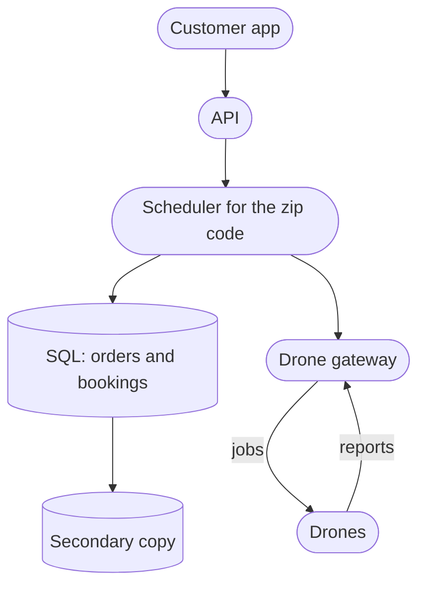
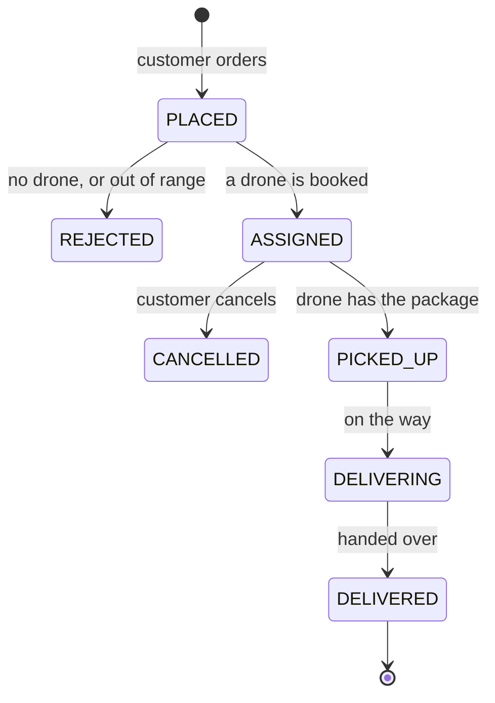

{: .no_toc}
# Drone Delivery

> Design a platform for a company that delivers packages using autonomous drones. A customer places an order, the system assigns a drone, and the drone picks up the package and delivers it to the customer's location.

<style>
/* Code on this page wraps instead of scrolling sideways, and the column is a little wider on desktop. */
pre, code { white-space: pre-wrap; overflow-wrap: anywhere; }
pre code { font-size: 12px; line-height: 1.45; }
@media (min-width: 961px) {
  .wrapper { width: 940px; }
  section { width: 640px; }
}
</style>

- TOC
{:toc}

### 1. What we are building

A customer opens the app and picks something from the catalog of what is available in their zip code, and gives a delivery address as a latitude and longitude. We make two promises. The package arrives **exactly once**, and it arrives **within the time window**. If we feel we cannot keep the promise, we say so straight away with an error, because a clear no is better than a broken promise.

Start small and say so out loud. One zip code, a proof of concept first, and the zip code as the shard key, so that each zip code can later become its own copy of the system. The radius of a zip code is not exact, and the weight of a package is assumed not to matter. Both are things to note and move on from.

The scale is one to ten million orders per zip code. I would read that as per year. Ten million a year is about 27,000 a day, or one order every three seconds on average. Even if it meant per day, that is about 116 a second, and perhaps a thousand a second at the busiest moment. That is within reach of one SQL primary database, and the realistic reading, per year, is tiny next to it. So the hard part of this problem is not speed. It is being correct.

There are two things I would confirm with the interviewer before drawing anything. First, the promise is a window, here two days from the order's start time, and saying no at order time is acceptable. Second, a drone carries one package at a time and flies from a depot in the zip code and back.

Now the hard part. Think of booking a meeting room. Two people ask at the same moment, both see the room free, and both book it. The calendar is the one thing that must say no to the second person. Here the rooms are drones, and the calendar is a table of who holds which drone for which time. Everything else is easy next to making that calendar honest. The second hard part is exactly once. Phones retry when the network drops, and drones report the same thing twice.

The pieces are few. An API takes the order. One scheduler for each zip code decides which drone gets it, and writes the decision to a SQL database that keeps the orders and the bookings, with a secondary copy ready to take over. A gateway talks to the drones, sending them their jobs and receiving their reports.



### 2. The simplest version

An order comes in, so give it the first drone that is free.

<details><summary markdown="span">Execute! (the simplest version)</summary>

```python
drones = [] # the drone ids in this zip code
busy = set() # drones that are on a delivery right now


def place_order(order_id):
    for drone in drones:
        if drone not in busy:
            busy.add(drone)
            return drone

    return None # no drone is free: say so now
```

</details>
<BR>


That is the whole idea, and it is wrong in four ways. A drone is either busy or free, with no sense of time, so it can never be promised for tomorrow. Two orders that arrive together can both see the same drone free. A customer's retry looks like a brand new order. And when a drone breaks down halfway, nobody notices. The next sections fix these one at a time.

### 3. Never giving one drone to two orders

Cut time into slots of fifteen minutes. A booking is simply this drone, these slots, for this order. Now give the booking table a **primary key on the drone and the slot**. The database then refuses to hold the same drone for the same slot twice, and that refusal is the calendar saying no.

<details><summary markdown="span">Execute! (the booking table, and booking a drone)</summary>

```sql
CREATE TABLE booked (drone TEXT, slot INTEGER, order_id TEXT, PRIMARY KEY (drone, slot));
```

```python
def book(db, drone, first, last, order_id):
    try:
        with db:
            for slot in range(first, last + 1):
                db.execute("INSERT INTO booked VALUES (?, ?, ?)", (drone, slot, order_id))

        return True # every slot was free and is now ours
    except sqlite3.IntegrityError:
        return False # someone holds one of them, and nothing of ours was kept
```

</details>
<BR>


A trip needs several slots in a row, so `book` takes them all in one transaction. If any one of them is already held, the database refuses, the whole transaction rolls back, and nothing is left half booked. Notice that we never look first and book second. We just try, and let the database decide. It decides correctly even if two servers ask in the same millisecond, so we do not have to trust our own code to check in time.

I measured it. Thirty orders arrive at once for three drones that can carry twelve deliveries between them. Checking first and booking after promised all thirty, and stacked 54 to 56 extra bookings on slots that were already taken, in each of five runs. With the primary key it promised exactly twelve and double-booked none.

One more thing, as a separate note. Because the zip code is the shard key, one scheduler can own each zip code and make these decisions one after another. That is not needed for correctness, since the database already refuses. It just stops two servers from racing for the same drone and retrying.

### 4. Is the drone free for the whole trip?

A drone is not free just because it is idle right now. It has to be free for the whole trip: out to the customer, the hand-over, and back, plus loading at the depot and a safety margin. So we work out how many slots the trip needs. Four kilometres is ten minutes of flying there and back, plus twenty minutes of handling and margin, which is thirty minutes, or two slots.

Then we look for a place for it. Start at the earliest time the customer allows and move later one slot at a time, up to the latest start that still finishes inside the window. For each start, try each drone, and the first booking that works wins. If nothing works, the answer is no, with the reason.

<details><summary markdown="span">Execute! (how long a trip takes, and finding a drone for it)</summary>

```python
SLOT = 15 # minutes: time is cut into slots like this
SPEED = 0.8 # km per minute, about 48 km/h
HANDLING = 10 # minutes to load at the depot and to hand over
BUFFER = 10 # minutes of safety margin
RANGE = 20 # km: farther than this we cannot deliver


def slots_needed(km):
    minutes = 2 * km / SPEED + HANDLING + BUFFER # there and back
    return math.ceil(minutes / SLOT)


def place_order(db, drones, order_id, km, t1, t2): # t1 and t2 are slot numbers
    if km > RANGE:
        return None, "OUT_OF_RANGE"

    need = slots_needed(km)

    for start in range(t1, t2 - need + 2): # the latest start still finishes by t2
        for drone in drones:
            if book(db, drone, start, start + need - 1, order_id):
                return drone, start

    return None, "NO_DRONE_AVAILABLE"
```

</details>
<BR>


The earliest start wins, which packs the drones tightly and leaves the most room for later orders. The no is the second promise at work: we tell the customer at once, and we say why, either out of range or no drone available, instead of accepting an order we cannot keep. A two-day window has about 190 start times, so an order that is refused tries every start on every drone, and that is the most work any order does. Each try is cheap and safe, because the primary key makes it so. If the refusals ever become a cost, ask the table which drones have free slots in the window before trying to book.

### 5. One order, one delivery

Phones retry. The customer taps order, the network drops, and the app sends the same order again. Without help that is two orders and two drones. The fix is an **idempotency key**. The app makes a random id when the customer taps order, and sends the same id on every retry. The order table has that id as its primary key, so the second insert does nothing, and the retry is simply given the same answer as the first.

<details><summary markdown="span">Execute! (a retry gets the same answer)</summary>

```python
def create(db, order_id):
    with db:
        done = db.execute("INSERT OR IGNORE INTO orders VALUES (?, 'PLACED', NULL, NULL)", (order_id,))

    return done.rowcount == 1 # False: we already had this order, so a retry changes nothing


def current(db, order_id):
    return db.execute("SELECT state, drone, start FROM orders WHERE order_id = ?", (order_id,)).fetchone()


def place(db, drones, order_id, km, t1, t2):
    if not create(db, order_id):
        return current(db, order_id) # a retry: answer exactly as before

    drone, detail = place_order(db, drones, order_id, km, t1, t2) # detail: the start slot, or the reason for saying no

    if drone is None:
        move(db, order_id, "PLACED", "REJECTED")
        return "REJECTED", None, detail

    with db:
        db.execute("UPDATE orders SET state = 'ASSIGNED', drone = ?, start = ? WHERE order_id = ?", (drone, detail, order_id))

    return "ASSIGNED", drone, detail
```

</details>
<BR>


The order is created first and the drone is booked second. That order matters. If twenty identical retries arrive together, only one of them gets to create the order, and the other nineteen are handed its answer. I ran that: twenty simultaneous retries made one order and one booking.

Then the order moves through states, and each move is a conditional update: go from this state to that one, only if it is still in this state.



<details><summary markdown="span">Execute! (a state can be left only once)</summary>

```python
def move(db, order_id, old, new):
    with db:
        done = db.execute("UPDATE orders SET state = ? WHERE order_id = ? AND state = ?", (new, order_id, old))

    return done.rowcount == 1 # only one caller can make this particular move


def delivered(db, order_id, drone, notify):
    with db:
        done = db.execute("UPDATE orders SET state = 'DELIVERED' WHERE order_id = ? AND state = 'DELIVERING' AND drone = ?", (order_id, drone))

    if done.rowcount == 1: # only the drone that holds the order can finish it
        notify(order_id) # runs once, however many times that drone reports it
```

</details>
<BR>


This is what exactly once really means. We cannot stop a drone from reporting delivered twice, or a network from repeating a message. What we can do is make the second report change nothing. Only one caller wins the move to delivered, so the customer is told once. I ran that too: twenty reports of the same delivery, and one notification.

### 6. When a drone fails

A drone loses its signal, or its battery fails. We mark it failed and **give its slots back**, then book a different drone inside what is left of the window. It is still the same order, with the same id, and the customer does not need to do anything.

<details><summary markdown="span">Execute! (give the slots back and book another drone)</summary>

```python
def reassign(db, drones, order_id, failed, km, now, t2):
    with db:
        db.execute("DELETE FROM booked WHERE order_id = ?", (order_id,)) # give the failed drone's slots back

    others = [drone for drone in drones if drone != failed]
    drone, start = place_order(db, others, order_id, km, now, t2) # book again inside what is left of the window

    if drone is not None:
        with db:
            db.execute("UPDATE orders SET state = 'ASSIGNED', drone = ?, start = ? WHERE order_id = ?", (drone, start, order_id))

    return drone, start
```

</details>
<BR>


The two-day window is what makes this work, because there is slack to try again. If nobody can take the order inside the window, the honest answer is to tell the customer early, and to refund. The slots that the failed drone gave back are free for the very next order, so nothing is wasted.

There is one trap. A drone we gave up on may still be flying, and may still deliver. That is why `delivered` takes the drone's id, and only accepts a report from the drone that holds the order right now. The old drone's report is ignored, and the order cannot be delivered twice.

### 7. Edge cases and what to watch for

**Proof of delivery.** Delivered should mean something. Ask for evidence, such as a photo, the drone's position at the address, or a code the customer reads out, before the order moves to delivered.

**A drone fails after pickup.** Giving the slots back is not enough, because the package is on the broken drone. Someone has to recover it, and the order may need a new package, or a refund. Keep that as its own state so it is not lost.

**The customer is not home, or the landing spot is unsafe.** The drone brings the package back, the order moves to a returned state, and the customer is told what happens next.

**Weather and no-fly zones.** A whole fleet can be grounded at once. Mark the drones unavailable, and then place the affected orders again, starting with those that have the least slack left in their window.

**Our estimates are wrong.** Wind and battery make trips longer than planned. The safety margin absorbs some of it. Record real trip times, use them to correct the estimate, and re-plan a drone that is running late, since the window has slack.

**Cancelling.** Allowed only before pickup. It is a conditional move from assigned to cancelled, together with giving the slots back, in the same transaction.

**Clocks.** Slots are numbers chosen by the server. Never trust a drone's own clock to decide who holds what.

**One zip code grows too big.** A big city can outgrow one primary database. Split it by depot, which is a natural boundary, since a drone only flies from its own depot.

**Failover.** The secondary takes over if the primary dies. Even if two schedulers briefly both think they are in charge, the primary key still refuses a double booking, so correctness never depended on there being only one.

**Telling the customer.** Confirmations and updates go through the notification system, see [Push Notifications](SystemDesignPushNotifications.md). The order must never fail because a notification could not be sent.

**Knowing it is healthy.** Watch how many orders are refused for no drone, how long it takes from order to assignment, how many deliveries are running late, and how many drones have gone silent. Alert when the late ones start to rise.
