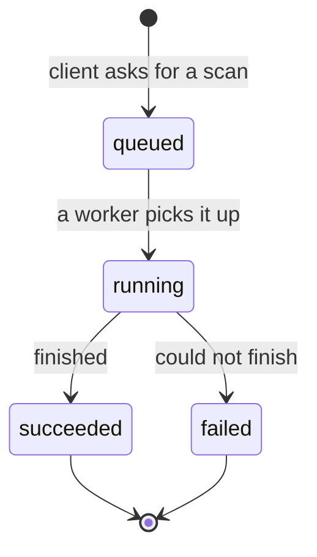

{: .no_toc}
# Remote Scans API

> Design a REST API for a remote scanning service. A client starts a scan with some parameters and gets back a scan ID. It then uses that ID to ask how the scan is going, and to get the result.

This is the API I built for a unified remote scanning system at high scale. A scan is a good example because it is **slow work behind a fast API**, and that is the shape of most real APIs.

<style>
/* Code on this page wraps instead of scrolling sideways, and the column is a little wider on desktop. */
pre, code { white-space: pre-wrap; overflow-wrap: anywhere; }
pre code { font-size: 12px; line-height: 1.45; }
@media (min-width: 961px) {
  .wrapper { width: 940px; }
  section { width: 640px; }
}
</style>

- TOC
{:toc}

### 1. The idea

A scan can take minutes or hours, so the API cannot wait for it to finish. Instead it works in two steps. First the client asks for a scan to start, and the server answers right away: "accepted, here is its ID". Later the client uses that ID to ask how the scan is going. When the status says it has finished, the result is there too.

A scan moves forward through a few states and never goes back.



### 2. The simplest version

Start here, in an interview and in real life. It does only what the idea says: start a scan, then check on it. There is no login, no limits and no database. It is about 40 lines.

<details><summary markdown="span">Execute! (the simplest version)</summary>

```python
app = Flask(__name__)

SCAN_SECONDS = 2

scans = {} # (tenant, scan id) -> the scan


@app.put("/v1/tenants/<tenant>/scans/<scan_id>")
def start_scan(tenant, scan_id):
    key = (tenant, scan_id)

    if key in scans:
        return scans[key], 200 # a retry: here is the scan we already have

    scans[key] = {"id": scan_id, "status": "queued", "params": request.get_json()}
    reply = dict(scans[key])

    threading.Thread(target=run_scan, args=(key,)).start()

    return reply, 202 # accepted, not finished yet


@app.get("/v1/tenants/<tenant>/scans/<scan_id>")
def get_scan(tenant, scan_id):
    scan = scans.get((tenant, scan_id))

    if scan is None:
        return error(404, "not_found", "no such scan")

    return scan


def run_scan(key):
    scans[key]["status"] = "running"
    time.sleep(SCAN_SECONDS)
    scans[key]["status"] = "succeeded"


def error(status, code, message):
    return {"error": {"code": code, "message": message}}, status
```

</details>
<BR>


Here is how it reads, top to bottom. `scans` is our memory of every scan, looked up by the tenant and the scan ID. `start_scan` is the first endpoint. If we have already seen this scan ID it returns the scan we have. Otherwise it records the new scan as `queued`, starts the work on a background thread, and answers straight away with `202 Accepted`. `get_scan` is the second endpoint: it returns the scan, or a `404` if there is no such scan. `run_scan` stands in for the real work, which takes two seconds. `error` makes every error look the same.

Running it and calling it with `curl` looks like this:

```
$ curl -i -X PUT localhost:5059/v1/tenants/acme/scans/9b2c4e1a-6d3f-4a8e-b1c7-5f0e2d8a7c31 \
       -H 'Content-Type: application/json' -d '{"target":"example.com"}'
HTTP/1.1 202 ACCEPTED
{"id":"9b2c4e1a-...","params":{"target":"example.com"},"status":"queued"}

$ (the same command again)
HTTP 200

$ curl localhost:5059/v1/tenants/acme/scans/9b2c4e1a-...
{"id":"9b2c4e1a-...","params":{"target":"example.com"},"status":"running"}

$ curl localhost:5059/v1/tenants/acme/scans/9b2c4e1a-...    (three seconds later)
{"id":"9b2c4e1a-...","params":{"target":"example.com"},"status":"succeeded"}

$ curl localhost:5059/v1/tenants/acme/scans/does-not-exist
{"error":{"code":"not_found","message":"no such scan"}}   [HTTP 404]
```

### 3. What even the simple version gets right

Several of the lessons are already in those 40 lines, and they are the ones that are painful to add later.

**The version is in the URL.** Everything starts with `/v1`. You will change the API one day, and the old clients must keep working while the new ones use `/v2`. Adding a field to a response is safe. Removing or renaming one is not, and that is when you need a new version.

**The tenant is in the URL.** Every request says which customer it is about. That makes it easy to check permissions, to put the customer's name in the logs, to throttle per customer, and to spread customers across servers later.

**The URL names a thing, not an action.** It is `.../scans/{scan_id}`, not `/startScan` or `/getScanStatus`. The HTTP method says what to do with the thing: `PUT` to create it and `GET` to read it.

**The client picks the scan ID, which makes retries safe.** This is the idempotency design, and it comes free with `PUT`. Networks fail. If the reply to "start a scan" is lost, the client cannot know whether the scan started, so it sends the same request again. Because the client chose the ID, the server can tell that it has seen this one before, and it answers with the existing scan (`200`) instead of starting a second one. Doing something twice has the same effect as doing it once, and that is all idempotent means.

**Slow work gets a quick `202`.** The request returns in milliseconds even though the scan takes minutes. `202` is the honest answer: "I accepted this, it is not finished".

### 4. What is still missing

The simple version would not survive a real customer. Each missing piece below is a small addition, and each one is a function that Flask runs **before** the route (`before_request`), so the two routes above do not change at all. They run in the order they are added.

**Who is calling.** Right now anyone can call it. Every request needs a bearer token in the `Authorization` header. The token says who the caller is and which tenant they belong to, and we look it up by its **hash**, so a leaked table is not a leaked key. How tokens are made and checked is in [Password Storage](SystemDesignPasswordStorage.md#9-after-sign-in-bearer-tokens). A token also carries scopes, such as `scans:read` and `scans:write`, so a reporting tool can look at scans without being able to start them.

<details><summary markdown="span">Execute! (the token, the tenant and the scope)</summary>

```python
tokens = {} # sha256 of a token -> {"tenant": "acme", "scopes": ["scans:read", "scans:write"]}
NEEDS  = {"GET": "scans:read", "HEAD": "scans:read", "PUT": "scans:write"}


@app.before_request
def check_token():
    kind, _, token = request.headers.get("Authorization", "").partition(" ")
    g.token = hashlib.sha256(token.strip().encode()).hexdigest()
    g.who   = tokens.get(g.token)

    if kind.lower() != "bearer" or g.who is None:
        return error(401, "unauthenticated", "send Authorization: Bearer <token>")


@app.before_request
def check_tenant_and_scope():
    if request.view_args is None:
        return # not one of our URLs

    if request.view_args["tenant"] != g.who["tenant"]:
        return error(404, "not_found", "no such resource") # not 403: do not reveal that it exists

    needs = NEEDS.get(request.method)
    if needs and needs not in g.who["scopes"]:
        return error(403, "forbidden", "this token lacks the scope " + needs)
```

</details>
<BR>


`check_token` answers `401` unless the header is `Bearer` followed by a known token. `check_tenant_and_scope` then compares the tenant in the URL with the tenant in the token. If they differ the answer is `404`, not `403`, because a `403` would tell an attacker that the scan exists and they are only missing permission, while a `404` tells them nothing. After that it checks that the token has the scope this method needs, and answers `403` if not.

**Throttling.** One customer with a runaway script must not slow down everyone else. Each token gets an allowance: a burst of requests at once, and then a steady rate. When it is spent, the answer is `429 Too Many Requests` with a `Retry-After` header that says how many seconds to wait. This is the same idea that a well-behaved client follows when it retries, as in [Paged REST API Client (Kotlin)](SystemDesignRestReport.md).

<details><summary markdown="span">Execute! (a token bucket per token)</summary>

```python
clock = time.monotonic

BURST      = 10  # requests a token may make at once
PER_SECOND = 5.0 # and how fast the allowance refills

buckets = {} # token -> (requests left, when we last looked)
lock    = threading.Lock()


@app.before_request
def throttle():
    with lock:
        now = clock()
        left, last = buckets.get(g.token, (BURST, now))
        left = min(BURST, left + (now - last) * PER_SECOND)

        if left >= 1:
            buckets[g.token] = (left - 1, now)
            return # allowed

        buckets[g.token] = (left, now)
        wait = math.ceil((1 - left) / PER_SECOND)

    body, status = error(429, "rate_limited", "too many requests")
    return body, status, {"Retry-After": str(wait)}
```

</details>
<BR>


The allowance is kept as "requests left" and "when we last looked". Each time, the allowance has grown by the time that passed times the refill rate, up to the burst size. If at least one request is left, it is spent and the request goes on. If not, the answer is `429` and the wait is how long until one request has refilled.

**Checking the input.** The server should never trust what arrives. The scan ID must be a GUID in lower case. The body must be an object with the fields we expect, in the ranges we expect, and unknown fields are rejected, so a typo does not silently do nothing. A mistake in the request is `400`. The same file also gives every response an `X-Request-ID`, so that when a customer reports a problem, you can find exactly what happened in the logs, and makes the error for an unknown URL or a wrong method look like all the others.

<details><summary markdown="span">Execute! (input checks, request ids and one error shape)</summary>

```python
FIELDS   = ("target", "profile")
PROFILES = ("quick", "full")


@app.before_request
def check_input():
    if request.method != "PUT" or request.view_args is None:
        return

    scan_id = request.view_args["scan_id"]
    body    = request.get_json(silent=True)

    if not is_guid(scan_id):
        return error(400, "invalid_id", "the scan id must be a GUID, in lower case")

    if not isinstance(body, dict):
        return error(400, "invalid_request", "the body must be a JSON object")

    if any(name not in FIELDS for name in body):
        return error(400, "invalid_request", "unknown field")

    if not isinstance(body.get("target"), str) or not 0 < len(body["target"]) <= 255:
        return error(400, "invalid_request", "target must be text of 1 to 255 characters")

    if body.get("profile", "quick") not in PROFILES:
        return error(400, "invalid_request", "profile must be quick or full")


@app.after_request
def add_request_id(response):
    response.headers["X-Request-ID"] = str(uuid.uuid4()) # so a support ticket can be traced
    return response


@app.errorhandler(404)
def no_such_url(e):
    return error(404, "not_found", "no such resource")


@app.errorhandler(405)
def wrong_method(e):
    return error(405, "method_not_allowed", "that method is not supported here")


def is_guid(text):
    try:
        return str(uuid.UUID(text)) == text
    except ValueError:
        return False
```

</details>
<BR>


**Two retries at the same moment.** In the simple version, two identical requests that arrive together can both pass the "have I seen this ID" check and both start a scan. Checking and creating must be one step that cannot be interleaved, and this version of `start_scan` does that with a lock. It also notices a client mistake: the same ID with different parameters is a `409`. The last line swaps it in for the simple version.

<details><summary markdown="span">Execute! (start_scan with a lock)</summary>

```python
lock = threading.Lock()


def start_scan(tenant, scan_id):
    key    = (tenant, scan_id)
    params = request.get_json()

    with lock: # the check and the create are one step now
        if key in scans:
            if scans[key]["params"] != params:
                return error(409, "id_in_use", "that scan id was used with different parameters")

            return dict(scans[key]), 200 # a retry: here is the scan we already have

        scans[key] = {"id": scan_id, "status": "queued", "params": params}
        reply = dict(scans[key])

    threading.Thread(target=run_scan, args=(key,)).start()

    return reply, 202 # accepted, not finished yet


app.view_functions["start_scan"] = start_scan # replaces the version without the lock
```

</details>
<BR>


One lock for everything is the simplest version, and a real service would lock per scan ID, or let a database do it with a unique key, as in the [Log Aggregator](SystemDesignLogAggregator.md).

I tested the pieces both on their own and plugged together, including the cases that go wrong: a token for the wrong tenant, a token with the wrong scope, a request over the allowance, bad input of every kind, and many identical requests at once. The race is real: with the lock removed and a slow store, several of the requests start a scan, and with the lock exactly one does. Each check was also broken on purpose to see that the tests notice.

### 5. Edge cases worth talking through

**The reply to "start a scan" is lost.** The client sends the same request again with the same ID, and the server returns the scan it already has. If the same ID arrives with *different* parameters, something is wrong on the client side, and the answer is `409 Conflict`.

**A million clients polling for status.** The status check becomes the busiest endpoint, much busier than starting scans. Tell clients to wait longer between checks, send `Retry-After`, support `ETag` so an unchanged status returns a cheap `304 Not Modified`, and cache finished scans. The best fix is to offer a webhook, so clients are told when the scan finishes and do not have to ask. See [Webhook Delivery and Back Pressure](SystemDesignWebhooks.md).

**A worker dies halfway through a scan.** A worker should hold a lease on the scan, a claim that expires, and renew it regularly. If the worker stops, the lease runs out and the scan goes back on the queue for another worker. That means a scan can run more than once, so the scan itself must be safe to repeat, or its result must be written only once.

**One tenant sends a hundred thousand scans.** Limit how many of a tenant's scans can run at the same time, and take turns between tenants so one cannot fill the queue and make everyone else wait. Beyond the limit you can reject with `429`, or accept the scan and leave it `queued` with an honest estimate.

**Cancelling a scan.** Offer `DELETE` on the scan, or a separate cancel action. The tricky part is the race: the scan may finish at the very moment the client cancels. The rule is that a scan ends in exactly one final state, and cancelling a scan that has already finished does nothing and returns its real state.

**The result is huge.** Do not put it in the status response. Return a link to a separate results resource that is paged, or a short-lived download link, and delete old results after a stated time.

**Listing all of a tenant's scans.** Use a filter on status, a maximum page size, and a cursor to continue from where the last page ended. Never return an unbounded list.

**Could someone guess a scan ID?** A random GUID is very hard to guess, but never rely on that. Every request is still checked against the token's tenant.

**Changing the API later.** Adding optional fields and new endpoints is safe, as long as clients ignore fields they do not know. Anything that breaks existing clients goes in `v2`. When you retire something, announce it ahead of time with `Deprecation` and `Sunset` headers.

**What does the status show on a retry?** It only moves forward: `queued`, then `running`, then one final state. If a scan is restarted after a worker failure it stays `running`, perhaps with an attempt count. It never goes backwards.

**`PUT` with a client ID, or `POST` with a server ID.** The usual way to create something is `POST /scans`, and the server chooses the ID. It is more familiar, but a retry would start a second scan, unless you also add an `Idempotency-Key` header and a table to remember it. Letting the client choose the ID avoids all that. The cost is that you must check the ID is well formed, and trust clients to make good random ones.

**Polling, webhooks or long polling.** Polling is simple and puts the work on the client, but it creates a lot of traffic. Webhooks remove that traffic, but you must then deliver them reliably, retry them and sign them. Long polling holds the request open until the state changes.

**Tenant in the URL or only in the token.** The URL makes the request explicit and easy to route. The token is the trusted source. So use both, and check that they agree.

**Throttle per token or per tenant.** Per token stops one script. Per tenant stops a customer who creates many tokens. Real systems do both.

**An in-memory store or a database.** The code keeps scans in a dictionary, so a restart loses them. In production the scan's state lives in a database, which is the source of truth, and the work waits on a durable queue.

**Auditing.** Record who started which scan, from which token, with which parameters. It helps with support and with security reviews.
