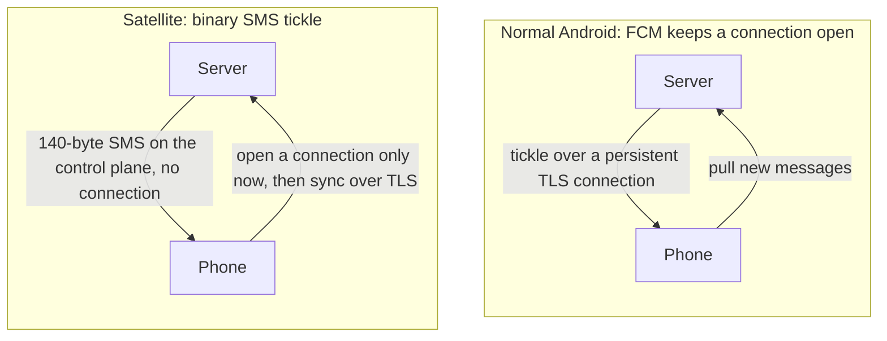

{: .no_toc}
# The Binary SMS Tickle

My favourite project, told as a story, with the background I need to be comfortable if the interviewer digs in. Related: the [Audit Log System](SystemDesignAuditLog.md) walkthrough.

- TOC
{:toc}

### 1. The story (about two minutes, spoken)

"At Google Messages we needed to push new-message alerts to phones over a satellite link. The normal Android path is FCM. The phone keeps one persistent, TLS-encrypted connection to Google, and to notify an app you send a small *tickle* over it, and the phone then pulls the real data.

That works on a normal network, but a persistent connection needs keepalive traffic that keeps the radio awake, and on satellite it doesn't work at all. Each satellite was overhead for about five minutes and the link was flaky, so every handoff would drop the connection and force a new TCP and TLS handshake: several kilobytes and a few round trips, every time.

Our insight was that the push doesn't have to carry data. It only has to say 'go and check'. So we sent the tickle as a **binary SMS**. It rides the cellular control plane, needs no data session and no handshake, and fits in one 140-byte message. The Messages app watches for it, and when it arrives, the app starts a normal encrypted sync over whatever connection is available.

The tickle carries no message and no ID, so loss, duplication and replay are all harmless: the worst case is one extra sync. A periodic sync covers lost tickles, so delay is bounded by the sync interval. And a spoofed tickle can't inject content, because content only arrives through the authenticated pull.

The trade-off is an extra pull after each tickle, and SMS is best-effort. It pays off when you can't hold a connection. For chatty traffic on a stable network, a persistent connection is still better. Result: one 140-byte message, over 20 times fewer bytes than opening a new TLS connection. *(Use 85% only if I can name its baseline.)*

What I took from it: treat push as a nudge, keep the source of truth elsewhere, and design so a lost or duplicate nudge costs almost nothing."

### 2. Background, if asked "how does that work?"

**What FCM costs.** Android keeps one shared, TLS-encrypted connection to Google for all apps. Sending is cheap. *Receiving* means holding that connection open, with heartbeats every few minutes so network equipment doesn't drop it. The real cost isn't bytes but **radio wake-ups**: any packet moves the radio to a high-power state for several seconds.

**TCP: the three-step handshake.** TCP needs both sides to agree on starting numbers, because every byte is numbered so loss, duplicates and order can be detected. **SYN:** the client picks a random starting number (say 1000) and sends it with its options. **SYN-ACK:** the server picks its own (say 5000) and acknowledges the client's ("I expect 1001 next"). **ACK:** the client acknowledges the server's ("I expect 5001"). That confirms both directions work, and each side keeps connection state. The numbers are random so stray packets from old connections aren't accepted and outsiders can't easily guess them. It costs one round trip, and if the first SYN is lost the client waits about a second and retries with growing delays.

**TCP on flaky links.** The receiver acknowledges how far it has received in order. The sender keeps unacknowledged data in a **send buffer** and **retransmits** if no acknowledgment arrives. The receiver reorders out-of-order pieces in a **receive buffer**. A **window** stops the sender overrunning it, and the sender slows down on loss, which assumes loss means congestion, so radio or satellite links get slowed more than necessary. Buffering and retries hide short glitches, but not a long outage or a changed path: the connection is tied to both addresses, so after a handoff it hangs, times out, and everything above it, including the TLS handshake, starts over.

**TLS: the handshake.** The client sends a hello with the ciphers it supports, a **client random** and its half of a key exchange. The server replies with its choice, a **server random** and its half. The randoms are public (they are sent in the clear). Each side combines its private number with the other's public value, and both get the **same shared secret**, which an eavesdropper can't compute. Both mix it with the two randoms to derive fresh session keys. Data is then encrypted with a fast symmetric cipher (AES-GCM), and every chunk carries a tag that exposes changes or replays. The private numbers are discarded, so recorded traffic can't be decrypted later (**forward secrecy**).

**TLS: why the certificate chain matters.** Key exchange can't tell you *who* is on the other end. A **man in the middle**, such as a hostile Wi-Fi network, could run one exchange with you and another with the server, and read everything in between. The certificate chain prevents this. The server sends a certificate tying its domain to its public key, signed by an intermediate authority, whose certificate is signed by a root your device already trusts. For github.com that is three certificates, about 2.7 KB. Your device checks each signature, the expiry dates, and that the name matches. The server then **signs a hash of the handshake, including both randoms, with its private key**, and your device **verifies** it with the public key in the certificate. An attacker can't do that for github.com, since they lack the key and no authority will issue them a certificate for it. The weak spots are a compromised authority or a rogue root on the device, which Certificate Transparency and pinning help catch.

**What a connection costs, measured.**

Opening TCP and a fresh TLS connection costs about 3,500 to 4,000 bytes and 2 round trips. With a resumed TLS session it is about 900 to 1,000 bytes, and still 2 round trips. The tickle is at most 140 bytes and needs no round trips at all.

**The cellular control plane, and how an SMS arrives.** The **user plane** carries your actual data over a data session. The **control plane** is the signaling channel that runs the network: SIM authentication, registering, being **paged**, handoffs, and requesting a data session. Think air traffic control versus the passengers. A powered-on phone is always in touch with it, even with no data session. 3GPP is the standards body that defines it. In most networks an SMS rides inside these signaling messages, which is why it needs no data session and is capped near 140 bytes. The network doesn't wait for a ping: it **pages** the phone, which wakes every second or two to listen. The carrier's SMSC stores and forwards the message with a validity period. A **data SMS addressed to a port** is routed silently to the right app. Delivery is usually seconds and never guaranteed.

### 3. Security

**The tickle carried an unencrypted marker, by design.** No content, and it only triggers an authenticated pull, so spoofing it costs one extra sync.

**If I had to secure it:** use a **MAC**, not encryption, because there's nothing secret and authenticity is what matters. A MAC is a short tag computed from the message and a shared secret, and the receiver recomputes it. About 14 bytes: version, an increasing counter, and an 8-byte truncated HMAC from a per-device key. The phone rejects a bad MAC or a counter it has already seen, and gaps from lost tickles are fine.

**Sharing the key:** at registration, over the already-authenticated TLS session, **never by SMS**. Derive it per device from a master key so the server stays stateless, store it in the Android Keystore, and rotate through the normal sync using a key-version byte.

### 4. Questions to expect

* **Why not FCM?** It needs a persistent encrypted connection, and a satellite pass lasts about five minutes.
* **Was it encrypted?** No, deliberately: no content, and it only triggers an authenticated pull.
* **Spoofing or replay?** Possible. The impact is one extra sync.
* **Lost tickle?** The periodic sync catches up. The trade-off is battery versus freshness.
* **Why not just poll?** Polling alone is slow or wasteful. The tickle gives low latency without constant polling.
* **Is SMS reliable or fast?** Fast because there's no setup, usually seconds, but best-effort.
* **What would I change?** Authenticate the tickle with a counter and MAC, or use an adaptive sync interval.

### 5. Do not say

* "Encrypted token". It wasn't.
* "85% smaller" without naming the baseline.
* "About 5 KB handshake". Say "several KB".
* Internal project or tool names I am not sure are public.

### 6. The bridge to GitHub notifications

"I've built this at the lowest level: push is a nudge, so keep it tiny and idempotent, keep the source of truth elsewhere, and use a periodic reconcile as the safety net." It maps directly to the push notification design: the inbox as the source of truth, dedupe by ID, best-effort push.

### 7. Still to confirm

* Was the marker the same for every phone?
* Did the app limit how often it synced in response to tickles? If not, say "I would add a limit".
* What was the 85% measured against?
