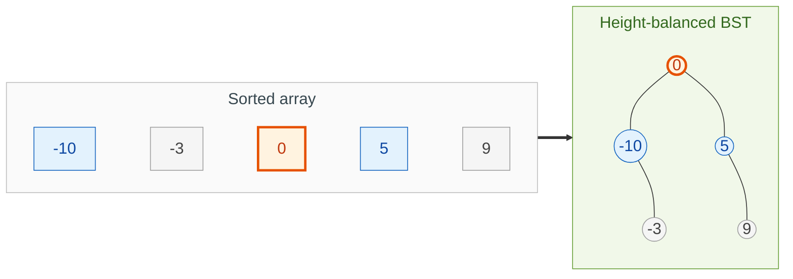
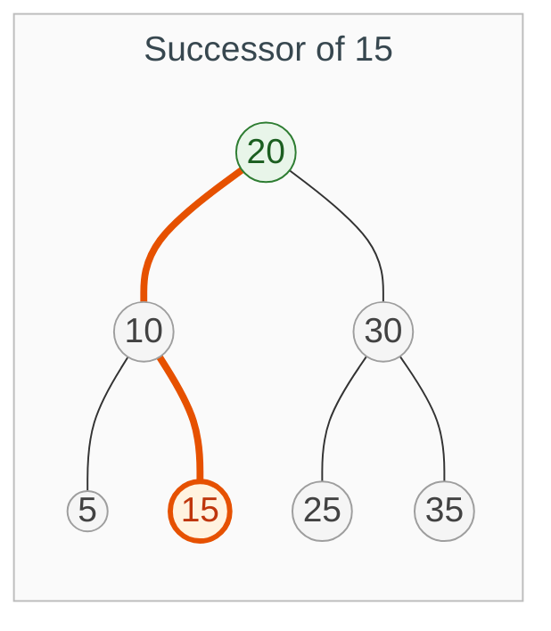
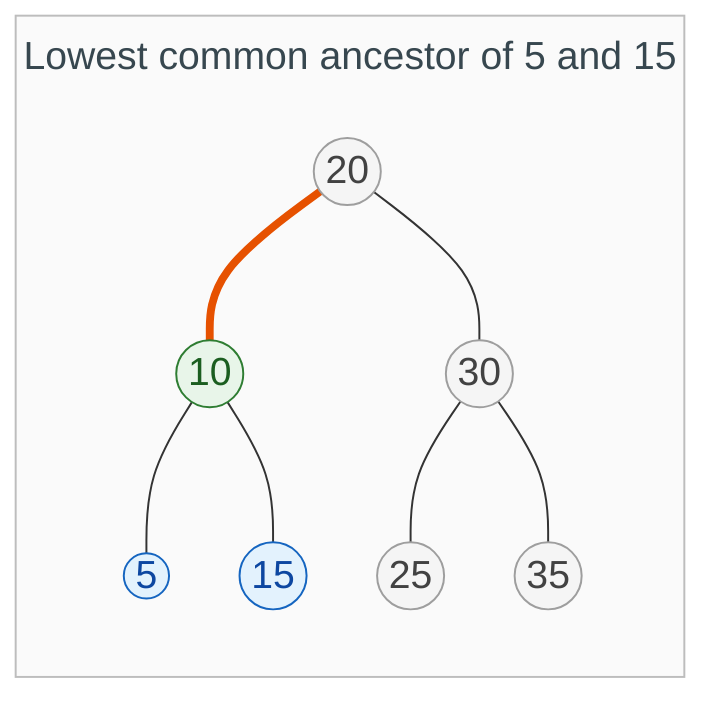
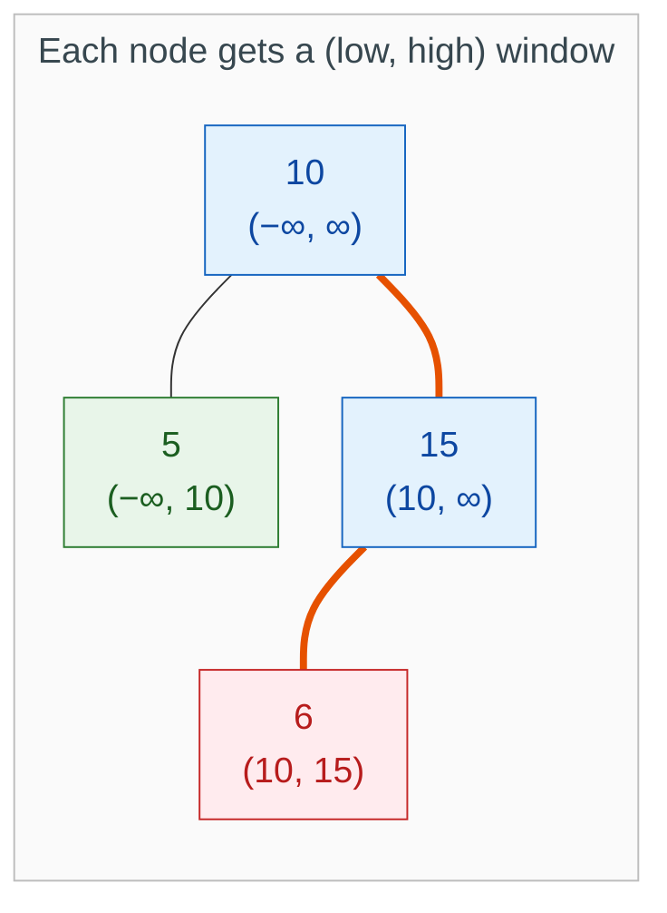

{: .no_toc}
# Binary Search Trees
Practise here: [Leetcode](https://leetcode.com/list?selectedList=9db7rant)

- TOC
{:toc}

### [Convert Sorted Array to BST](https://leetcode.com/problems/convert-sorted-array-to-binary-search-tree)

> Given an integer array nums where the elements are sorted in ascending order,
convert it to a height-balanced binary search tree.



The code picks `mid = (start + end) // 2`. The middle of the whole array (0) is the root. The left half `[-10, -3]` has its middle at -10, so -3 hangs to its right. The right half `[5, 9]` has its middle at 5, so 9 hangs to its right.

**Key intuition:** Make the middle element the root. Then both sides have about the same number of elements, which is what makes the tree balanced. Repeat on each half.

<details><summary markdown="span">Execute!</summary>

```python
class Solution:
    def sortedArrayToBST(self, arr: List[int], start = 0, end = None) -> TreeNode:
        if end is None:
            end = len(arr)-1

        if start > end:
            return None

        mid = (start+end)//2
        return TreeNode(arr[mid], self.sortedArrayToBST(arr, start, mid - 1), self.sortedArrayToBST(arr, mid + 1, end))
```

</details>
<BR>

### [Inorder successor](https://leetcode.com/problems/inorder-successor-in-bst/)

> Given a binary search tree and a node in it, find the in-order successor of that node in the BST.
The successor of a node p is the node with the smallest key greater than p.val.
>  <BR>



At 20, 15 is smaller, so go left and remember 20 (green). At 10, 15 is larger, so go right. At 15, nothing larger is below, so the search returns nothing, and the remembered 20 is the answer. Going right never remembers anything, because the answer cannot be there.

**Key intuition 1:** If p is smaller than the current node, this node might be the successor: remember it and go left to look for something closer. Otherwise go right.

**Key intuition 2:** The successor is the smallest value greater than p, which is why the "remember it" step only happens when you turn left.

<details><summary markdown="span">Execute!</summary>

```python
class Solution:
    def inorderSuccessor(self, root, p):
        if not root:
            return None
        if p.val < root.val:
            #cause the successor will be by definition one up
            return self.inorderSuccessor(root.left,p) or root

        #cause the successor will always be down. No need to go up here.
        return self.inorderSuccessor(root.right,p)
```

</details>
<BR>

### [Lowest Common Ancestor](https://leetcode.com/problems/lowest-common-ancestor-of-a-binary-search-tree/)

> Given a binary Search tree, find the lowest common ancestor (LCA) of two given nodes in the tree.



At 20 both 5 and 15 are smaller, so go left. At 10 one is smaller and one is larger (the two nodes split), so 10 is the lowest common ancestor.

**Key intuition 1:** The BST ordering tells you which way both nodes lie: both smaller means go left, both larger means go right.

**Key intuition 2:** The first node where p and q fall on different sides (or one of them equals the node) is the lowest common ancestor.

<details><summary markdown="span">Execute!</summary>

```python
class Solution:
    def lowestCommonAncestor(self, root: 'TreeNode', p: 'TreeNode', q: 'TreeNode') -> 'TreeNode':
        if root is not None:
            if root.val < min(p.val, q.val):
                return self.lowestCommonAncestor(root.right, p,q)
            if root.val > max(p.val, q.val):
                return self.lowestCommonAncestor(root.left, p,q)

            return root
```

</details>
<BR>

### [Check if BST](https://leetcode.com/problems/validate-binary-search-tree/)

> Given a binary tree, determine if it is a valid binary search tree (BST).



Going left caps the high end at the parent's value, going right raises the low end. The 6 is smaller than its parent 15, so a parent-only check passes, but it sits in the right subtree of 10, so its window is (10, 15) and 6 fails.

**Key intuition 1:** It is not enough to compare a node with its parent. Every node must fall inside a (low, high) window inherited from all its ancestors.

**Key intuition 2:** Going left lowers the upper bound to the node's value. Going right raises the lower bound to it. Another way to see it: an in-order traversal must be strictly increasing.

<details><summary markdown="span">Execute!</summary>

```python
class Solution:
    def isValidBST(self, root: TreeNode, lo=float('-inf'), hi=float('inf')) -> bool:
        if not root:
            return True
        if not lo < root.val < hi:
            return False

        return self.isValidBST(root.left, lo, min(root.val, hi)) and self.isValidBST(root.right, max(lo, root.val), hi)
```

</details>
<BR>