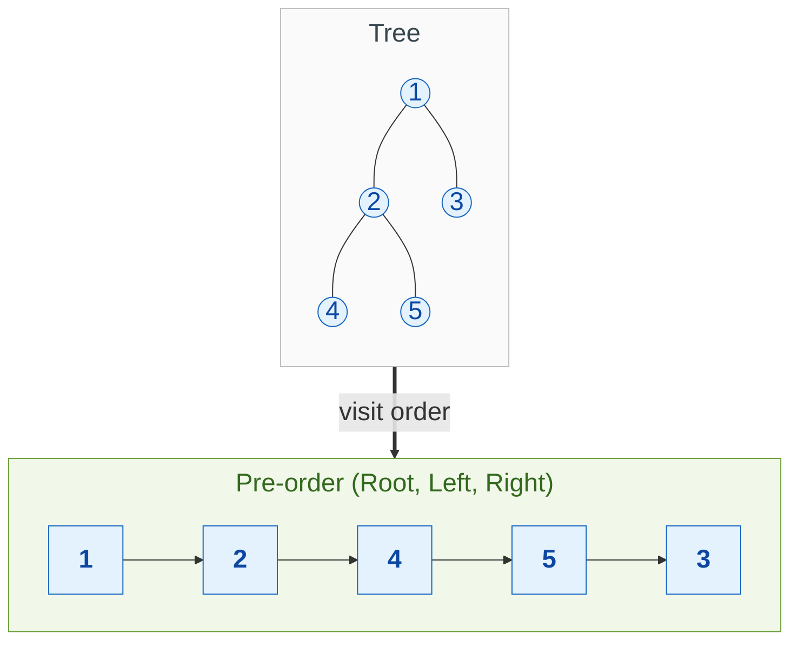
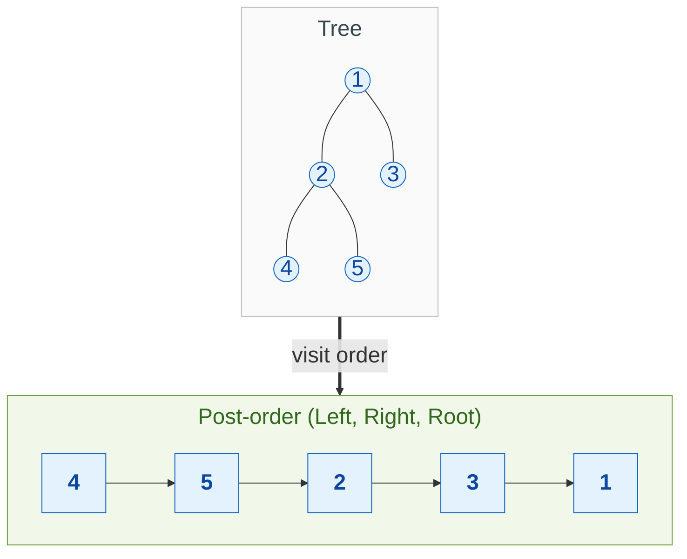
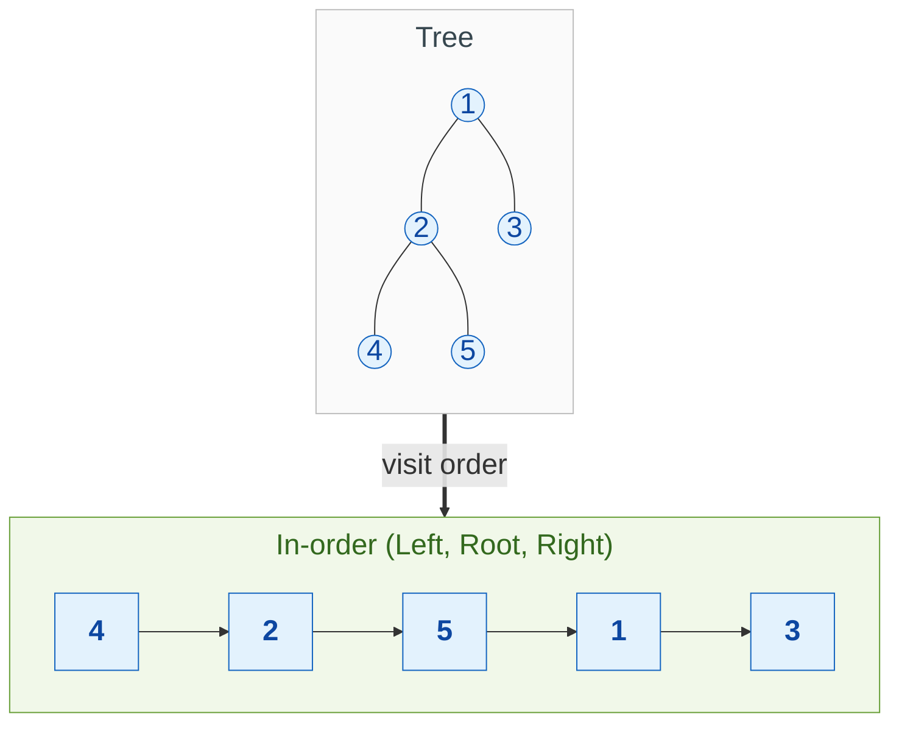
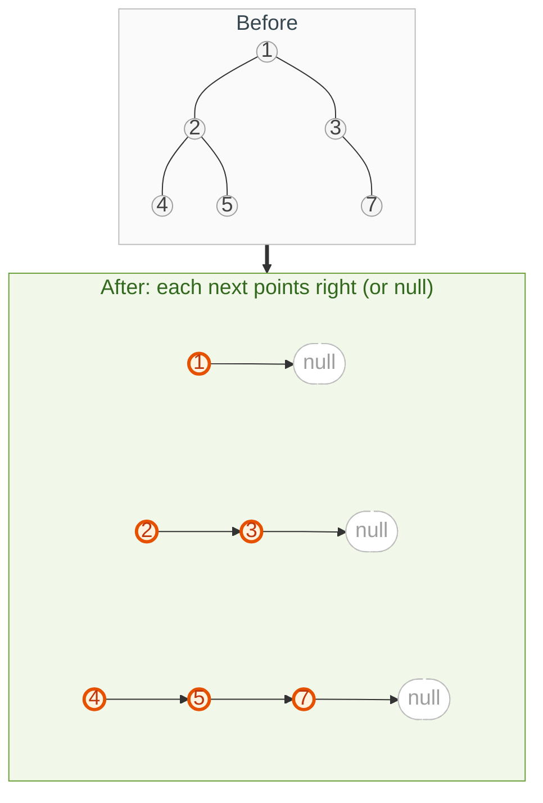
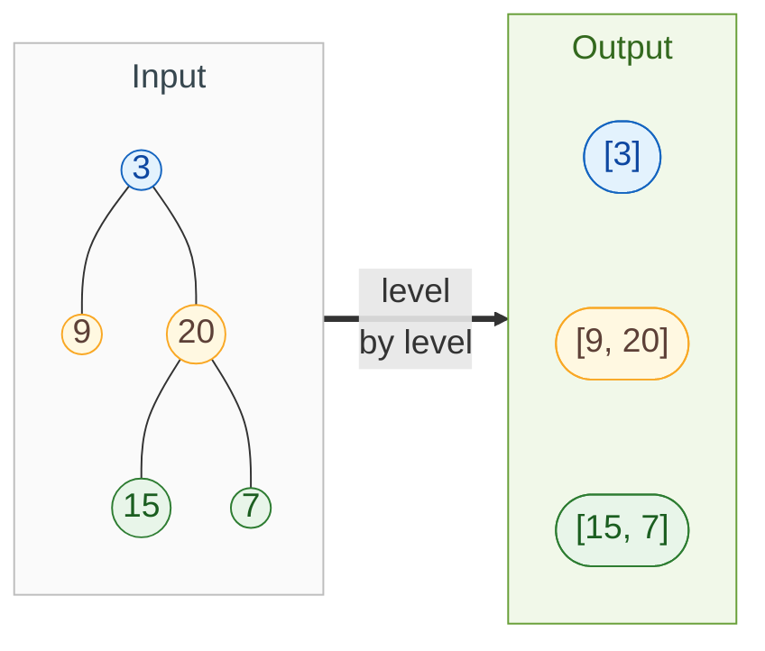
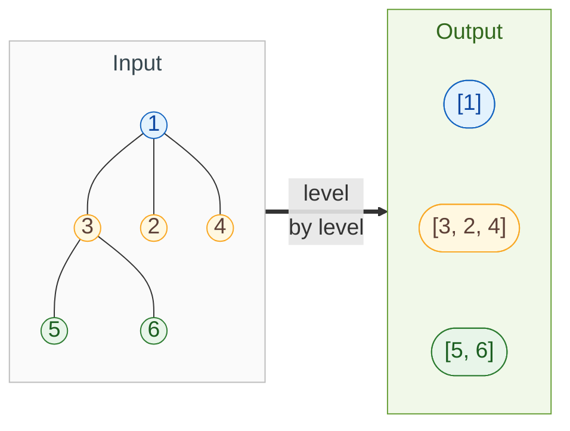
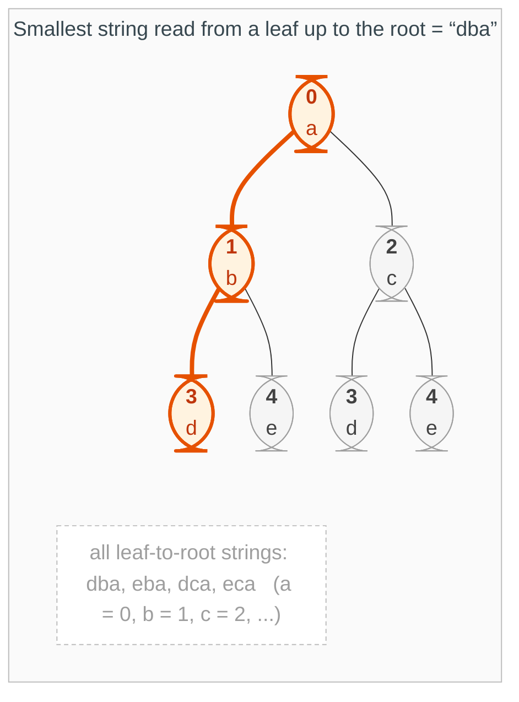

{: .no_toc}
# Binary Tree - Traversals

- TOC
{:toc}

### [Pre-Order](https://leetcode.com/problems/binary-tree-preorder-traversal/)



**Key intuition 1:** The name says when the root is visited relative to its children: before them (pre), between them (in), after them (post).

**Key intuition 2:** The iterative version replaces the call stack with your own stack. Push the right child before the left so the left comes off first.

<details><summary markdown="span">Execute!</summary>

```python
class Solution:
    def preorderTraversal(self, root: Optional[TreeNode]) -> List[int]:
        def solve(node):
            if node:
                res.append(node.val)
                solve(node.left)
                solve(node.right)

        res = []
        solve(root)
        return res
```

```python
class Solution(object):
    def preorderTraversal(self, root):
        res = []
        stack = [(root, False)]

        while stack:
            node, visited = stack.pop()

            if not node:
                continue

            if visited:
                # Node is marked as visited, add to result
                res.append(node.val)
            else:
                # REVERSE ORDER of Preorder: Right, Left, Root
                # Processed third
                stack.append((node.right, False))
                # Processed second
                stack.append((node.left, False))
                # Processed first
                stack.append((node, True))

        return res
```

</details>
<BR>


### [Post-Order](https://leetcode.com/problems/binary-tree-postorder-traversal/)



**Key intuition:** Root last means you need both children finished first, so post-order is the shape of every "combine the answers from my children" problem.

<details><summary markdown="span">Execute!</summary>

```python
class Solution:
    def postorderTraversal(self, root: Optional[TreeNode]) -> List[int]:
        def solve(node):
            if node:
                solve(node.left)
                solve(node.right)
                res.append(node.val)
        res = []
        solve(root)
        return res
```
</details>
<BR>

```python
class Solution(object):
    def postorderTraversal(self, root):
        res = []
        stack = [(root, False)]
        while stack:
            (node, visited) = stack.pop()
            if not node:
                continue

            if visited:
                res.append(node.val)
            else:
                stack.append((node, True))
                stack.append((node.right, False))
                stack.append((node.left, False))
        return res
```

### [In-Order](https://leetcode.com/problems/binary-tree-inorder-traversal/)



**Key intuition:** On a binary search tree, in-order visits the values in sorted order. That is the reason this traversal matters.

<details><summary markdown="span">Execute!</summary>

```python
class Solution:
    def inorderTraversal(self, root: Optional[TreeNode]) -> List[int]:
        def solve(node):
            if node:
                solve(node.left)
                res.append(node.val)
                solve(node.right)
        res = []
        solve(root)
        return res
```

```python
class Solution(object):
    def inorderTraversal(self, root):
        res = []
        stack = [(root, False)]
        while stack:
            (node, visited) = stack.pop()
            if not node:
                continue

            if visited:
                res.append(node.val)
            else:
                stack.append((node.right, False))
                stack.append((node, True))
                stack.append((node.left, False))
        return res
```

</details>
<BR>

### [Sideways: Populating Next Right Pointers in Each Node](https://leetcode.com/problems/populating-next-right-pointers-in-each-node-ii/)

> Populate each next pointer to point to its next right node.



**Key intuition:** Work one level at a time. While you walk a level left to right, you can collect the next level's nodes and link them as you go.

<details><summary markdown="span">Execute!</summary>

```python
class Solution:
    def connect(self, root: 'Node') -> 'Node':
        q = [root]
        qChildren = []

        while q:
            curr = q.pop(0)
            if not curr:
                continue

            if q:
                curr.next = q[0]

            if curr.left:
                qChildren.append(curr.left)
            if curr.right:
                qChildren.append(curr.right)

            if not q:
                tmp = q
                q = qChildren
                qChildren = tmp

        return root
```

</details>
<BR>

### [Level Order Traversal](https://leetcode.com/problems/binary-tree-level-order-traversal/)

> Return the values level by level, from left to right.



**Key intuition 1:** Breadth-first search with a queue visits nodes level by level. The depth-first alternative passes the depth down and files each value into the list for its depth.

**Key intuition 2:** A node's level is its parent's level plus 1, which is why both approaches work.

<details><summary markdown="span">Execute!</summary>

```python
class Solution:
    #Using global state
    def levelOrder(self, root: Optional[TreeNode]) -> List[List[int]]:
        def solve(node, d):
            if not node:
                return

            res[d].append(node.val)
            solve(node.left, d + 1)
            solve(node.right, d + 1)

        res = collections.defaultdict(list)
        solve(root, 0)
        return res.values()
```

</details>
<BR>

### [Level Order Traversal n-Ary](https://leetcode.com/problems/n-ary-tree-level-order-traversal/) <BR>

> The same for an n-ary tree: return the values level by level.



**Key intuition:** Exactly the same idea as the binary version. The only change is that a node has a list of children instead of a left and a right.

<details><summary markdown="span">Execute!</summary>

```python
class Solution:
    def levelOrder(self, root: 'Node') -> List[List[int]]:
        def solve(node, d):
            if not node:
                return

            if d == 0:
                res[d].append(node.val)
                d += 1

            for child in node.children:
                res[d].append(child.val)
                solve(child, d + 1)

        res = collections.defaultdict(list)
        solve(root, 0)
        return res.values()
```

</details>
<BR>

### [DFS Preorder Traversal: Smallest string from Leaf](https://leetcode.com/problems/smallest-string-starting-from-leaf/)

> Each node holds a number from 0 to 25 for a letter (a to z). Return the smallest string that starts at a leaf and ends at the root.



**Key intuition 1:** Build the string from the root downward by putting each new letter in front, so the finished string already reads leaf to root.

**Key intuition 2:** Only a leaf (no children) completes a string. Collect those and take the smallest.

<details><summary markdown="span">Execute!</summary>

```python
class Solution:
    def smallestFromLeaf(self, root: Optional[TreeNode]) -> str:
        def preorder(node, path):
            if not node:
                return

            path = chr(ord('a') + node.val) + path

            if not node.left and not node.right:
                res.append(path)

            preorder(node.left, path)
            preorder(node.right, path)
        res = []
        preorder(root, "")
        return min(res)
```

</details>
<BR>
