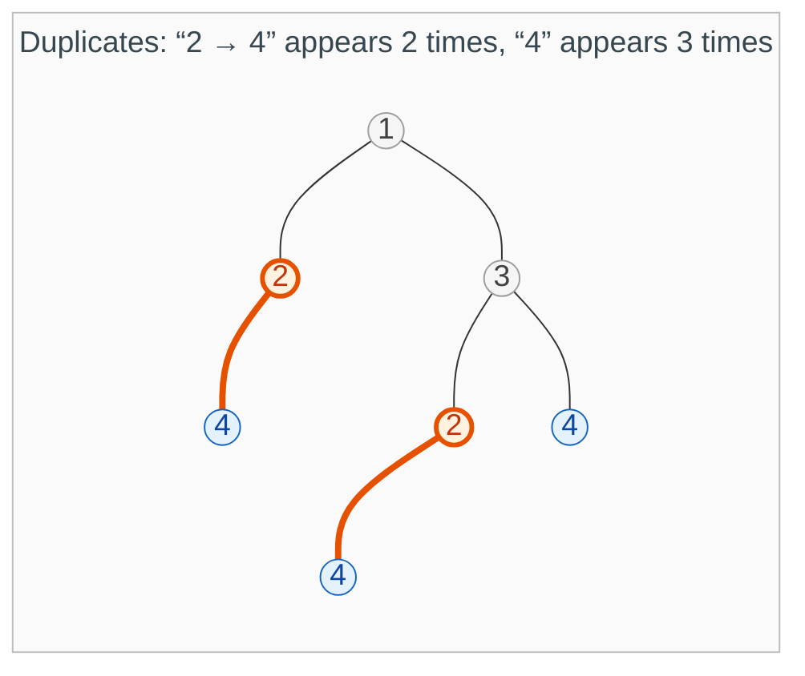
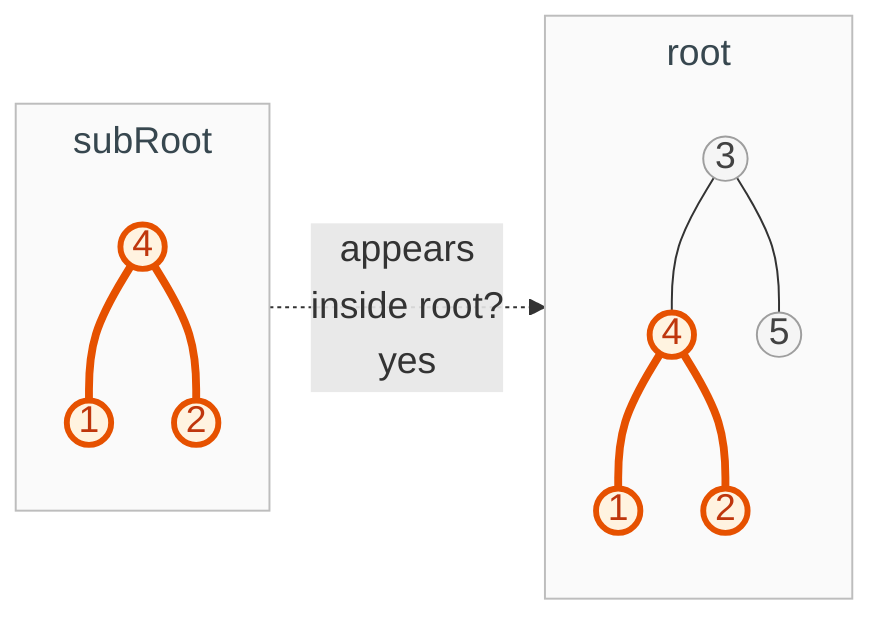
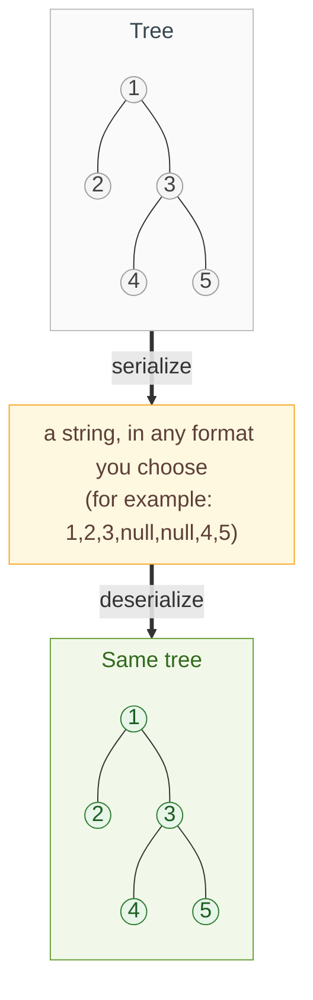
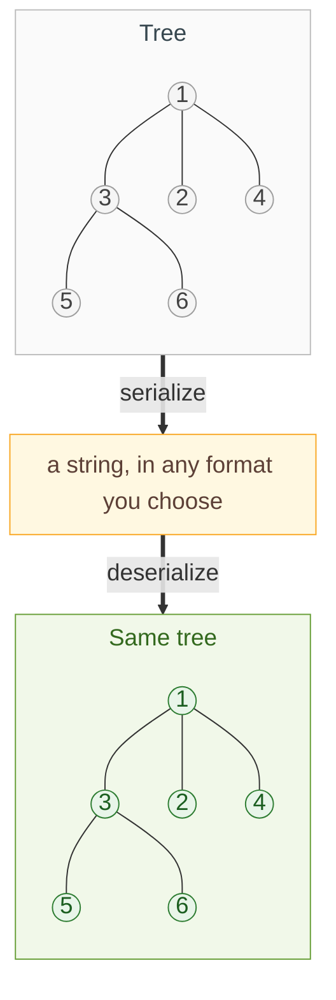

{: .no_toc}
# Binary Trees - Tuplify Method
Practise here: [Leetcode]()

- TOC
{:toc}

### [Find Duplicate Subtrees](https://leetcode.com/problems/find-duplicate-subtrees/) 

> Return one root for each group of duplicate subtrees (same structure and same values).



**Key intuition 1:** Describe every subtree as a tuple (value, left description, right description). Two subtrees are identical exactly when their tuples are equal.

**Key intuition 2:** Count how often each tuple appears in a dictionary, and report a subtree the moment its count reaches 2.

<details><summary markdown="span">Execute!</summary>

```python
class Solution:
    def findDuplicateSubtrees(self, root: Optional[TreeNode]) -> List[Optional[TreeNode]]:
        def tuplify(node):
            if node:
                tuple = (node.val, tuplify(node.left), tuplify(node.right))
                res[tuple].append(node)
                return tuple

        res = collections.defaultdict(list)
        tuplify(root)

        # Minor detail: v[0] cause any one parent node needs to be returned
        dupes = {k: v[0] for (k, v) in res.items() if len(v) > 1}
        return dupes.values()
```

</details>
<BR>


### [Subtree of Another Tree](https://leetcode.com/problems/subtree-of-another-tree/) 

> Does the tree subRoot appear inside root, with exactly the same structure and values?



**Key intuition:** Describe both trees with the same tuple. subRoot appears inside root exactly when its tuple equals the tuple of some node in root.

<details><summary markdown="span">Execute!</summary>

```python
class Solution:
    def isSubtree(self, root: Optional[TreeNode], subRoot: Optional[TreeNode]) -> bool:
        def tuplify(node):
            if node:
                return (node.val, tuplify(node.left), tuplify(node.right))

        if not root:
            return False

        if tuplify(root) == tuplify(subRoot):
            return True

        return self.isSubtree(root.left, subRoot) or self.isSubtree(root.right, subRoot)
```

</details>
<BR>

### [Serialize and Deserialize Binary Tree](https://leetcode.com/problems/serialize-and-deserialize-binary-tree/)

> Serialize a binary tree to a string, and deserialize the string back into the same tree.



**Key intuition 1:** A traversal that also records the missing children rebuilds a tree in only one way. The tuple (value, left, right), with None for a missing child, is exactly that record.

**Key intuition 2:** Deserialize is the mirror image of serialize: read the value, then rebuild the left, then rebuild the right.

<details><summary markdown="span">Execute!</summary>

```python
import collections
import json
class Codec:
    def serialize(self, root):
        def tuplify(node):
            if node:
                return (node.val, tuplify(node.left), tuplify(node.right))

        res = tuplify(root)
        return json.dumps(res)

    def deserialize(self, data):
        def detuplify(arr):
            if arr:
                root = TreeNode(arr[0])
                root.left = detuplify(arr[1])
                root.right = detuplify(arr[2])
                return root
        return detuplify(json.loads(data))
```

</details>
<BR>


### [Serialize and Deserialize N-ary Tree](https://leetcode.com/problems/serialize-and-deserialize-n-ary-tree/) <BR>

> The same for an n-ary tree: serialize it to a string, and deserialize the string back into the same tree.



**Key intuition:** Same as the binary version, except each node records a list of children. Serialize writes (value, [children...]) and deserialize reads it back the same way.

<details><summary markdown="span">Execute!</summary>

```python
class Codec:
    def serialize(self, root):
        def tuplify(root):
            if root:
                return (root.val, [tuplify(x) for x in root.children])

        return json.dumps(tuplify(root))

    def deserialize(self, data):
        def detuplify(arr):
            if arr:
                root = Node(arr[0], [])
                for c in arr[1]:
                    root.children.append(detuplify(c))
                return root

        return detuplify(json.loads(data))
```

</details>
<BR>

