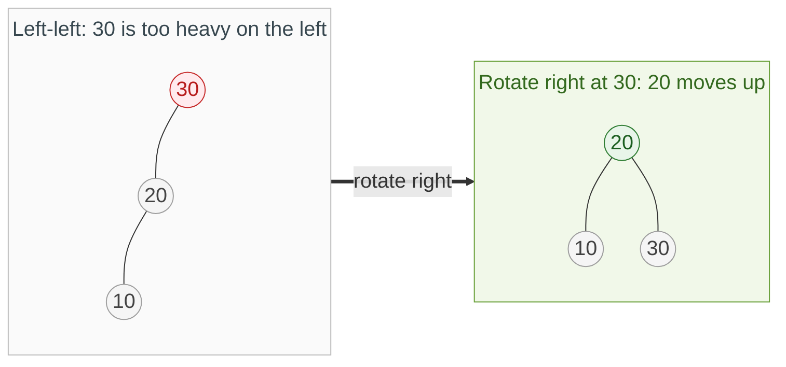
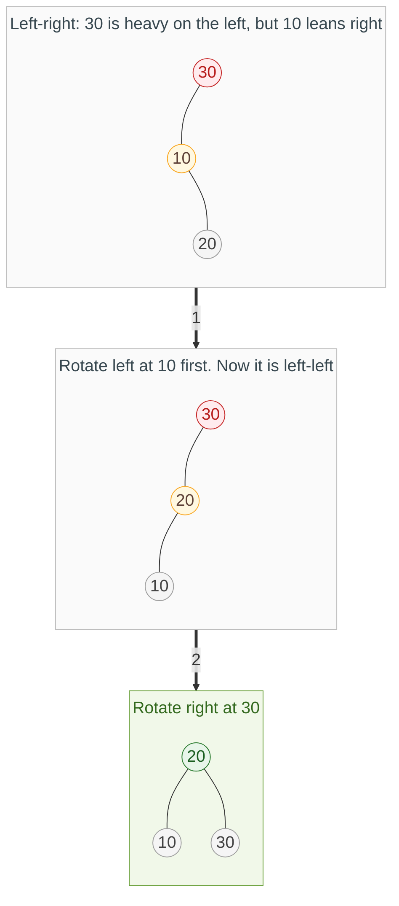
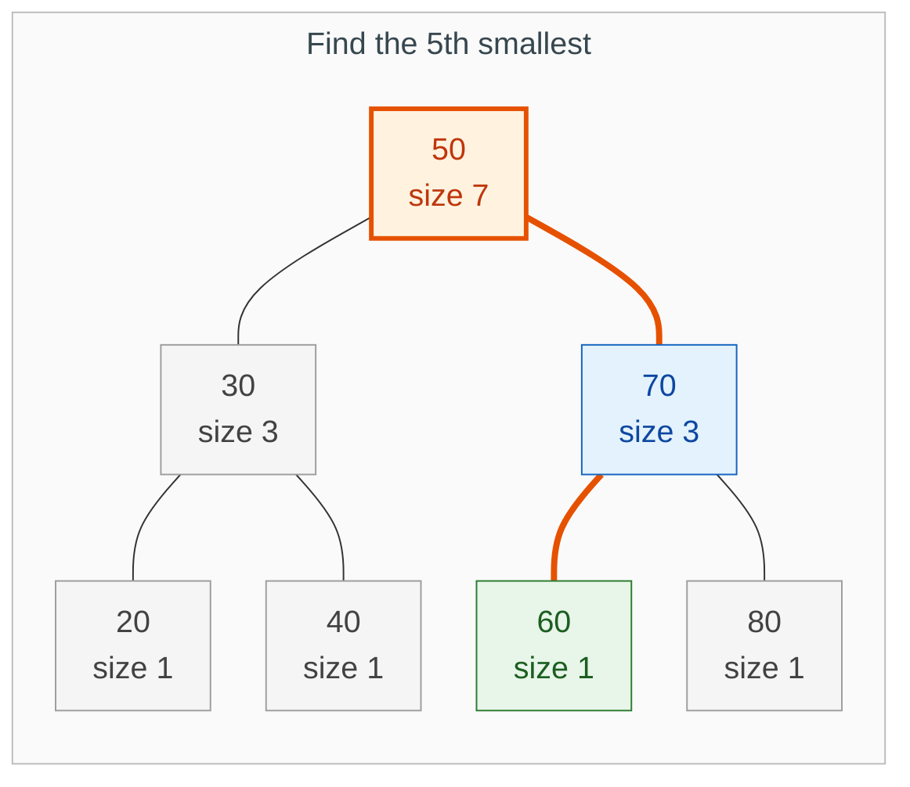
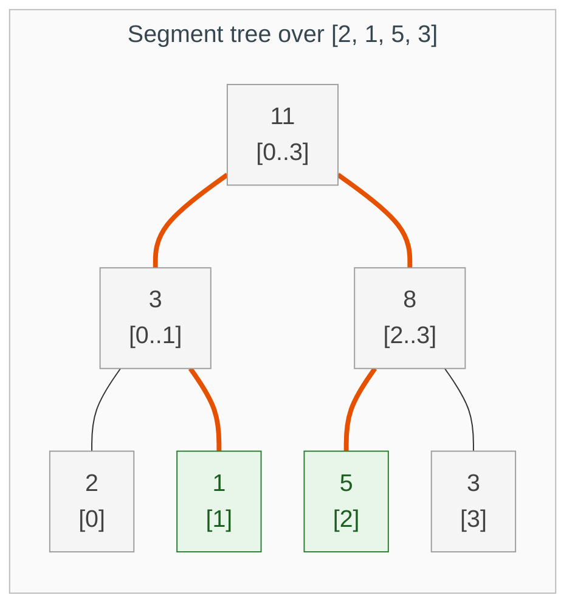

{: .no_toc}
# Self Balancing Trees
Practise here: [Leetcode]()

- TOC
{:toc}

**Optional / advanced.** A plain binary search tree can become a long skinny chain (O(n) per search). A **self-balancing tree** (AVL, red-black) rotates nodes after every insert to stay shallow, so search, insert and delete are always O(log n). In an interview you almost never write one: say "I would use a balanced tree (Java TreeMap, C++ std::map, Python sortedcontainers)" and explain *why*. The heap-based versions on the [Heaps](../Arrays/Heap.html) page are what to write.

### Median Sliding

> Design a data structure that allows ingestion of numbers, and can in O(1) time
> return the median. [Leetcode](https://leetcode.com/problems/find-median-from-data-stream/)

**Key intuition 1:** Store the numbers in a balanced tree where each node also remembers how big its subtree is. Then the k-th smallest (the median is the middle k) can be found by walking down and comparing sizes, in O(log n).

**Key intuition 2:** The rotations after each insert keep the tree shallow, which is what keeps every step O(log n).



One rotation fixes a chain that leans the same way twice. The middle node (20) becomes the root of this piece, and heights are restored. The mirror image (right-right) uses a left rotation.



When the heavy child leans the other way, a single rotation just moves the imbalance. First rotate the child to make it lean the same way, then rotate at the top. The mirror image is right-left.

<details><summary markdown="span">AVL Tree Implementation</summary>

```python
class AVLTree(object):
    def __init__(self, val):
        self.val = val
        self.left = None
        self.right = None
        self.height = 1
        self.balance= 0
        self.size = 1

    def sizeOf(self, node):
        return 0 if node is None else node.size

    def balanceTree(self, root):
        if root.balance in [-1,1,0]:
            return root
        if root.balance > 1:
            if root.left.balance <0:
                root.left = self.rotateLeft(root.left)
            root= self.rotateRight(root)
        elif root.balance < -1:
            if root.right.balance > 0:
                root.right = self.rotateRight(root.right)
            root= self.rotateLeft(root)
        return root

    def updateBalance(self, root, recurse=False):
        if root is not None:
            l = root.left.height  if root.left  else 0
            r = root.right.height if root.right else 0

            root.height = max(l, r)+1
            root.balance= l - r

            if recurse:
                self.updateBalance(root.left)
                self.updateBalance(root.right)

    def rotateLeft(self, Z):
        #Swap A with Left(A)
        # (Z)
        #        Y
        #   (Yc)   X
        #
        #Swap (Z) with Yc
        #        Y
        #  Z       X
        #    Zc
        Y  = Z.right
        Yc = Y.left

        Z.size = self.sizeOf(Z.left) + self.sizeOf(Y.left) + 1

        Y.left = Z
        Z.right = Yc

        self.updateBalance(Z,False)
        self.updateBalance(Y,False)

        return Y

    def rotateRight( self, Z):
        #Swap A with Left(A)
        #        (Z)
        #    Y
        # X   (Yc)
        # Swap, z with Yc
        #
        #    Y
        # X     Z
        #      Yc
        Y  = Z.left
        Yc = Z.left.right

        Z.size  = self.sizeOf(Z.right) + self.sizeOf(Y.right) + 1

        Y.right = Z
        Z.left = Yc

        self.updateBalance(Z,False)
        self.updateBalance(Y,False)

        return Y

    def insert(self, root, val):
        if not root:
            return AVLTree(val)
        if val < root.val:
            root.left  = self.insert(root.left, val)
        else:
            root.right = self.insert(root.right, val)

        self.updateBalance(root, False)
        root = self.balanceTree(root)
        self.updateBalance(root, False)

        root.size = self.sizeOf(root.left) + self.sizeOf(root.right) + 1

        return root

    def searchK(self, root, k):
        currSize = self.sizeOf(root.left) + 1
        if k == currSize:
            return root.val

        return self.searchK(root.left, k) if k < currSize else self.searchK(root.right, k - currSize )

class MedianFinder(object):
    def __init__(self):
        self.tree = None

    def addNum(self, num):
        if self.tree is None:
            self.tree = AVLTree(num)
        else:
            self.tree = self.tree.insert(self.tree, num)

    def findMedian(self):
        curSize = self.tree.size
        if curSize & 1:
            return self.tree.searchK(self.tree, (curSize + 1) /2 )

        return self.tree.searchK(self.tree, curSize / 2) / 2.0 + self.tree.searchK(self.tree, curSize / 2 + 1) / 2.0
```

</details>
<BR>

<details><summary markdown="span">Red Black Tree Implementation</summary>

```python
class RedBlackTree(object):
    def __init__(self, val):
        self.val = val
        self.size = 1
        self.left = None
        self.right = None
        self.isRed = True

    def sizeOf(self, node):
        return 0 if node is None else node.size

    # Example: Rotate Left
    # Z is root. Y is Z's right. and so on.
    # (Z)
    #        Y
    #   Yl       X
    #
    # Swap (Z) with Yl. Y Is the new root.
    #        Y
    #  Z         X
    #    Yl
    def rotateLeft(self, Z):
        Y = Z.right

        Z.size = self.sizeOf(Z.left) + self.sizeOf(Y.left) + 1
        Y.size = Z.size
        Y.isRed = Z.isRed
        Z.isRed = True

        Z.right = Y.left
        Y.left = Z

        return Y

    # Right Rotation: Swap Z with YRight
    #        (Z)
    #    Y
    # X   (Yr)
    # Swap, Z with YRight
    #
    #    Y
    # X     Z
    #      Yr
    def rotateRight(self, Z):
        Y = Z.left

        Z.size  = self.sizeOf(Z.right) + self.sizeOf(Y.right) + 1
        Y.size  = Z.size
        Y.isRed = Z.isRed
        Z.isRed = Y.isRed

        Z.left  = Y.right
        Y.right = Z

        Z.isRed = True
        return Y

    def insertTo(self, root, val):
        def isRed(node):
            return node.isRed if node is not None else False

        if root is None:
            return RedBlackTree(val)

        if val < root.val:
            root.left  = self.insertTo(root.left, val)
        else:
            root.right = self.insertTo(root.right, val)

        # If tree is right heavy, rotate Left
        if isRed(root.right) and not isRed(root.right.right):
            root = self.rotateLeft(root)

        # If tree is left heavy, rotate Right
        if isRed(root.left) and isRed(root.left.left):
            root = self.rotateRight(root)

        # If children are red, root must be black
        if isRed(root.left) and isRed(root.right):
            root.left.isRed = False
            root.right.isRed = False
            root.isRed = True

        root.size = self.sizeOf(root.left) + self.sizeOf(root.right) + 1

        return root

    def searchK(self, root, k):
        currSize = self.sizeOf(root.left) + 1
        if k == currSize:
            return root.val

        return self.searchK(root.left, k) if k < currSize else self.searchK(root.right, k - currSize )

class MedianFinder(object):
    def __init__(self):
        self.tree = None

    def addNum(self, num):
        if self.tree is None:
            self.tree = RedBlackTree(num)
        else:
            self.tree = self.tree.insertTo(self.tree, num)
        self.tree.isRed = False

    def findMedian(self):
        curSize = self.tree.size
        if curSize %2 == 1:
            return self.tree.searchK(self.tree, (curSize + 1) /2 )

        return self.tree.searchK(self.tree, curSize / 2) / 2.0 + self.tree.searchK(self.tree, curSize / 2 + 1) / 2.0
```

</details>
<BR>

### Kth Largest Element

> Find the kth largest element in an unsorted array. 
> [Leetcode](https://leetcode.com/problems/kth-largest-element-in-an-array/)

**Key intuition 1:** Reuse the size-augmented tree from above: the k-th largest is the (n - k + 1)-th smallest.

**Key intuition 2:** The heap solution on the [Heaps](../Arrays/Heap.html) page is simpler and is the one to write.

<details><summary markdown="span">Execute!</summary>

Note: This just uses the MedianFinder class introduced above

```python
class Solution:
    def findKthLargest(self, nums: typing.List[int], k: int) -> int:
        m = MedianFinder()
        [m.addNum(x) for x in nums]
        return m.tree.searchK(m.tree, len(nums)-k+1)
```

</details>
<BR>

### [Array Rank Indexing - Rank Tree](https://leetcode.com/problems/count-of-smaller-numbers-after-self/)

> You are given an integer sort nums and you have to return a new counts sort. 
> The counts sort has the property where counts[i] is the number of smaller elements to the right of nums[i]. 
 



Each node stores the size of its subtree, so the k-th smallest is found by comparing k with the size on the left: go left if k fits there, take the node if k is one past it, otherwise go right and subtract. Here the 5th smallest of 20, 30, 40, 50, 60, 70, 80 is 60.

**Key intuition 1:** Go through the array from right to left, inserting each number into a tree. Before inserting, ask the tree how many numbers already in it are smaller: those are the smaller numbers to the right.

**Key intuition 2:** Each node keeps a count of how many nodes are in its left subtree (its rank), so that question is answered while walking down.

<details><summary markdown="span">Execute!</summary>

```python
class TreeNode(object):
    def __init__(self, x):
        self.val = x
        self.left = None
        self.right = None
        self.rank = 0

class RankTree(object):
    def __init__(self):
        self.root = None

    def insert(self, val):
        def _insert(root, val):
            if not root:
                return TreeNode(val)
            if val <= root.val:
                root.left = _insert(root.left, val)
                root.rank += 1
            if val > root.val:
                root.right = _insert(root.right, val)
            return root
        self.root = _insert(self.root, val)

    def get_rank(self, val):
        def _get_rank(root, val):
            if not root:
                return 0
            if val <= root.val:
                return _get_rank(root.left, val)

            return 1 + root.rank + _get_rank(root.right, val)
        return _get_rank(self.root, val)

class Solution(object):
    def countSmaller(self, nums):
        res = []
        r = RankTree()
        for elem in nums[::-1]:
            r.insert(elem)
            res.insert(0, r.get_rank(elem))
        return res
```
And voila it now works
</details>
<BR>

### [Range Sum - Segment Tree](https://leetcode.com/problems/range-sum-query-immutable/)

> Given an integer sort nums, find the sum of the elements between indices i and j (i ≤ j), inclusive.



Each node stores the sum of its range, and the leaves are the numbers. A query takes whole nodes where it can instead of adding leaf by leaf. Updating one number changes only the nodes on the path from its leaf to the root.

**Key intuition 1:** A segment tree stores the sum of every range that is a power-of-two block, as a binary tree: the root holds the sum of everything, its children each hold half, and so on.

**Key intuition 2:** A range query visits only O(log n) nodes, and an update to one number changes only the O(log n) nodes above it. That is its advantage over a prefix-sum array when the numbers change. See [Prefix Sums](../Arrays/PrefixSums.html) when they never change.

<details><summary markdown="span">Execute!</summary>

```python

#Segment tree node
class Node(object):
    def __init__(self, start, end):
        self.left  = None
        self.right = None

        self.start = start
        self.end = end
        self.total = 0

class NumArray(object):
    def __init__(self, nums):
        def createTree(nums, l, r):
            if l <=r:
                #leaf node
                if l == r:
                    n = Node(l, r)
                    n.total = nums[l]
                    return n

                mid = (l + r) // 2
                root = Node(l, r)
                root.left = createTree(nums, l, mid)
                root.right = createTree(nums, mid+1, r)
                #Total stores the sum of all leaves under root i.e. between (start, end)
                root.total = root.left.total + root.right.total
                return root

        self.root = createTree(nums, 0, len(nums)-1)

    def update(self, i, val):
        def updateVal(root, i, val):
            #Base case. The actual value will be updated in a leaf.
            if root.start == root.end:
                root.total = val
                return val
            mid = (root.start + root.end) // 2
            if i <= mid:
                updateVal(root.left, i, val)
            else:
                updateVal(root.right, i, val)
            #Propogate the changes after recursive call returns
            root.total = root.left.total + root.right.total
            return root.total

        return updateVal(self.root, i, val)

    def sumRange(self, i, j):
        def rangeSum(root, i, j):
            if root.start == i and root.end == j:
                return root.total

            mid = (root.start + root.end) // 2
            if j <= mid:
                return rangeSum(root.left, i, j)
            if i >= mid + 1:
                return rangeSum(root.right, i, j)

            return rangeSum(root.left, i, mid) + rangeSum(root.right, mid+1, j)

        return rangeSum(self.root, i, j)
```

</details>
<BR>
