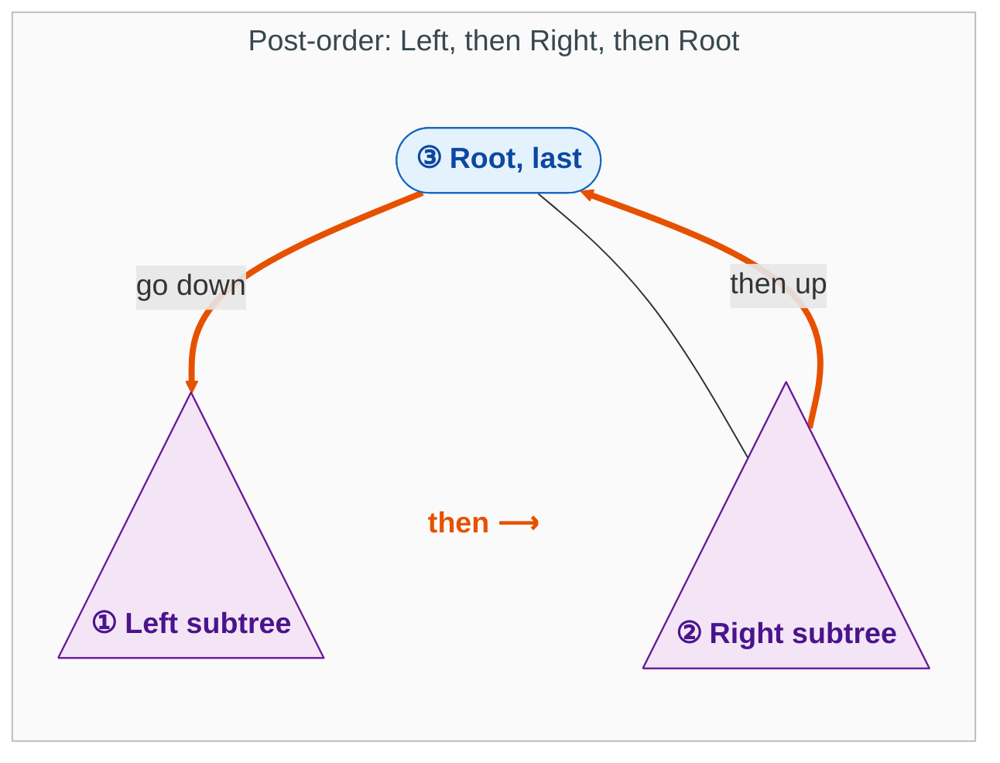
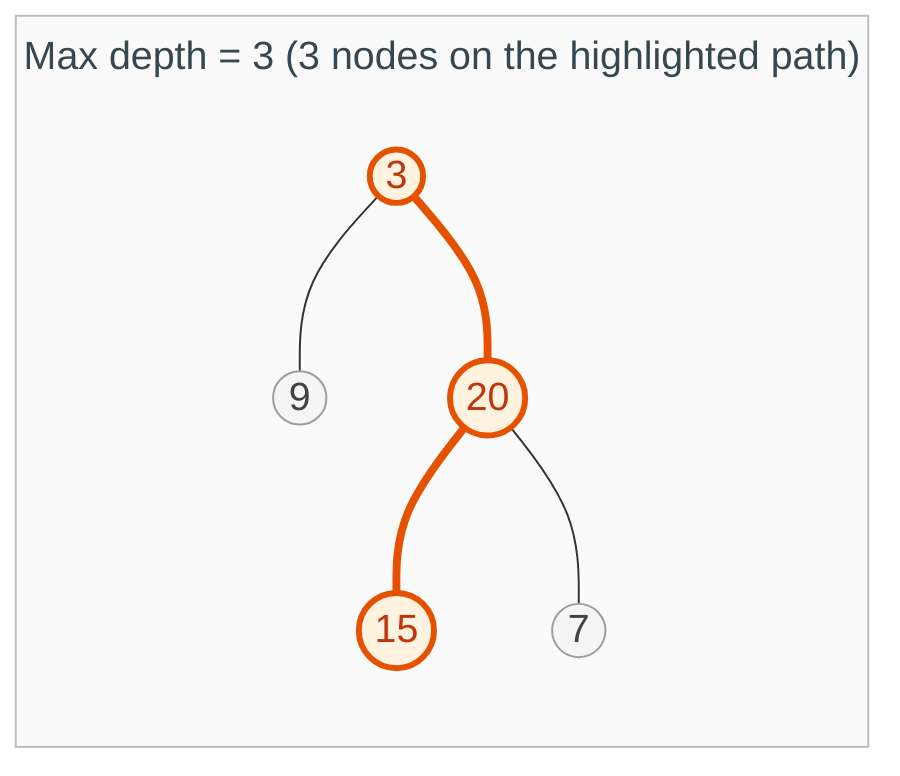
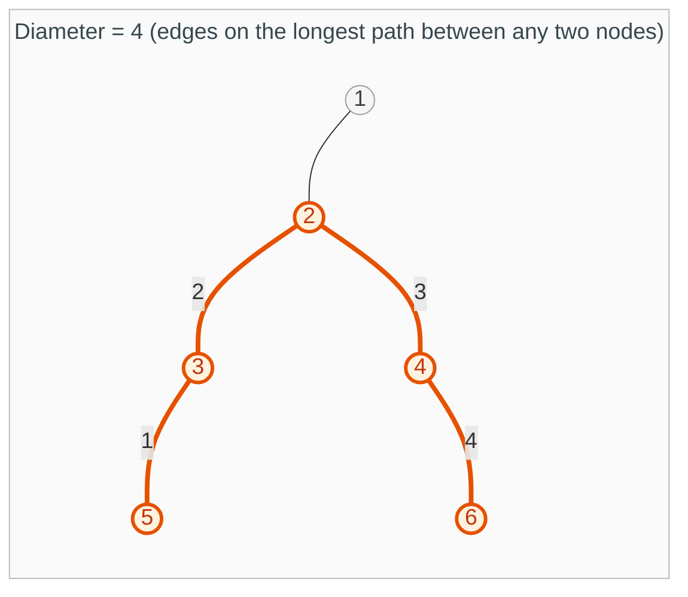
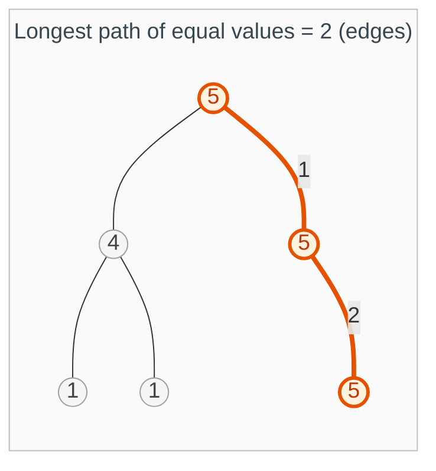
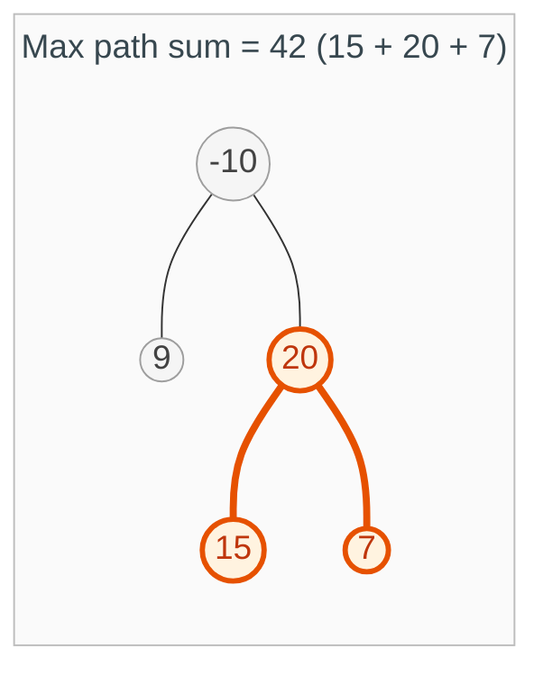
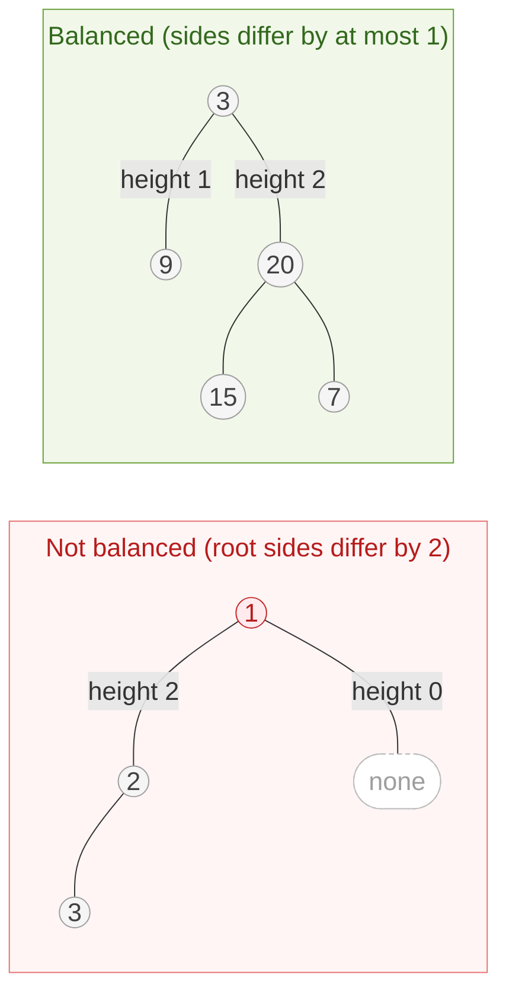
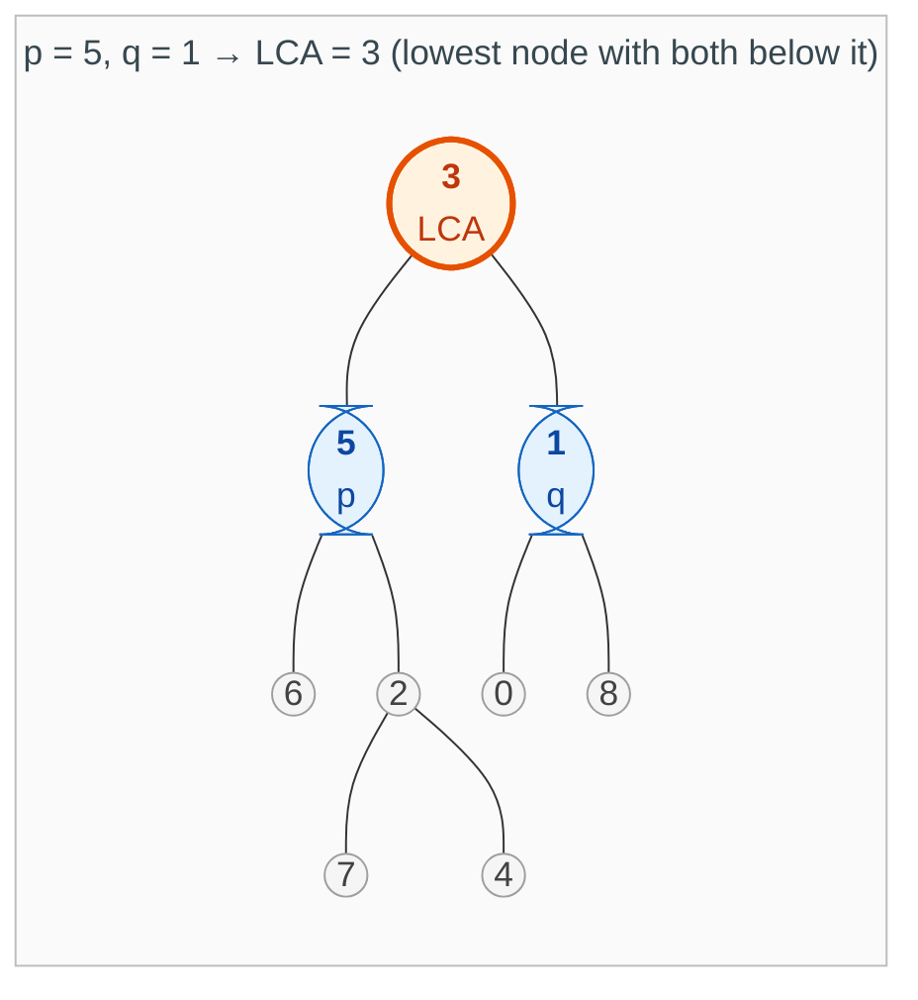

{: .no_toc}
# Post Order

> **Which traversal?** Need answers from my children before I can decide? That is post-order. Passing information *down* to my children? That is [pre-order](PreOrder.md).

Post-order means **Left, then Right, then Root**. Any tree is a root with a left subtree and a right subtree. You go all the way into the left subtree and finish all of it, then all of the right subtree, and only then do you come back to the root. The root is always the last node to finish.



The same rule applies inside every subtree, because each subtree is itself a root with a left subtree and a right subtree.

Key intuition here: In every one of these examples, the "Root" is a manager waiting for reports from the "Left Child" and "Right Child" before it can finish its own job.

The "Tell": The Wait for Reports - Notice the pattern in every snippet:

```
ls = solve(node.left)
rs = solve(node.right)
```

The Decision: Only after these two lines do you see the logic that updates a global variable (like self.res or self.maxSum) or calculates a return value.

Why these MUST be Post-order: 

* Max Depth / Balanced Tree: You can't possibly know your own height until you know the height of your tallest child. You have to wait for the numbers to "bubble up."
* Diameter / Max Path Sum: These are "Bridge" problems. You need to know the longest "arms" coming from the left and right to see if their sum creates a new global record at the current node.
* LCA: A node only knows it is the "Lowest Common Ancestor" if it receives a "Found Target" signal from both subtrees.

Every problem below visits each node once: **O(n) time, O(h) space** for the recursion stack, where h is the tree height (O(log n) when balanced, O(n) when skewed).

- TOC
{:toc}

### [Max Depth of a Binary Tree](https://leetcode.com/problems/maximum-depth-of-binary-tree/description/)

> The maximum depth of a binary tree is the number of nodes on the longest path from the root down to a leaf.



**Key intuition 1:** A node's depth is one more than its deeper child. You cannot know yours until both children have told you theirs.

**Key intuition 2:** A missing child has depth 0. That single fact is your base case, and it makes a leaf come out as depth 1.

<details><summary markdown="span">Execute!</summary>

```python
class Solution:
    def maxDepth(self, root: Optional[TreeNode]) -> int:
        def depth(node):
            if not node:
                return 0

            ls = depth(node.left)
            rs = depth(node.right)

            return max(ls,rs) + 1
        return depth(root)
```

</details>
<BR>

### [Tree Diameter](https://leetcode.com/problems/diameter-of-binary-tree/)

> The diameter is the number of edges on the longest path between any two nodes. The path may or may not pass through the root.



**Key intuition 1:** The longest path bends at exactly one node, its highest point: it goes down the left side and down the right side. So the longest path through a node is (left depth) + (right depth).

**Key intuition 2:** A parent can only use one arm of a path, because a path cannot fork on the way up. So each node returns one number (its depth) but records a different one (left + right) in a global.

<details><summary markdown="span">Execute!</summary>

```python
class Solution:
    def diameterOfBinaryTree(self, root: Optional[TreeNode]) -> int:
        def solve(root):
            if root is None:
                return 0

            ls = solve(root.left)
            rs = solve(root.right)

            # If this node was the highest point of a path, how long would that path be (diameter)
            self.res = max(self.res, ls + rs)

            # Calculates Depth
            return max(ls, rs) + 1
        self.res = 0
        solve(root)
        return self.res
```

</details>
<BR>

### [Longest Univalue path](https://leetcode.com/problems/longest-univalue-path/)

> Find the length, in edges, of the longest path in which every node has the same value.



**Key intuition 1:** This is Tree Diameter with a rule: an arm only counts if that child has the same value as me. Otherwise that arm is 0.

**Key intuition 2:** Same trick as diameter: return the longer single arm to your parent, and record the sum of both arms as a candidate answer.

<details><summary markdown="span">Execute!</summary>

```python
class Solution:
    def longestUnivaluePath(self, root: Optional[TreeNode]) -> int:
        def solve(node):
            if not node:
                return 0

            ls = solve(node.left)
            rs = solve(node.right)

            ls = ls + 1 if node.left and node.left.val == node.val else 0
            rs = rs + 1 if node.right and node.right.val == node.val else 0

            self.maxpath = max(self.maxpath, ls + rs)

            return max(ls, rs)
        self.maxpath = 0
        solve(root)
        return self.maxpath
```

</details>
<BR>

### [Path with Maximum sum](https://leetcode.com/problems/binary-tree-maximum-path-sum/)

> Find the maximum path sum. A path can start and end at any node.



**Key intuition 1:** Same shape as Tree Diameter: the best path bends at one top node, so record node + left arm + right arm.

**Key intuition 2:** A negative arm only hurts, so treat it as 0 (take max(arm, 0)). Return node + the better single arm so your parent can extend the path.

<details><summary markdown="span">Execute!</summary>

```python
class Solution:
    def maxPathSum(self, root: Optional[TreeNode]) -> int:
        def solve(node):
            if not node:
                return 0

            l = max(solve(node.left), 0)
            r = max(solve(node.right), 0)

            # What is the best path that passes through me, connecting my left and right subtrees?"
            self.maxSum = max(self.maxSum, node.val + l + r)

            # If my parent wants to include me in a path, what is the best single branch I can offer them?
            return max(l, r) + node.val

        self.maxSum = float('-inf')
        solve(root)
        return self.maxSum
```

</details>
<BR>

### [Check if tree is Height Balanced](https://leetcode.com/problems/balanced-binary-tree/) 

> A tree is height-balanced if, at every node, the left and right subtrees differ in height by no more than 1.



**Key intuition 1:** Do not compute heights separately for every node (that repeats work). Compute the height once, from the bottom up, and check the balance on the way back up.

**Key intuition 2:** A node is unbalanced if its two heights differ by more than 1. Once one node is unbalanced, the whole tree is.

<details><summary markdown="span">Execute!</summary>

```python
class Solution:
    def isBalanced(self, root: Optional[TreeNode]) -> bool:
        def depth(node):
            if not node:
                return 0

            ls = depth(node.left)
            rs = depth(node.right)

            if abs(ls - rs) > 1:
                self.balanced = False

            return 1 + max(ls, rs)

        self.balanced = True
        depth(root)
        return self.balanced
```

</details>
<BR>

### [Lowest Common Ancestor](https://leetcode.com/problems/lowest-common-ancestor-of-a-binary-tree/)

> Find the lowest common ancestor (LCA) of two given nodes: the lowest node that has both of them as descendants (a node counts as a descendant of itself).



**Key intuition 1:** Ask each subtree one question: "do you contain p or q?" If both sides say yes, this node is the lowest common ancestor.

**Key intuition 2:** If only one side says yes, pass that answer upward unchanged: it is either the LCA that was already found or one of the targets.

<details><summary markdown="span">Execute!</summary>

```python
class Solution:
    def lowestCommonAncestor(self, root: 'TreeNode', p: 'TreeNode', q: 'TreeNode') -> 'TreeNode':
        if not root:
            return None
        if root in (p,q):
            return root

        left = self.lowestCommonAncestor(root.left, p, q)
        right = self.lowestCommonAncestor(root.right, p, q)

        if left and right:
            return root
        if not left and not right:
            return None
        if right:
            return right
        if left:
            return left
```

</details>
<BR>
