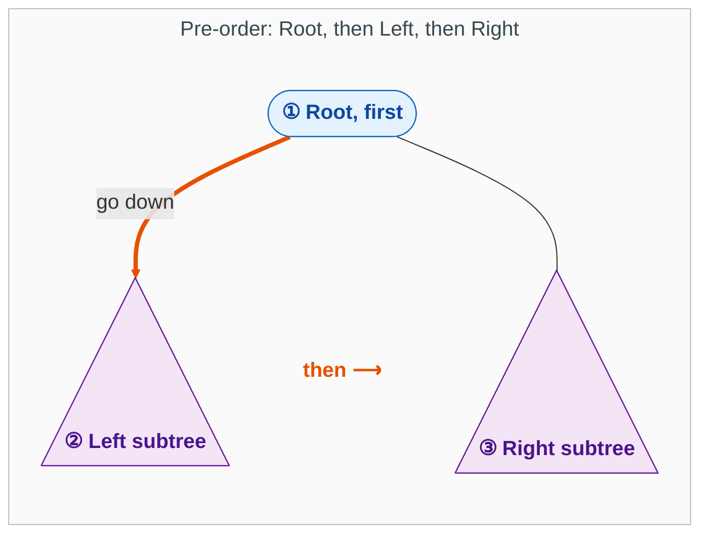
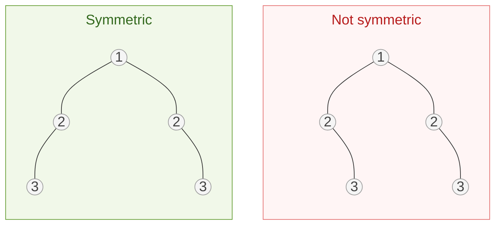
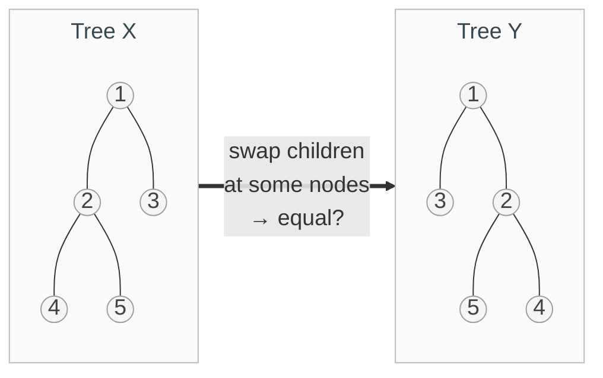
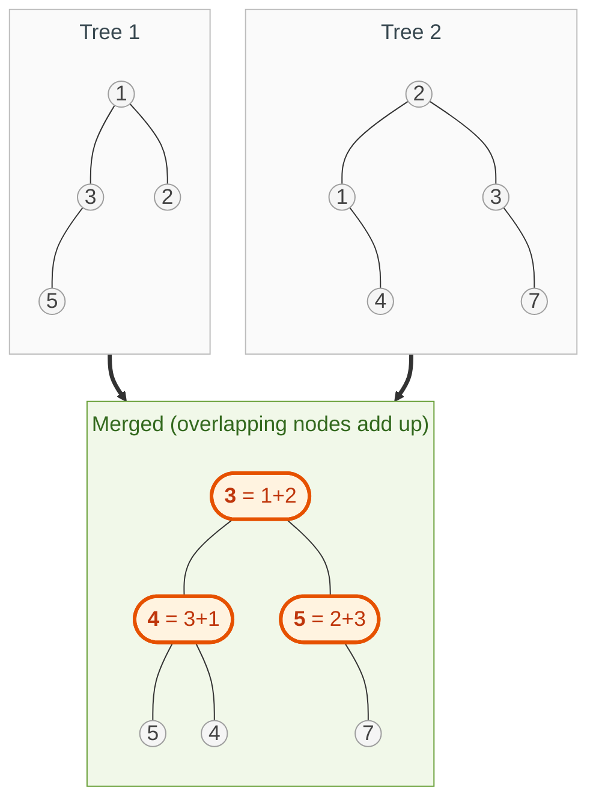
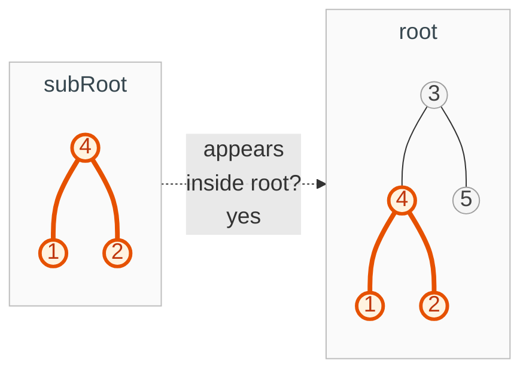
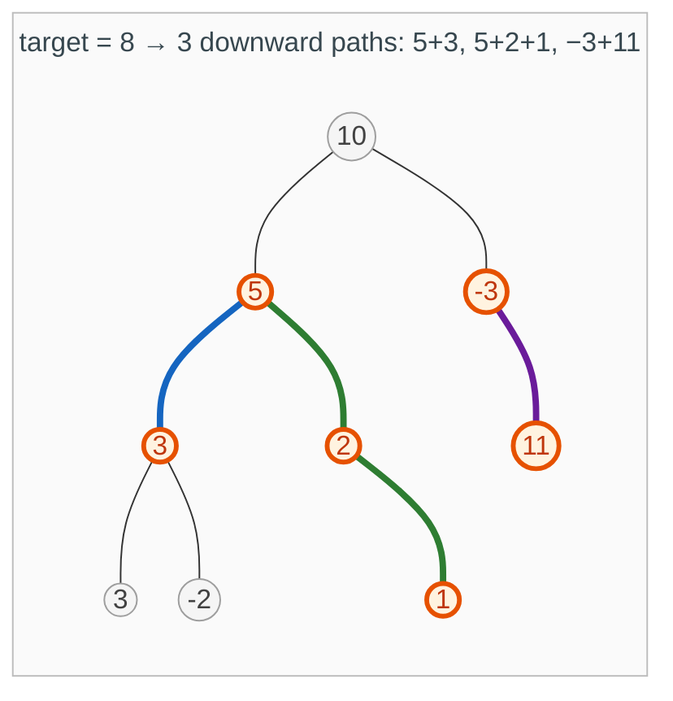

{: .no_toc}
# Pre Order 

> **Which traversal?** Passing information *down* to my children? That is pre-order. Need answers from my children before I can decide? That is [post-order](PostOrder.md).

Pre-order means **Root, then Left, then Right**. Visit the root first, then go all the way into the left subtree and finish all of it, then all of the right subtree.



The same rule applies inside every subtree, because each subtree is itself a root with a left subtree and a right subtree.

Every single snippet here follows a Pre-order Traversal pattern: the  "Root" logic (comparing values or creating the parent node) happens before the function fully dives into the children. It is a "top-down" approach: the current level decides the fate of the branches below it.

- TOC
{:toc}

### [Symmetric Trees](https://leetcode.com/problems/symmetric-tree/)

> Check whether a binary tree is a mirror of itself (symmetric around its center).



**Key intuition 1:** A tree is symmetric when its left subtree is the mirror image of its right subtree, so you have to compare two nodes at the same time.

**Key intuition 2:** Write a helper that takes two nodes. They mirror each other if the values match, a.left mirrors b.right, and a.right mirrors b.left.

<details><summary markdown="span">Execute!</summary>

```python
class Solution:
    def isSymmetric(self, root: Optional[TreeNode]) -> bool:
        def solve(a,b):
            if a is None and b is None:
                return True
            if a is None or b is None:
                return False
            if a.val != b.val:
                return False

            return solve(a.left, b.right) and solve(a.right, b.left)

        return solve(root, root)
```
</details>
<BR>

### [Flip Equivalent Binary Trees](https://leetcode.com/problems/flip-equivalent-binary-trees/)

> Are trees X and Y flip equivalent? A flip swaps the left and right children of a node, and you may flip any number of nodes.



**Key intuition 1:** This is the "same tree" check, with one extra freedom: at every pair of nodes you may match children straight across or crossed.

**Key intuition 2:** Check the values first, then accept either (left~left and right~right) or (left~right and right~left).

<details><summary markdown="span">Execute!</summary>

```python
class Solution(object):
    def flipEquiv(self, a, b):
        if a == b == None:
            return True
        if a is None or b is None:
            return False
        if a.val != b.val:
            return False
        return (self.flipEquiv(a.left, b.left)  and self.flipEquiv(a.right, b.right) or
                self.flipEquiv(a.left, b.right) and self.flipEquiv(a.right, b.left))
```

</details>
<BR>

### [Merge Two Binary Trees](https://leetcode.com/problems/merge-two-binary-trees/)

> Lay one tree on top of the other and merge them: where two nodes overlap, add their values; otherwise keep the node that exists.



**Key intuition 1:** Where only one tree has a node, just reuse that whole subtree. There is nothing to merge.

**Key intuition 2:** Where both have a node, add the values and merge the left children and the right children the same way.

<details><summary markdown="span">Execute!</summary>

```python
class Solution:
    def mergeTrees(self, a: TreeNode, b: TreeNode) -> TreeNode:
        if a is None and b is None:
            return
        if a is None:
            return b
        if b is None:
            return a

        return TreeNode(a.val + b.val, self.mergeTrees(a.left, b.left), self.mergeTrees(a.right, b.right))
```

</details>
<BR>

### [Subtree of Another Tree](https://leetcode.com/problems/subtree-of-another-tree/) 

> Does the tree subRoot appear inside root, with exactly the same structure and values?



**Key intuition 1:** Two questions: does subRoot match the tree starting right here? If not, ask the same question about the left and right children.

**Key intuition 2:** "Does it match starting here" is just the same-tree check. Keep it as its own small helper.

<details><summary markdown="span">Execute!</summary>

```python
class Solution(object):
    # LeetCode uses root/subRoot names
    def isSubtree(self, root, subRoot):
        if not root:
            return False

        # 1. Check if they match starting here
        if self.isMatch(root, subRoot):
            return True

        # 2. If not, recurse down the main tree
        return self.isSubtree(root.left, subRoot) or self.isSubtree(root.right, subRoot)

    def isMatch(self, a, b):
        if not a and not b:
            return True
        if not a or not b:
            return False
        if a.val != b.val:
            return False
        return self.isMatch(a.left, b.left) and self.isMatch(a.right, b.right)
```

</details>
<BR>


### [Number of Paths having Sum](https://leetcode.com/problems/path-sum-iii/)

> Count the paths whose values add up to a target. A path goes downward (parent to child) and may start and end at any node. [See also](https://leetcode.com/problems/maximum-size-subarray-sum-equals-k/)



**Key intuition 1:** A path can start at any node, so for every node ask: how many downward paths that start here add up to the target?

**Key intuition 2:** The total is the paths starting at this node, plus the answer for the left subtree, plus the answer for the right subtree. That is why the code has two recursions.

<details><summary markdown="span">Execute!</summary>

```python
class Solution:
    def pathSum(self, root: TreeNode, target: int) -> int:
        def find_paths(root, target):
            if not root:
                return 0

            return int(root.val == target) + find_paths(root.left, target-root.val) + find_paths(root.right, target-root.val)

        if not root:
            return 0

        return find_paths(root, target) + self.pathSum(root.left, target) + self.pathSum(root.right, target)
```

</details>
<BR>

