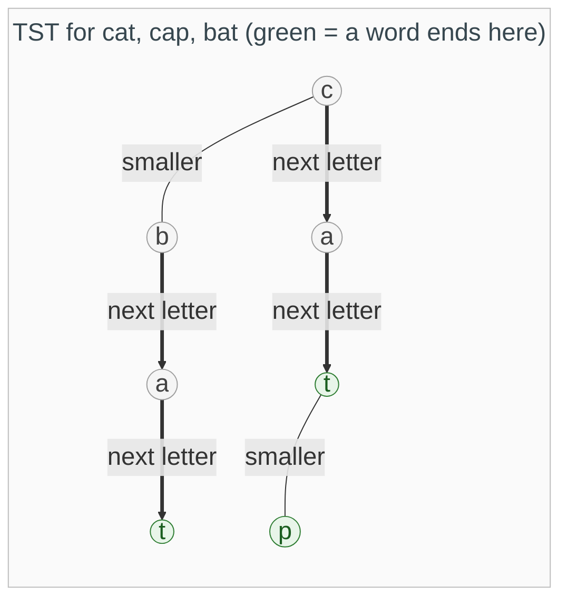

{: .no_toc}
# Ternary Search Tree (optional)

> **Optional.** In interviews "trie" almost always means the plain [prefix tree](Tries.md). Come here after you are comfortable with that one.

A ternary search tree (TST) stores one letter per node like a trie, but each node has just three children: **left** if the next letter is smaller, **right** if it is larger, and **middle** to move on to the next letter of the word.



While a Ternary Search Tree (TST) is more space-efficient for large character sets, a standard trie is much faster (O(L), where `L` is the length of the word) because it uses a hash map or an array to jump directly to the next character node.

- TOC
{:toc}

### [Implement Trie with a TST](https://leetcode.com/problems/implement-trie-prefix-tree/) <BR>

In a regular Trie, every node typically contains a full array of pointers for every possible character in the alphabet (e.g., an array of 26 for English, or 256 for ASCII). If you are storing a limited number of words, most of those pointers are null, wasting significant memory.
TST Advantage: Each node only ever has three pointers (left, mid, right), regardless of how large the alphabet is.
Best For: Large character sets like Unicode, where a regular Trie node would require thousands of potential child pointers.

Because TST nodes are smaller (only three pointers), they are more likely to stay in the CPU's L1/L2 cache.
In a regular Trie, a node with a 256-slot array might exceed the size of a cache line, forcing the CPU to fetch from slower RAM more frequently.

Near-Neighbor Search: TSTs are excellent for spell-checking or "fuzzy matching" (finding words within a certain Hamming distance) because you can prune the left/right branches of the search tree more effectively than you can in a standard Trie's flat dictionary.

Ref: [Masters SuffixTriePresentation](https://kanhar.github.io/pdf/SuffixTriePresentation.pdf)

<details><summary markdown="span">Execute!</summary>
```python
class TSTNode(object):
    def __init__(self, ch, val=0):
        self.key = ch
        self.val = val
        self.left = None
        self.mid = None
        self.right = None

class Trie:
    def __init__(self):
        self.root = None

    def insert(self, key: str) -> None:
        if not key:
            return

        def create(node, word, val):
            ch = word[0]
            if node is None:
                node = TSTNode(ch)

            if ch < node.key:
                # Still looking for the SAME ch, so don't slice word
                node.left = create(node.left, word, val)
            elif ch > node.key:
                # Still looking for the SAME ch
                node.right = create(node.right, word, val)
            else:
                # Character matches!
                if len(word) > 1:
                    # Move to next char and go down the middle
                    node.mid = create(node.mid, word[1:], val)
                else:
                    # End of word
                    node.val = val
            return node

        self.root = create(self.root, key, 1)

    def _get_node(self, word: str):
        """Helper to find the node corresponding to the last char of word."""
        curr = self.root
        i = 0
        while curr and i < len(word):
            ch = word[i]
            if ch < curr.key:
                curr = curr.left
            elif ch > curr.key:
                curr = curr.right
            else:
                if i == len(word) - 1:
                    return curr
                curr = curr.mid
                i += 1
        return None

    def search(self, word: str) -> bool:
        node = self._get_node(word)
        return node is not None and node.val != 0

    def startsWith(self, prefix: str) -> bool:
        return self._get_node(prefix) is not None
```

</details>
<BR>
