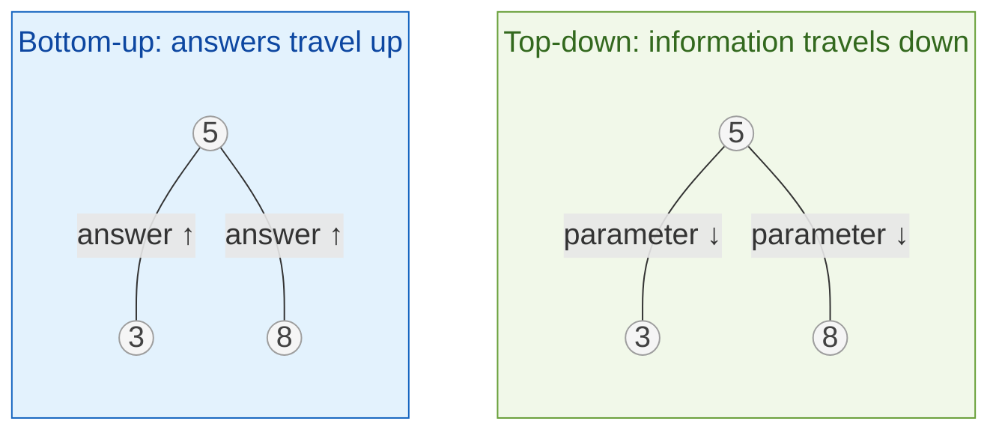
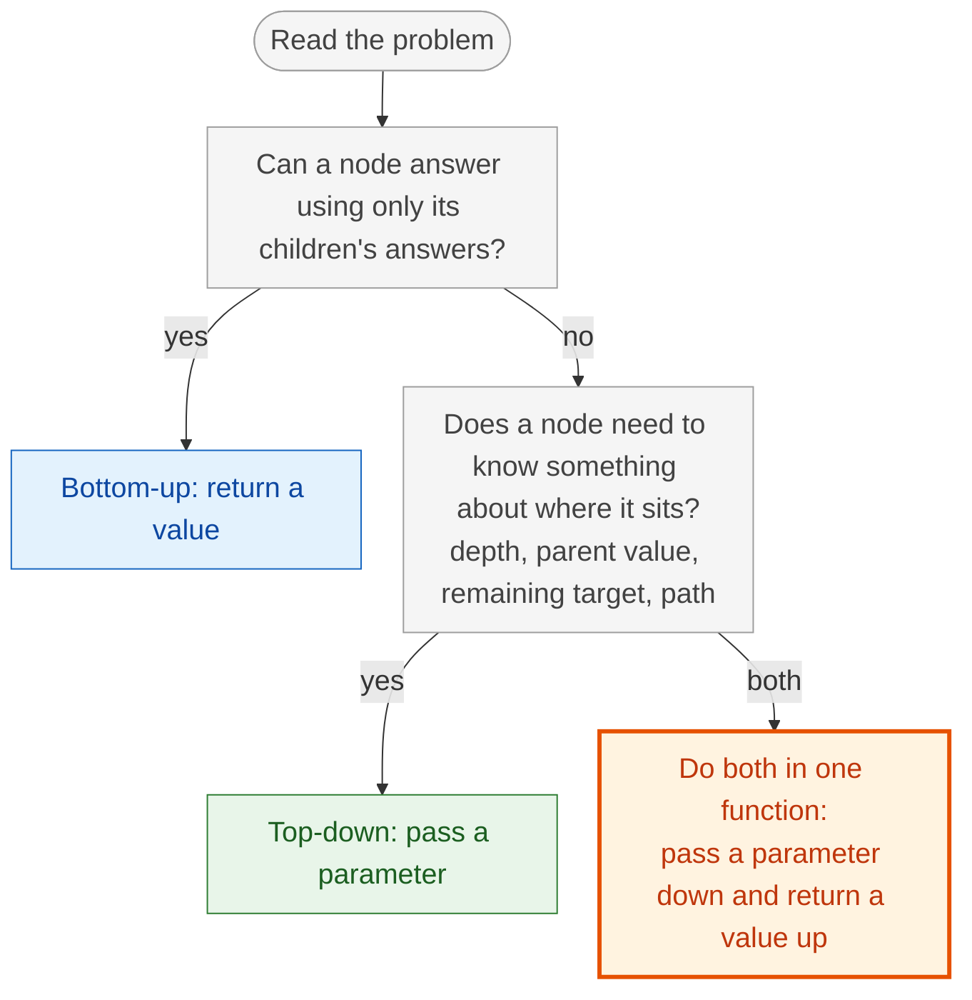

{: .no_toc}
# Tree Templates

> Nearly every tree problem is one of two templates. Pick by asking **which way the information flows**.

Information flows **up** from the children? Use [bottom-up](PostOrder.md) (post-order). Information flows **down** from the parents? Use [top-down](PreOrder.md) (pre-order).



| | Bottom-up (post-order) | Top-down (pre-order) |
|---|---|---|
| Information flows | up, from children to the parent | down, from the parent to the children |
| The function carries | a **return value** | a **parameter** |
| The node works | after its children finish | before it calls its children |
| Ask yourself | "Can this node answer from its children alone?" | "Does this node need to know where it sits?" |
| Best examples | Max depth (a depth is built from the children's depths)<br>Diameter (needs both children's heights)<br>Invert (swap what the children hand back) | Path Sum (the remaining target comes from above)<br>Validate BST (the window comes from the ancestors)<br>Root-to-leaf paths (the path so far comes from above) |

### Template 1: bottom-up

Wait for both children, then combine their answers.

```python
class Solution:
    def someQuestion(self, root: Optional[TreeNode]) -> int:
        def solve(node):
            if not node:
                return 0

            left = solve(node.left)
            right = solve(node.right)

            return combine(left, right)

        return solve(root)
```

**Three examples, and the intuition for each:**

* **Max depth.** Formula: `1 + max(left, right)`. A node's depth is one more than its deeper child, so it only needs its children's answers.

<details><summary markdown="span">Max depth</summary>

```python
class Solution:
    def maxDepth(self, root: Optional[TreeNode]) -> int:
        def solve(node):
            if not node:
                return 0

            left = solve(node.left)
            right = solve(node.right)

            return 1 + max(left, right)

        return solve(root)
```

</details>

* **Diameter.** Formula: return `1 + max(left, right)`, and record `left + right` on the side. A node's longest path is its two arms added together, but only one arm can continue up.

<details><summary markdown="span">Diameter</summary>

```python
class Solution:
    def diameterOfBinaryTree(self, root: Optional[TreeNode]) -> int:
        best = 0

        def height(node):
            nonlocal best
            if not node:
                return 0

            left = height(node.left)
            right = height(node.right)

            # The longest path through this node uses both arms
            best = max(best, left + right)

            # The parent can only use one arm
            return 1 + max(left, right)

        height(root)
        return best
```

</details>

* **Invert.** Formula: swap the two answers and return the node. Each child hands back its already inverted subtree, so you only swap this node's two children.

<details><summary markdown="span">Invert</summary>

```python
class Solution:
    def invertTree(self, root: Optional[TreeNode]) -> Optional[TreeNode]:
        def solve(node):
            if not node:
                return None

            left = solve(node.left)
            right = solve(node.right)

            node.left = right
            node.right = left

            return node

        return solve(root)
```

</details>

### Template 2: top-down

Do your work first, then hand the children what they need to know.

```python
class Solution:
    def someQuestion(self, root: Optional[TreeNode]) -> int:
        def solve(node, state):
            if not node:
                return 0

            state = update(state, node)

            left = solve(node.left, state)
            right = solve(node.right, state)

            return left + right

        return solve(root, initial_state)
```

**Three examples, and the intuition for each:**

* **Path Sum.** Formula: `remaining -= node.val`, then pass `remaining` down. What is still needed is only known from above, so each node takes its share and hands the rest to its children.

<details><summary markdown="span">Path Sum</summary>

```python
class Solution:
    def hasPathSum(self, root: Optional[TreeNode], target: int) -> bool:
        def solve(node, remaining):
            if not node:
                return False

            remaining -= node.val
            if not node.left and not node.right:
                return remaining == 0

            return solve(node.left, remaining) or solve(node.right, remaining)

        return solve(root, target)
```

</details>

* **Validate BST.** Formula: going left lowers `high` to this value, going right raises `low` to it. A node is only valid if it sits inside the window every ancestor handed down.

<details><summary markdown="span">Validate BST</summary>

```python
class Solution:
    def isValidBST(self, root: Optional[TreeNode]) -> bool:
        def solve(node, low, high):
            if not node:
                return True

            if not low < node.val < high:
                return False

            return solve(node.left, low, node.val) and solve(node.right, node.val, high)

        return solve(root, float("-inf"), float("inf"))
```

</details>

* **Root-to-leaf paths.** Formula: append before recursing, pop after. The path so far is the state, and undoing your step on the way out lets siblings reuse the same list.

<details><summary markdown="span">Root-to-leaf paths</summary>

```python
class Solution:
    def binaryTreePaths(self, root: Optional[TreeNode]) -> List[str]:
        result = []
        path = []

        def solve(node):
            if not node:
                return

            path.append(str(node.val))
            if not node.left and not node.right:
                result.append("->".join(path))

            solve(node.left)
            solve(node.right)

            path.pop()

        solve(root)
        return result
```

</details>

### How to choose



Many real problems do both. Validate BST passes a window down and returns true or false up. Path Sum III passes the running total down and returns a count up. That is fine: the template names which direction carries the **question**.

### If in doubt

Pick whichever direction is **most intuitive to a human**. If you would explain the problem as "each node needs to know X from above", go top-down. If you would explain it as "each node needs the answer from below", go bottom-up. When a problem could go either way, an approximate answer is fine: a slightly less elegant template that you can write correctly under pressure beats a perfect one you have to puzzle out.

### Quick reference

| Problem | Template | Why |
|---|---|---|
| Max depth, node count, sum | Bottom-up | A node's answer is built from its children's |
| Diameter, max path sum | Bottom-up, return one thing and record another | Needs both children's heights, once |
| Balanced tree | Bottom-up, return a tuple | Needs (ok, height) from each child |
| Invert, prune, flatten, LCA | Bottom-up, return the node | The parent rewires with what the children return |
| Path sum, root-to-leaf numbers | Top-down, pass a value | The target or prefix is known from above |
| Validate BST | Top-down, pass the window | The limits come from the ancestors |
| Good nodes | Top-down, pass the maximum so far | Depends on the path |
| All root-to-leaf paths | Top-down, mutable path | The path is the state |
| BST search, insert, successor | Top-down, one side only | The BST property picks the side |
| Build a tree from a sequence | Top-down, pass an index range | Each node owns a slice |

More problems for each template: [Post-Order](PostOrder.md) (bottom-up) and [Pre-Order](PreOrder.md) (top-down). When a problem needs a tuple, see [Tuplify](BinaryTree-Tuplify.md).
