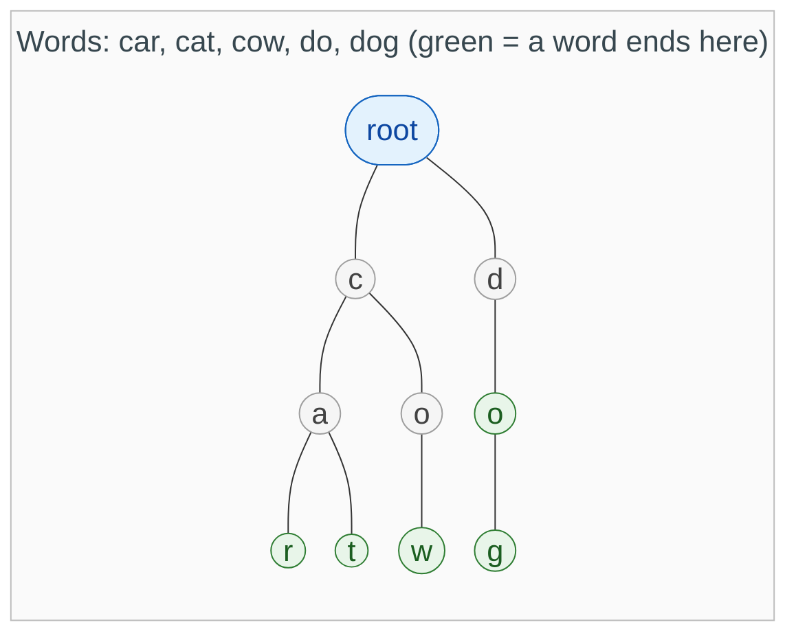
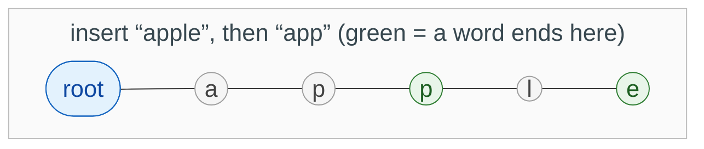
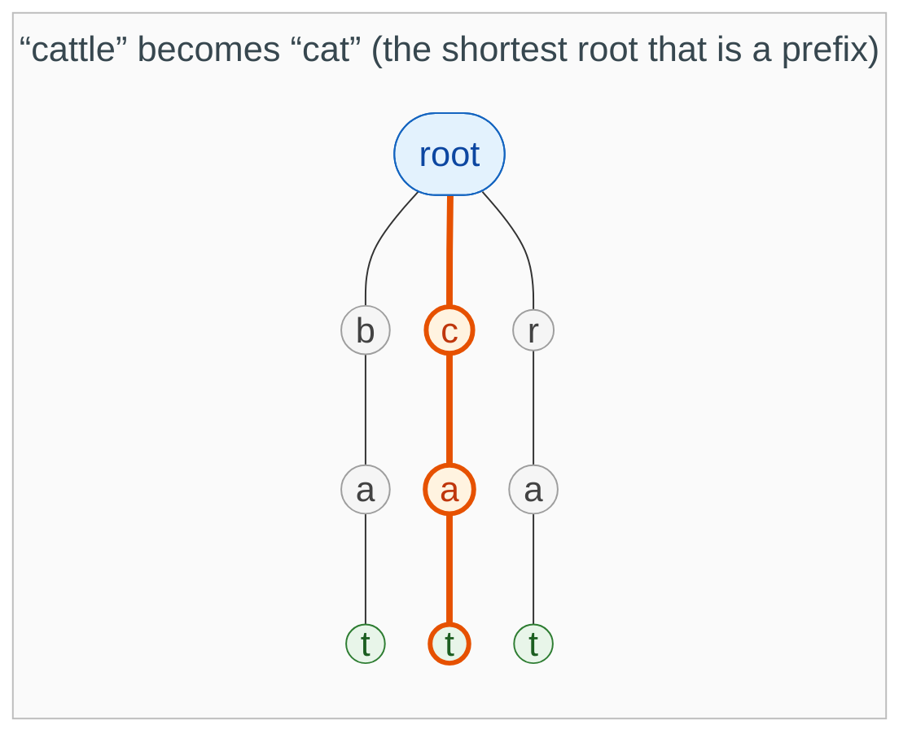
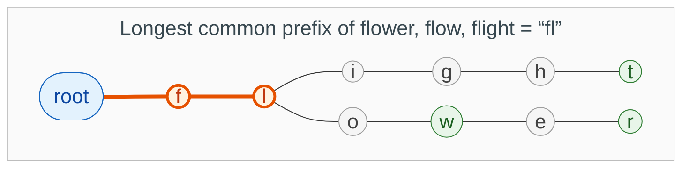
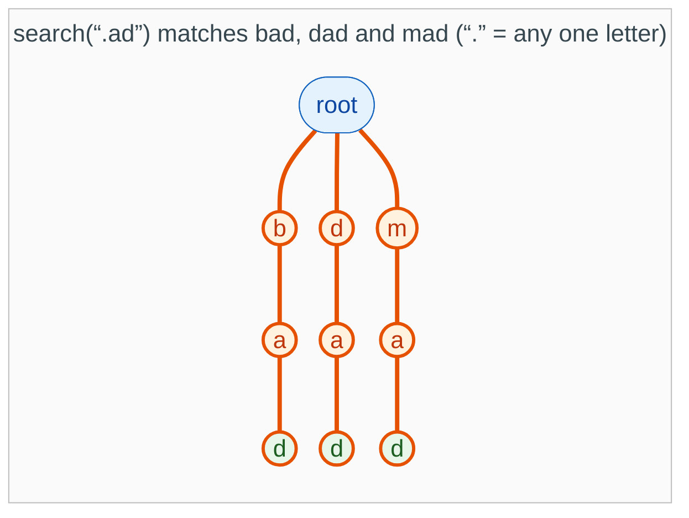
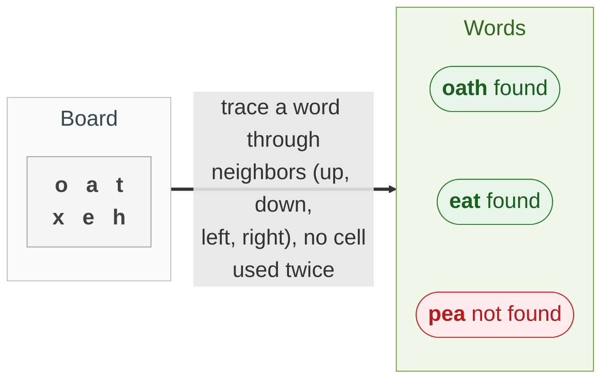
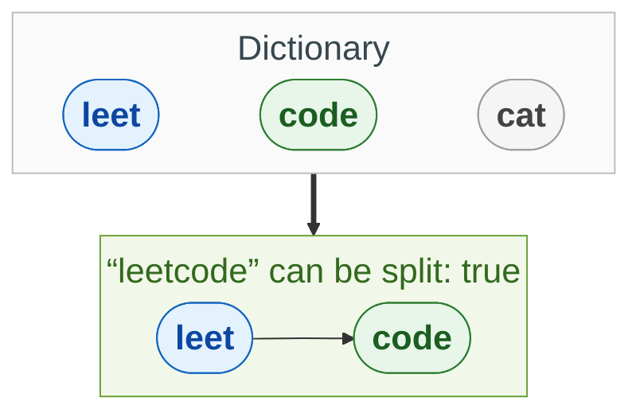

{: .no_toc}
# Prefix Tree (Trie)
Practise here: [Leetcode](https://leetcode.com/list?selectedList=9db74ov1)

A trie stores words one letter per node, so words that start the same way share the same path. (The ternary search tree is a different structure with its own optional page: [Ternary Search Trees](TernarySearchTrees.md).)



* Each line is one letter. Walking down from the root spells a prefix.
* A green node means a word ends there: `do` is a word, and also the start of `dog`.
* Words that start the same way share their path: `car` and `cat` store `c` and `a` only once.

#### Build one in 5 lines

Every problem below starts from this builder. A node is just a dictionary that maps a letter to the next node.

```python
def build(words):
    root = {}
    for word in words:
        node = root
        for ch in word:
            # step down; create the letter if it is new
            node = node.setdefault(ch, {})
        # a word ends here
        node["$"] = True
    return root

# {'c': {'a': {'r': {'$': True}, 't': {'$': True}}}}
build(["car", "cat"])
```

**Study order:** the first three problems below are the whole idea, and they are short. Wildcard search adds one twist. The last two are hard, so come back to them later.

- TOC
{:toc}

### [Implement Trie](https://leetcode.com/problems/implement-trie-prefix-tree/)

> Implement `insert`, `search` (is this exact word stored?) and `startsWith` (does any stored word begin with this?).



**Key intuition 1:** Words that start the same share the same path from the root, so a prefix is just "walk down the letters and see whether the path exists".

**Key intuition 2:** Mark the node where a word ENDS (here with a '$' key). Without it you cannot tell the stored word "app" from the mere prefix of "apple": search needs the marker, startsWith does not.

<details><summary markdown="span">Execute!</summary>

```python
class Trie:
    def __init__(self):
        self.root = {}

    def insert(self, word: str) -> None:
        node = self.root
        for ch in word:
            node = node.setdefault(ch, {})
        node["$"] = True

    def _walk(self, text: str):
        node = self.root
        for ch in text:
            if ch not in node:
                return None
            node = node[ch]
        return node

    def search(self, word: str) -> bool:
        node = self._walk(word)
        return node is not None and "$" in node

    def startsWith(self, prefix: str) -> bool:
        return self._walk(prefix) is not None
```

</details>
<BR>

### [Replace Words](https://leetcode.com/problems/replace-words/)

> Replace each word in a sentence with the shortest dictionary root that is a prefix of it. Words with no root stay as they are.



**Key intuition 1:** For each word, walk down the trie; the first time you land on a node that ends a word, that is the shortest root, so stop and use it.

**Key intuition 2:** If the path runs out of letters before any word ends, the word has no root and stays as it is.

<details><summary markdown="span">Execute!</summary>

```python
# the trie builder from the top of this page
def build(words):
    root = {}
    for word in words:
        node = root
        for ch in word:
            # step down; create the letter if it is new
            node = node.setdefault(ch, {})
        # a word ends here
        node["$"] = True
    return root

class Solution:
    def replaceWords(self, dictionary: List[str], sentence: str) -> str:
        root = build(dictionary)

        def shortest_root(word):
            node = root
            for i, ch in enumerate(word):
                if ch not in node:
                    # no root is a prefix of this word
                    return word
                node = node[ch]
                if "$" in node:
                    # the first word end is the shortest root
                    return word[:i + 1]
            return word

        return " ".join(shortest_root(w) for w in sentence.split())
```

</details>
<BR>

### [Longest Common Prefix](https://leetcode.com/problems/longest-common-prefix/)

> Find the longest common prefix of a list of words.



*A trie is not required here. It is useful because it makes the answer visible: the shared prefix is the path before the first branch.*

**Key intuition 1:** The common prefix is how far every word stays on the same single path. Build a trie and walk down from the root while there is exactly one child and no word ends.

**Key intuition 2:** Stop at the first branch (two children) or the first word end. Everything walked so far is the common prefix.

<details><summary markdown="span">Execute!</summary>

```python
# the trie builder from the top of this page
def build(words):
    root = {}
    for word in words:
        node = root
        for ch in word:
            # step down; create the letter if it is new
            node = node.setdefault(ch, {})
        # a word ends here
        node["$"] = True
    return root

class SolutionLCP:
    def longestCommonPrefix(self, strs: List[str]) -> str:
        node = build(strs)
        prefix = []
        # one way to go, and no word ends here
        while len(node) == 1 and "$" not in node:
            ch = next(iter(node))
            prefix.append(ch)
            node = node[ch]
        return "".join(prefix)
```

</details>
<BR>

### [Design Add and Search Words](https://leetcode.com/problems/design-add-and-search-words-data-structure/)

> Design a dictionary with `addWord` and `search`, where a `.` in a search matches any one letter.



**Key intuition 1:** Insert is identical to the plain trie. Only search changes: a normal letter follows one child.

**Key intuition 2:** A '.' wildcard could be ANY letter, so try every child (recursion/DFS). The trie keeps this fast because a dead path is abandoned immediately.

<details><summary markdown="span">Execute!</summary>

```python
class WordDictionary:
    def __init__(self):
        self.root = {}

    def addWord(self, word: str) -> None:
        node = self.root
        for ch in word:
            node = node.setdefault(ch, {})
        node["$"] = True

    def search(self, word: str) -> bool:
        def dfs(node, i):
            if i == len(word):
                return "$" in node
            ch = word[i]
            # any letter: try every branch
            if ch == ".":
                return any(dfs(child, i + 1) for key, child in node.items() if key != "$")
            return ch in node and dfs(node[ch], i + 1)

        return dfs(self.root, 0)
```

</details>
<BR>

## Harder: come back to these

### [Word Search II](https://leetcode.com/problems/word-search-ii/)

> Given a board of letters and a list of words, find every word that can be traced through neighboring cells (up, down, left, right), using each cell at most once per word.



**Key intuition 1:** Searching every word separately repeats the same work. Put all the words in ONE trie and run a single DFS over the grid, following only paths that are still a prefix of some word.

**Key intuition 2:** If the current path is not a prefix of any word, stop: that is the pruning that makes it fast. When a word ends, record it and remove it so it is found once.

<details><summary markdown="span">Execute!</summary>

```python
class SolutionWS2:
    def findWords(self, board: List[List[str]], words: List[str]) -> List[str]:
        root = {}
        for word in words:
            node = root
            for ch in word:
                node = node.setdefault(ch, {})
            # keep the whole word at its last letter
            node["$"] = word

        found = []

        def dfs(r, c, node):
            ch = board[r][c]
            if ch not in node:
                return
            nxt = node[ch]
            if "$" in nxt:
                # take each word only once
                found.append(nxt.pop("$"))
            # this cell is used on the current path
            board[r][c] = "#"
            for dr, dc in ((1, 0), (-1, 0), (0, 1), (0, -1)):
                nr = r + dr
                nc = c + dc
                if 0 <= nr < len(board) and 0 <= nc < len(board[0]):
                    dfs(nr, nc, nxt)
            board[r][c] = ch
            if not nxt:
                # nothing left below this letter: prune it
                node.pop(ch)

        for r in range(len(board)):
            for c in range(len(board[0])):
                dfs(r, c, root)
        return found
```

</details>
<BR>

### [Word Break](https://leetcode.com/problems/word-break/)

> Can the string `s` be split into one or more words from the dictionary? Words can be reused.



**Key intuition 1:** Ask: "is s[i:] splittable?" for every start i. Remember the answer so each position is solved once (dynamic programming).

**Key intuition 2:** From position i, the trie tells you every dictionary word that starts there, so you only try real words instead of every substring.

<details><summary markdown="span">Execute!</summary>

```python
from functools import lru_cache

# the trie builder from the top of this page
def build(words):
    root = {}
    for word in words:
        node = root
        for ch in word:
            # step down; create the letter if it is new
            node = node.setdefault(ch, {})
        # a word ends here
        node["$"] = True
    return root

class SolutionBreak:
    def wordBreak(self, s: str, wordDict: List[str]) -> bool:
        root = build(wordDict)

        @lru_cache(None)
        def solve(start):
            if start == len(s):
                return True
            node = root
            for i in range(start, len(s)):
                if s[i] not in node:
                    return False
                node = node[s[i]]
                # a word ends here: can the rest be split?
                if "$" in node and solve(i + 1):
                    return True
            return False

        return solve(0)
```

</details>
<BR>
